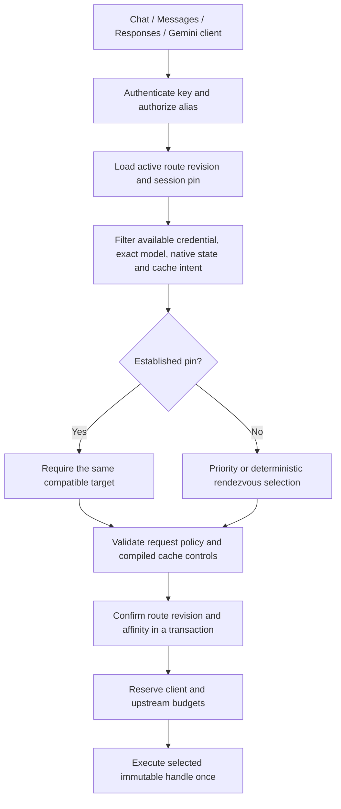

# ADR-0021: Authorized logical routing and compatible session affinity

- **Status:** Workspace candidate, 2026-11-11; M4 remains in progress.
- **Goal:** [TD-0034](../td/TD-0034-protocol-neutral-router-cache-accounting.md).
- **Operator interface:** [Backends and logical routes](../operator/backends.md).

## Decision

Keep client protocol, logical model, backend instance, endpoint family/profile and
credential reference independent. An operator-owned `route/<id>` contains aliases
whose ordered targets are exact registered backend/model pairs. A virtual key or
identity grant selects the route and authorizes aliases; neither request headers
nor a client model string can supply another credential or arbitrary endpoint.
Existing fixed upstream names retain precedence. Logical registration cannot
shadow a host-owned name, including an older name beginning with `route/`.

`priority` chooses the first eligible target. `rendezvous` hashes the session
namespace and target identity, so reordering candidates does not change a decision.
With explicit `affinity:none`, it hashes canonical input instead. Selection occurs
before inference. Timeout, an origin error or an interrupted stream does not cause
another backend to receive an implicit replay.

Eligibility currently checks registered binding identity, positive revisions and
credential generation, current credential expiry, declared exact model, Gemini
target path safety, native-input compatibility and the actual codec/profile's
request encoder with compiled cache controls. The pure preflight starts no network
request; dispatch repeats encoding and expiry validation. A family label alone
does not prove support for a request option. Actual-target
content/deadline policy runs after selection; a policy denial does not select a
different target to evade that policy. Both alias and actual-model checks precede
reservation. Strict JSON decoding rejects duplicate keys on every ingress so
admission and native forwarding cannot authorize different interpretations.

Discovery intersects key-authorized aliases with available targets. Gemini also
filters aliases that cannot be encoded as its supported model path. Discovery is
an availability snapshot, not proof that every possible payload is translatable.

## Affinity and credential compatibility

Session affinity is enabled by default. A SHA-256 namespace includes authenticated
virtual-key, subject/group and route scope, canonical alias and the existing
derived session hint. If there is no hint, the first materialized user turn supplies
a stable component. Raw conversation text and raw identity hints are not persisted
in the affinity table. Continuation-only clients need a stable explicit/native
session hint. Caller hints identify a conversation within authenticated scope;
they do not establish identity or authorize another account.

A pin records target backend/model, compatibility fingerprint and fixed expiry.
The fingerprint covers backend revision, provider label, credential reference,
family/profile, actual model, cache policy and a private credential identity.
Ordinary API-key bindings include the actual secret in that private identity;
the secret and standalone private digest are never exported. Consequently an
external secret change followed by reconstruction invalidates old affinity and
scoped cache keys even when the registered generation did not advance.

For the actual constrained Codex transport, a nonempty account header and bounded
lease permit same-account access-token renewal without invalidating affinity.
Account, endpoint, model, profile or backend revision changes still invalidate it.
The current observed generation remains in the selected plan. Metadata that merely
claims the Codex profile cannot grant this exception to a standard transport.
Every dispatch continues to check lease expiry. This does not implement Anthropic
subscription renewal or relax the Codex origin/access-only envelope.

An unavailable or incompatible live pin fails closed. A new materialized session
can choose another eligible backend; the gateway never transfers provider cache
state, signed thinking, encrypted reasoning or continuation IDs between them.
Opaque state or resource references require an existing compatible pin and are
refused with `affinity:none`. A pin proves admission continuity, **not** that a
particular opaque ID was issued by this gateway. Stronger issuer provenance remains
an open qualification/design requirement.

## Persistence and concurrency

The existing SQLite store owns route definitions, revisions, revocation and pins.
Definitions are bounded to 64 KiB, 128 aliases and 16 targets per alias. There are
at most 256 route records, including revoked entries, and 16,384 live pins. TTL is
60 seconds through seven days, default one day; use does not extend it. Expired
pins are removed during new admission. Capacity exhaustion refuses admission.

Conditional revision updates prevent lost writes. Identical active registration
is idempotent; differing definitions and revocation need the observed revision.
A transaction confirms the active route revision and existing pin immediately
before budget admission. Concurrent first turns cannot silently overwrite each
other with different bindings. Token-count endpoints do not establish pins.
Blocking reads use a bounded routing semaphore; mutations share existing lifecycle
and writer admission. Restart reconstructs configured backends and reuses durable
route/pin records. Config apply validates route dependencies before credential
writes, then applies backends, routes and dependent grants in order.

## Evidence and remaining work

Synthetic Rust journeys cover all four ingress and four backend families in both
delivery modes, alias rewriting, actual Gemini paths, disjoint usage, both budget
legs, deterministic selection, incompatible-pin refusal, policy authority,
discovery and host-name compatibility. Store tests cover conditional lifecycle,
restart, expiry and concurrent first-turn conflicts. Real-process SDK cases cover
all four SDK APIs, CLI/config application, restart, reordering, revocation,
registered rotation and unreported credential-file changes. These establish local
candidate behavior, not live provider/subscription qualification.

The selected plan is retained in request accounting memory. Existing tracked
surfaces additionally persist the bounded selection/cache/policy summary through
[ADR-0022](0022-durable-execution-context.md). Default legacy mode does not gain
that record. Uniform physical-attempt attribution and recovery remain M5 work;
legacy usage dimensions and provider-slug upstream budgets remain in effect.
Broader media/tool loops, issuer provenance,
OIDC route journeys and cancellation/restart qualification remain M3–M6 gates.
The separately retained Z.AI matrices exercise explicit fixed backends; they do
not establish live qualification of this new logical-route path.
