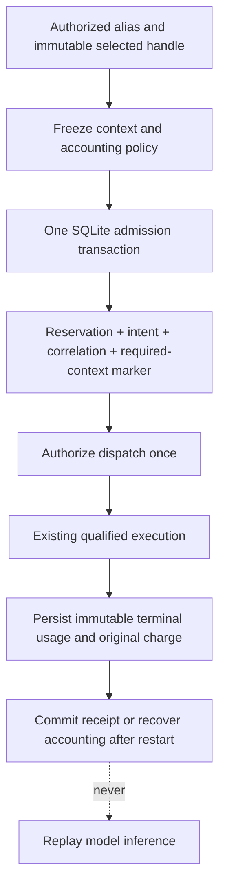

# ADR-0022: Freeze execution context in the existing admission transaction

- **Status:** M5a workspace candidate, 2026-11-11. Physical-attempt persistence and
  uniform tracked transport activation remain M5 work.
- **Goal:** [TD-0034](../td/TD-0034-protocol-neutral-router-cache-accounting.md).
- **Related:** [Logical routes](0021-logical-routing-and-compatible-affinity.md),
  [owned accounting](../operator/buffered-accounting.md).

## Problem

Logical routing froze a backend handle and cache plan in request memory. The
existing tracked ledger persisted intent, dispatch authorization, usage and
settlement, but could not identify the selected route/backend/profile after restart.
Terminal recording also received the runtime's cache-read weight without a durable
admission policy to compare it with. A usage event's legacy `backend:external`
dimension cannot reconstruct that selection or prove a physical attempt.

## Decision and implemented boundary

Extend the existing ledger rather than create another accounting system. New
tracked HTTP admissions atomically commit the primary reservation, execution
identity, Sandhi request correlation, Prepared dispatch fence and a bounded
`budget_execution_context` record. Context insertion failure rolls back that
transaction. Dispatch authorization still requires its existing one-use permit.
The context alone does not prove that the transport sent anything.

The version-one allowlisted context contains:

| Dimension | Persisted facts |
| --- | --- |
| Client surface | Ingress family, buffered/streaming delivery and processing plane |
| Routing | Requested model, actual model, upstream reference and optional logical route ID/revision/compatibility hash |
| Backend | Optional backend ID/revision, configured provider label, credential reference/generation and endpoint profile |
| Transport | Actual endpoint family and wrapped credential/transport binding hash |
| Cache | Optional compiled-plan hash, binding hash, intent, capability profile and native-preservation flag |
| Policy | Accounting-formula version, admitted cache-read weight, actual upstream budget scope and optional content-policy revision |

No arbitrary extension map, body, prompt, raw caller hint, URL, header, credential
or standalone credential digest enters this record. Cache controls are represented
by a digest and bounded semantic summary; the record is not a replayable request.
It is operational metadata, not an anonymized export.

Context is at most 16 KiB, with bounded control-free labels, lowercase SHA-256
digests, known profiles and positive revisions. Strict deserialization and canonical
re-encoding reject unknown fields, malformed values and unsupported versions.
Blocking read projection bounds bytes before allocating JSON. The existing global
retained-intent capacity also bounds the number of contextual records.

The dispatch fence records `context_version=1` for new contextual admissions.
Missing/corrupt required context refuses dispatch, terminal recording and recovery;
it cannot silently become a legacy context-free admission. Old rows migrate with
`context_version=0` and retain absent context. No metadata is invented for them.
There is no context-update API. Scope checks and fixed single-file topology remain
the existing ledger's responsibility; a lookup ID does not authorize a caller.

Accounting policy version 1 names the existing `billable_weighted` formula and its
bounded basis-point cache-read weight. Recording terminal usage with a different
weight refuses before storing an observation. The HTTP owner uses the captured
weight. Recovery uses the original frozen charge, including after runtime policy
or credential changes; it never re-quotes old usage under new configuration.
Raw fresh/read/write/output/reasoning counters retain neutral measurements. This
does not introduce TD-0032's richer fixed-point, per-scope allowance policy.

## Activation and compatibility

This increment records context only within **already admitted tracked surfaces**:
buffered Chat/Messages clients with the built-in retry-free Chat backend and bounded
transparent Chat streaming. All existing tracked requirements still apply.
Responses/Gemini ingress, other backend families, Codex leases and translated
streaming are not newly admitted to tracked mode by a context record.

Default legacy mode remains unchanged. Backend/logical routing continues to work
there, but its selected context is not durably recorded through this path.
Usage-event schemas, legacy provider-slug upstream budgets and public HTTP usage
diagnostics remain unchanged. The new table is internal ledger evidence, not a new
physical-attempt export or an automatic deployment/migration qualification.
Keep backups and the existing prohibition on older writers against tracked state;
an older binary does not implement these contextual checks.

## Evidence and remaining M5 work

Store tests inject context-write failure and verify no reservation, intent, fence,
correlation or context commits. Reopen preserves the exact context; wrong scope,
weight changes, missing/oversized/unknown-field/version-corrupt records refuse.
An old context-free fence migrates and remains context-free. Canonical settlement
commits once and returns the original receipt on replay.

A routed HTTP regression first demonstrated successful settlement without any
durable selected context. It now checks stored alias/actual model, backend,
cache intent, weight and receipt across buffered Chat, translated Messages and
tracked Chat streaming. Its synthetic stream includes the required native chunk
type; the existing qualifier continues to reject malformed frames.

A real-process SDK case blocks receipt insertion after a model response, verifies
durable context and terminal charge, kills the gateway, then restarts with a changed
runtime weight and rotated fixture credential. Recovery commits the old charge
without another model call or a context rewrite. A new materialized session records
the new generation/weight and settles both budget scopes. These are synthetic
source checks, not live provider/account qualification.

Subsequent progress and remaining work:

1. [M5c now persists single-attempt transport evidence](0024-durable-physical-attempt-evidence.md)
   for existing tracked surfaces, reusing the W05b transport observer. Authorization
   alone is still not proof of a send. Uniform coverage across routing profiles
   remains required.
2. [M5b now links both budget legs](0023-paired-budget-settlement.md) for new
   supported tracked admissions and settles/recovers them atomically. Default
   legacy mode and older unpaired rows retain their historical semantics;
   backend-ID budget scopes are not introduced.
3. Qualify buffered/streamed usage separately for Anthropic, standard Responses,
   constrained Codex and Gemini, preserving absent/malformed/inconsistent evidence.
   Expand tracked activation only with the corresponding ownership and restart
   tests; never infer support from a constructor or legacy success response.
4. Record and expose bounded provenance, completion/outcome and policy evidence
   without changing cache observations into proof of provider reuse. Extend SDK
   tool loops, cancellation, credential expiry and restart qualification accordingly.
5. Resolve the retained historical owned-settlement stress failures. Later green
   runs do not prove their original cause or justify inference replay.
