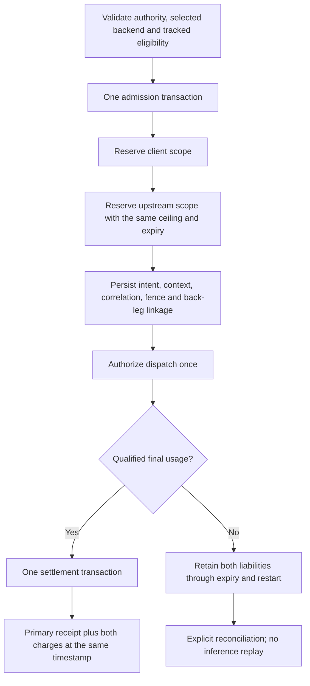

# ADR-0023: Admit, settle and recover both budget legs atomically

- **Status:** M5b workspace candidate, 2026-11-11; uniform physical-attempt evidence
  and additional tracked protocols remain open.
- **Goal:** [TD-0034](../td/TD-0034-protocol-neutral-router-cache-accounting.md).
- **Extends:** [Execution context](0022-durable-execution-context.md) and the
  [upstream-budget convention](0015-upstream-budgets-back-leg-caps.md).

## Problem and reproduced defect

The tracked path admitted its upstream lease before the primary intent. A durable
terminal observation then caused that upstream lease to settle independently,
including at zero for unavailable usage. Losing the process could also leave it
eligible for legacy expiry reclaim. Neither absence of usage nor an interrupted
request establishes zero provider consumption.

The HTTP regression reproduced this mismatch: an unmeasured upstream failure held
31 units on the client budget and zero on the upstream budget. The new requirement
is equal retained liability on both scopes, with no release from expiry alone.

## Decision

Use the same original single-file ledger, execution, qualified observation and
accounting policy. There is no second settlement engine or model replay.

Either budget denial or a linkage/context write failure rolls back both admission
rows and all execution metadata. A rejected request cannot leave a released
upstream-reservation row behind. The upstream scope remains
`upstream:<adapter-slug>`; independent backend-ID caps and cap hierarchy are not
introduced. One measured quantity applies to two separate allowances; telemetry
still observes the model call once.

`budget_execution_back_leg` binds the execution to one unique reservation. The
dispatch fence independently retains its required `back_reservation_id`. The
original context supplies the upstream scope; both rows must agree on ceiling,
expiry, settlement state, charge and timestamp. A back leg cannot be another
primary intent or have an independent settlement receipt. Missing/mismatched
linkage refuses dispatch, terminal recording and canonical recovery.

Legacy settlement and both expiry-reclaim paths recognize either retained link.
Losing one linkage row therefore cannot turn that reservation into a legacy
`settle(0)` or expiry candidate. This is consistency checking of the original
ledger, not permission to replace databases, migrate shards or trust an older
writer that does not implement these checks.

## Settlement and recovery

The subsequent [M5c transport-evidence increment](0024-durable-physical-attempt-evidence.md)
also requires complete dispatch/terminal evidence for new marked admissions.
Authorization alone is not evidence of a physical send.

Qualified final provider-reported usage yields the original frozen charge under
the admitted accounting policy. One transaction inserts the existing primary
outbox receipt and settles **both** reservations with that charge and receipt
timestamp. The primary receipt, execution linkage and both reservation rows are
the evidence join; the back leg does not publish a second outbox receipt. Replays
return the same original receipt.

A failure updating either leg rolls back both charges and the receipt. The
previously persisted terminal observation remains available for recovery.
Restart runs the existing canonical terminal-settlement API, which now settles
the pair together. Current credentials, grants or runtime cache weights do not
re-quote an already persisted charge, and recovery never contacts the model.

| Evidence/state | Both budget legs |
| --- | --- |
| Rejected before admission or either scope denies | No committed reservation or execution rows |
| Prepared intent, explicitly closed before authorization | Both released atomically at zero; closure evidence, no model-usage receipt |
| Authorized, usage absent/partial/unqualified, including after crash | Both remain held; neither expiry nor a drop invents zero consumption |
| Final qualified usage, receipt transaction fails | Both remain held; durable terminal usage is ready for accounting recovery |
| Final qualified usage and committed receipt | Both settle once to the original charge, including a qualified reported zero |

Held unknown liability can exhaust a scope and deny further work. This is the
intended accounting distinction from measured zero. An explicit amendment or
operator resolution policy is future work; this change supplies no automatic
release or inference-retry authority.

## Compatibility and evidence

New already-supported tracked HTTP admissions use paired admission. Tracked
eligibility, strict usage qualification and the two forwarding planes are
unchanged. Default legacy mode retains its historical RAII/expiry behavior.
Older unpaired tracked/library admissions remain unpaired; the gateway never
guesses their linkage from reservation order, scope or model strings. Their
original evidence and settlement semantics remain readable.

Store tests cover either-scope denial, rollback under linkage failure, both held
through expiry/reopen, refusal of legacy release, atomic rollback under a back-leg
settlement trigger, original-receipt replay, safe pre-dispatch closure and missing
linkage. The HTTP missing-usage/error regression now retains both scopes. Process
tests check token and TLS/OIDC modes, buffered/streamed delivery, contention,
SIGKILL, grant revocation and receipt recovery. The route SDK case changes runtime
weight and fixture credential across restart while preserving the old context and
charge. All providers, credentials and faults in these cases are synthetic.

M5 still requires durable physical-dispatch identities/terminal evidence and
qualified activation across Anthropic, standard Responses, constrained Codex and
Gemini backends. Paired accounting does not establish those capabilities or live
provider/cache qualification.
