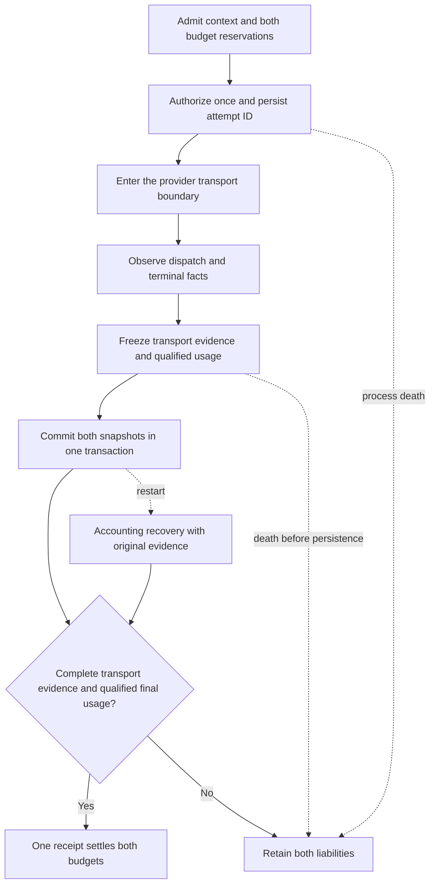

# ADR-0024: Bind tracked settlement to durable physical-attempt evidence

- **Status:** M5c workspace candidate, 2026-11-11; source qualification is tracked
  in [TD-0034](../td/TD-0034-protocol-neutral-router-cache-accounting.md).
- **Extends:** [Execution context](0022-durable-execution-context.md) and
  [paired budget ownership](0023-paired-budget-settlement.md).

## Decision

Reuse the existing transport observer, request owner, settlement jobs and original
single-file ledger. New paired admissions require one retry-free physical attempt.
Admission sets an independent `attempt_version=1` marker on the dispatch fence.
The first dispatch authorization transaction allocates one opaque attempt ID,
stores `budget_physical_attempt`, and binds the same ID to the fence. Only its
successful commit returns the in-process dispatch permit. A replay returns
`MayHaveDispatched`, with no new identity or permission to call the model.

## Facts and authority

| Retained fact | Meaning | Limit |
| --- | --- | --- |
| Attempt ID and authorization timestamp | One send slot was authorized | Does not prove a send occurred |
| Dispatch observation | Gateway entered the instrumented provider transport boundary | Does not prove bytes reached or were accepted by the provider |
| Terminal transport observation | Gateway observed success, rejection, error, timeout, cancellation or incomplete stream; optional HTTP status/request ID | Does not independently qualify usage or establish provider billing |
| Qualified execution usage | Original normalized usage under the frozen accounting policy | Diagnostic attempt usage is not substituted for this evidence |
| Original receipt | Both linked reservations settled atomically | Does not prove delivery to the client or export consumer |

The store owns bounded, strict transport-evidence types and has no dependency on
the provider crate. The proxy consumes the two-event observer after dropping the
transport source. It validates execution/attempt identity and ordinal, and freezes
dispatch/terminal timestamps, outcome, HTTP status, bounded provider request ID,
dropped-observation count and an invalid-evidence flag. Diagnostic provider/model
labels and diagnostic parsed usage are omitted; durable execution context supplies
the actual selected backend/model/account binding.

The single-attempt context is shared across clones. A second instrumented call
refuses before constructing or polling another transport future. Both buffered
forwarding planes and qualified transparent Chat streaming use this context.
The raw unmetered API remains an explicit library escape hatch; it is not used by
these tracked proxy paths. No retry, fallback or hedging is introduced.

## Persistence and recovery

Transport evidence and canonical terminal usage commit together. Failure of either
write rolls back both, preserving the preallocated identity with unknown evidence.
The existing jobs owner retains the exact pair before telemetry callbacks and
retries accounting only. Replays require identical snapshots; later refinements,
different IDs or omission of required evidence refuse.

Settlement additionally requires dispatch and terminal observations, zero dropped
events and no invalid flag. Complete transport evidence alone does not make absent,
partial, estimated or malformed usage settleable. Qualified final usage alone
cannot settle a new execution with incomplete transport evidence. Both liabilities
remain held through expiry/restart in either case. Timestamps are bounded Unix
times; wall-clock ordering is not assumed.

A process death before snapshot persistence leaves evidence absent and status
unknown, even when a synthetic test origin independently saw a request. No send is
replayed. A death after snapshot persistence permits recovery of the original
frozen charge and one receipt, without another provider request. Missing required
attempt rows, fence mismatches, corrupt/noncanonical JSON and half-persisted
snapshots fail closed.

## Compatibility and remaining work

Migration initializes older fences to `attempt_version=0`; it invents no physical
attempts or observations for historical admissions. Older paired/unpaired rows
keep their original settlement rules. Proven closure while still Prepared creates
no attempt and releases both reservations without a usage receipt. Default legacy
mode is unchanged. Older writers must not open a database containing new evidence.

Tracked eligibility remains buffered Chat/Messages ingress to built-in retry-free
OpenAI-compatible Chat backends, plus bounded transparent Chat streaming. This
increment does not qualify tracked Anthropic, standard Responses, Codex or Gemini
backends, translated streams, subscription lifecycle, multi-attempt execution,
export, public diagnostics or live deployment. Those remain goal milestones;
the router's broader protocol matrix continues to use its separately documented
legacy path until the remaining gates pass.
