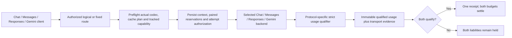

# ADR-0025: Qualify buffered accounting by endpoint protocol

- **Status:** M5d workspace candidate, 2026-11-11; source qualification is recorded
  in [TD-0034](../td/TD-0034-protocol-neutral-router-cache-accounting.md).
- **Extends:** [Durable physical-attempt evidence](0024-durable-physical-attempt-evidence.md).

## Decision and supported activation

Use the same paired reservations, frozen execution context, single-attempt transport
observer and canonical settlement owner for buffered **Chat, Messages, Responses
and Gemini ingress**, routed to any of the four built-in standard endpoint families.
The client dialect does not select the accounting formula. The chosen upstream
wire protocol supplies usage, and the admitted policy supplies the budget weight.
Raw same-family forwarding preserves bytes; translated calls use the existing codec.

Eligibility is factory-owned, requires a built-in retry-free transport with an
available raw forwarder, and is checked before either reservation. A provider
label or a custom handle's declared family cannot enable it. Block policy, an
explicit output limit, a durable single-file ledger, fixed topology and no logical
idempotency key remain required. Existing stream eligibility is unchanged.

Logical buffered routes include tracked capability and synchronous-operation checks
in target preflight **before selection/pin confirmation**. A new session can select
a later accounting-compatible target without sending to an incompatible target.
An established pin that becomes incompatible refuses; it does not move to another
backend. Async/background Responses is refused before reservation: fixed backends
return 400, while a logical route with no compatible target returns its usual 409.

## Qualified token semantics

Pure qualifiers validate the original response before calling the existing family
parser. They preserve explicit reasoning zero, reject wrong types, implausible
counts and inconsistent totals, and expose failure separately from completed model
output. They do not estimate missing counters or infer cache hits from timing.

| Upstream protocol | Required counters | Cache/input rule | Reasoning rule |
| --- | --- | --- | --- |
| Chat | `prompt_tokens`, `completion_tokens` | Prompt includes cache reads/writes; subtract each once | Reported reasoning is included in completion |
| Standard Responses | `input_tokens`, `output_tokens` | Input includes cached and written tokens; validate optional details and total | Reported reasoning is included in output |
| Messages | `input_tokens`, `output_tokens`, `cache_read_input_tokens`, `cache_creation_input_tokens` | Input is fresh; add read/write as separate categories; check provided TTL subtotals | Reported `thinking_tokens` is a subset of output |
| Gemini | `promptTokenCount`, `candidatesTokenCount` | Fresh input is prompt minus cached content plus separately reported tool-use prompt tokens | Thoughts are separate from candidate output |

For Messages, absent cache counters cannot be safely treated as fresh input because
the input counter already excludes caching. Such a response remains unqualified,
even when older/compatible endpoints return only input/output. Explicit zero is
accepted. Legacy extraction remains lenient outside tracked qualification.

An explicit **`anthropic_implicit_cache` endpoint profile** covers compatible
Messages endpoints whose uncached input includes implicit cache construction and
which meter no separate cache-write category. It requires fresh/input, output and
cache-read counters; omitted or explicit-zero cache writes qualify. Null, malformed
or nonzero writes refuse rather than being erased. Missing reads still refuse.
This profile is an operator-declared accounting convention, not inferred from a
provider name, response omission, or the request's `implicit_only` cache-control
capability. It supports only Messages API-key/static-bearer endpoints; it grants
no subscription/OAuth support.

The profile is persisted in backend definitions, exposed through CLI/API/inventory,
reconstructed on restart, included in the existing route binding, and frozen in
execution context. A profile/revision change fences an established pin. Standard
profiles retain their original definition serialization and meaning.

For Gemini, an optional total must equal prompt + tool-use prompt + candidates +
thoughts. Sandhi folds tool-use prompt tokens into neutral fresh input; this can
make normalized input larger than the wire `promptTokenCount`. Thinking remains
separate and is added once. For Responses, a provided nonterminal response status
cannot qualify final usage. Optional inclusive cache details retain their existing
reporting-coverage metadata; missing details are not reported cache zero.

These rules follow the [official OpenAI usage example](https://developers.openai.com/api/docs/guides/reasoning),
[Anthropic cache-counter definition](https://platform.claude.com/docs/en/build-with-claude/prompt-caching),
[Messages usage reference](https://platform.claude.com/docs/en/api/messages) and
[Gemini UsageMetadata definition](https://aistudio.google.com/api-reference/generate-content#Resource:UsageMetadata).
Provider declarations and synthetic responses do not independently verify billing,
tokenizers, actual cache reuse or subscription quota conversion.

Built-in buffered Chat/Messages/Responses/Gemini JSON decoding also rejects duplicate
object keys, including escaped duplicates. Typed transports refuse ambiguous JSON;
qualified raw forwarding retains the original response bytes with an explicit
qualification failure. Successful unambiguous legacy responses keep their format.

## Ownership, recovery and evidence

The proxy submits the unchanged qualified usage and transport snapshot through the
existing request/jobs owner. The attempt ID joins route/backend/model/cache/policy
context to usage and the original paired receipt. A successful HTTP status or
transport terminal event alone cannot authorize settlement.

Missing, malformed, ambiguous or inconsistent usage yields correlated unresolved
accounting and retains both reservations. Receipt failure retains the original
snapshots; restart recovery uses their frozen weight and charge without another
model call. SIGKILL before terminal persistence preserves the allocated identity
with unknown send status and both held ceilings. Neither outcome permits inference
replay or a zero release.
New unavailable snapshots retain a bounded qualification reason (static error/field
names) instead of labelling the missing measurement as success. The raw provider
body and credentials are not stored in this diagnostic.

The synthetic SDK matrix covers all 16 buffered ingress/backend combinations, both
forwarding planes, cache/read/write/reasoning normalization, route/cache context,
physical-attempt facts and paired receipts. Additional standalone drills cover the
new backend families' missing/malformed/ambiguous usage, receipt failure/recovery,
SIGKILL, admission refusal and compatible target/pin selection. See the tracker for
executed counts, broader checks and retained failures.

## Remaining gates

Constrained Codex aggregation is SSE even for a buffered client. Its tracking
capability remains off until strict Responses SSE qualification joins the same
owner. Anthropic subscription credentials, other expiring profiles, translated
streaming and non-Chat backend streaming also require their own qualification and
ownership/restart gates. Existing bounded transparent Chat streaming remains
available. Cohere/Ollama keep their legacy behavior and are not newly activated.

The historical intermittent owned-settlement stress failure remains open. Passing
reruns do not establish its cause. No deployment, export, multi-shard recovery,
automatic evidence amendment or live all-family tracked qualification is claimed.

## Live Z.AI finding

The first new tracked cache-pair matrix had **16/24 successful cells**. All eight
Messages-backend cells stayed unresolved, with both liabilities held and no
receipt. A separate diagnostic call showed an omitted `cache_creation_input_tokens`
field. The standard qualifier correctly refused to invent it; the explicit profile
above provides the compatible accounting convention without weakening the standard
profile. The failed report is retained unchanged and is not evidence of zero usage.
The final scoped matrix and remaining limits are recorded in
[the tracked qualification review](../reviews/zai-router-tracked-buffered-2026-11-11.md).
