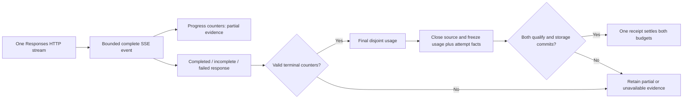

# ADR-0026: Qualify Responses streaming at the response owner

- **Status:** M5e workspace candidate; validation is recorded in
  [TD-0034](../td/TD-0034-protocol-neutral-router-cache-accounting.md).
- **Extends:** [Qualified buffered protocols](0025-qualified-buffered-protocol-accounting.md)
  and [durable physical attempts](0024-durable-physical-attempt-evidence.md).

## Decision

Extend the existing bounded, complete-event SSE observer to standard Responses.
Reuse the raw HTTP response owner, physical attempt guard, immutable terminal
capture and paired settlement jobs. Protocol completion, final token measurement
and delivery outcome remain independent facts.

Tracked mode admits bounded **transparent standard Responses streaming**, alongside
transparent Chat. The built-in retry-free backend eligibility, durable ledger,
Block policy, explicit output limit and complete streaming deadline policy remain
required. Translation, Codex aggregation and other streaming protocols remain
separately gated. No raw subscription bypass is added. Background Responses
requests fail synchronous-operation preflight before dispatch.

Logical routes preflight delivery compatibility before pin confirmation: a new
Responses stream can skip a target requiring translation, while an existing
incompatible pin refuses without switching. An unbounded tracked stream creates
no pin or reservation. This also applies to the existing tracked Chat stream path.

## Event and token semantics

The [official Responses stream reference](https://developers.openai.com/api/reference/resources/responses/streaming-events)
defines nested lifecycle events. Completed, incomplete and failed responses are
protocol terminals. An incomplete model result can still have final usage; a failed
event records provider rejection independently of HTTP 200 and can report final counts.

| Observation | Qualified evidence |
| --- | --- |
| Created/queued/in-progress without counters | No measurement; absence is never reported zero |
| Valid progress counters | Partial; retain known cumulative lower bounds and reported field presence |
| Response terminal with valid required input/output totals | Final, subject to cache/reasoning/total validation |
| Standalone error event | Provider failure; retain preceding partial evidence |
| Content/tool/future response event | Forward bytes; embedded usage cannot supply request totals |
| Contradictory/regressing counters, malformed data or mismatched identity | Sticky failure; preserve preceding evidence as Partial |

Inclusive input is fresh + read + write. Reasoning is included in output and is
never added again; explicit reasoning zero survives canonical capture. An omitted
progress category retains prior knowledge. Growing subsets can raise inclusive
lower bounds. A later total cannot contradict known bounds. Progress never becomes
a settlement-authorizing total. These are reported counts, not tokenizer estimates.

Named SSE events must agree with JSON types. Provided response IDs must agree
within the HTTP response, and provided sequence numbers must increase. Compatible
endpoints may omit IDs/sequences; attribution uses Sandhi's persisted attempt ID.
SSE `id` grants no attribution or replay permission. Duplicate JSON keys fail.
One optional `[DONE]` is accepted after a real Responses terminal; it cannot supply
terminal proof alone. Post-terminal data fails qualification.

Shared framing retains line/event limits, bounded chunk copies, CR/LF/CRLF,
initial BOM and multiline support. EOF never dispatches an unfinished event.
Forwarded bytes are unchanged, including malformed bytes. No parser failure
causes another model request.

## Ownership, compatibility and limits

`QualifiedStreamObservation::snapshot()` retains its original copyable projection.
The additive `evidence()` atomically clones canonical `UsageV2` with partial counters
and reported-zero presence alongside that snapshot. The proxy and attempt guard
consume canonical evidence; diagnostic projections cannot authorize settlement.

Drop, timeout and transport failure close the same source once and publish one
terminal attempt observation. Final measurements remain final on delivery failure;
progress remains partial. EOF additionally validates framing and termination.
The owner retains counts independently of diagnostic channel delivery.

Clean gateway EOF waits for committed accounting, although headers and terminal
events may already have reached a client. A terminal event is not a receipt.
Partial/unknown usage retains both reservations through shutdown and restart;
recovery only repeats accounting. Source tests do not establish live subscriptions,
billing or deployed lifecycle. Broader SDK tool loops, translated streaming and
subscription qualification remain active goal work.
