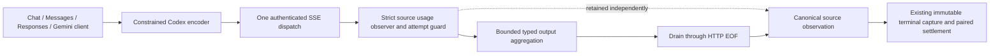

# ADR-0027: Account for buffered Codex delivery from its qualified SSE source

- **Status:** M5f workspace candidate. See [source qualification](../reviews/codex-qualified-accounting-source-2026-11-11.md).
- **Extends:** [Responses stream qualification](0026-qualified-responses-stream-accounting.md)
  and [constrained endpoint profiles](0016-explicit-backend-endpoint-binding.md).

## Decision

Admit retry-free constrained Codex **buffered host delivery** to tracked accounting
through the typed codec. The upstream still uses SSE. One physical response owner
qualifies complete events, retains canonical token evidence and owns the attempt
guard. The typed aggregator drains the response through HTTP EOF before returning
qualified success, even when decoding its native terminal response finishes earlier.

No external raw forwarding is enabled. The gateway factory retains fixed-origin,
leased access-token/account binding and expiry checks; per-call headers cannot
replace the credential or account. Profile encoding still requires instructions,
materialized input, `store=false` and SSE. Cache synthesis remains unsupported.
The built-in factory owns tracked eligibility; merely declaring a provider family
or implementing a custom provider cannot enable admission.

## Evidence and bounds

The additive provider `stream_qualified` API defaults to refusal. Its built-in
Responses implementation uses the same response observer as qualified raw delivery,
with one guard and no usage inference from the legacy line sniffer. The resilience
decorator requires zero retries, retains circuit/setup/idle policy and applies the
original buffered whole-call deadline across setup, aggregation and EOF draining.
Heartbeats cannot reset it. No new background task owns inference.

An internal, single-assignment observation handle belongs to the tracked attempt
context. Only the built-in physical transport can attach it. The request owner
reads it after source closure, including when decoding returns an error. This
prevents loss of observed counts without promoting decoded usage or diagnostics
into settlement authority. It retains bounded numeric evidence and the bounded
origin request ID, not prompts, credentials or native response content.

| Source evidence | Accounting behavior |
| --- | --- |
| Valid final counters and complete framing | Final usage; paired settlement can commit |
| Explicit reported zero | Final zero; a zero receipt can settle both reservations |
| Missing counters | Unavailable; both liabilities remain held |
| Progress only, contradictory totals or malformed/trailing data | Preserve preceding Partial counts; no receipt |
| Decoder failure after observing valid final counters | Retain Final counts independently of the failed client output |
| Timeout/cancellation with only progress observed | Partial; never infer unseen terminal counts |
| Timeout/cancellation after final counters | Retain Final measurement unless already-observed framing invalidates it |

Interrupted data framing invalidates qualification. An interrupted keepalive
comment cannot become data and does not erase an earlier measurement. Delivery
outcome, provider response status and measurement completeness remain separate.
Tracked usage records count observed gateway dispatches, including zero when
credential/codec rejection happens before the transport begins; authorization
alone does not count as a physical dispatch or prove provider billing.

Qualified decoding assembles complete SSE events in both native-output modes,
including multiline data, CRLF and an initial BOM. Native output remains opt-in.
The existing aggregation byte limit and strict event/line bounds remain in force.

## Admission and qualification limits

The existing Block/output-limit/single-file-ledger admission requirements remain.
The Codex codec continues to omit `max_output_tokens` and temperature from its wire
request. Its client output limit contributes to the admission estimate; this does
not create an upstream hard token cutoff. Actual qualified counts settle under the
original frozen allowance weight. Neither counts nor two budget legs establish
subscription quota conversion or a monetary price.

This increment qualifies synthetic buffered accounting across the four ingress
shapes. Codex tracked **streamed host delivery**, broader SDK tool/media/state
loops, subscription refresh/expiry/account lifecycle and live subscription acceptance
remain active work. Default legacy behavior retains its existing path. No managed
gateway or external credential is changed by the synthetic fixtures.
