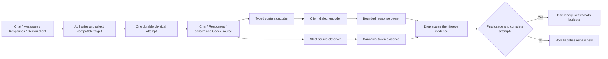

# ADR-0028: Qualified translated streams share the tracked response owner

- **Status:** M5g workspace candidate; evidence and remaining gates live in
  [TD-0034](../td/TD-0034-protocol-neutral-router-cache-accounting.md).
- **Extends:** [Responses source qualification](0026-qualified-responses-stream-accounting.md),
  [constrained Codex accounting](0027-qualified-codex-buffered-accounting.md) and
  [paired settlement](0023-paired-budget-settlement.md).

## Decision

Accept bounded tracked streams from qualified retry-free Chat, standard Responses
and constrained Codex transports for all four client dialects: Chat, Messages,
Responses and Gemini. Compatible standard routes retain transparent delivery;
other routes use the typed codec and existing bounded response owner. This adds
no raw Codex bypass or alternate inference executor.

Logical routes run the actual streaming preflight before pin confirmation. A
translated target can now be selected or remain pinned when its source qualifies.
Unbounded streams, retry-enabled handles, unqualified source families and
unsupported profile/content/cache controls still refuse before admission. Current
Messages/Gemini **upstream** streams remain unqualified; accepting their client
request formats does not qualify their source accounting.

## Source evidence owns accounting

Typed decoders do not qualify their own output. Their final usage events are
replaced with strict source counts, including explicit reasoning zero. The attempt
context retains canonical source evidence independently of decoder progress and
client delivery. The owner drops the source before freezing that evidence and
submits the same paired settlement transition used for transparent delivery.
Missing, regressing, malformed or truncated evidence cannot promote character
estimates into spend. No error path chooses another model/account or replays a
possibly executed request.

A failed Responses model result can carry final measured usage. Delivery fails,
while the original charge may settle once. Disconnect, body deadline and shutdown
retain source-final counts even when the client saw only part of the projection.
An already-expired shutdown deadline can retain the immutable RAM owner without
committing a receipt; a crash before evidence persistence leaves unknown durable
liability. A terminal event, successful SDK parse and accounting receipt are
separate facts.

## Client completion and bounds

Chat finish reasons can precede the final usage chunk. Translated finish events
are retained as one bounded reason until source EOF and qualification succeeds.
Responses completed frames and Anthropic stop deltas therefore receive final
counts. Every translated Anthropic message delta, including the stop delta,
carries usage for the SDK's high-level stream accumulator. Compatible native
frames retain their original ordering. Clean HTTP EOF still waits for settlement;
clients stopping at a native terminator must consult the receipt independently.

Tracked typed projection charges payload bytes plus a fixed per-event allowance
against an 8 MiB budget. This bounds retained Responses text/tool output and
Gemini tool arguments independently of queue backpressure and token estimates.
Exceeding it closes delivery; only independently qualified source evidence can
settle. It is not a tokenizer limit, provider-side output cutoff or total process
memory guarantee. Existing bounded SSE framing, four-frame copied wire queue,
setup/idle/body deadlines and shutdown accounting headroom remain in force.

## Qualification and remaining work

The synthetic HTTP matrix covers three source profiles, four client dialects,
final/zero/missing/unterminated/post-terminal/truncated evidence, plus failed
Responses/Codex model results. It joins request, context, attempt, canonical usage,
receipt and both leases. Separate cases cover disconnect/deadline/shutdown and
projection overflow. Actual vendor SDK fixtures validate all four client formats
against both standard qualified source families and established route affinity.
These are source/SDK fixtures, not live Codex subscription acceptance.

Live endpoint qualification, Messages/Gemini source observers, broader streamed
tool/media journeys, issuer-bound native state and the retained intermittent
accounting-wait failure remain active goal requirements. No passing rerun proves
that failure's cause. No release or deployment is established by this decision.
