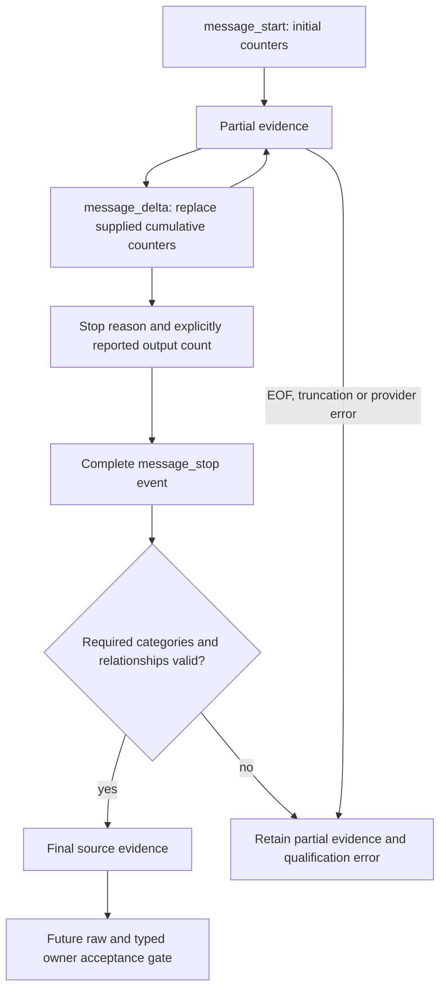

# ADR-0030: Qualify cumulative Messages stream usage before routing activation

- **Status:** Implemented library prerequisite, unreleased. Messages source ownership
  is connected separately in [ADR-0031](0031-qualified-messages-stream-ownership.md).
- **Extends:** [Strict buffered qualification](0025-qualified-buffered-protocol-accounting.md),
  [Responses stream qualification](0026-qualified-responses-stream-accounting.md)
  and [typed stream ownership](0028-qualified-translated-stream-accounting.md).

## Problem

Messages streams spread cumulative token counters across multiple events. Treating
the initial output count as final, summing successive totals or manufacturing an
unreported cache category would misstate usage. A neutral router needs source
evidence independent of client projection and delivery success.

The [Anthropic streaming contract](https://platform.claude.com/docs/en/build-with-claude/streaming)
(consulted 2026-11-11) describes matching named/JSON events, cumulative delta usage,
a final `message_stop`, pings, errors and future event types. This implementation
uses that lifecycle as a conservative qualification contract, while applying
Sandhi's stricter required-counter policy for settlement.

## Decision

Extend `ProtocolStreamUsageObserver` with a Messages reducer and an explicit,
family-scoped `AnthropicUsageProfile`. The old constructors and standard Chat
behavior remain compatible. The observer performs no HTTP, retries, persistence,
admission or settlement. It is not an additional physical attempt owner.

Fresh input, cache read, cache write and output are disjoint categories. Thinking
is included in output; its optional count preserves absent versus explicitly zero.
Progress always has `Partial` completeness. Omitted fields retain earlier actual
observations; cumulative counters replace rather than add. Supplied counters must
be bounded nonnegative integers and cannot regress.

The reducer retains only one bounded message ID and seven known numeric fields.
It never retains text, tool arguments, signatures, model responses or credentials.
The shared SSE framing still bounds lines/events to 8 MiB, supports chunk splits
and CR/LF/CRLF, rejects duplicate JSON keys and never completes an event at EOF.
Named event mismatches, repeated starts, contradictory identities, invalid order,
provider errors and post-terminal data set sticky errors. Unknown event types
cannot contribute usage. Explicit fallback blocks are conservatively unqualified;
this is not accounting for model fallback or server-tool charges.

Final evidence requires an identified message start, a stopping delta that itself
reports output, and a complete `message_stop`. A stop reason alone cannot promote
an earlier progress count. Fresh input and cache read must have been explicitly
reported. The default separate-write profile also requires an explicit aggregate
cache-write count. The implicit-cache profile accepts missing/zero writes and
rejects any positive write category, including TTL subsets.

TTL splits and thinking can establish partial lower bounds without inventing
reported parent counts. Each actual frame's aggregate/subset relations are checked.
Across frames, older TTL splits are lower bounds for newer aggregate writes;
their sum cannot exceed the final reported aggregate. The final qualifier receives
only actual aggregate counter observations, never inferred progress parents.
Missing required fields, malformed final counts and inconsistent lower bounds
retain partial evidence and cannot authorize settlement.

## Validation and activation boundary

Core tests cover unknown/zero presence, disjoint categories, thinking inclusion,
TTL lower bounds, invalid numeric/detail types and implicit-cache refusal. Observer
tests exercise every byte split for both usage profiles and all three SSE newline
forms, cumulative replacement, sparse updates, missing required parents, zero
totals, identity/order errors, regressions, truncation, post-terminal events,
provider errors, abort evidence and unknown-event injection.

At prerequisite checkpoint `74b4a10`, raw qualified dispatch rejected Messages and
Gemini before sending or creating an attempt. No typed adapter gained opt-in in
that increment. Before
activating tracked Messages sources, wire the same declared profile through raw
and typed owners, require complete-event decoder draining, and pass the four-client
HTTP/SDK, cancellation, restart and paired-receipt matrix. Live ZAI Messages calls
and native subscription lifecycle need their own evidence. Gemini source
qualification remains a separate prerequisite. Messages ownership and its scoped
acceptance are now covered by ADR-0031. See
[TD-0034](../td/TD-0034-protocol-neutral-router-cache-accounting.md).
