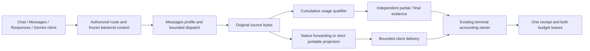

# ADR-0031: Connect qualified Messages sources to the tracked stream owner

- **Status:** Development source candidate; acceptance evidence is recorded in
  [TD-0034](../td/TD-0034-protocol-neutral-router-cache-accounting.md).
- **Extends:** [Messages evidence](0030-messages-stream-usage-qualification.md)
  and [translated stream ownership](0028-qualified-translated-stream-accounting.md).

## Decision

Connect retry-free Messages transports to the existing response-owned qualifier,
typed stream API and bounded HTTP owner. All four client dialects can consume
portable Messages output. Compatible native Messages routes preserve upstream
bytes. Gemini source streaming still requires its own qualifier and acceptance.

Both wire planes receive the declared `AnthropicUsageProfile`: standard separate
cache writes, or explicit `anthropic_implicit_cache`. Observer construction checks
family/profile compatibility before attempt authorization or HTTP setup. One
physical HTTP boundary owns one attempt guard and an independent usage sidecar;
the decoder creates no additional attempt, retry or settlement owner.

The shared qualified typed wrapper publishes one source-authoritative final usage
and finish only after source EOF passes qualification. Decoder totals never become
authority. A source-final measurement remains independently available if projection,
client delivery, cancellation or a deadline fails. Only qualified final counts can
settle; partial/absent evidence retains the original liabilities. Recovery retries
accounting, never inference.

The dedicated Messages projection uses complete SSE events, drains past
`message_stop` and never flushes a partial event at EOF. Legacy decoder behavior is
unchanged. It preserves initial text/thinking and actual initial tool objects,
tracks block indices/lifecycle and bounds retained block state. An explicitly
reported empty tool input remains `{}` when there are no substantive argument
deltas; malformed or incomplete deltas are never repaired into an invented object.
Initial nonempty input plus conflicting deltas fails explicitly. Gemini output
retains its strict object-argument validation and explicit incomplete finish reason.

## Native state and request controls

Signatures, redacted thinking, unknown blocks/events and tool-caller provenance
cannot disappear during portable projection. Native routes preserve them; an
unsupported translation fails explicitly. This does not implement cross-provider
thinking-state migration or server-side conversation reconstruction. Model fallback
blocks remain unqualified by the source observer.

A live GLM default-thinking run exposed this boundary: native Messages completed,
while translated calls refused a nonempty signature delta. The negative report is
retained. This is not a reason to discard the signature or silently disable thinking.

An explicit disable request must reach the backend. The Messages encoder now sends
`thinking: {type: disabled}` for neutral `thinking.enabled: false` and effort
`none`, and refuses contradictory enabled-thinking/none-effort controls. An omitted
control keeps the provider default. Endpoint/model support remains authoritative;
the [Claude API documents models that reject disabled thinking](https://platform.claude.com/docs/en/api/errors).
The [OpenAI reasoning guide](https://developers.openai.com/api/docs/guides/reasoning)
likewise makes effort support model-dependent. This mapping preserves an explicit
request; it does not assert that every model supports it.

The installed Gemini SDK emits `thinking_budget` inside `thinkingConfig`. Ingress
accepts that observed spelling and `thinkingBudget`, rejecting duplicate aliases.
Thinking controls that have no portable representation remain native-only instead
of vanishing. Gemini SSE failures use numeric HTTP codes and canonical status
names so structured failures can be parsed by the Google SDK. A failed body can
also raise a transport error; the default-SDK fixture verifies one origin send.

Compatible Gemini re-encoding merges the original thinking object and replaces
only the modeled budget fields. This preserves native members such as
`includeThoughts` when output-cap injection selects the typed path. Both accepted
budget spellings canonicalize to one wire field; they do not erase other controls.

## Evidence and remaining gates

The provider matrix checks both profiles, native attachment modes, eight evidence
conditions and both wire planes: 64 synthetic physical calls. Complete-event tests
exercise every multiline byte split and all SSE newline forms, EOF truncation and
profile rejection before authorization. The expanded seven-test HTTP fixture
covers 385 calls, including four-client joins, tools, native-state refusal,
disconnect/deadline/shutdown and paired settlement after failed projection.

Actual SDK fixtures cover both profiles, normal/output-limited completion,
restart/pin revision fencing, explicit disable intent and default Google SDK error
handling without another model send. Live cache reports remain endpoint, model,
control and binary specific; portable-output qualification must not be described
as default signed-thinking compatibility. No live subscription or native Gemini
source acceptance is established here.

Known signature-emitting defaults also motivate a future declared output-state
capability for preflight route compatibility; provider/model names must not become
heuristics. Broader tools/media/issuer-provenance journeys, Gemini source ownership,
subscription lifecycle, joined operator diagnostics and the retained intermittent
admission-timeout cause remain full-goal gates. Passing reruns do not close them.
