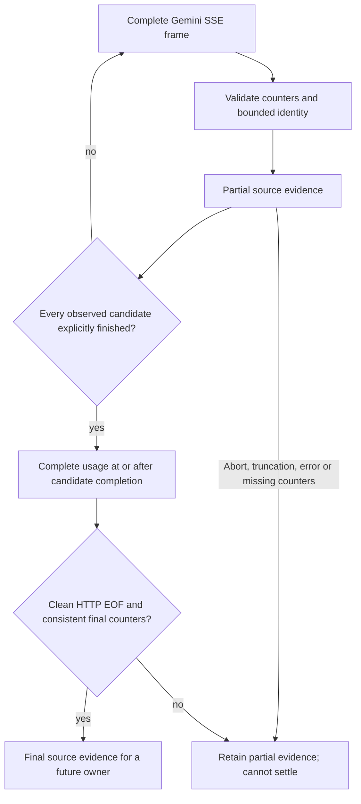

# ADR-0032: Qualify Gemini stream counts before backend activation

- **Status:** Implemented library prerequisite, unreleased. Source ownership is
  connected separately in [ADR-0033](0033-qualified-gemini-stream-ownership.md);
  this is not a live Google backend qualification.
- **Extends:** [Buffered qualification](0025-qualified-buffered-protocol-accounting.md)
  and [typed stream ownership](0028-qualified-translated-stream-accounting.md).

## Decision

Add a GenerateContent reducer to the bounded, complete-event protocol usage
observer. It performs no dispatch, admission, persistence, replay or settlement.
At prerequisite checkpoint `c098f45`, Gemini raw and typed adapters did not opt
into tracked streaming. ADR-0033 records the subsequent activation boundary.
Existing four-client ingress support and GLM evidence retain their earlier scope.

Google's [GenerateContent response reference](https://docs.cloud.google.com/gemini-enterprise-agent-platform/reference/rest/v1/GenerateContentResponse)
and [Google Gen AI SDK usage type](https://googleapis.github.io/js-genai/release_docs/classes/types.GenerateContentResponseUsageMetadata.html)
(consulted 2026-11-12) describe cached content within prompt tokens, separate tool
input and thoughts, and a total across prompt, tool input, candidates and thoughts.
Candidate finish reasons describe generation completion. These references inform
the following **conservative Sandhi contract**, rather than prove every compatible
endpoint supplies the required fields or follows this stream placement.

| Neutral category | Gemini measurement |
| --- | --- |
| Fresh input | `promptTokenCount - cachedContentTokenCount + toolUsePromptTokenCount` |
| Cache read | `cachedContentTokenCount`, a subset of prompt input |
| Cache write | No separate write measurement in this profile |
| Output | `candidatesTokenCount`, across generated candidates |
| Reasoning | `thoughtsTokenCount`, **separate** from candidate output |
| Consistency total | Prompt + tool input + candidate output + thoughts |

Optional thought-count absence remains unknown, distinct from reported zero.
No token category implies a currency price, cache lifetime or subscription credit.
Supplied counters must be bounded nonnegative integers and cannot regress.
Cumulative snapshots replace counts; repeated frames never add them again.

Unlike Chat and Messages, this profile has no separate SSE terminator marker.
Counts remain partial until clean HTTP EOF, with all observed candidates explicitly
finished and a self-contained usage frame at or after completion. That frame must
report prompt, candidate and total counts. Earlier progress cannot supply a missing
final parent. Nonzero optional counts cannot disappear from the final measurement;
previously reported optional zeros retain presence. A usage trailer is accepted,
but content for a finished candidate, duplicate indices, identity drift and
provider errors make qualification fail. A new candidate invalidates an earlier
terminal measurement until another complete usage frame arrives.

Candidate identities are bounded to 64 indices. Response/model identities, when
supplied, are bounded and stable. Unknown finish or prompt-block reasons refuse
qualification. A recognized prompt block can qualify only with explicit zero
candidate output and no positive thoughts; it cannot infer zero from absence.
This is evidence qualification, not a portable projection of every candidate,
native state, continuation or server tool execution.

The reducer retains numeric counters, at most two bounded identifiers, candidate
completion bits and a bounded numeric snapshot. It retains no response content,
tool arguments, signatures, credentials or arbitrary metadata. Shared SSE framing
rejects duplicate JSON keys, bounds line/event sizes, supports CR/LF/CRLF and never
manufactures an event at EOF. Abort after a fully framed final-looking chunk still
leaves partial Gemini evidence because HTTP completion has not been established.

## Validation and remaining activation gates

Core tests exercise disjoint counts, cached lower bounds, optional zero presence,
malformed fields and inconsistent totals. Observer tests exercise every byte split
for three newline forms, cumulative trailers, multiple candidates, missing final
parents, unfinished candidates, regression, identity drift, duplicate keys,
truncation, abort, errors and blocked prompts. The existing response owner is tested
without routing activation across seven EOF/drop/error paths: bytes remain
unchanged, upstream releases once and one attempt receives one terminal record.

Before enabling a Gemini source, connect both raw and typed adapters to the same
response owner; qualify portable tool/content projection and native preservation
or refusal; pass four-client HTTP/SDK, cancellation, restart and paired-settlement
tests; validate exact generation paths; and separately obtain live-provider
evidence. GLM's advertised Chat, Messages and Responses endpoints provide Gemini
**client** translation coverage, not a native Gemini backend. No Google credentials
or additional live calls are used for this prerequisite. See
[TD-0034](../td/TD-0034-protocol-neutral-router-cache-accounting.md).
