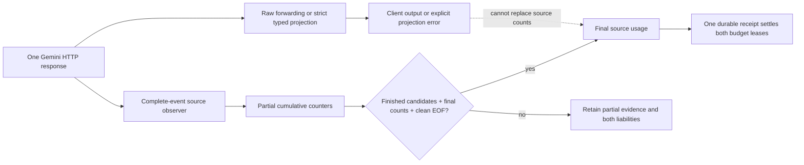

# ADR-0033: Connect qualified Gemini streams to the tracked response owner

- **Status:** Implemented source candidate, unreleased. Synthetic source and real
  client-SDK evidence; no live native Google backend qualification.
- **Extends:** [Gemini usage prerequisite](0032-gemini-stream-usage-qualification.md),
  [tracked typed streams](0028-qualified-translated-stream-accounting.md) and
  [Messages ownership](0031-qualified-messages-stream-ownership.md).

## Decision

Enable retry-free Gemini streaming through the existing raw and typed physical
response owner. Chat Completions, Messages, Responses and Gemini clients can select
a Gemini backend through authorized logical-model routes. Existing credential,
budget, model, cache namespace, session pin and streaming deadline checks remain
on that path. This adds no inference retry, detached response drainer or independent
settlement owner.

The raw path accepts only a path-safe model in
`/models/{model}:streamGenerateContent?alt=sse` or its `/v1beta` form. Gemini chooses
streaming in the URL, rather than a body `stream` field. Resource, buffered,
non-SSE, extra-query and unsafe-model paths refuse before physical setup. The
tracked transparent bridge now passes its validated model/stream route through to
that transport, rather than using the constant-path assumption of other families.
API-key and OAuth/Bearer header forms remain exclusive and explicit.

## Counts and completion

Google's [response reference](https://docs.cloud.google.com/gemini-enterprise-agent-platform/reference/rest/v1/GenerateContentResponse)
describes inclusive cached prompt input and separate tool-input/thought counts.
Sandhi applies the conservative qualification contract in ADR-0032: all observed
candidates must explicitly finish; prompt, candidate and total counts must appear
in a self-contained usage frame at or after completion; previously observed
nonzero categories cannot disappear; and clean HTTP EOF is required. There is no
independent Gemini SSE terminator. Missing parent counters never become zero.

For example, prompt **7**, cached **6**, tool input **1**, candidate output **4**
and thoughts **2** become fresh/read/write/output/reasoning **2/6/0/4/2**.
Reasoning is separate from output. A Chat or Messages client sees six inclusive
output tokens, while a Gemini client keeps four candidate tokens and two thoughts.
The accounting owner uses the source split once; client projections cannot add
another reasoning charge. Cache weighting is frozen policy, not a currency price
or subscription conversion.

Cancel, transport error, body deadline and shutdown before EOF retain partial
Gemini evidence even if a complete candidate-finish frame was received. In
contrast, families with an independently qualified protocol terminator can retain
final measurements across an unfinished HTTP body. The lifecycle tests assert
that difference; no source-specific deadline is increased to make them pass.

## Projection and native fidelity

Tracked typed decoding assembles bounded complete SSE events, never flushes an
unfinished event at EOF and never stops HTTP polling at a candidate finish.
Portable projection supports one candidate at index zero, text, thought-text and
self-contained function calls. Function arguments must be an explicitly supplied
JSON object. Stream-wide call indices are unique, and omitted IDs use a fresh
128-bit random namespace per response across buffered, qualified and legacy
streaming decoders. Entropy failure is explicit. Supplied IDs remain unchanged;
duplicate IDs within a qualified response and unsupported argument shapes refuse.
Request encoding consumes preceding unanswered calls in order, so reuse of a
supplied ID in a later completed turn cannot relabel an earlier result. Future,
already-consumed or duplicate-outstanding references refuse before dispatch.
`STOP` after calls
maps to tool completion, while `MAX_TOKENS` preserves the output-limit reason.
Representable filtering reasons retain their filter semantics.

Opaque thought signatures, media, grounding/provenance metadata, multiple
candidates, continuation state, unknown output fields and unsupported finish
reasons require native delivery or explicit refusal. Native typed mode retains the
complete original frames, including their opaque payloads, alongside canonical
response/usage/completion scaffolding. It does not invent a portable content/tool
projection beside those frames. The shared source qualifier remains authoritative
for counts and lifecycle even in native mode.

On a portable projection refusal, the decoder stops projecting but continues
polling the same source under the owner's existing bounds. A real clean EOF can
therefore retain final measured usage and settle both leases despite failed client
delivery. If source evidence or EOF is also missing, liability remains unresolved.
No second request is sent to repair output. Unknown standalone JSON event shapes
cannot masquerade as a harmless Gemini trailer.

## Evidence and remaining gates

The HTTP matrix adds Gemini sources to all four client formats, with final/zero,
missing/malformed, regression, provider-error and terminal/framing cases. Separate
tests join native-state/tool projection successes and refusals to one physical
attempt, one usage event, one receipt and two settled leases. The lifecycle matrix
checks disconnect, deadline and both shutdown paths. Provider tests cover both
credential forms, both native modes and raw/typed paths, including signature/media
refusal after successful source drain. Complete-event unit tests cover every byte
split, multiline data, three newline forms, stable call indices and truncated EOF.

Real vendor SDKs exercise all four ingress dialects against six configured source
profiles, including normal and output-limited Gemini completion. The Gemini
restart cases retain partial source usage, both unresolved reservations and one
usage event, and assert no model replay. These are synthetic upstreams: the
advertised GLM endpoints support three other source protocols and provide Gemini
**client** compatibility evidence, not a live Gemini source. Native Google cache
lifetime, explicit cache-resource lifecycle and live subscription acceptance need
their own evidence. The retained accounting-wait reliability gate and broader
tool/media/issuer journeys remain open in
[TD-0034](../td/TD-0034-protocol-neutral-router-cache-accounting.md).

Independent review rejected activation checkpoint `fe782e3`: generated IDs repeated
between responses, and a full-history last-wins lookup silently relabeled an
earlier tool result in a three-request loop. The namespace/chronological-consumption
fix covers all delivery paths. Four codec/stream regressions and sixteen real-SDK
three-request cases exercise all ingress dialects, both delivery modes and omitted
or reused supplied IDs. Each loop checks the actual third upstream request and
three paired settlements. Re-review applies to the resulting fix commit; the
rejected checkpoint has no clean approval record and was not published as a branch
tip. Its [sanitized reproduction](../reviews/artifacts/gemini-tool-history-review-regression-2026-11-12.json)
contains only synthetic tool names/results and structural evidence.
