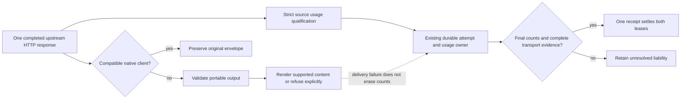

# ADR-0034: Keep buffered source evidence independent of output translation

- **Status:** Implemented source candidate, unreleased; synthetic qualification.
- **Extends:** [Buffered qualification](0025-qualified-buffered-protocol-accounting.md),
  [Codex aggregation](0027-qualified-codex-buffered-accounting.md) and
  [physical-attempt evidence](0024-durable-physical-attempt-evidence.md).

## Problem and decision

A successful HTTP response can contain qualified token measurements alongside
output the selected client cannot represent. Previously a typed decode failure
discarded those measurements and left both budget reservations unresolved. Other
decoders silently skipped signed thinking, encrypted reasoning, media or unknown
output fields. Keeping a source-native envelope in an unused extension did not
prevent that loss when another protocol rendered the response.

Built-in Chat, Messages, Responses and Gemini JSON transports now qualify usage
after the bounded, strict JSON response completes, before typed output decoding.
The existing tracked attempt holds one immutable numeric snapshot, including the
bounded upstream request ID. It holds no response body or credential. Recorded
HTTP status must agree with the successful response. The same one-response slot
holds either buffered or streaming evidence; it adds no dispatch, retry, worker
or accounting owner. Legacy diagnostic channels retain their existing behavior.

The response owner reads this snapshot during finalization. Source counts replace
projected counts, while delivery outcome and boundary timing remain separate.
Qualified final usage and valid transport evidence can therefore settle both
budget scopes once even when the client receives a translation error. Missing or
malformed usage remains unavailable and retains both liabilities. A JSON decode
failure, truncated body or missing HTTP facts cannot establish final source usage.

## Portable output contract

Gateway preparation requests a native buffered envelope only for a compatible
client protocol. Cross-protocol typed decoding validates output before projection.
Meaningful unknown fields, media/provenance, signed or encrypted provider state,
multiple candidates, unsupported finish reasons and invalid tools require native
delivery or an explicit error. Empty optional native fields do not themselves
constitute provider state. Tool arguments must be an explicitly supplied JSON
object; a malformed argument never becomes an invented `null` input.

The neutral response renders materialized reasoning, visible text/refusal and
then function calls. Source content that revisits an earlier content kind refuses
instead of silently changing that order. Chat/Responses refusal text is preserved
between those protocols; Messages/Gemini projection refuses when it cannot retain
the refusal semantics. Native delivery retains the original envelope, including
unknown fields and upstream argument representations.

Plain reasoning text is exposed as Chat `reasoning_content`, a Messages thinking
block, a Responses reasoning summary, or a Gemini thought-text part. This is
presentation, not provider-generated provenance. An empty Messages signature is
not a valid provider signature; a generated Responses presentation ID is not a
continuation token. Existing request-side native-state classification still
rejects incompatible replay. This increment does not promise that an agent can
send the projected reasoning back to an arbitrary provider unchanged.

Buffered Codex aggregation retains reasoning deltas and its terminal native
snapshot, checks that snapshot before portable delivery, and removes only the
native bucket. This is not full qualification of every interim Responses event;
broader Chat/Responses streaming output-state auditing remains an explicit gate.

## Token interpretation

For inclusive input **8**, cache read **6**, cache write **0**, output **4** and
reasoning **1 included in output**, the source split is **2/6/0/4**, with one
reasoning token already included. Unit weights charge **12**, including after an
unsupported output projection. Gemini's separate thought count instead yields
**13** for the corresponding prompt/candidate/thought example. Client rendering
does not create a second charge. A reported all-zero usage record settles at
zero; an absent or malformed record does not. Cache weights remain frozen policy,
not currency prices or a subscription entitlement estimate.

## Acceptance and limits

The Rust HTTP matrix covers four sources, four clients and seven output/usage
scenarios: plain reasoning, opaque state, invalid tools, unknown fields, missing
usage, malformed usage and reported zero. Another four calls force typed decode
failure with valid counts: **116 physical calls** total. Assertions join source
usage to one receipt and two settled leases, or no receipt and two held leases.
Native cases compare the complete original JSON value.

Real vendor SDK tests add 32 source/client/reasoning-or-state cells and four
receipt-failure/restart journeys. Restart keeps the original attempt, source
usage, policy valuation and paired receipt without replaying inference. Standard
OpenAI and Anthropic SDK retry defaults remain enabled for the new buffered
refusal cases. Google SDK retries are explicitly limited to one attempt.

The initial SDK run passed 35 cases and rejected one synthetic Gemini signature
because the fixture was not valid base64. The corrected fixture uses base64
provider state; no production rule was weakened. These are synthetic origins,
not new live Google, subscription or cache-lifetime acceptance. The retained
admission/dispatch timing failures remain open independently of these checks.
