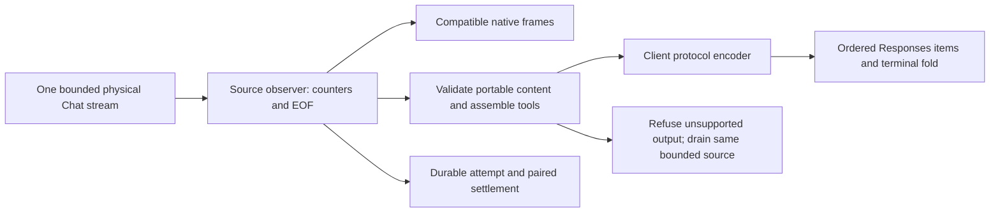

# ADR 0035: Portable Chat stream output and Responses presentation

Status: accepted for the bounded qualified stream path. Broader Responses-source
interim-state qualification remains open.

## Decision

Qualified Chat translation validates complete SSE events before publishing a
portable view. The existing bounded source owns transport, EOF qualification,
token evidence and the physical attempt. Projection has no dispatch or settlement
authority. Compatible native Chat delivery retains its established decoder,
canonical view and original frames; legacy unqualified Chat decoding is unchanged.

| Source output | Portable delivery |
| --- | --- |
| Single choice 0, text, plain materialized reasoning | Preserve content |
| Refusal text | Preserve as refusal in Chat/Responses; explicitly refuse Messages/Gemini |
| Tool ID/name/argument fragments | Assemble within bounds; require unique IDs and complete strict JSON object arguments |
| Prose after an unfinished tool assembly | Refuse rather than reorder prose ahead of the call |
| Audio, opaque provider state, meaningful unknown fields, multiple choices | Require compatible native delivery |
| Known content-filter terminal | Preserve filtering in Chat/Responses/Gemini; explicitly refuse Messages |

Tool assembly retains at most 1,024 calls and eight MiB, with 256-byte identity
bounds. Present response IDs/models must stay consistent and fit the same
256-byte identity bound. Invalid JSON, conflicting reasoning aliases, duplicate IDs, late deltas
and unsupported finish reasons refuse explicitly. A projection failure drains the
same source within its existing bounds and deadlines before returning the error.
This permits final source counters to survive an output refusal. A transport or
qualification failure still prevents final accounting; cancellation is not a
new success condition.

The existing cache-field observation wrapper remains around portable decoding,
so availability evidence can precede delivered content without inventing numeric
counts. The qualified-source wrapper remains the only publisher of final usage.

## Responses egress

The previous terminal fold flattened refusal into output text, omitted reasoning
and reused one message slot across intervening calls. A dedicated bounded encoder
now assigns an item at first open and preserves item order in added/delta/done
events and the terminal output. Text, refusal and materialized reasoning retain
their distinct types. Switches open new items; tools retain their call identity,
complete arguments and lifecycle. Added, done and terminal snapshots share stable
presentation IDs, and events carry monotonic sequence numbers.

The encoder retains at most 1,024 items and eight MiB, validates tool lifecycle
and strict object arguments, and rejects incomplete or duplicate calls. Its
terminal response includes source-derived input/output/total token presentation
and the qualified usage breakdown. Existing client-wire compatibility defaults
remain separate from authoritative optional source counters. SDK-required
response metadata uses presentation defaults when the canonical stream has no
corresponding setting; it does not prove backend configuration. Generated item
IDs and reasoning summaries do not confer provider provenance or continuation
state. A client needs a compatible native route to retain that state.

Gemini egress now renders plain materialized reasoning as text with `thought:true`.
This is presentation, not a fabricated thought signature. Messages filtering and
Messages/Gemini refusal failures occur at egress; an early egress failure may end
delivery before future source evidence arrives. Do not claim the projection
drain guarantee for every encoder failure. Unknown liability remains held under
the existing accounting rules.

## Qualification

Provider HTTP tests join native/portable Chat output to one physical attempt and
source counts. The proxy matrix joins both qualified Chat usage profiles to all
four client protocols, including projection refusals. Focused tests cover every
byte split of multiline fragmented-tool events under LF, CRLF and CR boundaries,
same-source draining, ordering refusal and retention limits.

Actual OpenAI SDK accumulation exercises reasoning, refusal and fragmented tools
through both Chat usage profiles. Its complete terminal items are checked along
with SDK event schemas, one origin call, one receipt and two settled reservations.
Initial schema validation exposed the missing Responses `total_tokens`; the
presentation now includes the saturating sum of inclusive input and output.

This does not qualify live Google, subscription credentials, media conversion or
opaque interim Responses/Codex state. The two retained accounting-wait stress
failures remain unresolved; passing these tests does not establish their cause.

Independent review rejected `ddceb70` for three P2 findings: changing Chat IDs or
models could merge into one successful output; tool fragments were appended
before checking retention and remained oversized during draining; Responses
start metadata was outside its retention counter. The fixes reject identity drift,
check fragment bounds before mutation and count start metadata before cloning.
Actual HTTP drift cases and committed-method retention regressions cover these
findings. The rejected tip received no clean review record. The source observer's
broader Chat identity policy is not changed; this portable decoder refuses the
contradictory output while retaining physical source usage evidence.
