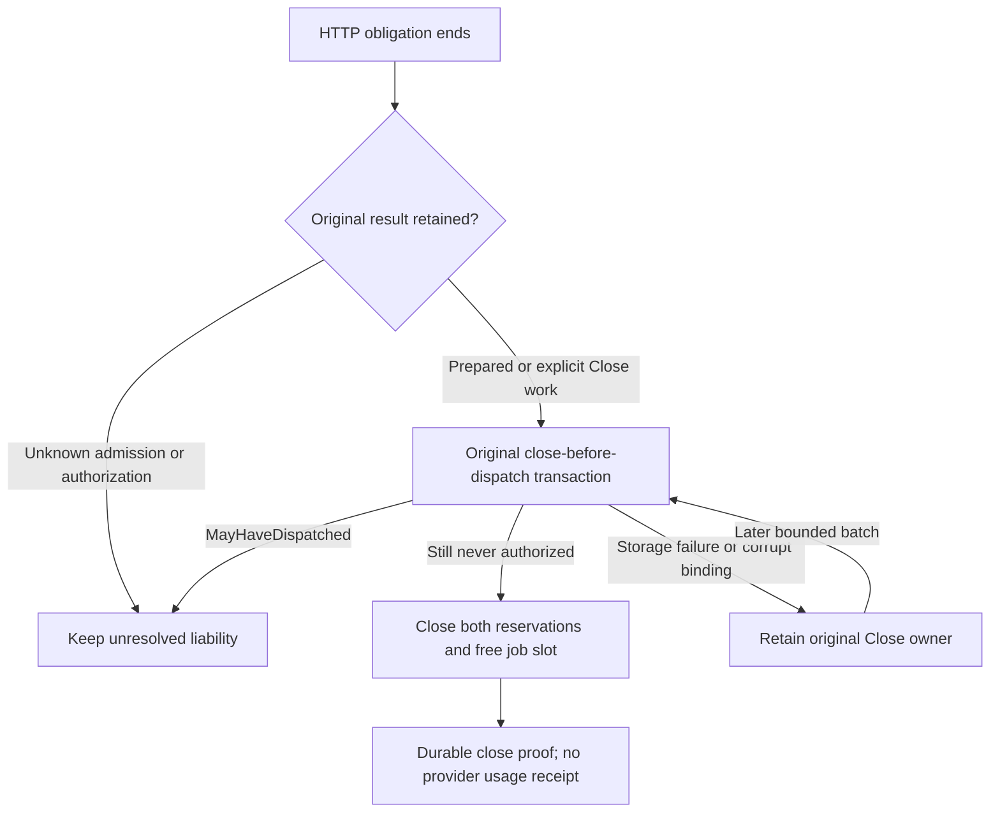

# ADR 0036: Recover abandoned Prepared owners on the original ledger

Status: accepted for surviving HTTP accounting owners. Spontaneous wait latency
and broader restart/unknown-commit recovery remain separate gates.

## Problem and evidence

An admission can commit after its HTTP waiter times out. The worker retains the
original committed `Prepared` result, but the former recovery slice only retried
terminal settlement. A controlled regression against `09f1996` leaves one job
slot and both reservations held, with zero physical attempts, observations and
provider receipts. A similar gap exists when an owner disappears after publication
or after taking Prepared but before authorization.

The [sanitized regression artifact](../reviews/artifacts/abandoned-prepared-recovery-2026-11-12.json)
binds the failing log and passing test source/log hashes to actual HTTP/request,
execution, reservation, attempt and receipt joins. The tests occupy the only
blocking worker and retain the existing two-second accounting wait. This
controlled queue delay does not explain the earlier spontaneous failures.

## Decision

The existing bounded recovery slice may consume an abandoned original Prepared
result or explicitly retained Close work. It invokes the existing
`close_before_dispatch_for_intent_durable` transaction on the original ledger and
intent. That compare-and-set transaction remains the authority for releasing both
reservations. No request-ID lookup reconstructs an owner; no admission,
authorization or inference is replayed.

Recovery skips live held/running slots. An ordinary public admission ticket
continues to use explicit result collection; it has no HTTP obligation phase and
is not automatically closed. Prepared cleanup marks its existing in-memory phase
as Closing so a storage failure retains the kind of original work across later
recovery slices. A phase marker never authorizes release: the store revalidates
the original intent and paired binding on every close attempt.

The current store fence wins a race with authorization. An unclaimed authorized
result or a competing authorization leaves `MayHaveDispatched` liability held,
even when a test happens to know no transport ran. Interrupted admission without
a committed Prepared result remains unknown. Missing attempts, timings or usage
never establish closure authority. No legacy `settle(0)` path is used.

## Accounting semantics and bounds

Known pre-dispatch closure releases both linked reservations at zero through its
separate durable close proof. It creates no physical attempt, provider usage,
usage event or provider settlement receipt. A fresh independent request can use
the restored capacity, dispatch once and settle both budgets normally.

The same registry, lifecycle, ledger and bounded recovery cursor own the work.
Each existing recovery batch performs at most one retained-owner operation; the
iteration/record bounds and original shutdown deadline are unchanged. SQLite can
still exceed a wall-clock slice. Unknown rows and unresolved bindings continue to
make shutdown incomplete.

## Validation

The failing baseline and passing corrected tests cover queued late publication,
published-but-unclaimed Prepared, and Prepared taken before owner loss. Separate
cases preserve generic collection, interrupted admission uncertainty and both
unclaimed/competing authorization. Transaction failure and a missing back-leg
link release neither reservation; repairing storage permits retry of the same
original Close owner.

Four controlled HTTP journeys use Chat, Messages, Responses and Gemini `/v1`
ingress. Each first request times out with retry suppression and reaches no
origin. Its late Prepared admission closes both linked reservations without a
usage receipt. Each fresh request then sends exactly once, records final source
10-input/2-output usage and settles both reservations at 12 neutral units. The
artifact contains eight request contexts, four zero-usage closures, four mock
origin inferences and four measured receipts. Cache-read availability is absent
in those measured responses; this is not a live cache test or a cache-miss claim.

The retained spontaneous admission and authorization wait failures remain open.
This fixes recovery after a known late admission; it does not prove those
failures' cause or grant automatic cleanup of unknown post-crash state.

The full Rust workspace passes 1,187 tests with six opt-in ignored across 50
suites, including 23 job tests and the four HTTP journeys. All 128 tracked SDK
cases pass with current provider pins. Default workspace/all-target and proxy
ONNX/SentinelPass all-target Clippy, formatting, bindings and strict docs pass.
Independent exact-tip review and new public CI remain checkpoint gates.
