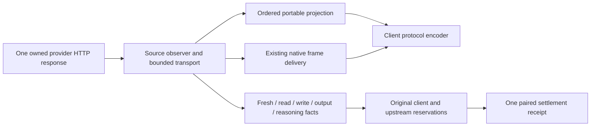

# ADR 0037: Preserve Responses source output before translating delivery

Status: implemented. Reviewed source `eec5eaa` / documentation tip `550b2fa`
passes public CI and full current-SDK qualification. Two retained local accounting
wait failures remain a separate reliability/merge gate.

## Problem and decision

Qualified Responses and Codex streams previously decoded visible deltas but
could silently omit terminal-only text/tools or interim opaque reasoning state.
Buffered Codex retained only the terminal response envelope. A partial encrypted
item from an earlier event was consequently lost if the terminal omitted it.
The strict portable Chat decoder also rejected the provider's normal string
`obfuscation` padding field.

Qualified portable Responses delivery now uses complete SSE events and an
ordered bounded item projection. It materializes terminal-only text and calls,
reconciles repeated snapshots with emitted prefixes, checks identities and item
positions, and refuses meaningful native fields, unsupported item kinds or
contradictory output. Typed string padding is recognized in both Chat and
Responses portable decoders. Upstream padding remains enabled. Re-encoding a
different protocol does not claim to preserve the provider's padding properties.

The projection owns no transport, credentials, dispatch or accounting lease.
On a source-projection refusal it keeps polling the same bounded source to its
actual completion or transport error. It emits no successful finish. Later
observed source counters remain available to the original settlement owner;
neither refusal nor translation invents a cache hit, zero usage or another call.
Cancellation and the existing transport deadlines still bound this work.

## Native delivery and bounds

Native streaming retains original frames, including opaque fields and transport
metadata, through the established decoder. Qualified buffered native Codex
assembles complete `output_item.done` snapshots into the terminal response when
the source omits them. Added encrypted state is incomplete and is never promoted
to replayable state. If no complete item or terminal counterpart covers it,
buffered delivery refuses explicitly. A complete replacement may change the
partial encrypted string. Complete snapshots must agree on their contents and
positions; holes and conflicting identities refuse.

Buffered native assembly also checks that materialized text, refusals, reasoning
and arguments are covered by the complete response. Unhandled native event kinds
and rich part metadata that the assembler cannot verify require native
streaming. This is a bounded assembly contract, not support for every Responses
event type. No synthetic native stream frames are created. Legacy canonical
delivery keeps its established path; the stronger materialized-output coverage
check applies to qualified buffered delivery.

Portable retention is at most 8 MiB of accumulated payload/identities, 1,024
items and 1,024 parts. Native buffered snapshot/materialization retention has
its own 8 MiB ceiling and 1,024-entry bounds. Both preflight retained fragments
before storing them. The established native decoder now also bounds retained
tool arguments and call count, so draining it cannot grow that state forever.
Buffered canonical aggregation remains separately bounded. These are individual
state limits, not a claim that total process memory is 8 MiB.

Portable streaming preserves ordered text, refusal, materialized reasoning and
complete function calls. A later item waits for an earlier open item. Buffered
portable output additionally refuses ordering that the flat canonical response
cannot represent, such as a function call followed by visible text. An egress
encoder refusal or an early native decoder/transport error can still stop before
future source counts arrive; only actually observed facts are authoritative.

## Evidence and limits

Regression tests first failed on the published implementation for dropped
terminal text, accepted interim encrypted state and rejected normal padding.
The resulting checks cover ordinary and Codex profiles, original native-frame
equality, complete encrypted snapshots, call-ID drift, later-chunk source counts,
parallel completion order, prefix consistency, invalid lifecycles, byte splits,
multiline Unicode SSE and pre-mutation retention limits.

Fifteen current-SDK gateway cases use OpenAI Chat, Anthropic Messages and Gemini
clients against a synthetic Responses HTTP origin. They cover terminal-only
text/tools, normal padding, opaque interim state and conflicting tool identities.
Three tool-result continuations return the original call identity in a second
physical request. Delivery refusal after SSE headers aborts the stream instead
of changing HTTP status; both boundaries must avoid replay. The database checks
join actual source facts and require paired settlement at five neutral units
per completed physical call. Those units are a policy valuation, not currency
or measured price savings.

The provider pins remain OpenAI 3.49.0, Anthropic 2.8.0 and Google GenAI 3.2.0,
rechecked against PyPI on 2026-11-12. No version bump was needed. A fresh fetch
also found the working branch contains the current `develop` baseline. These
synthetic tests do not qualify a live Codex subscription, Gemini issuer, cache
TTL, media path or provider cache-price discount. The broader qualification and
spontaneous accounting-wait work remains open in TD-0034.

Independent review rejected candidate `9a7cc77` for four P2 findings: complete
per-item snapshots could omit emitted parts, native materialized item IDs were
not bound to complete item IDs, meaningful root event metadata could disappear,
and terminal snapshot bytes were omitted from retained-budget accounting. Three independent actual-HTTP probes
confirmed successful delivery of those contradictions while retaining one
physical dispatch and final source counts. The corrected projection requires
complete part coverage; native assembly binds identities and requires their
presence in the replay envelope. Terminal clone bytes enter the retention budget,
post-terminal assembly events refuse, and meaningful unretained event metadata
refuses before storage. The rejected candidate has no clean review record.

The pre-review full SDK run was intentionally interrupted after source fixes:
248 passed and two skipped; it is partial evidence and cannot qualify the final
source snapshot. The partial run was excluded from final qualification; the completed run is recorded
below.

Protocol references:
[Responses streaming events](https://developers.openai.com/api/reference/resources/responses/streaming-events),
[Responses creation and padding](https://developers.openai.com/api/reference/resources/responses/methods/create),
and [Chat streaming events](https://developers.openai.com/api/reference/resources/chat/subresources/completions/streaming-events).

The final-source workspace run reproduced two unresolved terminal-settlement
waits. Workers started within 50–63 microseconds, then remained running beyond
the unchanged two-second wait with no published result. The
[retained failure report](../reviews/accounting-running-wait-2026-11-12.md)
distinguishes the explicitly correlated request from an unassigned adjacent
trace. This is a separate reliability/merge gate; the source-fidelity fixes do
not resolve the worker's internal latency or authorize liability release.

Independent re-review cleared all four findings on `eec5eaa` against `4443ed8`.
The reviewer reran the original HTTP/method probes in a fresh SHA-specific
target, seven portable projection units, four native aggregate units and the
focused matrices: 40 Responses, 26 Chat and 48 Codex HTTP cases. The verdict is
clean for the fidelity/security increment. It explicitly retains the two
accounting-terminal failures as an unresolved reliability/merge gate and does
not imply green CI or merge approval. Default and ONNX/SentinelPass Clippy and
strict documentation pass. The completed final-source SDK result is recorded below.

The stable final-source full SDK run completed: **564 passed, three optional
skips** in 744.37 seconds, including the served dashboard and pinned CPU origin.
Six distinct gateway fixture copies and their current alias share binary SHA-256
`79583541e09ddde0c44c9837c02723a2ddc97487b225dc1e94041194c35eeeca`.
The [sanitized artifact](../reviews/artifacts/provider-sdk-responses-fidelity-2026-11-12.json)
records source/harness scope and limits. This passing suite does not erase the
separate failed Rust accounting run or qualify a live subscription issuer.

[Public CI for `550b2fa`](https://github.com/anvai-labs/sandhi/actions/runs/43233149595)
completed successfully: all fourteen jobs, including the aggregate, passed on
verified GitHub-hosted Ubuntu runners. Documentation passed. The obsolete base
mirror had zero jobs and was cancelled. These results do not resolve the retained
local accounting failures or close broader goal qualification.
