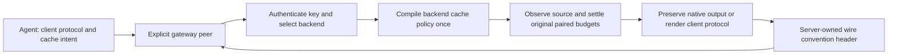

# ADR-0041: Declare the immediate gateway peer independently of its backends

- Status: Implemented and locally source-validated; independent final-tip review and public CI remain separate.
- Tracks: [TD-0034](../td/TD-0034-protocol-neutral-router-cache-accounting.md),
  [shared endpoint profiles](0039-shared-embedded-endpoint-profiles.md) and
  [shared buffered qualification](0040-shared-buffered-source-qualification.md).

## Decision

The shared Python/Node provider constructor appends `peer_role` / `peerRole`.
`provider` is the direct-source default. `sandhi_gateway_v1` explicitly selects an
immediate Sandhi gateway, with a required client protocol and base URL, a Bearer
credential and zero hidden retries. The client protocol is Chat Completions,
Messages, Responses or Gemini generation, independently of its provider label
and the gateway's selected backend. Omitted protocol, backend endpoint profiles,
Codex protocol aliases, account headers and positive retry counts refuse at
construction in gateway-peer mode. HTTPS and loopback HTTP origins are accepted;
URL-embedded credentials, query parameters and fragments refuse.

| Client protocol | Binding base URL relative to the gateway root |
| --- | --- |
| `chat_completions` | `/v1` |
| `anthropic_messages` | Root |
| `responses` | `/v1` |
| `gemini_generate_content` | `/v1beta` |

The gateway peer uses the existing family codecs and response owner. It has no raw
forwarder, upstream credential fingerprint or factory-owned durable-backend
eligibility. It cannot become an authorized nested backend by adding a header.
Run/session/step correlation remains separate from execution identity. Session
metadata fills an absent gateway session header; explicit wire correlation wins.
Obsolete logical-meter
`Idempotency-Key`, upstream account and response-convention headers do not cross
this client hop. Direct-source custom headers retain their existing behavior.

## One response-boundary counts decision

Successful gateway responses carry one `x-sandhi-usage-convention` value:

| Value | Actual emitted usage convention |
| --- | --- |
| `v1-chat-standard` | Standard separate Chat totals |
| `v1-chat-terminal` | Explicit terminal-choice Chat totals, also accepting standard totals |
| `v1-messages-standard` | Messages with separate fresh/read/write counts |
| `v1-messages-implicit-cache` | Declared compatible Messages convention with implicit writes |
| `v1-responses-standard` | Standard Responses counts |
| `v1-gemini-standard` | Standard Gemini generation counts |

These values describe count interpretation only. There is no Codex-authority
variant. Credential scheme, endpoint/account/expiry fences and backend permission
remain server configuration and key-bound decisions.

The gateway derives the value from its **actual emitted view**. Raw bytes and
compatible typed native envelopes/frames use the source convention; re-encoded
output uses the client's standard convention. A typed execution is not necessarily
re-encoded output. Source convention survives disabling raw forwarding for a
credential fence. Upstream copies of the header remain outside the response
allowlist; the gateway inserts its own value after filtering. Error responses make
no successful measurement claim.

Only an explicitly configured gateway peer consumes this metadata. It requires
one bounded, known value matching its client family, before decoding/observing
response bytes. Missing, duplicate, combined, unknown-version, incompatible-family
or Codex-looking values cause terminal output-projection refusal without another
inference. Direct sources ignore these headers and retain their explicit configured
qualifier. Buffered source evidence and typed projection consume the same parsed
convention. Streaming keeps the same response-owned observer and attempt guard,
selecting its qualifier after validated response headers.

## Terminal gateway errors do not authorize inference repair

Gateway-role HTTP failures preserve a bounded machine code, actual status and
available gateway request ID while returning `retryable:false`. The error reader
caps the body before parsing, rejects ambiguous JSON/control-bearing labels and
retains bounded sanitized display context. It never derives decisions from prose. Generic 5xx, malformed/oversized error bodies
and network ambiguity also remain terminal. Direct-source error behavior stays
separate. A payload or status is not authority to repeat a possibly completed call.

The existing response observer captures bounded gateway SSE error facts during
its existing strict JSON parse. Typed delivery preserves those facts through native
and portable projectors. Streamed failure emits no successful final usage or finish;
physical rejection/timeout status and source counts remain independent evidence.
Gateway HTTP request identity takes precedence over an embedded upstream error ID.
Native error shapes that lack a string machine code retain a conservative gateway
error category with available status/correlation; no code is inferred from text.

## One cache compiler owner

A gateway-facing binding validates typed `cache_intent` and serializes it once as
the existing reserved `sandhi_cache` field. It does not require selected-backend
capabilities, compile a local plan, add automatic cache markers or invent a cache
namespace. Omitted intent also suppresses historical client-encoder placement;
it leaves the backend's server policy to decide. Native client controls retain
their existing explicit fidelity/refusal rules. JSON never admits a compiled plan.

The server retains the existing sequence: authenticate scope, select the target,
validate policy/model capabilities and native state, compile, admit, dispatch.
Unsupported TTL or conflicting fixed policy refuses before a lease or inference.
Backend/credential generation and authenticated key/subject/group scope continue
to bind existing cache hashes. No credential or capability declaration is accepted
from the client convention header. Cache control acceptance is not evidence of a
provider cache hit or monetary saving.

## Client wire observations and source accounting remain distinct

The header describes the immediate wire view. It is not upstream provenance, a
usage receipt or proof of billing. The gateway's original source measurement and
paired receipt remain authoritative for accounting.

For example, a source reporting **2 fresh + 6 read + 2 write** tokens can render
Gemini usage as **10 prompt, 6 cached**, because the gateway's Gemini usage view has no separate cache
write category. Its client observes 4 uncached input tokens; the source ledger
retains 2 fresh and 2 write. A zero in an unsupported wire category does not prove
that the source explicitly reported zero. Likewise, separate Gemini thoughts
become inclusive output in Chat/Messages/Responses, while original source evidence
retains the separate subset and its inclusion convention. Optional counts and
explicit zero must be assessed against the source evidence, not inferred from
compatibility rendering.

Strict two-hop tests additionally exposed two existing renderer issues. Translated
Messages now closes content/tool blocks before final usage deltas. Rendered Chat
omits unavailable optional audio/prediction fields instead of emitting invalid
null counters, preserving explicitly reported zero. Source qualifiers were not
relaxed to accept either malformed rendering.

## Qualification and remaining boundaries

Focused local HTTP tests reuse persistent client handles across seven source
profiles and four client dialects, both delivery modes and native/portable views.
Each of the 112 cells checks one actual origin request, the exact correlated
source/attempt/context, original primary/back-leg linkage and committed receipt.
Additional cache-owner and malformed-metadata tests exercise policy refusal before
admission and absence of replay. Binding tests exercise the appended role parameter
and source-convention switching with synthetic peers. These are synthetic source
results, not live provider, release-wheel platform or subscription acceptance.

A separate existing identity gap remains visible: native Messages/Gemini adapters
use static family slugs for runtime observation and upstream budget scope, while
frozen context can retain a custom backend provider label. Durable attempt evidence
persists attempt identity/status, not those diagnostic labels. This increment must
not silently rename family-scoped budgets or bypass existing holds to fix that
migration. The source-context and back-leg identities remain explicitly checked;
provider-label budget migration needs its own checkpoint.

Accounting-default retirement, the coordinated Victor role migration, retained
admission/native-exit/shutdown reliability failures, broader cache lifecycle,
provider-bound state/media and issuer/subscription acceptance remain open. The
prepared Sandhi 0.17.0 / Victor 0.29.0 source versions are not published artifacts.
