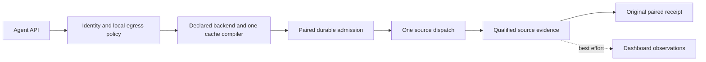

# Control egress. Reuse context. Account for every token.

Sandhi routes AI requests, applies access policy and measures usage in **neutral
units**. Use the standalone gateway for enforcement or the library for metering.
Cache-aware routing helps agents reuse repeated context across supported API
dialects; optional local ONNX evaluation supports content policy before provider
dispatch. Pricing and billing belong to downstream systems.

- **Reuse context across agent APIs**

    Compile declared cache intent for the selected backend. Preserve marker
    boundaries and measure fresh, read and write tokens separately.

    [Cache-aware routing and token efficiency →](product/cache-aware-routing.md)

- **Inspect protocol and credential support**

    Choose the client wire API separately from the backend protocol, source
    qualifier and credential profile. Unsupported native state refuses explicitly.

    [Protocol and credential matrix →](product/protocol-and-credential-matrix.md)

- **Control outgoing content locally**

    Apply configured egress rules with optional embedded ONNX evaluation.
    The shipped classifier audits; deterministic rules own its blocks.

    [Local ONNX and egress policy →](operator/sensitive-policy.md)

- **Verify the token benefit**

    Live Z.AI probes reported 3,776 reused tokens out of 3,781 input tokens.
    Read the evidence and its limits; cache-read share is not cost saved.

    [See the measured split →](product/cache-aware-routing.md#measured-example-3776-reused-tokens-5-fresh-tokens)

- **Connect with identity**

    Choose token credentials or optional OIDC. Keep provider credentials at the gateway.

    [Choose an access profile →](operator/oidc-sso.md)

- **Control access and capacity**

    Bind identities to models, budgets and operator-owned deadlines.

    [Understand budgets →](product/metering-and-budget-guarantees.md)

- **Recover without replay**

    Separate observed usage from persisted evidence and committed accounting.

    [Inspect durable execution →](operator/buffered-accounting.md)

!!! info "Published baseline and source documentation"
    Sandhi **0.17.1** is published. This development site also describes the
    **0.18 source candidate** and coordinated Victor **0.29.0** integration.
    Check [release notes](releases/v0.17.1.md) before configuring an installed
    version. Live qualification applies to its recorded endpoint and source;
    documentation, source integration and deployment acceptance are separate.

## One request, two responsibilities

The console's **Routing & cache guide** (`/dashboard#flow-section`) and the
[visual cache/token guide](product/cache-aware-routing.md) follow the same operator
workflow: inspect the client dialect, selected backend/cache policy, local egress
rules and original source evidence. Client response counters, dashboard observations
and committed source receipts are separate views of that work. The
[protocol and credential matrix](product/protocol-and-credential-matrix.md) keeps
client dialects, backend qualification and subscription boundaries distinct.

| Responsibility | Standalone gateway | In-process library |
|---|---|---|
| Normalize and attribute usage | Yes | Yes |
| Keep upstream credentials behind a boundary | Yes | Caller owns credential handling |
| Enforce proxy budgets and admission | Yes, single node | No proxy ledger enforcement |
| Price usage or bill customers | Downstream responsibility | Downstream responsibility |

## Earlier release evidence and adoption gates

The [published 0.17.1 release](releases/v0.17.1.md) includes the protocol router,
cache intent and durable execution foundation. Artifact verification, consumer
adoption and managed deployment are separate gates. Earlier version-specific
changes remain in the [0.14.0 release notes](releases/v0.14.0.md).

!!! info "Current source: one durable HTTP execution contract"
    The current source requires the original `SANDHI_STORE` path and one ledger
    shard for every HTTP generation call. Client/upstream admission and measured
    settlement share one owner; the permissive execution mode is removed.
    Pure provider FFI stays ledger free. Follow the
    [migration and capability check](operator/buffered-accounting.md) and verify
    `capabilities.execution_accounting == "paired_durable_v1"` on your actual
    binary before qualification. Current source behavior does not establish
    publication or managed deployment.

!!! warning "Release verified; managed adoption remains pending"
    Tracked buffered accounting is opt-in in the [published 0.12.0 release](releases/v0.12.0.md).
    The [0.13.0 release](releases/v0.13.0.md) adds bounded tracked OpenAI Chat streaming.
    All artifact targets verify; publication does not establish managed deployment
    or full mixed-team acceptance. Check [release artifacts](https://github.com/anvai-labs/sandhi/releases)
    and your actual binary identity before enabling it.

| Change | What it gives you | Still to qualify |
|---|---|---|
| Owned buffered admission and recovery ([#338](https://github.com/anvai-labs/sandhi/pull/338)) | Correlated intent, retained final usage and bounded recovery | Preserved-state managed deployment and broader lifecycle |
| Actual process restart drills ([#339](https://github.com/anvai-labs/sandhi/pull/339)) | Held unknown liability; one recovered receipt without another model call | Live provider/member acceptance |
| Terminal publication under contention ([#340](https://github.com/anvai-labs/sandhi/pull/340)) | Recovery if RAM survives; explicit uncertainty if it does not | Live provider/session behavior and deployed lifecycle |
| Bounded tracked streaming ([#355](https://github.com/anvai-labs/sandhi/pull/355), [#356](https://github.com/anvai-labs/sandhi/pull/356)) | Durable final usage, receipt-gated completion and synthetic TLS/OIDC restart acceptance | Managed rollout and actual-member C5 |

[Accounting contract and evidence](product/attempt-accounting-and-evidence.md)
contains the complete status. [The documentation map](README.md) separates current
contracts, design history and co-design snapshots.

## Choose your next step

| Your task | Guide |
|---|---|
| Inspect usage, routing and management in one console | [Operator console](operator/dashboard.md) · open `/dashboard` on your gateway |
| Reuse agent context and understand cache marker/token semantics | [Cache-aware routing](product/cache-aware-routing.md) · [backend configuration](operator/backends.md) |
| Evaluate outgoing text locally before provider dispatch | [Embedded ONNX](operator/embedded-onnx.md) · [sensitive-text policy](operator/sensitive-policy.md) |
| Let people sign in and assign roles | [OIDC setup](operator/oidc-sso.md) · [groups and delegated keys](operator/identity-groups.md) |
| Set global, endpoint or model deadlines | [Buffered calls](operator/buffered-deadlines.md) · [streaming](operator/streaming-deadlines.md) |
| Understand cache counts and missing measurements | [Cache reporting](adr/0010-cache-read-reporting-availability.md) |
| Rehearse restart and restore safely | [Recovery drill](operator/recovery-drill.md) |
| Integrate embeddings or completions | [Text endpoints](operator/text-endpoints.md) |
| Inspect architecture, decisions and unfinished work | [Documentation map](README.md) |
