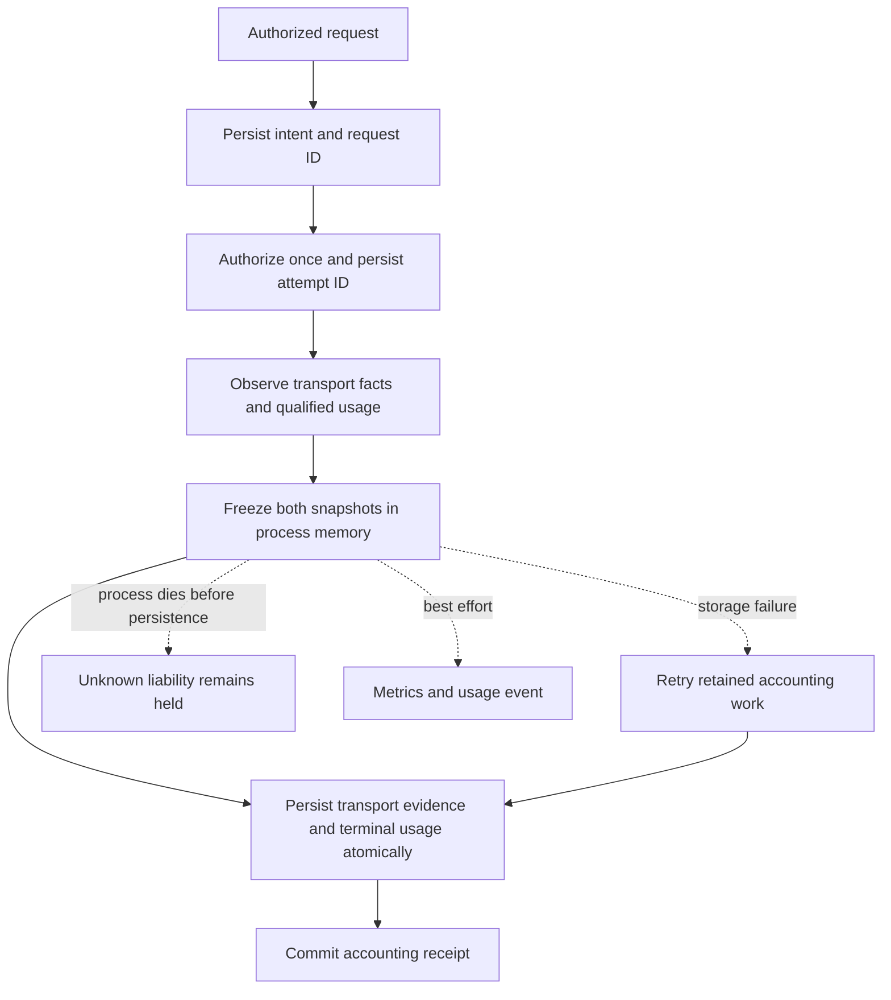

# Owned HTTP accounting

!!! warning "Mandatory durable HTTP execution — source candidate"
    The current candidate requires an explicit ordinary-file `SANDHI_STORE` and
    exactly one ledger shard. Every generation path uses the same durable owner.
    `SANDHI_BUFFERED_ACCOUNTING` was removed: unset it, including old `tracked`
    assertions. Any supplied value refuses startup before stores open.
    This source change is distinct from public packaging, independent review and
    deployment acceptance. The opt-in behavior in the published
    [0.12.0 release scope](../releases/v0.12.0.md) remains historical evidence.

Chat, Messages, Responses and Gemini clients use qualified buffered or streaming
source transports through the existing paired owner. Standard Chat, Messages,
Responses, Gemini and constrained Codex sources share the source/attempt/receipt
contract. Native Cohere/Ollama backend sources also have strict usage/EOF qualification;
pure FFI availability alone does not authorize durable HTTP execution. OpenAI-
shaped open-weight backends use the qualified Chat source contract.

The standalone process and public serve functions reject unavailable/unsupported
execution ownership before binding. `build_app` can assemble read-only operator
states; such a state stays unready and refuses generation before credential or
route processing. A valid existing single-file ledger initializes its canonical
owner through the normal builder. No library path creates a replacement ledger.
Native-reference metadata initializes privately on the same original ledger before serving.
Its queued/running storage workers remain lifecycle-owned until actual completion and use the
original request/response deadline, shortened by shutdown when applicable; mutex/SQLite waits
do not obtain a fresh budget or admit new work after expiry. Uninterruptible storage can
outlive its waiter while retaining ownership and causing incomplete shutdown. Public serving
supervises these workers and recovery alongside active responses. Proof failure does not authorize replay or invent usage.
Pure provider FFI remains an observer/codec boundary without a SQLite owner.

Default streams have validated 30-second setup, 90-second idle and 180-second body
limits under a 240-second ceiling. Explicit
[streaming deadline policy](streaming-deadlines.md) can refine those bounds.
Client or delivery cancellation does not prove the provider did not execute.

Keep the existing authentication, TLS, vault and **same store path**. Quiesce older
writers before upgrading. Limits, windows, Block/Warn policy, settled spend, live
holds, dedup history and route pins remain on that original file. No old row gains
invented context, dispatch evidence or receipts. Historical unpaired lease expiry
keeps its prior semantics; unknown tracked pairs survive expiry and restart.
Multi-shard deployments require a separately planned offline migration; startup
refuses them before opening/migrating the ledger. Do not start an older writer on
a file containing new tracked evidence.

See [the mandatory execution decision](../adr/0043-mandatory-durable-http-execution.md)
and [buffered source qualification](../adr/0025-qualified-buffered-protocol-accounting.md).

**A translation error can still have measured token usage.** The current source
captures strict buffered usage before output decoding. Unsupported signed/encrypted
state, media, unknown output or invalid tools refuses explicitly on incompatible
client protocols; compatible native delivery preserves the source envelope.
Valid final source measurements still settle both budgets once, even after a
502 delivery error. Missing or malformed measurements retain both liabilities.
Plain reasoning presentation does not make provider state portable for replay.
See [buffered output fidelity and source evidence](../adr/0034-buffered-source-evidence-and-output-fidelity.md).

Deterministic output refusals use `output_projection_error`, HTTP 502 and
`x-should-retry:false`. OpenAI/Anthropic
SDK defaults then avoid repeating inference for an unsupported format. That header
cannot control connection retries before headers arrive and is not inference
idempotency. Canonical source measurements,
rather than protocol compatibility defaults for absent reasoning counters, remain
the accounting authority.

The current workspace candidate additionally freezes a bounded execution-context
record with the original admission: ingress/delivery/plane, optional logical-route
and backend revisions, actual model, transport/cache-plan fingerprints and the
admitted accounting-policy version/cache-read weight. Context, both budget
reservations and their linkage/intent/correlation/fence commit together. Missing or corrupt required
context fails closed; older admissions retain absent context. Terminal recording
cannot substitute a different weight, and restart recovery keeps the original
frozen charge. This adds no new tracked protocol;
see [ADR-0022](../adr/0022-durable-execution-context.md) for evidence and limits.

New tracked admissions reserve the client and upstream budgets in one transaction.
Either denial commits no accounting rows. Qualified final usage settles both with
one original receipt/charge/timestamp; a settlement failure charges neither.
Unknown or unqualified usage retains both liabilities through expiry and restart,
which can deny further work when held capacity fills a budget. Absence of usage is
never a measured zero. Only proven pre-dispatch closure releases both at zero
without a provider-usage receipt. Older unpaired rows are not retroactively linked.
See [paired budget settlement](../adr/0023-paired-budget-settlement.md).

New dispatch authorization also persists one opaque attempt ID. The transport
observer captures dispatch/terminal facts under that ID; its immutable snapshot
commits atomically with qualified usage. Settlement requires both complete
transport evidence and qualified final usage. Missing evidence after a crash
means unknown send status, with both liabilities retained. A surviving owner
retries accounting with the unchanged snapshot; it never repeats inference.
Older rows gain no invented attempts. See
[durable physical-attempt evidence](../adr/0024-durable-physical-attempt-evidence.md).

## Follow the evidence

| Evidence | What it proves | What it does not prove |
|---|---|---|
| Request ID and prepared intent | One correlated admission is durable | The provider executed or charged |
| Persistent attempt ID | One send slot was authorized | A send occurred or reached the provider |
| Durable transport evidence | Instrumented dispatch/terminal facts survived storage | Independently qualified usage or provider billing |
| Usage in memory or metrics | The gateway observed reported usage | Persistence or committed spend |
| Durable terminal observation | The original usage snapshot survived storage | Settlement has committed |
| Accounting receipt | The original ledger committed accounting | Atomic telemetry delivery or external billing |

A disconnected client does not cancel owned admission or buffered execution.
For tracked streams it closes the source while retaining its last observed usage
for settlement. Recovery never repeats inference or re-emits usage events.
Usage is retained before telemetry callbacks; a failing sink cannot discard the
snapshot needed for accounting recovery.

## Supported activation

| Surface | Required in tracked mode | Refused before admission |
|---|---|---|
| Ledger | One file-backed ledger, fixed topology | Volatile or sharded ledgers fail startup |
| Ingress | Buffered Chat, Messages, Responses or Gemini; bounded streams from qualified sources; native OpenAI Text Completions and buffered Embeddings | Unbounded streams or unqualified source families |
| Buffered upstream | Built-in retry-free Chat, Messages, Responses, Gemini, Cohere or Ollama transport; constrained Codex SSE aggregation | Custom transports; other expiring handles without a qualified codec |
| Streaming upstream | Qualified retry-free Chat, Messages, standard Responses, Gemini, Cohere, Ollama or constrained Codex source | Custom sources without a strict qualifier |
| Operations | Synchronous generation or input-only embeddings | Background/async Responses; logical routes preflight eligibility before pinning |
| Policy | Block and Warn with durable paired measurement; explicit or operator-default output limit | Storage-error fail-open, hidden retry and logical-idempotency combinations |
| Processing plane | Buffered and streaming transparent/translated | No silent downgrade to legacy accounting |

Standard Chat stream totals arrive on empty choices. The explicitly selected
`openai_terminal_chunk_usage` profile also accepts validated request totals on one
known terminal choice; progress, malformed and conflicting usage still fail. Both
wire planes use the declared profile, never a provider-name guess. See
[terminal Chat usage placement](../adr/0029-explicit-terminal-chat-usage-profile.md).

Standard tracked Messages requires explicit fresh/output/cache-read/cache-write
counters; omitted cache categories remain unqualified. The explicitly configured
`anthropic_implicit_cache` endpoint profile allows an omitted separate write
counter when uncached input covers implicit cache construction; missing reads and
contradictory nonzero writes still refuse. This is independent of request cache
controls. Gemini tool-use prompt tokens are
included in normalized fresh input, while thoughts remain separate from candidate
output. Reported zero, absent counters and malformed values retain distinct meanings.
See the [qualifier table and recovery limits](../adr/0025-qualified-buffered-protocol-accounting.md#qualified-token-semantics).

Codex buffered requests still pass through its constrained codec, fixed-origin
credential factory and expiry/account checks. The source owner drains SSE through
HTTP EOF and keeps canonical usage if aggregation fails. Setup, idle and the
original buffered whole-call deadline remain bounded. The codec omits the wire
output limit; the client's limit contributes to gateway admission estimates and
does not establish a hard upstream token cutoff. See [Codex bounds and evidence](../adr/0027-qualified-codex-buffered-accounting.md).

## Output defaults and soft caps

Clients may omit the output maximum. The operator default is injected before
admission and sent through canonical encoding to compatible upstreams, preserving
native request state or refusing it explicitly. A response then carries
`x-sandhi-output-limit-source: operator_default` and `x-sandhi-output-max` with the
selected value. Explicit client limits retain their existing meaning; the gateway
does not guess model/backend capabilities. Victor's ordinary default is also 4096.
The configured default is a requested output bound, not a guarantee that total
billable usage fits an estimated reservation. Codex still omits its wire maximum;
its input/output exposure remains estimated. Measured overshoot is never clipped.

Warn keeps its stored soft cap and permits over-cap work through the same paired
admission/measurement/receipt path. It does not permit unmetered execution on a
storage error. Both primary and upstream policies remain authoritative, and
post-receipt alerts use their reconciled spend. Block/Warn never changes the source
counts, cache-read weight frozen at admission, or receipt identity.

## Bounds and configuration

| Bound | Standalone value | Configuration / meaning |
|---|---|---|
| Omitted output limit | 4096 tokens | `SANDHI_DEFAULT_MAX_OUTPUT_TOKENS` (1–1,000,000), clamped only to an explicit backend model maximum; see below |
| Streaming setup / idle / body | 30s / 90s / 180s | Validated 240s ceiling; explicit configured policies can override |
| Retained owners | 64 | One slot spans the detached HTTP operation |
| Each accounting wait | 2 seconds | A timed-out wait does not cancel or repeat a possibly committed transition |
| Transport deadline | 120 seconds | Existing global/endpoint/model buffered policy may override, up to 600 seconds |
| HTTP wait | Transport + three accounting waits | A longer client timeout cannot extend it |
| Retained intent capacity | 100,000 | Retention and migration are separate work |

Embedders can call `settlement::buffered::enable(&Arc<ProxyState>, Config::new(...))`
before serving. Configuration is immutable after enable. The library validates
capacity 1–1024, accounting waits up to 30 seconds and transport deadlines up to
600 seconds. See [buffered deadline policy](buffered-deadlines.md).

Tracked streams use the authorized endpoint/model's setup, idle and body limits.
Admission reserves setup + body duration plus three accounting waits and 60 seconds
of headroom. The existing post-header lease check still applies. On shutdown,
tracked delivery stops one accounting wait before the original grace deadline
(or immediately if less time remains); the deadline is never extended. This gives
settlement an opportunity, not a guarantee against SQLite contention.

## Interpret a response

| Outcome | Client result | Required interpretation |
|---|---|---|
| Final qualified usage and committed settlement | Normal provider result | Consult the receipt for committed accounting |
| Missing/malformed usage, transport failure, accounting timeout or failed settlement | Correlated 502 | Upstream may have completed; **do not automatically retry** |
| Explicit reported zero | May settle zero | Absence of usage is not reported zero |
| Client disconnect | Client has no confirmed result | Gateway ownership continues; inspect evidence |

Gemini tool projection rejects invalid/incomplete/duplicate-key or non-object
arguments explicitly; it does not invent `{}` or null arguments. A projection
failure can still have independently qualified final usage and a committed paired
receipt. Buffered projection failures send a non-retryable 502 and
`x-should-retry: false`; streamed failures terminate the body with an error.
Explicit output-limit/filter reasons survive Responses tool-call translation.

The client may not receive completed model output when accounting is unresolved.
A 502 is not proof the model failed.

Tracked accounting errors send `x-should-retry: false`. The tested OpenAI and
Anthropic SDKs honor this before their status-based retry rules; a JSON message
alone does not stop their default retries. Tracked typed failures with qualified
final usage also suppress automatic SDK retry even when their receipt commits.
Four synthetic default-retry SDK cases verify one model request for missing usage
and receipt-write failure, including accounting-only recovery after restart.
This header does not control clients that ignore it or transport failures for
which no response arrives; callers still must not blindly repeat ambiguous work.

Translated finish events wait for qualified source EOF, and Anthropic stop deltas
include final usage for SDK accumulation. Tracked typed projections have an 8 MiB
payload/event budget; exceeding it fails delivery without settling estimated counts.
See [stream ownership and bounds](../adr/0028-qualified-translated-stream-accounting.md).

For streams, headers and partial bytes can already have reached the client.
A successful HTTP EOF waits for committed settlement; unresolved accounting ends
the body with an error. Already-forwarded `[DONE]` is **not** an accounting receipt.
Clients that stop reading at `[DONE]` must consult durable evidence independently.
No retry is authorized by an interrupted response.

| Stream evidence at source termination | Stored usage | Settlement |
|---|---|---|
| Responses progress without qualified terminal totals | Partial, preserving observed cache counts and reported-zero presence | Unresolved; never promoted to final totals |
| Qualified counts; cancellation/timeout but no qualification error | Final counts and delivery outcome | May commit the measured charge |
| Conflicting/malformed data, truncated event or missing terminator at EOF | First counts retained as Partial with bounded qualification reason | Unresolved; no receipt |
| No qualified counts | Unavailable with explicit missing-usage reason | Unresolved; never an invented zero |
| Terminal publication refused or unavailable | Immutable snapshot retained in the existing jobs owner | Retry accounting only; death before persistence leaves unknown liability |

Partial observed totals agree between metrics, events and stored evidence; observed
totals are not committed spend. No second parser or settlement eligibility rule is
introduced. Qualification remains conservative when later data invalidates a stream.

Each admitted request gets one generated Sandhi ID, committed atomically with its
prepared intent. Responses carry `x-sandhi-request-id`; tracked usage events use
that same ID and preserve an available origin ID separately. The ID is not an
execution ID, idempotency key or replay authority. Old admissions retain absent
correlation. Response-body completion IDs are not substituted for HTTP request IDs.
The typed provider response currently does not preserve success response headers;
an absent origin ID does not invalidate the gateway/intent/receipt join.

## Recover and shut down

| Situation | Behavior |
|---|---|
| Process survives a storage failure | Retry the retained, immutable terminal snapshot |
| HTTP admission finishes after its waiter/owner ends | Close an original retained Prepared result through the existing pre-dispatch transaction; both reservations release with separate close proof and no provider usage receipt |
| Durable final usage survives a restart | Recover settlement through the original ledger |
| Process dies before terminal persistence | Keep liability unresolved; RAM cannot establish durable evidence |
| Recovery sweep | Once per second; at most eight batches, 32 execution records and one retained terminal/Prepared-owner recovery per batch |
| Sweep progress | Advance scope/execution cursors, including unbudgeted and removed-key scopes |
| Shutdown | Drain workers, then check fresh bounded durable inventory plus retained owners |
| Unknown rows, incomplete inventory or timeout | Incomplete shutdown, exit 124 |

The one-second recovery check happens between batches. These are iteration/record
bounds, **not a hard SQLite latency bound**. Recovery settles only authoritative
final usage; unavailable observations stay held. Shutdown keeps the original grace
deadline and watchdog; a large backlog may need more recovery before shutdown.

Emergency exit 124 uses immediate OS termination so a blocked C exit callback
cannot prevent the watchdog from stopping the standalone binary. Successful
cleanup still uses ordinary exit; embedded libraries do not terminate their host.
The [controlled tests and executable provenance](../reviews/emergency-exit-and-binary-provenance-2026-11-12.md)
describe this guarantee and its limits. Passing them does not diagnose the retained
shutdown timing occurrence or release unresolved accounting liability.

[Abandoned Prepared recovery](../adr/0036-abandoned-prepared-recovery.md) requires
the original committed result or explicit Close work. Unknown commit status and
`MayHaveDispatched` remain held; missing usage or timings do not authorize release.
Do not restore older writers over a database containing tracked evidence.

## Accepted source evidence and remaining gates

| Gate | Source evidence | Scope |
|---|---|---|
| Unknown dispatch after SIGKILL | Liability and incomplete shutdown survive restart | [#339](https://github.com/anvai-labs/sandhi/pull/339) |
| Persisted final usage | One receipt recovered; another restart preserves spend and identity | #339, synthetic receipt-write failure |
| Terminal publication contention | Retained retry commits once if process survives; death preserves unknown liability | [#340](https://github.com/anvai-labs/sandhi/pull/340) |
| Tracked buffered TLS/OIDC | CA-verified shutdown and OIDC accounting/denial joins; existing browser role matrix | [Synthetic source acceptance](../product/attempt-accounting-and-evidence.md#tracked-buffered-tlsoidc-source-acceptance) |
| OIDC crash/restart | Unknown liability retains its bound scope; final usage settles once after inference-grant revocation; new dispatch is denied without accounting changes | Same two recovery cases parameterized over token and TLS/OIDC modes |
| Released binary with deployed OIDC policy | 0.12.0 isolated TLS candidate: both Qwen routes and ZAI reconcile three receipts / 51 tokens | [Qualification and limits](../product/attempt-accounting-and-evidence.md#isolated-released-binary-oidc-qualification-2026-10-10); managed gateway unchanged |
| Managed tracked OIDC and streaming lifecycle | Pending | Source HTTP tests do not qualify deployed lifecycle |
| Strict streamed usage qualification | Core qualifier, bounded event observer and opt-in raw response owner; usage survives drop/error; no automatic replay | [Source prerequisite](../product/attempt-accounting-and-evidence.md#openai-chat-stream-usage-qualification-w05c-prerequisite); Rust raw transport plus opt-in tracked HTTP bridge; unreleased |
| Tracked streaming HTTP ownership | Source tests | Clean EOF after receipt, bounded disconnect/deadline/shutdown, partial/absent usage, setup timeout, failed terminal write and accounting-only retry, panicking telemetry |
| Standalone streaming lifecycle | Built-proxy HTTP/TLS and OIDC fixtures | [Process death/restart, contention, revoked-grant recovery and completion/disconnect/SIGTERM](../product/attempt-accounting-and-evidence.md#standalone-streaming-lifecycle-source-acceptance); synthetic source evidence, unreleased |
| Executed cache reuse, tokenizer correctness and actual-member C5 | Pending | Source drills cannot establish these |
| Released tracked-mode deployment | Pending | Existing 0.12.0 default-mode deployment does not qualify tracked lifecycle |

The restart drills use the same copied/hashed binary and local synthetic provider
responses. The existing SIGKILL and terminal-publication contention drills run with
buffered and streaming requests in token compatibility and CA-verified TLS/OIDC
modes using the disposable authority. Each drill observes one origin request.
See the [full acceptance record](../product/attempt-accounting-and-evidence.md#tracked-buffered-crashrestart-acceptance).

!!! note "Telemetry is not a settlement outbox"
    Events, metrics and traces are best effort. Counters can increase before
    persistence, and a success-labelled observation does not prove a successful
    client response. The event may be absent after a sink failure. Tracked threshold
    alerts, atomic telemetry export, observation amendments and multi-shard migration
    remain separate work.

Before submitting paid qualification requests, query the authenticated
`GET /admin/version` endpoint and require
`capabilities.execution_accounting == "paired_durable_v1"`. This value means the
existing durable paired-execution owner was initialized against the validated
single file-backed ledger. `"unavailable"` refuses that claim. The companion
`durable_ledger` boolean follows the same owner, rather than usage-store presence.
These are configured contract facts, not a live database-health guarantee. A
version number or populated usage database alone is insufficient qualification.

## Plaintext operations share the execution owner

`/v1/completions` and `/v1/embeddings` keep their native OpenAI-compatible
paths and response bytes. They use the same paired admission, physical attempt,
source qualifier and receipt as chat. Frozen context records `text_completion`
or `embedding`; old contexts without an operation remain unknown. These
operations require a declared compatible raw OpenAI backend and never enter a
chat encoder. Plaintext request cache intent remains unsupported explicitly.

Text reservation includes every prompt and generated alternative (`best_of`),
including repeated suffix exposure. Its existing omitted `max_tokens` default
is made explicit as 16 on the native request. Embeddings reserve input only;
reported input usage and consistent totals are required. Output is inapplicable
by the frozen embedding operation, rather than an absent generative counter
being promoted to measured zero. Both float and base64 vectors remain opaque
response data.

Text streams require the native `text_completion` envelope, finished choices,
a separate request-total usage event and a complete `[DONE]` event. They share
the bounded source/body owner. Missing or malformed usage retains both holds,
including across cancellation and restart; recovery never resends inference.
A Chat-specific terminal-usage profile cannot authorize a text stream.
