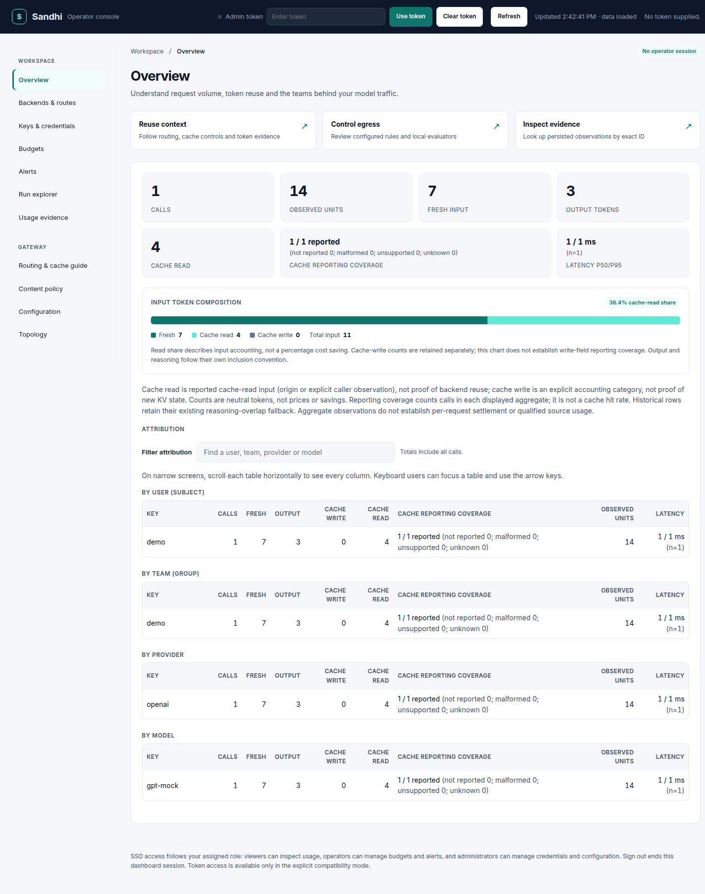
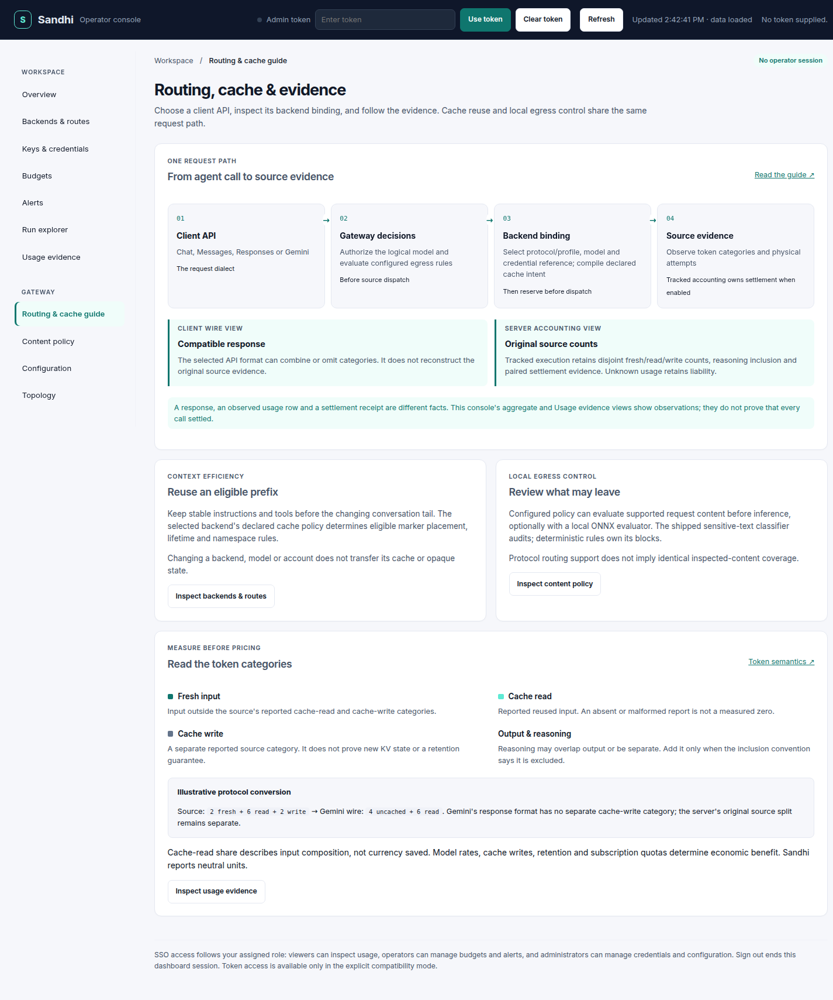
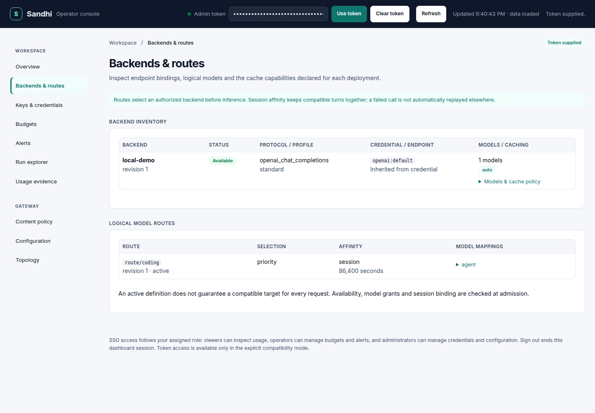
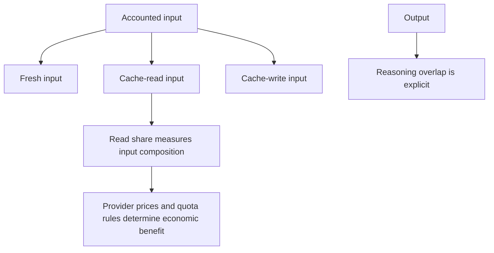

# Operator console

Status: prepared 0.17.0 source candidate; not a published release. Open `/dashboard` on your gateway. The
console uses the gateway's existing APIs and serves local assets; no separate
frontend build or service is required. Production identity and TLS configuration
follow the [identity guide](oidc-sso.md).

*Workspace preview captured with AgentBrowser against a disposable local gateway.
All identities, requests and token counts in this image are synthetic.*

The console is a lightweight navigable application. Its sidebar, browser history
and fragment links select one workspace at a time. Desktop uses a persistent
navigation rail; narrow screens use a scrollable navigation strip. Light/dark
appearance, keyboard navigation and reduced-motion preferences are supported.

| Workspace | Operator task |
| --- | --- |
| Overview | Inspect volume, neutral token categories, cache-read reporting coverage, latency and attribution by subject/group/provider/model. Filter attribution rows without changing aggregate totals. |
| Backends & routes | Inspect backend revisions, endpoint family/profile, declared models/cache capabilities and logical target mappings. Manage definitions through CLI or Configuration. |
| Keys & credentials | Inspect references, mint scoped virtual keys and use supported credential operations. Newly minted secrets have one-time visibility. |
| Budgets | Inspect scope limits, spent/remaining units and configure supported budget windows/policies. |
| Alerts | Inspect rules and acknowledge supported notifications. |
| Run explorer | Look up one exact run ID and compare each step's own/subtree neutral usage. |
| Usage evidence | Query bounded persisted rows by exact request, session or run ID; inspect fresh/read/write/output counts and evidence limits. |
| Content policy | Inspect configured policy and decision receipts. |
| Configuration | Preview and apply additive provider/backend/route/key/budget intent with component-level results. |
| Topology | Inspect the configured gateway topology snapshot, when available. |
| Routing & cache guide | Follow the request path, distinguish client dialect from backend profile, and interpret source/wire usage and settlement boundaries. |

For example, `/dashboard#routing-section` opens routing inventory and
`/dashboard#evidence-section` opens usage evidence. `/dashboard#flow-section`
opens the matching [cache/token guide](../product/cache-aware-routing.md) inside
the console. Overview shortcuts and guide actions use the same navigation/history
and move keyboard focus to the selected heading. A fragment carries navigation
only. Do not put credentials in the URL.

*The guide connects backend inventory, local egress policy and usage evidence.
The numerical conversion is illustrative; this screenshot contains no admin credential.*

*The routing workspace separates protocol/profile and credential reference from
logical model mappings. This synthetic inventory is not live-provider evidence.*

## Interpret token reuse accurately

The overview draws input composition only when all calls in the aggregate have
qualified cache-read reporting and safe, conserving counts. Missing or malformed
measurements remain visible as unavailable coverage; they are not converted into
zero hits. Cache-write totals do not yet carry an independent write-coverage
measurement. Reasoning may be included in output or separate, as recorded.
Read share is not a percentage cost saving, and latency does not prove cache reuse.
See the [visual cache/token guide](../product/cache-aware-routing.md) for marker
placement and the retained live example.

The **Observed units** summary and Run usage tree show normalized usage totals.
Recorded reasoning overlap takes precedence; historical rows without that flag
retain the existing magnitude fallback. Aggregates are not qualified-source proof,
prices, frozen weighted charges or proof that all calls settled. Compatible client wire
formats can combine source categories: Gemini has no separate cache-write field.
Tracked settlement retains the original source split independently of that client
view. The guide labels its numerical protocol example as illustrative.

The Usage evidence view queries at most 100 rows per request and paginates its
display. It preserves exact identifiers, including meaningful surrounding spaces,
and rejects control characters or more than 256 UTF-8 bytes. It shows the API's
truncation and unavailable-evidence notices. These are best-effort persisted
logical-call observations: active traffic may have no row, request IDs need not be
unique, and physical-dispatch provenance is not yet provided by this API. An empty
result is not proof that no traffic occurred. A failed new lookup does not display
the previous identifier's rows as if they answered the new query.

## Access and freshness

SSO follows server-issued permissions: viewers inspect ordinary inventory,
operators manage permitted budgets/alerts, and administrators manage credentials
and configuration. Usage evidence requires **diagnostics** permission. A viewer
needs an explicit `allow_diagnostics` grant; ordinary read access is insufficient.
Administrators already have diagnostics permission. Every API request remains
authorized by the server, including CSRF checks for cookie-authorized mutations
and diagnostic POSTs.

Explicit token compatibility mode presents an Admin token field. The submitted
token stays in memory and is sent only to the same gateway. Editing/clearing it,
signing out or expiring the SSO session cancels reads and removes protected data
and one-time secrets. Reload does not recover a token from browser storage.
An unverified supplied token is not described as a verified administrator role.

Refresh reloads inventory and reports unavailable or stale panels. A failed
refresh may retain clearly labeled prior data; it does not turn a failed read into
an empty successful table. Backend inventory describes persisted configuration
and current reconstruction readiness. An active route does not guarantee that
every request is compatible or that a provider cache hit will occur.

Browser tests exercise real disposable gateway/store APIs, SSO roles and
diagnostics grants, stale replies, authentication changes, hostile metadata,
navigation/history, filters, mobile layout and supported management workflows.
AgentBrowser visual review used a disposable gateway with synthetic data. That
review is distinct from live provider and production usability qualification.
