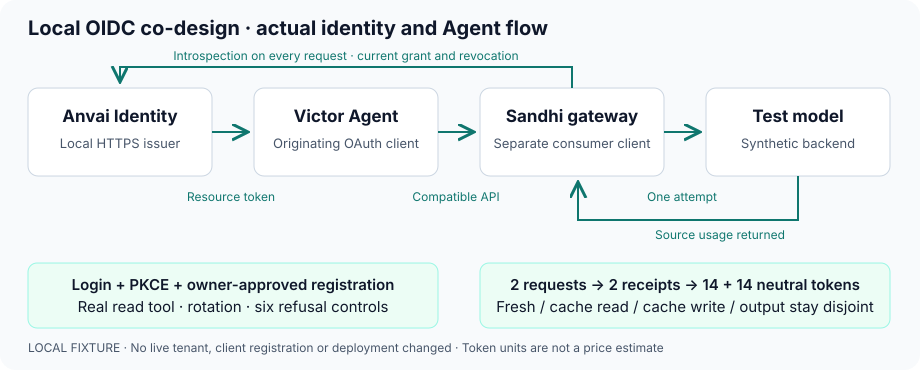
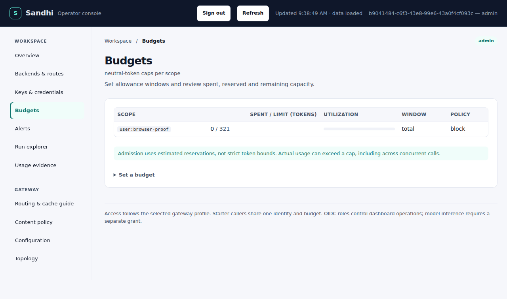

# Optional authentication and local Anvai Identity integration

**Sandhi 0.18 release candidate.** The new starter has no client authentication.
Token and OIDC profiles are optional. Published 0.17.1 retains its earlier startup
behavior and does not include the resource-audience override described here.

## Choose an access mode

| Profile | Configuration | Client experience | Accounting identity |
| --- | --- | --- | --- |
| Starter — default | No auth mode or OIDC configuration | No key or login prompt; default listener is `127.0.0.1:8787` | One shared starter identity and budget |
| Tokens | `SANDHI_AUTH_MODE=tokens` | Scoped virtual key; optional separate operator token | Server-bound virtual-key subject/group |
| OIDC | `SANDHI_AUTH_MODE=oidc` and `SANDHI_OIDC_CONFIG` | Browser SSO or short-lived resource access token | Verified issuer/subject and configured grant |

- An OIDC configuration supplied without a mode is an explicit OIDC opt-in.
- Invalid configured authentication stops startup; it never selects a weaker profile.
- A starter can set `SANDHI_ADMIN_TOKEN` to protect operator actions while leaving inference unauthenticated.
- All profiles retain the original durable ledger, both budget legs, cache rules and source accounting.
- Starter callers share one trust realm. This is not per-user or tenant isolation. An explicit non-loopback bind makes that access available on the selected network.

For a local starter, use `scripts/quickstart.sh`. Provider credentials and model
configuration are separate from client authentication.

## Dependency order for the public development integration

The public development issuer is `https://id.anvaiops.dev`. Public accessibility
requires the same authentication, TLS and authorization checks as other shared
deployments. The credential-free starter is for the separate local demonstration.

| Gate | Required evidence before proceeding |
| --- | --- |
| Identity source | Reviewed discovery, introspection, resource grants and revocation; local acceptance |
| Development deployment | Exact artifact/configuration provenance, private backup and verified upgrade; valid HTTPS and matching issuer |
| Client registration | Separate Victor origin and Sandhi consumer; exact callbacks, audience and consumer ACL |
| Sandhi | Startup discovery, browser roles, agent grants, expiry/revocation refusals and durable usage joins |
| Victor | Actual login/token lifecycle and successful Agent/tool loop through the qualified gateway |
| Release | Sandhi artifacts verified first; Victor adopts that published SDK before its release |

- Require an authenticated Sandhi profile on the public test route; restrict direct model access independently.
- Keep signing keys, client secrets, token files and backups private. Capture only redacted test evidence.
- Preserve the intended tenant, existing accounts and recovery access; do not substitute another issuer.
- A missing capability blocks the next gate. Never guess an introspection URL or downgrade authentication.

## Local co-design: Victor, Sandhi and AnvaiOps development IDM



| Component | Responsibility |
| --- | --- |
| Anvai Identity | HTTPS login, consent, PKCE, issuance receipts, resource grants and live revocation |
| Victor | Originating OAuth client; private token-file credential; real Agent/tool execution |
| Sandhi | Separate introspection consumer; resource-audience and subject/grant checks; durable accounting |
| Model backend | Synthetic loopback model for repeatable protocol and usage assertions |

### Verified local contract

| Check | Evidence |
| --- | --- |
| Operator setup | Supported owner review → passkey approval → apply; resource and consumer ACLs |
| Positive flow | Real HTTPS login/PKCE, two actual Agent requests and a successful read-tool result |
| Credential lifecycle | Rotation between requests; introspection and revocation checks |
| Receipt provenance | Actual wire bearer hashes and returned request IDs joined to IDM issuance receipts and Sandhi's original ledger |
| Refusals | UserInfo token, ID token, wrong resource, private-file expiry, signed-token expiry and logout |
| Scope | Disposable local state and synthetic provider; not a live-service deployment |

### Browser SSO and role enforcement



*Actual local browser capture after verified HTTPS login and a successful budget
write. The account and budget are synthetic. This is a working local integration,
not a screenshot from the public development tenant.*

| Local browser profile | Read budget | Write budget | Read configuration | Cookie-only inference |
| --- | --- | --- | --- | --- |
| Admin | 200 | 200 | 200 | 401 |
| Operator | 200 | 200 | 403 | 401 |
| Viewer | 200 | 403 | 403 | 401 |
| Unassigned subject | No dashboard session | Denied | Denied | No inference grant |

The run verified actual PKCE/callback processing, Secure/HttpOnly/host-only
cookies, exact-origin/CSRF refusals, mixed-credential refusal, logout and rejection
of the captured session cookie after logout. TLS verification stayed enabled.
Its optimized IDM artifact matches the development upgrade candidate; the Sandhi
artifact includes the reviewed starter browser-origin correction.

Run the paired browser fixture from its reviewed Anvai Identity checkout:

```sh
IDM_TEST_BINARY=/path/to/qualified/idm \
SANDHI_OIDC_TEST_BINARY=/path/to/qualified/sandhi-proxy \
IDM_SANDHI_BROWSER_PROOF=/private/new-browser-proof \
python tests/integration_sandhi_operator_browser.py
```

### Agent tool-loop accounting

| Neutral units | Request 1 | Request 2 |
| --- | ---: | ---: |
| Physical model attempts | 1 | 1 |
| Fresh input | 2 | 2 |
| Cache read | 6 | 6 |
| Cache creation | 2 | 2 |
| Output | 4 | 4 |
| Paired settled total | **14** | **14** |

The total is **28 token units**. Cache categories are already included; do not add
them again or interpret this fixture as a price, savings or cache-hit guarantee.

### Reproduce the integration

Use the paired Anvai Identity integration fixture, its built binary, Docker and
the documented fixture prerequisites. The driver allocates local ports and private
state; it does not adopt an existing database or modify system DNS.

```sh
IDM_GATEWAY_FIXTURE=/path/to/anvai-identity/tests/integration_gateway_introspection.py \
IDM_TEST_BINARY=/path/to/qualified/idm \
SANDHI_OIDC_TEST_BINARY=/path/to/qualified/sandhi-proxy \
VICTOR_IDM_EVIDENCE_FILE=/private/local-identity-evidence.json \
python -m pytest tests/integration/providers/test_sandhi_idm_gateway_session.py -q --no-cov
```

Run this from the coordinated Victor checkout with its qualified Sandhi SDK.
The fixture uses its own CA and hostname mapping; HTTPS verification remains on.
See the [progress ledger](../reviews/post-0.17.0-pr-train.md#three-project-identity-co-design)
for source, published-artifact, CI and deployment status. Earlier SDK 0.17.0
snapshots are historical; subsequent local runs used the official 0.17.1 SDK with
the Sandhi 0.18 source candidate and the patched, remote-aligned IDM candidate.

## OAuth client identity and access-token resource audience

| Identity | Meaning |
| --- | --- |
| Victor origin client | Requests the resource token; may appear as `client_id` in introspection |
| Sandhi consumer `client_id` | Authenticates Sandhi's introspection request; remains the browser ID-token audience |
| `access_token_audience` | Exact resource identifier intended for Sandhi; defaults to consumer `client_id` only when omitted |
| Verified subject | Stable `sub` under the configured issuer; not an email, display name or caller header |

Keep origin and consumer registrations separate. ID tokens and dashboard cookies
cannot substitute for agent resource tokens. Audience strings are compared exactly;
blank values, wildcards, whitespace and control characters are rejected.

## Configure Sandhi

1. Register the origin client, the confidential Sandhi consumer, the resource audience and consumer ACL in Anvai Identity using the owner review/passkey/apply path.
2. Use the generated client IDs and verified subject. Keep the consumer secret in a private environment source.
3. Create private `oidc.json`; configure listener TLS and use the registered HTTPS callback.

```json
{
  "issuer": "https://id.localhost:9443",
  "client_id": "GENERATED_SANDHI_CONSUMER_ID",
  "client_secret_env": "SANDHI_OIDC_CLIENT_SECRET",
  "access_token_audience": "https://sandhi.local/resource",
  "redirect_url": "https://gateway.localhost:8787/auth/callback",
  "ca_file": "/private/local-idm-ca.pem",
  "scopes": ["profile"],
  "subjects": {
    "VERIFIED_SUBJECT": {
      "role": "admin",
      "grants": {
        "coding": {"upstream": "route/default", "models": ["coding"]}
      }
    }
  }
}
```

These ports and registration values are illustrative; the automated fixture
allocates its own. Match the callback, CA, client IDs and route/model to the actual
local registration. The JSON is not a configuration for the public development host.

```sh
SANDHI_AUTH_MODE=oidc \
SANDHI_OIDC_CONFIG=/private/oidc.json \
SANDHI_CONFIG=/private/listener-and-routes.json \
SANDHI_STORE=/private/original-usage.db sandhi-proxy
```

Provider credentials remain in the configured vault or provider environment. OIDC
setup does not provision them or move existing spend to a new database.

## Choose a compatible OIDC provider

| Required contract | Sandhi checks |
| --- | --- |
| HTTPS discovery and JWKS | Exact issuer; trusted CA and hostname; no guessed endpoints |
| Code flow | `code`, S256 PKCE, supported token authentication and RS256/ES256 signing |
| Introspection metadata | Advertised endpoint **and** advertised authentication methods; `none` or `client_secret_basic` |
| Access-token result | Active, exact issuer, intended audience, subject, bearer type, future expiry and valid `nbf` when present |
| Confidential consumer | Configured secret plus advertised Basic introspection support |

Token-endpoint authentication methods do not stand in for introspection methods.
A signed JWT still goes through Sandhi's configured introspection path. The local
Anvai Identity fixture exercises this contract; another provider needs its own
qualification. References: [OIDC Discovery](https://openid.net/specs/openid-connect-discovery-1_0.html)
and [token introspection](https://www.rfc-editor.org/rfc/rfc7662.html).

## Roles and agent access

These roles apply to the OIDC profile. Starter access has a shared operator context,
not an authenticated OIDC role.

| Role | Permission |
| --- | --- |
| `viewer` | Usage, run queries and masked metadata |
| `operator` | Viewer reads plus budgets and alerts |
| `admin` | Credentials, keys, configuration and diagnostics |
| Dedicated agent grant | Explicit upstream/models, attribution and budget policy; independent of dashboard role |

### Onboard a human dashboard user

1. Admit the verified subject to the dedicated application in Anvai Identity.
2. Add its subject binding in private `SANDHI_OIDC_CONFIG`, preserving existing administrators and grants.
3. Restart through the service manager with the original ledger; existing browser sessions expire.
4. Sign in through `/dashboard`; verify one allowed read and one forbidden action for that role.

Example subject entry: `"VERIFIED_SUBJECT": {"role": "viewer"}`.
It is an object entry, not a replacement configuration file. Bindings are
deployment-wide; they do not create tenant isolation or model-inference grants.

### Change roles and recover access

| Operation | Supported path |
| --- | --- |
| Change role/grant | Update the private subject binding and restart; no dashboard role editor |
| Diagnostics automation | Explicit `allow_diagnostics: true`; bounded reads, no budget or credential writes |
| Browser mutation | Verified session, exact Origin and CSRF proof |
| Agent request | Short-lived access token; per-request introspection; never an ID token or browser cookie |
| Login failure | Check issuer, subject, assignment and grant; do not downgrade authentication or replay an old authorization URL |

Browser sessions use Secure, HttpOnly, SameSite=Lax cookies. Logout ends the Sandhi
session, not other applications' sessions. Keep credentials, cookies and complete
authorization URLs out of screenshots, logs and support reports.

## Live development service

HTTPS checks on **2026-11-13 UTC**, after the reviewed development upgrade,
qualified the actual Sandhi and broker client profiles below. Public transport,
client registration and successful login remain separate facts.

| `https://id.anvaiops.dev` discovery | Observed |
| --- | --- |
| Issuer | Exact `https://id.anvaiops.dev` |
| Authorization / token / JWKS | Advertised and public JWKS reachable |
| Code flow / PKCE / signing | `code` / `S256` / `RS256` |
| Token authentication | `none`, `client_secret_basic` |
| Introspection endpoint | Advertised `https://id.anvaiops.dev/oauth2/introspect` |
| Introspection authentication | Advertised `client_secret_basic` |
| Actual Sandhi/broker introspection transport | Their declared client user agents receive **401 / no-store** for anonymous and invalid-Basic requests on both development issuers |
| Actual Sandhi startup | Public discovery/JWKS with normal TLS trust passed; mode remains OIDC, with no starter access |
| Unregistered consumer control | Missing bearer returns **401**; a synthetic, unregistered Basic consumer returns **503**, without model dispatch |
| Generic Python user-agent probe | Edge **403**; this does not describe the tested clients' transport |
| Sandhi/Victor live client integration | **Not qualified**; dedicated registrations and end-to-end acceptance remain open |

The previous schema-67 deployment lacked introspection discovery. The reviewed
schema-70 upgrade now advertises it, preserving existing issuer configuration,
key custody and identity/admission rows. Its private backup remains on the host.
The actual clients already identify themselves as `sandhi-oidc/0.18.0` and
`anvai-gateway-pkce-example/1`; no browser impersonation or edge-policy change
was used. The broker also validated public discovery, S256 and its advertised
resource grant. No real owner/client credentials were used in these public
checks. Successful real-account login still needs the supported owner/passkey
registration ceremony; the local integration above does not establish it.
[Inspect public discovery](https://id.anvaiops.dev/.well-known/openid-configuration)
before any future rollout.

## Migrate and verify

### Optional gateway and authentication are separate choices

| Request route | Profile | Sandhi enforcement |
| --- | --- | --- |
| Through Sandhi | Starter, token or OIDC | Durable metering, budgets and cache policy remain active |
| Direct to provider | Provider's configured authentication | Sandhi cannot account for or enforce these calls |

A failed gateway/OIDC request never authorizes direct-provider fallback or a retry
with weaker credentials. Upstream provider authentication remains independent.

### Deployment sequence

1. Preserve the binary, private configuration, provider credentials and complete original SQLite store.
2. Choose the profile explicitly for managed deployments; test on an isolated listener with private local state first.
3. Verify readiness, identity/role where configured, one real Agent request and the joined source/usage receipt.
4. Test denial, expiry, cancellation and restart before replacing the existing writer.

Pending logins and browser sessions are bounded and process-local; restart removes
them. Distributed sessions, refresh tokens, backchannel logout and automatic IdP
role synchronization are outside the current implementation.
