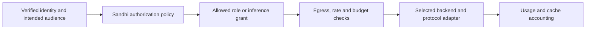
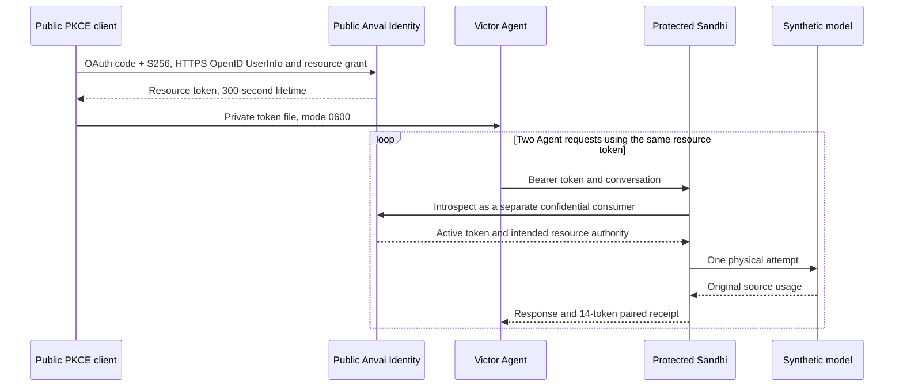

# Optional authentication and Anvai Identity integration

**Sandhi 0.18 release candidate.** The new starter has no client authentication.
Token and OIDC profiles are optional. Published 0.17.1 retains its earlier startup
behavior and does not include the resource-audience override described here.

!!! success "Verified native Agent access through Sandhi's optional OIDC profile"
    OAuth code/S256, authoritative HTTPS OpenID UserInfo and resource-token
    access supported a real Victor read-tool loop through the protected gateway. See the
    [28-token accounting and scope](#public-development-issuer-verified-agent-flow).
    Separate browser checks cover local roles and an actual HTTPS admin session below.

## Choose an access mode

| Profile | Configuration | Client experience | Accounting identity |
| --- | --- | --- | --- |
| Starter — default | No auth mode or OIDC configuration | No key or login prompt; default listener is `127.0.0.1:8787` | One shared starter identity and budget |
| Tokens | `SANDHI_AUTH_MODE=tokens` | Scoped virtual key; optional separate operator token | Server-bound virtual-key subject/group |
| OIDC | `SANDHI_AUTH_MODE=oidc` and `SANDHI_OIDC_CONFIG` | Browser SSO or short-lived resource access token | Verified issuer/subject and configured grant |

- An OIDC configuration supplied without a mode is an explicit OIDC opt-in.
- Invalid configured authentication stops startup; it never selects a weaker profile.
- A starter can set `SANDHI_ADMIN_TOKEN` to protect operator actions while leaving inference unauthenticated.
- All profiles retain the original durable ledger, both budget legs, cache rules and source accounting.
- Starter callers share one trust realm. This is not per-user or tenant isolation. An explicit non-loopback bind makes that access available on the selected network.

### Listener transport

| Credential surface | Standalone listener requirement |
| --- | --- |
| Credential-free starter | Local HTTP remains available |
| Tokens or OIDC | Listener TLS; plaintext companions refused by default |
| Starter with an admin token or client-credentials registry | Same TLS requirement |
| Deliberate local test or same-host TLS termination | `SANDHI_ALLOW_LOOPBACK_HTTP=1`; every plaintext socket must be literal IP loopback |

Configure listener TLS in `SANDHI_CONFIG`:

```json
{
  "tls": {
    "cert": "/etc/sandhi/tls/server-chain.pem",
    "key": "/etc/sandhi/tls/server.key"
  }
}
```

Use a certificate whose names cover the client-facing hostname. Keep its private
key readable only by the service. Clients must trust the issuing CA. The loopback exception accepts only `1`; unset or `0` keeps enforcement,
and all other values fail startup. It never admits wildcard, LAN or IPv4-mapped
IPv6 sockets. Forwarding headers do not establish TLS. A local terminator must
provide HTTPS and prevent untrusted access to its loopback backend. The standalone
guard runs before OIDC discovery or durable state initialization.

The private `scripts/subscription_service.py` gateway runner accepts an explicit
`"listener_config": "/private/gateway.json"` in `service.json` to supply that TLS
configuration. Its configured `gateway` URL must use the corresponding HTTPS
address. It does not inherit a plaintext exception or enable one automatically.

In-process provider FFI has no listener. Programmatic `serve*` callers own transport
selection and must use TLS or their own protected local termination boundary;
these APIs do not read the standalone exception variable.

For a local starter, use `scripts/quickstart.sh`. Provider credentials and model
configuration are separate from client authentication.

## Shared identity, service-owned policy

OIDC authenticates the user. OAuth access tokens identify the intended service
and delegated scope. Sandhi applies its own authorization policy to each request.

| Decision | Owner | Why |
| --- | --- | --- |
| Login, stable identity and token/session status | Identity provider | One identity can be used across applications |
| Intended audience and delegated scope | Authorization server, checked by Sandhi | A token for another service must not authorize Sandhi |
| Dashboard role and inference permission | Sandhi | Signing in does not grant administrative or model access |
| Models, providers, routing and egress | Sandhi policy | These decisions depend on the application's configuration and request |
| Budgets, rates, cache boundaries and accounting | Sandhi | Enforcement must remain consistent across credentials and token rotation |

The dashboard and API share the configured identity provider and subject bindings.
Browser sessions use secure cookies; agents use resource access tokens. These
credentials are not interchangeable. A coarse scope such as `gateway.access`
does not replace Sandhi's model allowlist, routing or budget checks.
OpenAI, Anthropic, Gemini and Responses are request formats, not permission
levels; the same service policy applies across supported formats.



## Qualify the integration

| Stage | Verify before proceeding |
| --- | --- |
| Identity provider | Discovery, signing keys, supported authentication and introspection |
| Registration | Exact HTTPS callback, client identities, resource audience and admission |
| Gateway | TLS, role/grant enforcement, expiry and revocation refusals |
| Client | A successful tool loop with request and usage correlation |
| Rollout | Certificate renewal, restart behavior and the installed artifact version |

Use an isolated listener and private test state. Keep signing keys, client
secrets, token files and detailed operational evidence outside public documentation.
Never guess an introspection endpoint or select weaker authentication after failure.

<a id="public-development-issuer-verified-agent-flow"></a>

## Verified Agent integration

A recorded Anvai Identity integration used a real development issuer, a protected
local gateway and a synthetic model backend. It demonstrates the identity and
accounting contract; it is not a hosted-service setup recipe.



| Verified boundary | Observed result |
| --- | --- |
| Registration | Genuine owner/passkey approval; public native Victor origin and a distinct confidential Sandhi introspection consumer |
| Identity | Public OAuth code/S256 PKCE and authoritative HTTPS OpenID UserInfo; subject matched the owner-authorized registration |
| Resource | Custom advertised resource-access grant, `online_gateway`, `gateway.access`, 300 seconds; an explicitly registered gateway audience |
| Gateway route | Protected loopback **HTTP** listener; the audience URI is a resource identifier |
| Client credential | One resource token in a private `0600` file, reused for both calls |
| Agent | Real Victor read tool returned content matching the owned test file |
| Provenance | Request identities, durable usage records and issuer receipts matched |

| Synthetic source units | Request 1 | Request 2 | Total |
| --- | ---: | ---: | ---: |
| Physical model attempts | 1 | 1 | **2** |
| Fresh input tokens | 2 | 2 | 4 |
| Cache-read tokens | 6 | 6 | 12 |
| Cache-creation tokens | 2 | 2 | 4 |
| Output tokens | 4 | 4 | 8 |
| Paired settled tokens | **14** | **14** | **28** |

The cache categories are included in each 14-token total. Synthetic counts test
accounting conservation; provider cache reuse, pricing and savings were not measured.

| Acceptance scope | Boundary |
| --- | --- |
| Qualified stack | Reviewed Victor source, official published SDK **0.17.1**, and Sandhi **0.18 source candidate** |
| Sandhi authority | Disposable local administrator binding and a fixture-only inference grant were explicit; `gateway.access` conferred no dashboard or AnvaiOps role |
| Live coverage | Two successful requests; no additional live expiry, ACL-removal or revocation controls were performed |
| Separate local evidence | Browser SSO/roles and lifecycle refusals below retain their own fixture provenance |
| Not exercised in this recorded Agent run | Automatic renewal, deployed browser SSO and paid-provider traffic; separate browser coverage is described below |

The recorded run used an explicitly isolated loopback transport. Authenticated
network listeners require the TLS configuration described above. The acceptance
summary is in the [release verification record](../reviews/post-0.17.0-pr-train.md#public-issuer-agent-acceptance).

<a id="local-co-design-victor-sandhi-and-anvaiops-development-idm"></a>

## Integration example: Anvai Identity and Victor


| Component | Responsibility |
| --- | --- |
| Anvai Identity | HTTPS login, consent, PKCE, issuance receipts, resource grants and live revocation |
| Victor | Originating OAuth client; private token-file credential; real Agent/tool execution |
| Sandhi | Separate introspection consumer; resource-audience and subject/grant checks; durable accounting |
| Model backend | Synthetic loopback model for repeatable protocol and usage assertions |

### Verified local contract

| Check | Evidence |
| --- | --- |
| Operator setup | Supported owner review → passkey approval → apply; resource and consumer ACLs |
| Positive flow | Real HTTPS login/PKCE, two actual Agent requests and a successful read-tool result |
| Credential lifecycle | Rotation between requests; introspection and revocation checks |
| Receipt provenance | Actual wire bearer hashes and returned request IDs joined to IDM issuance receipts and Sandhi's original ledger |
| Refusals | UserInfo token, ID token, wrong resource, private-file expiry, signed-token expiry and logout |
| Scope | Disposable local state and synthetic provider; not a live-service deployment |

### Browser SSO and role enforcement

The role matrix below is local-fixture coverage. A separate deployed admin session
also passed HTTPS login, CSRF enforcement and logout checks.


*Actual OIDC admin session showing a test neutral-token budget; identity redacted.
No inference usage is shown.*

| Local browser profile | Read budget | Write budget | Read configuration | Cookie-only inference |
| --- | --- | --- | --- | --- |
| Admin | 200 | 200 | 200 | 401 |
| Operator | 200 | 200 | 403 | 401 |
| Viewer | 200 | 403 | 403 | 401 |
| Unassigned subject | No dashboard session | Denied | Denied | No inference grant |

The run verified actual PKCE/callback processing, Secure/HttpOnly/host-only
cookies, exact-origin/CSRF refusals, mixed-credential refusal, logout and rejection
of the captured session cookie after logout. TLS verification stayed enabled.

### Accounting interpretation

The [recorded Agent flow](#public-development-issuer-verified-agent-flow) settled
28 neutral token units across two requests. Cache categories are included in that
total. Synthetic usage verifies accounting conservation, not provider pricing,
cache-hit rates or savings.

### Validate your deployment

1. Sign in through the dashboard and confirm the intended account and role.
2. Check an allowed read and a denied write for that role.
3. Run an agent request with a correctly scoped access token and explicit inference grant.
4. Correlate the returned request identifier with usage and budget records.
5. Test expiry, logout/revocation and restart before relying on unattended operation.

Fixture results do not establish your deployment's admission, roles, token renewal
or provider access. Qualify those against your own issuer and configuration.

## OAuth client identity and access-token resource audience

| Identity | Meaning |
| --- | --- |
| Victor origin client | Requests the resource token; may appear as `client_id` in introspection |
| Sandhi consumer `client_id` | Authenticates Sandhi's introspection request; remains the browser ID-token audience |
| `access_token_audience` | Exact resource identifier intended for Sandhi; defaults to consumer `client_id` only when omitted |
| Verified subject | Stable `sub` under the configured issuer; not an email, display name or caller header |

Keep origin and consumer registrations separate. ID tokens and dashboard cookies
cannot substitute for agent resource tokens. Audience strings are compared exactly;
blank values, wildcards, whitespace and control characters are rejected.

### OIDC-only and delegated keys

OIDC mode does not accept ordinary virtual keys, including keys retained from a
previous token-mode deployment. Authentication failure or identity-provider
unavailability never selects the legacy key store as a fallback.

`allow_delegated_keys` defaults to `false`. Enabling it permits only keys explicitly
delegated from a verified OIDC access token and constrained by a Sandhi inference
grant. It does not reactivate ordinary virtual keys. Short-lived delegation is
bounded by the originating credential; longer-lived subject keys require an
explicit `max_subject_key_ttl_seconds` policy, which defaults to zero.

Delegated keys are a deliberate alternative credential: they are checked against
Sandhi's current grant and key policy rather than introspected with the identity
provider on every use. Keep delegation disabled when each request must depend on
current OIDC authority. Document lifetime and revocation expectations before
allowing longer-lived keys.

## Configure Sandhi

1. Register a confidential Sandhi client with its exact HTTPS dashboard callback. For agent access, register the originating client and the intended resource/consumer permissions using your identity provider's supported administration flow.
2. Use the generated client IDs and verified subject. Keep the consumer secret in private server-side storage.
3. Create private `oidc.json`; configure listener TLS and use the registered HTTPS callback.

```json
{
  "issuer": "https://identity.example.com",
  "client_id": "GENERATED_SANDHI_CONSUMER_ID",
  "client_secret_env": "SANDHI_OIDC_CLIENT_SECRET",
  "access_token_audience": "https://sandhi.example.com/resource",
  "redirect_url": "https://sandhi.example.com/auth/callback",
  "scopes": ["profile"],
  "allow_delegated_keys": false,
  "max_subject_key_ttl_seconds": 0,
  "subjects": {
    "VERIFIED_SUBJECT": {
      "role": "admin",
      "grants": {
        "coding": {"upstream": "route/default", "models": ["coding"]}
      }
    }
  }
}
```

These registration and route values are examples. Replace them with your verified
issuer, client, callback, subject and model configuration. Set `ca_file` only when
the identity provider requires a custom CA. Listener certificates and client trust
for the gateway are separate settings.

```sh
SANDHI_AUTH_MODE=oidc \
SANDHI_PUBLIC_URL=https://sandhi.example.com \
SANDHI_OIDC_CONFIG=/private/oidc.json \
SANDHI_CONFIG=/private/listener-and-routes.json \
SANDHI_STORE=/private/original-usage.db sandhi-proxy
```

Set `SANDHI_PUBLIC_URL` to the externally visible HTTPS origin and register its
`/auth/callback` exactly. Configure the appropriate listener bind and, when used,
the trusted reverse proxy; the public origin may differ from the local bind.
See the [proxy guide](proxy-guide.adoc) for listener configuration.

Provider credentials remain in the gateway's configured server-side credential source. OIDC
setup does not provision them or move existing spend to a new database.

## Choose a compatible OIDC provider

| Required contract | Sandhi checks |
| --- | --- |
| HTTPS discovery and JWKS | Exact issuer; trusted CA and hostname; no guessed endpoints |
| Code flow | `code`, S256 PKCE, supported token authentication and RS256/ES256 signing |
| Introspection metadata | Advertised endpoint **and** advertised authentication methods; `none` or `client_secret_basic` |
| Access-token result | Active, exact issuer, intended audience, subject, bearer type, future expiry and valid `nbf` when present |
| Confidential consumer | Configured secret plus advertised Basic introspection support |

Token-endpoint authentication methods do not stand in for introspection methods.
A signed JWT still goes through Sandhi's configured introspection path. The local
Anvai Identity fixture exercises this contract; another provider needs its own
qualification. References: [OIDC Discovery](https://openid.net/specs/openid-connect-discovery-1_0.html)
and [token introspection](https://www.rfc-editor.org/rfc/rfc7662.html).

## Roles and agent access

These roles apply to the OIDC profile. Starter access has a shared operator context,
not an authenticated OIDC role.

| Role | Permission |
| --- | --- |
| `viewer` | Usage, run queries and masked metadata |
| `operator` | Viewer reads plus budgets and alerts |
| `admin` | Operator permissions plus credentials, keys, configuration and diagnostics |
| Dedicated agent grant | Explicit upstream/models, attribution and budget policy; independent of dashboard role |

### Onboard a human dashboard user

1. Admit the verified subject to the dedicated application in your identity provider.
2. Add its subject binding in private `SANDHI_OIDC_CONFIG`, preserving existing administrators and grants.
3. Restart through the service manager with the original ledger; existing browser sessions expire.
4. Sign in through `/dashboard`; verify one allowed read and one forbidden action for that role.

Example subject entry: `"VERIFIED_SUBJECT": {"role": "viewer"}`.
It is an object entry, not a replacement configuration file. Bindings are
deployment-wide; they do not create tenant isolation or model-inference grants.

### Change roles and recover access

| Operation | Supported path |
| --- | --- |
| Change role/grant | Update the private subject binding and restart; no dashboard role editor |
| Diagnostics automation | Explicit `allow_diagnostics: true`; bounded reads, no budget or credential writes |
| Browser mutation | Verified session, exact Origin and CSRF proof |
| Agent request | Short-lived access token; per-request introspection; never an ID token or browser cookie |
| Login failure | Check issuer, subject, assignment and grant; do not downgrade authentication or replay an old authorization URL |

Browser sessions use Secure, HttpOnly, SameSite=Lax cookies. Logout ends the Sandhi
session, not other applications' sessions. Keep credentials, cookies and complete
authorization URLs out of screenshots, logs and support reports.

## Call the inference API

Obtain a short-lived access token for Sandhi using your identity provider's
supported client flow. Send it in the authorization header; do not use a browser
cookie, ID token or upstream provider key as a substitute.

```sh
curl --fail-with-body https://sandhi.example.com/v1/chat/completions \
  -H "Authorization: Bearer ${SANDHI_ACCESS_TOKEN:?Set a valid Sandhi access token}" \
  -H 'Content-Type: application/json' \
  --data '{"model":"coding","messages":[{"role":"user","content":"Explain this function."}]}'
```

The model must be allowed by the subject's Sandhi inference grant. If more than
one grant is configured, select an allowed grant with `x-sandhi-grant`; a single
grant needs no selector. An expired or rejected credential must trigger the
client's supported reauthentication path, not a direct-provider fallback.

For a private CA, configure the actual client's trusted CA bundle and verify the
hostname. Trust the issuer and gateway independently. Never disable certificate
verification to make a request succeed.

## Identity-provider qualification

Qualification applies to the specific issuer and client registration. Recheck
discovery and supported authentication methods when configuring a deployment;
do not copy another installation's endpoints or credentials.

The Anvai Identity example qualified the advertised code/PKCE, UserInfo,
resource-token and introspection paths. Other providers need equivalent checks.
Browser SSO acceptance and agent-resource acceptance are separate tests: passing
one does not establish the other's permissions or lifecycle behavior.

## Migrate and verify

### Optional gateway and authentication are separate choices

| Request route | Profile | Sandhi enforcement |
| --- | --- | --- |
| Through Sandhi | Starter, token or OIDC | Durable metering, budgets and cache policy remain active |
| Direct to provider | Provider's configured authentication | Sandhi cannot account for or enforce these calls |

A failed gateway/OIDC request never authorizes direct-provider fallback or a retry
with weaker credentials. Upstream provider authentication remains independent. Use TLS for each
credential-bearing network hop, including remote provider connections.

### Deployment sequence

1. Preserve the binary, private configuration, provider credentials and complete original SQLite store.
2. Choose the profile explicitly for managed deployments; test on an isolated listener with private local state first.
3. Verify readiness, identity/role where configured, one real Agent request and the joined source/usage receipt.
4. Test denial, expiry, cancellation and restart before replacing the existing writer.

Pending logins and browser sessions are bounded and process-local; restart removes
them. Sandhi does not refresh browser sessions or synchronize IdP roles automatically.
An agent credential publisher owns access-token renewal under the identity
provider's policy; Sandhi continues validating every request. Token renewal must
not bypass expiry, revocation or service-owned authorization.
