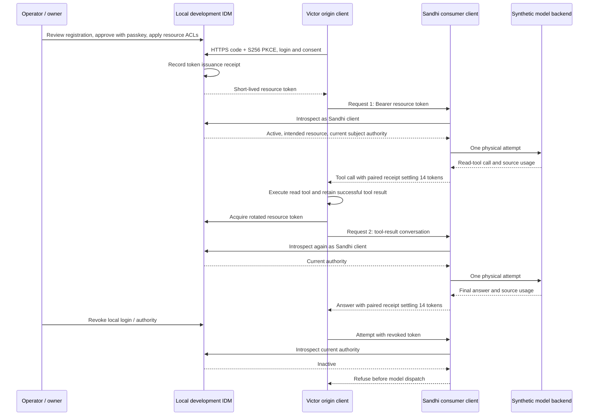

# OIDC provider setup, SSO and migration

The standalone `sandhi-proxy` defaults to `SANDHI_AUTH_MODE=oidc`. It refuses to start
without valid OIDC configuration and verified HTTPS discovery. `--help` and `--version`
work without service configuration. Embedded `ProxyState::new` retains its existing
behavior; embedders opt into OIDC explicitly.

## OAuth client identity and access-token resource audience

The post-release audience candidate adds optional `access_token_audience` to
`oidc.json`. Omit it to preserve the existing behavior: introspected access tokens
must target `client_id`. When configured, it is the exact intended Sandhi resource
audience, for example `https://sandhi.example.com/resource`. Values must be 1–512
UTF-8 bytes with no whitespace, controls or `*`; explicit null is rejected. Sandhi
does not trim, normalize, fetch or interpret wildcards in this value.

`client_id` still identifies Sandhi's OAuth application for browser ID-token
verification, authorization/code exchange and introspection client authentication.
An ID token addressed to the resource audience does not become a valid browser
login. An access token addressed only to the browser client does not qualify when
a different resource audience is configured. Audience arrays must contain only
strings and include the exact selected access-token audience.

For confidential introspection, Sandhi sends its own `client_id` in both the form
and HTTP Basic authentication, with `token` and `token_type_hint=access_token`.
The introspection response's `client_id` can identify the originating Victor
client; it is not Sandhi's consuming client identity or an authorization grant.
The issuer must authenticate access-token purpose and current authority before
reporting `active: true`. A signed JWT or matching audience alone is insufficient.
All issuer, subject, expiry, token-type, group and explicit Sandhi grant checks
remain required. Do not forward a Victor-service audience token to Sandhi.

Victor's existing private token-file credential pins the same issuer, resource
audience and subject and reloads the broker result for each request. Its metadata
does not verify the token: Sandhi still introspects it. This candidate does not
implement a Victor login/refresh broker, migrate any issuer or qualify a live IDM
deployment. See [the audience decision](../adr/0045-access-token-resource-audience.md).

## Choose a compatible OIDC provider

Sandhi uses OIDC and OAuth contracts, not a required identity product. Kanidm is
one example below. Register Sandhi as its own application with your provider;
provider discovery alone does not establish that its access tokens are compatible.

| Setting or contract | Required Sandhi behavior |
| --- | --- |
| Issuer | An exact HTTPS issuer, including any tenant/client path. Discovery's `issuer` must match `oidc.json`; a hostname, discovery URL and issuer are different values. |
| Discovery | Sandhi appends `/.well-known/openid-configuration` to the issuer after trimming a trailing slash for that request. Configure `issuer`, not the complete discovery URL. |
| Authority endpoints | Discovery must advertise HTTPS `authorization_endpoint`, `token_endpoint`, `jwks_uri` and `introspection_endpoint`, all on the issuer's origin. If group policy uses UserInfo, that endpoint must also be on the issuer origin. |
| Browser application | Authorization-code flow, advertised S256 PKCE, and an exact external HTTPS redirect `https://YOUR_GATEWAY/auth/callback`; no wildcard callback. ES256 and RS256 ID-token signatures are supported. |
| Client registration | Set the assigned `client_id`. A public client needs no application secret; a confidential client names a private environment variable with `client_secret_env`. Never put its secret in the JSON file. |
| Scopes | Sandhi requests `openid` automatically. Request only additional scopes admitted for this application, such as `profile`; requesting a scope does not grant a Sandhi role or inference permission. |
| Audience | The configured `client_id` remains the ID-token audience. Introspected access tokens must target `access_token_audience` when configured, otherwise `client_id`. Tokens intended for another service do not qualify. |
| Introspection | Bearer access tokens are introspected for each request. Discovery must explicitly advertise `introspection_endpoint_auth_methods_supported`; supported methods are `none` and `client_secret_basic`. Token-endpoint methods do not substitute for introspection methods. |
| Introspection result | Require `active: true`, exact `iss`, `aud` equal to or containing the selected access-token audience (only strings are allowed in audience arrays), nonempty `sub`, future `exp`, bearer `token_type`, and a valid `nbf` when present. A signed JWT access token still needs this introspection path. |

For introspection, Sandhi selects `client_secret_basic` when a secret is configured
and the provider advertises it; otherwise it uses an advertised `none`. Missing or
unsupported methods fail startup. This is Sandhi's supported profile, not a claim
that every compliant OIDC provider exposes token introspection. ID-token verification
also checks the signature, issuer, audience, expiry, browser nonce and access-token
hash when supplied.

Get the issuer from your provider's application/tenant registration, then inspect
its public discovery document over verified HTTPS. Verify advertised JWKS and the
contracts above before registering accounts or changing a running gateway. Do not
invent endpoint paths, rewrite discovery metadata or disable TLS verification to
make an unsupported provider appear compatible. See [OIDC Discovery](https://openid.net/specs/openid-connect-discovery-1_0.html),
[OAuth metadata](https://www.rfc-editor.org/rfc/rfc8414.html) and
[token introspection](https://www.rfc-editor.org/rfc/rfc7662.html).

## Configure Sandhi

Create a private `oidc.json`. Subject keys are the verified OIDC `sub` under that
issuer, not display names, email addresses or caller headers. A subject may be an
opaque string rather than a UUID. Replace every example value; the example issuer
below is a placeholder, not a live service:

```json
{
  "issuer": "https://idp.example.com/YOUR_TENANT",
  "client_id": "sandhi",
  "redirect_url": "https://gateway.example.com/auth/callback",
  "scopes": ["profile"],
  "subjects": {
    "VERIFIED_OPERATOR_SUBJECT": {"role": "admin"},
    "VERIFIED_AGENT_SUBJECT": {
      "grants": {
        "local": {
          "upstream": "inferflux:local",
          "models": ["qwen3-coder-30b", "qwen2.5-coder-14b"],
          "group": "multiagent-validation"
        },
        "cloud": {"upstream": "zai:cloud", "models": ["glm-5.3"], "group": "multiagent-validation"}
      }
    }
  }
}
```

For an internal CA add `"ca_file": "/run/identity/public-ca.pem"`. This adds trust for
the IdP without disabling chain or hostname verification. To use a confidential client
add `"client_secret_env": "SANDHI_OIDC_CLIENT_SECRET"`. No secrets belong in committed JSON.

```sh
SANDHI_OIDC_CONFIG=/run/sandhi/oidc.json \
SANDHI_CONFIG=/run/sandhi/config.json \
SANDHI_STORE=/var/lib/sandhi/usage.db sandhi-proxy
```

Configure listener TLS in `SANDHI_CONFIG` (`tls.cert` and `tls.key`) or terminate TLS at
a trusted reverse proxy with a private backend connection. The configured callback must
match the browser's external HTTPS origin. Do not expose a plaintext backend across an
untrusted network. Forward `/auth/*`, `/dashboard*`, and `/admin/*` on the same origin.
OIDC configuration grants access; provider credentials still live in the existing vault
or explicitly configured provider environment. Register credentials through an administrator
session or declarative provider configuration before inference.

## Provider examples

### Kanidm

Use a dedicated client and access groups; do not reuse another application's
registration. For a public client, no application secret is needed:

```sh
kanidm system oauth2 create-public sandhi 'Sandhi Gateway' https://gateway.example.com/dashboard
kanidm system oauth2 add-redirect-url sandhi https://gateway.example.com/auth/callback
kanidm system oauth2 enable-strict-redirect-url sandhi
kanidm group create sandhi_users
kanidm system oauth2 update-scope-map sandhi sandhi_users openid profile
kanidm group add-members sandhi_users YOUR_ACCOUNT
```

Kanidm's issuer is client-specific: `https://IDP/oauth2/openid/sandhi`.
Check that registration's discovery for S256, a supported signing algorithm and
explicit introspection authentication methods. A public Sandhi client requires
advertised `none` introspection authentication; a confidential client can use
`client_secret_basic` with `client_secret_env` in the configuration above. Login-client
authentication and introspection authentication are selected independently.

Use the issuer returned by that client's discovery document, rather than the
placeholder issuer in the generic JSON. A Kanidm account UUID can be obtained with
`kanidm person get YOUR_ACCOUNT -o json`; verify it belongs to the intended issuer.
For the example access group, `kanidm group add-members sandhi_users YOUR_ACCOUNT`
admits that account to this application. Subject-to-role binding in Sandhi is still
separate. Check commands against your installed [Kanidm administration version](https://kanidm.github.io/kanidm/stable/integrations/oauth2.html).

### AnvaiOps development IDM: discovery checked, integration not qualified

A credential-free HTTPS check on **2026-11-13 UTC** returned discovery from
[`https://id.anvaiops.dev/.well-known/openid-configuration`](https://id.anvaiops.dev/.well-known/openid-configuration)
with the exact issuer **`https://id.anvaiops.dev`**. The advertised public JWKS
endpoint also returned successfully. This is the development host, not the
historical Kanidm issuer recorded in [the migration snapshot](identity-groups.md).

| Public metadata | Observed value |
| --- | --- |
| `issuer` | `https://id.anvaiops.dev` |
| `authorization_endpoint` | `https://id.anvaiops.dev/oauth2/authorize` |
| `token_endpoint` | `https://id.anvaiops.dev/oauth2/token` |
| `jwks_uri` | `https://id.anvaiops.dev/oauth2/jwks` |
| Code flow / PKCE / signing | `code` / `S256` / `RS256` |
| `token_endpoint_auth_methods_supported` | `none`, `client_secret_basic` |
| `introspection_endpoint` | Absent |
| `introspection_endpoint_auth_methods_supported` | Absent |

**This discovery does not currently satisfy Sandhi's startup profile.** The absent
introspection endpoint and its authentication metadata are required even when the
initial goal is browser login. Do not append a guessed introspection URL or switch
authentication modes as a fallback. A compatible, advertised introspection contract
and a dedicated Sandhi registration must be provided and qualified before using
this issuer with Sandhi. The check established no Sandhi client ID, callback,
account admission, role binding, token audience or end-to-end login. No credentials
were used, client registrations changed or deployments migrated. Recheck public
metadata and the intended tenant issuer before future setup; do not silently
substitute a production or another tenant's issuer.

## Local co-design: Victor, Sandhi and AnvaiOps development IDM

**Demonstrated locally with source candidates; not deployed to the public development
host.** The published Sandhi **0.17.1 does not contain `access_token_audience`**.
The combined **0.18.0 source train is unreleased**. This example explains the
candidate contract above without treating local acceptance as a live setup recipe.

The three components have separate responsibilities. IDM owns login, current
resource grants and token revocation. Victor is the originating OAuth client and
owns its private token-file credential. Sandhi is a distinct consuming OAuth
client: it authenticates introspection as itself, checks the intended resource
and applies its own subject/grant and durable accounting rules. Provider credentials
remain server-side at Sandhi.



Use distinct illustrative registrations such as `victor-origin` and
`sandhi-consumer`, with `https://sandhi.example.com/resource` as the explicit
resource audience. These are placeholders, not deployed registrations. In Sandhi's
candidate configuration, `client_id` is `sandhi-consumer` and
`access_token_audience` is that resource string. IDM's introspection response may
name `victor-origin` as the issuing client; that does not replace Sandhi's Basic
or form client identity, nor grant inference by itself. Browser ID tokens remain
addressed to Sandhi's OAuth client and cannot substitute for resource access tokens.

The local run used the supported owner registration path, including review,
passkey approval and apply, rather than editing token claims or bypassing resource
ACLs. It exercised real HTTPS login, consent, PKCE, token issuance receipts,
per-request introspection, rotation and live revocation in the disposable local
IDM process. A real Victor Agent completed a read-tool loop against a synthetic
loopback model backend. Actual Authorization-bearing requests and returned Sandhi
request IDs were joined to IDM issuance receipts and durable execution/usage
records; the transcript included a matching successful tool result.

| Observed result | Request 1 | Request 2 |
| --- | ---: | ---: |
| Physical model attempts | 1 | 1 |
| Fresh input tokens | 2 | 2 |
| Cache-read tokens | 6 | 6 |
| Cache-creation tokens | 2 | 2 |
| Output tokens | 4 | 4 |
| Paired settled tokens | 14 | 14 |

The two receipts total **28 neutral tokens**, not a price or savings estimate.
The cache split is already part of each 14-token total; it is not added again.
Six refusal controls covered UserInfo-purpose tokens, ID tokens, the wrong
resource, private token-file expiry, signed-token expiry and logout/revocation.
The demonstrated two successful calls made two physical model attempts.

The final local acceptance repeated this flow with the **official published SDK
0.17.1**, the reviewed combined **Sandhi 0.18.0 source candidate**, and the IDM
registration candidate aligned to its actual remote baseline. All three acceptance
tests passed, including actual wire/receipt joins, successful tool execution and
six refusal controls. Native module and server binary hashes bind the run to those
artifacts; a reported version alone is not provenance. The earlier SDK 0.17.0
candidate evidence remains historical. Separate published-0.17.1 gateway checks
also passed eight Agent/tool-loop cases; that released server does not gain the
candidate audience feature. Reviewed consumer adoption, hosted CI and deployment
remain separate gates in the
[progress ledger](../reviews/post-0.17.0-pr-train.md#three-project-identity-co-design).
The public `id.anvaiops.dev` discovery still lacks required introspection metadata;
the [live-host compatibility gap](#anvaiops-development-idm-discovery-checked-integration-not-qualified)
remains. No live client registration, tenant, credential or deployment was changed.

## Roles and agent access

| Role | Allowed operations |
|---|---|
| `viewer` | Usage, run queries and masked operational metadata |
| `operator` | Viewer operations plus budget and alert changes |
| `admin` | Operator operations plus credentials, virtual keys, configuration and diagnostics |

Roles are deployment-wide, not tenant isolation. A successful login grants no implicit
role. Subject bindings are server configuration and require restart; IdP groups control
client admission but are not automatically synchronized to Sandhi roles.

### Onboard a human dashboard user

Two independent permissions are required: the identity provider must admit the account
to the Sandhi application, and Sandhi must bind its verified subject to a role. A working
administrator test login does not establish access for another account.

1. Obtain the account's stable subject from the provider's verified account/claim
   tooling. Confirm the intended account under the exact configured issuer before
   granting access. Do not trust a username, email address, group name or an
   unverified token payload as the subject binding. The [Kanidm example](#kanidm)
   gives its UUID lookup command.
2. Admit the account to the dedicated Sandhi application using the provider's
   assignment, access group or scope policy. Read back the assignment and subject.
   Do not alter another application's registration or assume an IdP group grants
   a Sandhi role automatically. Use the deployment's existing group policy where
   explicitly configured; see [identity and group boundaries](identity-groups.md).
3. Back up the private file referenced by `SANDHI_OIDC_CONFIG`, then add an entry to its
   existing `subjects` object. Preserve the issuer, client, callback, CA, existing
   administrators and agent grants. For read-only dashboard access, the entry is:

   ```json
   "VERIFIED_PERSON_SUBJECT": {"role": "viewer"}
   ```

   This is a JSON object entry, not a replacement configuration file. Choose
   `"operator"` for budget/alert management or `"admin"` for full gateway administration.
   These choices use the role table above; none implicitly grants model inference.
   Keep both the configuration and its backup private, for example mode `0600`.
4. Restart the gateway instance that reads that file, using the deployment's service
   manager. Verify its binary/version and readiness. A restart invalidates existing
   Sandhi browser sessions; preserve the usage database, vault and rollback files.
5. Start a new login from `/dashboard`. Verify the displayed role and an authorized
   read. A viewer must still be denied budget changes, credentials and configuration.
   Confirm the intended human account, not only a separate test administrator.

### Change roles and recover access

In 0.9.1, role and inference-grant changes require deployment configuration access and
a restart. There is **no dashboard role editor or administrative API for OIDC subject
bindings**. The admin role's configuration permission does not rewrite
`SANDHI_OIDC_CONFIG`. Use the same subject entry to change `viewer`, `operator` or `admin`;
do not add a second identity registry, share the administrator's password, or switch to
token mode to bypass a failed login. Keep an authorized deployment recovery path and
the prior private configuration before changing the account used to administer Sandhi.

An IdP page saying **Access Denied** with an operation ID can occur after successful
authentication but before the callback. Have an authorized IdP administrator correlate
that ID with server audit logs. A requested-scope denial with no available scopes means
the account needs the Sandhi application's mapped access group. Do not widen global
scopes or disable TLS verification. After correcting membership, start a fresh login
from the dashboard instead of replaying the old authorization URL.

If the callback reaches Sandhi but access is denied, check the verified issuer/subject
binding and required permission. A viewer's denial on an administrative operation is
expected. If startup/readiness fails, investigate that separately; a longer browser
timeout or a different role does not repair an unavailable gateway. Never put passwords,
access tokens, browser cookies or complete authorization URLs in support reports.

For automated accounting, explicitly give a dedicated subject `"role": "viewer"`
and `"allow_diagnostics": true`. This adds only the bounded read-only C4
`POST /admin/usage/diagnostics` permission; it grants no budget writes, credential
management, configuration access or inference. The flag defaults to false and does
not change existing viewer/operator access. Admin retains its existing access.
Session metadata advertises `diagnostics` only for explicit opt-in; the existing
`admin` permission continues to imply diagnostics, preserving default responses.
`allow_diagnostics` alone grants diagnostics without other viewer reads. The
permission is deployment-wide: it does not restrict queries to that subject's runs.
Cookie-authenticated diagnostic POSTs still require exact Origin and CSRF proof;
automation uses a separately issued OAuth access token, never a browser cookie.
This requires 0.9.0 or later: 0.8.0 binaries reject the new field. Explicit
token compatibility mode still requires its existing admin token for diagnostics.

Open `/dashboard` and select **Sign in with SSO**. Tokens stay server-side. Browser
sessions use Secure, HttpOnly, SameSite=Lax `__Host-` cookies. Writes require both a CSRF
proof and the exact configured Origin. **Sign out** invalidates this Sandhi session; it
does not sign the user out of the identity provider or other applications.

Dashboard section links jump to usage, configuration, access, budgets, alerts and run
lookup. Keyboard users can use **Skip to overview** and focus each attribution table
to scroll it horizontally on narrow screens. Cache reporting details remain visible
separately from the larger token totals; reporting coverage is not a cache hit rate.
The dashboard follows the system light/dark preference and reduced-motion setting.

Agent clients supply a short-lived OAuth **access token** in their SDK credential field.
ID tokens and dashboard cookies cannot authorize inference. With multiple configured
grants, send `x-sandhi-grant: local` or `cloud`; a single grant needs no selector. The
selected grant enters the same model allowlist, attribution, rate, budget and metering
path as virtual keys. Caller credentials are never forwarded to upstream providers.
Upstream authentication is independent: ZAI retains its provider credential, and an
InferFlux deployment may use its separately configured OIDC or API-key profile.

## Migrate and verify

### Optional gateway and authentication are separate choices

Choose the request route explicitly in the consuming application. Direct access means
Victor calls the provider itself; gateway access means it calls Sandhi. Disabling the
gateway must not disable authentication on InferFlux or another selected provider.

| Deployment | Request route | Authentication and enforcement |
|---|---|---|
| Managed multiagent deployment | Through Sandhi | OIDC by default; Sandhi grants, metering and budgets apply |
| Authorized direct development or diagnosis | Direct to InferFlux/provider | Provider authentication still required; Sandhi cannot meter or enforce these calls |
| Explicit compatibility deployment | Either route | Scoped API/virtual keys configured for that route; never selected automatically after an OIDC error |

If a deployment requires Sandhi's budgets or audit trail, restrict direct origin access
to the gateway identity/network and separately authorized operators. An unrestricted
direct route would bypass those controls even with valid user authentication. Never
silently reroute a failed gateway request or retry it with weaker credentials.

Keep route selection, model selection and identity separate in the client UX. Show the
selected endpoint and whether Sandhi metering is active; distinguish gateway connection
failure, identity-provider unavailability, expired login, forbidden access and model
readiness. Browser users sign in once through SSO; unattended agents use a dedicated
service identity and short-lived OAuth access tokens through the provider's supported
client/service-account flow. For example, Kanidm offers service-account token exchange;
keep any bootstrap credential private. A provider's machine-token flow and resulting
introspection claims require separate qualification. This does not eliminate upstream
provider credentials such as ZAI's API key.

Each service validates its own intended token audience. A token issued for Sandhi must
not simply be forwarded to InferFlux. Upstream token acquisition, renewal and exchange
need separate acceptance; the current gateway does not implement those automatically.

References: [OAuth security best practices](https://www.rfc-editor.org/rfc/rfc9700.html)
and [Kanidm service accounts](https://kanidm.github.io/kanidm/stable/accounts/service_accounts.html).

### Deployment sequence

1. Preserve the current binary, private configuration, provider credentials and SQLite
   state. Stop the old writer before replacing its live database; never clear shared cache.
2. Register the dedicated client and bind known subjects. Validate the candidate on an
   isolated listener and disposable or backed-up state first.
3. Verify login, roles, budget writes, expiry and logout through the external HTTPS URL.
   Test actual agent access and confirm provider/model, request/session and usage joins.
4. Replace the service with the reviewed release and its explicit configuration. Check
   `sandhi --version`, `sandhi-proxy --version` and `/version.package_version` agree.

For retained virtual-key/admin-token deployments, set `SANDHI_AUTH_MODE=tokens`
explicitly. This mode keeps the legacy API and dashboard token UI; it is never selected
after an OIDC error. `scripts/quickstart.sh` is only this local compatibility bootstrap.
`SANDHI_ADMIN_TOKEN` and `SANDHI_DASHBOARD_PUBLIC` do not bypass OIDC authorization.

Login attempts and sessions are in-memory and bounded (1,024 pending logins, 4,096 active
sessions, 16 simultaneous authority operations). Pending login expires after five minutes;
sessions expire at the earlier of ID-token expiry or one hour and disappear on restart.
Authority requests have ten-second deadlines and 256 KiB response limits. Distributed
sessions, refresh tokens, backchannel logout and automatic IdP role synchronization are
not implemented. An IdP outage fails closed; already issued browser sessions remain valid
until their local expiry or logout.
