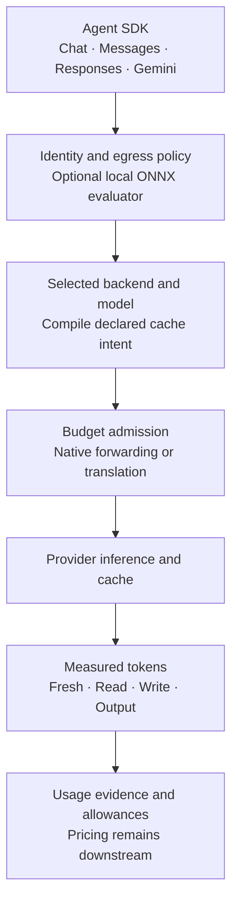
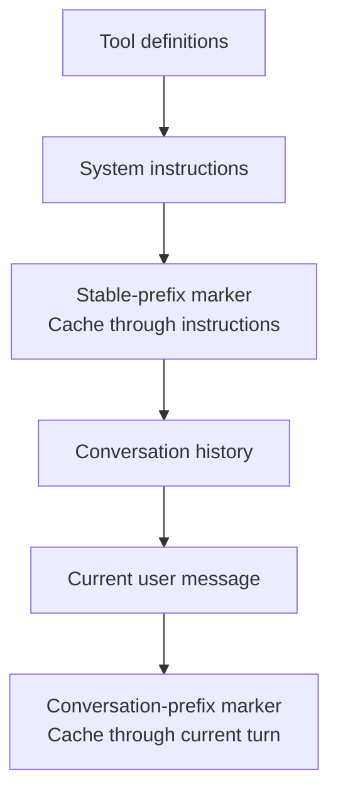
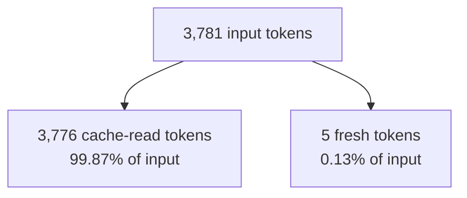

# Cache-aware routing and token efficiency

Keep your agent's API. Reuse stable context. See which tokens were actually reused.
Sandhi combines protocol translation, backend-specific cache controls and neutral
usage accounting at the gateway, alongside [local egress policy](../operator/policy-evaluation.md)
and [embedded ONNX evaluation](../operator/embedded-onnx.md).

!!! info "Development implementation; qualification is endpoint-specific"
    Explicit backend/cache policy is an unreleased workspace candidate. Live Z.AI
    tests cover four client protocols, three backend protocols and both delivery
    modes with `glm-5.3`. They establish text interoperability and observed implicit
    cache reads for that setup. Automatic backend switching, uniform durable attempt
    attribution and broader agent-loop qualification remain [active work](../td/TD-0034-protocol-neutral-router-cache-accounting.md).

The subsequent [tracked buffered qualification](../reviews/zai-router-tracked-buffered-2026-11-11.md)
passed 24 live cache-pair calls through logical aliases, with 24 qualified durable
attempt/usage/paired-receipt joins. It also retains the missing-counter and
accounting-response failures found along the way. Additional tracked streaming
and subscription profiles remain gated.

The [tracked Responses streaming pair](../reviews/zai-router-tracked-responses-stream-2026-11-11.md)
also passed with final attempt/usage/receipt joins. Its repeated request reported
3,776 cached input tokens, while progress counters remained partial until a valid
terminal response. This is a narrow endpoint qualification; translated tracked
streams are covered by the subsequent source increment below; live Codex
subscription acceptance remains active work.

The subsequent [Codex source qualification](../reviews/codex-qualified-accounting-source-2026-11-11.md)
adds tracked buffered host delivery through its constrained SSE codec. Source token
evidence survives decoder failure and remains separate from client delivery. This
uses synthetic origins; live subscription acceptance remains open.

[Qualified translated streaming](../adr/0028-qualified-translated-stream-accounting.md)
now connects all four client protocols to tracked Chat, Messages, Responses, Gemini and constrained
Codex sources. The same source counters settle both budget scopes; SDK-visible
output is not accounting evidence. [Messages ownership](../adr/0031-qualified-messages-stream-ownership.md)
supports portable output; signed/native state requires compatible native delivery
or explicit refusal. [Gemini source ownership](../adr/0033-qualified-gemini-stream-ownership.md)
keeps cached input within prompt tokens and thought tokens separate from candidate
output. Its source counts become final only after clean HTTP EOF. Broader
tool/media/subscription and native Google cache-lifetime journeys remain follow-ups.

The [live Messages cache matrix](../reviews/zai-messages-tracked-streams-2026-11-12.md)
adds eight joined four-client calls with explicitly disabled thinking. Its 99.87%
observed input read share came from an already-used synthetic prefix; it is not
a price saving, cold-cache test or proof of default signed-thinking portability.

The [live tracked translation/cache matrix](../reviews/zai-router-tracked-translated-streams-2026-11-11.md)
passed all 16 Chat/Responses streaming calls from four SDK formats, with complete
paired accounting joins and 15 observed cache reads. It retains the initial Chat
placement failure and its explicit-profile correction. Measured input read share
was 93.63%; this is not a percentage price saving.

## Two reasons to put Sandhi in the call path

| Capability | Mechanism | Useful outcome |
| --- | --- | --- |
| Context reuse and accountable token usage | Preserve eligible prefixes and native markers; compile declared cache intent; separate fresh/read/write/output counts | Repeated agent context can use provider caching without changing the client's SDK. Operators can measure reuse and apply their own allowance or pricing policy. |
| Control over outgoing content | Evaluate configured rules locally, optionally using a pinned ONNX model, before provider dispatch | Policy can block or audit configured findings without sending text to a classifier service. The shipped sensitive-text classifier is audit-only; deterministic rules own its blocks. |

These mechanisms complement identity, virtual keys and budgets. Cache controls
govern context reuse; content policy governs which requests may leave the gateway.
Neither a cache hit nor a classifier score grants permission to call another account.

The live cache matrix did not enable content inspection. The current inspection
gate accepts supported text shapes for Chat, Messages, embeddings and completions;
Responses/Gemini ingress fails closed when that gate is enabled. Protocol routing
support does not imply identical inspected-content coverage. See
[request coverage](../operator/policy-evaluation.md#supported-request-coverage).



## Client protocol and backend protocol are independent

An OpenAI, Anthropic or Gemini agent can call a configured backend through its
usual SDK. Backend identity, endpoint family/profile and credential reference are
separate settings. An OpenAI-shaped endpoint does not automatically inherit
OpenAI Platform's cache features.

| Client API | Gateway ingress | Live Z.AI backend qualification |
| --- | --- | --- |
| OpenAI Chat Completions | `/v1/chat/completions` | Chat, Messages and Responses; buffered and streamed |
| Anthropic Messages | `/v1/messages` | Chat, Messages and Responses; buffered and streamed |
| OpenAI Responses | `/v1/responses` | Chat, Messages and Responses; buffered and streamed |
| Gemini generateContent | `/v1beta/models/{model}:generateContent` or `:streamGenerateContent` | Chat, Messages and Responses; buffered and streamed |

The [live report](../reviews/zai-router-live-2026-11-11.md) retains failed probes,
the accounting defect they found, the fix and subsequent evidence. Z.AI's Responses
endpoint uses the standard API-key profile. It does not qualify ChatGPT/Codex or
Anthropic subscription credentials, native Gemini backends or Gemini Interactions.

## Cache marker placement: what becomes reusable?

A cache generally reuses an eligible **prefix**, rather than a bag of matching
sentences. Stable content, its ordering and the backend's native cache rules matter.
Sandhi keeps attribution outside prompt text and preserves compatible native input.
It does not reorder instructions just to create a cache hit.

The following shows Anthropic's tools → system → messages ordering. The selected
mode chooses one eligible boundary; the two labels are alternatives:



| Selection | Placement semantics | What changes on the next turn? |
| --- | --- | --- |
| `auto_stable_prefix` | Anthropic: furthest eligible system/tool block. OpenAI explicit: last eligible initial system/developer text block. | Stable context can remain reusable while the conversation tail grows. |
| `auto_conversation_prefix` | Anthropic: last eligible conversation block. OpenAI explicit: native implicit placement. | The selected prefix grows; a previous eligible prefix may be reused according to provider rules. |
| `auto` | Use the declared backend/model mechanism; implicit-only profiles add no invented fields. | Provider chooses reuse under its own supported mechanism. |
| `preserve_native` | Keep compatible caller controls and boundaries; add no placement. | Caller retains placement responsibility. |
| `suppress_gateway` | Preserve caller controls and add no gateway markers. | Provider-internal caching can still occur. |

Native markers take precedence. An automatic policy does not silently replace a
boundary. Unsupported required TTLs, contradictory controls and nonportable native
cache state fail before reservation/dispatch. `1h`, `12h` and Gemini resource TTLs
are different contracts; Sandhi does not approximate one with another.

For Gemini, implicit caching and explicit cached-content resources are distinct.
Sandhi can preserve a compatible resource reference; creating, expiring, deleting
or transferring that resource is separate lifecycle work.

## Follow the tokens, then evaluate cost

For an inclusive input counter:

```text
total_input = fresh_input + cache_read + cache_write
total_work  = total_input + output_including_reasoning
```

Anthropic's `input_tokens` is already fresh input. OpenAI-style input totals include
cache categories, so Sandhi subtracts reported reads and writes once. Gemini
reports thought tokens separately; normalization respects whether a provider's
output count already includes reasoning. Do not add included reasoning twice.

| Neutral event field | Meaning | Cost interpretation belongs to the selected provider/plan |
| --- | --- | --- |
| `tokens_in` | Fresh input after normalization | Fresh-input rate or plan rules |
| `cache_read_tokens` | Reported reused input | A cached-input rate may be lower; this is a measurement, not a discount promise |
| `cache_creation_tokens` | Reported cache-write input | Creation charges and retention rules can differ from reads |
| `tokens_out` | Provider output under its inclusion convention | Account for separate reasoning only when it is excluded |
| `reasoning_tokens` / `reasoning_included` | Reasoning amount and overlap evidence | Prevent double-counting output |
| `cache_read_status` | Reported, absent, malformed, unsupported or unknown | Distinguish a reported zero from unavailable evidence |

### Measured example: 3,776 reused tokens, 5 fresh tokens

In the final live Z.AI long-prefix run, every one of 48 calls reported this input
split, and all 48 SDK usage projections matched their correlated SQLite event:



| Category | Tokens per request in this example |
| --- | ---: |
| Inclusive input | 3,781 |
| Cache read | 3,776 |
| Fresh input | 5 |
| Cache write in the event | 0; no positive write evidence in this run |
| Output | Varies per response; retained in the report |

**99.87% cache-read input is not a 99.87% cost saving.** Total context still counts
as 3,781 input tokens. Output, cache-write charges, retention, minimum prefix,
model pricing and subscription quota rules affect the actual benefit. Sandhi emits
neutral units; downstream systems apply current prices. A subscription quota is
not converted into a guaranteed token entitlement.

The repeated prefix was synthetic Python code. The final run was already warm;
an earlier run captured a reported-zero first read followed by 3,776 reads. Latency
alone is never used as evidence. See the [report and retained artifacts](../reviews/zai-router-live-2026-11-11.md).

## Namespace and backend locality

Cache keys, conversation IDs, marker boundaries and backend affinity have different
jobs. Optional scoped OpenAI keys hash authenticated scope, backend revision,
observed credential generation, private actual-credential identity, actual model,
policy and a bounded caller hint. Reconstruction after an external secret change
fences old keys even if the observed generation did not advance.
They do not put raw user/key identity into the prompt or namespace.

A namespace hash does not move KV state, pin a provider worker or establish
physical isolation. APIs without caller-controlled namespaces retain their native
sharing semantics. Changing backend/model/account can make cached or opaque state
incompatible. The [logical-routing candidate](../operator/backends.md#logical-models-and-deterministic-selection)
pins compatible sessions and refuses incompatible live pins; broader fidelity and
durable dispatch accounting remain active milestones. Inspect the declared targets
and measured categories in the [operator console](../operator/dashboard.md).
There is no implicit retry on another model after ambiguous inference.

## Enable a declared policy

Start with `native_only` / `preserve_native` for an unqualified deployment. For a
qualified implicit-cache endpoint, this declaration enables portable `auto`
without inventing native cache fields:

```json
{
  "default_intent": {"mode": "auto"},
  "models": {"glm-5.3": {"profile": "implicit_only"}}
}
```

Save it as a policy file and pass `--cache-policy path/to/policy.json` when
registering the backend. All four HTTP ingress protocols also accept the reserved
request field `"sandhi_cache":{"mode":"auto"}` when overrides are permitted.
Use the [backend operator guide](../operator/backends.md) for exact registration,
profile/TTL constraints, scoped keys and legacy migration, and
[ADR-0020](../adr/0020-cache-intent-compilation.md) for implementation semantics.

## Pair efficiency with local egress control

Use [policy evaluation](../operator/policy-evaluation.md) to choose block, audit or
quarantine behavior under an operator-owned rule set. The optional
[embedded ONNX adapter](../operator/embedded-onnx.md) evaluates approved model
artifacts locally with pinned hashes, bounded admission and deadlines. The
[sensitive-text bundle](../operator/sensitive-policy.md) documents the shipped
classifier's audit-only setting and known detection limits. Cached context remains
subject to admission policy; reuse does not bypass egress checks.

Provider mechanism references: [Z.AI automatic caching](https://docs.z.ai/guides/capabilities/cache),
[OpenAI prompt caching](https://developers.openai.com/api/docs/guides/prompt-caching),
[Anthropic prompt caching](https://platform.claude.com/docs/en/build-with-claude/prompt-caching),
[Gemini caching](https://aistudio.google.com/docs/caching?generate-content=true).
