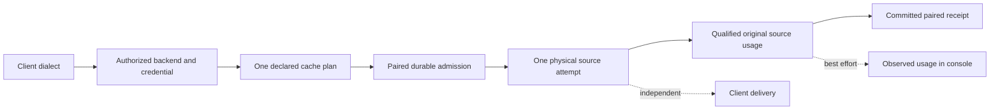

# Protocol, credential and evidence support

A client API, a backend protocol, a credential profile and a committed receipt are
separate choices and facts. Sandhi keeps the agent's portable request contract
while selecting an authorized backend and compiling its declared cache intent
once. [Cache routing and token efficiency](cache-aware-routing.md) complements
[local ONNX egress policy](../operator/embedded-onnx.md).

!!! info "Current source candidate"
    This matrix describes implementation and synthetic acceptance boundaries.
    It does not establish publication, deployment or live acceptance for every
    provider. The recorded [Z.AI evidence](../reviews/zai-router-live-2026-11-11.md)
    applies to its exact endpoints and configuration. Supported source-issued native
    ownership initializes on the original ledger; externally created resources still
    have no implicit adoption workflow. Exact-source public CI, release/deployment
    and broader provider lifecycle qualification remain in [TD-0034](../td/TD-0034-protocol-neutral-router-cache-accounting.md).

## Client APIs stay independent of backend selection

| Client dialect | Gateway generation endpoint | Delivery |
| --- | --- | --- |
| OpenAI Chat Completions | `/v1/chat/completions` | Buffered and bounded streaming |
| Anthropic Messages | `/v1/messages` | Buffered and bounded streaming |
| OpenAI Responses | `/v1/responses` | Buffered and bounded streaming; async/background operations refuse |
| Gemini generateContent | `/v1/models/{model}:generateContent`, `:streamGenerateContent`; `/v1beta` also accepted | Buffered and bounded streaming |

These four APIs share the portable conversation router. Tool/media and native
state have their own fidelity checks: compatible state survives, unsupported
translation refuses explicitly. A working text call does not qualify every
provider-specific feature. Content inspection coverage is a separate
[egress-policy contract](../operator/policy-evaluation.md#supported-request-coverage).

## Backend source qualification

| Selected source | Profile / source basis | Boundary |
| --- | --- | --- |
| OpenAI-compatible / open-weight Chat | Standard counts; explicit terminal-chunk profile when declared | Backend/model cache capability is declared, not inferred from an OpenAI-shaped URL |
| Anthropic-compatible Messages | Separate cache writes, or explicitly selected implicit-cache convention | Wire Bearer/API-key choice does not imply a managed subscription |
| Standard Responses | Standard Responses source qualifier | Async/background execution is outside this synchronous owner |
| ChatGPT/Codex Responses | Constrained fixed-origin codec and expiring access-only lease | Buffered SSE aggregation and bounded streams; operator-configured account fencing and out-of-band renewal |
| Gemini | Native source usage and EOF qualifier | Supported source-issued state needs matching native proof; external cache lifecycle/adoption remains separate |
| Cohere v2 | Actual `usage.tokens`, separately from vendor `billed_units` | Buffered and streamed qualified sources; billed-only or missing actual counts remain unknown |
| Ollama native Chat | Reported prompt/output totals; optional cached input is an inclusive prompt subset | Buffered and NDJSON streaming; absent cached input is unavailable coverage, not a measured zero |

Cohere and Ollama are backend families behind the four client dialects; Sandhi
does not add native Cohere/Ollama ingress APIs. Portable projection can fail while
valid original source usage still settles. Projection/delivery failure does not
authorize inference replay. Source qualification is distinct from a claim of
live cache reuse, vendor billing equivalence or universal provider-version support.
This matrix does not qualify arbitrary provider extensions or an adoption workflow
for externally created cache, file or retrieval resources; those require their
own explicit lifecycle and ownership contract.

## Native plaintext operations remain available

| Operation | Backend requirement | Accounting |
| --- | --- | --- |
| `/v1/completions` | Native OpenAI-compatible raw endpoint, including eligible InferFlux | Buffered or bounded SSE; native request/response shapes retained; batch and alternative exposure included |
| `/v1/embeddings` | Native OpenAI-compatible raw endpoint and embedding model | Buffered, input-only operation; vectors pass through; reported input and consistent totals required |

These routes use the same paired durable owner as chat. Text Completions makes
its existing omitted `max_tokens=16` default explicit. Missing generative usage
cannot become an embedding-style inapplicable output. Unknown or malformed source
usage retains both liabilities through cancellation/restart. See
[governed text endpoints](../operator/text-endpoints.md).

## Credentials do not inherit meaning from API shape

| Credential / deployment | Current Sandhi support | What is not established |
| --- | --- | --- |
| Ordinary provider API key or Bearer API credential | Explicit supported transport scheme, selected endpoint and vaulted credential reference | Managed expiry/renewal, principal verification or subscription entitlement from token syntax |
| GLM Coding Plan | Z.AI API key sent as Bearer to its advertised compatible endpoint | First-party Anthropic consumer OAuth or Claude Pro/Max quota |
| First-party Claude Console API | Standard Messages transport with an authorized API credential | Consumer subscription login or a managed WIF publisher/renewal profile |
| First-party Claude Pro/Max OAuth | No supported Sandhi-managed subscription relay profile | A provider-approved relay, credential-custody and identity/renewal contract cannot be inferred from a Bearer header |
| Codex lease | Fixed origin, explicit account/profile/expiry fences; access-only publication | Independent cryptographic account verification, quota conversion or unlimited/shared entitlement |

Z.AI documents its plan API key under `ANTHROPIC_AUTH_TOKEN` with base
`https://api.z.ai/api/anthropic`. That environment variable does not make the key
an Anthropic subscription grant. [Z.AI setup](https://docs.z.ai/devpack/tool/claude).

Anthropic's current guidance directs third-party products/services to API-key or
supported cloud authentication and restricts third-party Claude.ai login and
consumer-credential intermediation. A documented provider-approved contract is
required before advertising a Sandhi consumer-subscription relay.
[Anthropic authentication and credential use](https://code.claude.com/docs/en/legal-and-compliance#authentication-and-credential-use).

The official API also documents Workload Identity Federation. Its short-lived API
access is distinct from consumer subscription quota; Sandhi does not implement
its issuer/rule-bound exchange and renewal lifecycle merely by selecting Bearer.
[Claude API authentication](https://platform.claude.com/docs/en/manage-claude/authentication).

## Read the execution evidence independently

The configured provider label is diagnostic. Endpoint family/profile selects a
codec. The credential reference and its generation bind credential lifecycle.
The backend record's immutable `upstream_budget_scope` selects existing budget
authority; it can keep a family-named bucket after a vendor label changes. A
namespace is never reconstructed from the display label. Historical caps, spend,
holds, contexts and receipts are not regrouped.

Current standalone generation requires the original ordinary `SANDHI_STORE`
path and one ledger shard. The initialized owner is reported by
`capabilities.execution_accounting == "paired_durable_v1"`; readiness is a separate
`/readyz` lifecycle snapshot. Neither proves live SQL/provider health, available
capacity, cache reuse or settlement for a particular request. Native provider FFI
remains ledger free. See [durable execution](../operator/buffered-accounting.md).

Fresh/read/write input remains disjoint in original source evidence. Client wire
formats can combine categories, especially Gemini cache writes. Reasoning may
already be included in output. A usage observation is not a receipt; a receipt is
not proof of delivery. Cache-read share is input composition, not currency saved,
and subscription quotas are not guaranteed token entitlements. Sandhi emits
neutral units; monetary prices and billing remain downstream.
