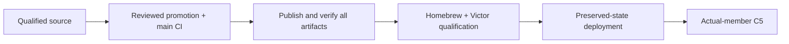

# Sandhi 0.13.0

**Status: published and all artifact targets verified. Managed adoption remains pending.**

## What changes

| Surface | Benefit | Boundary |
|---|---|---|
| Tracked OpenAI Chat streaming | Final measured counts survive client disconnect, deadline and shutdown; normal EOF waits for committed settlement | Opt-in bounded transparent transport only |
| Strict usage evidence | Complete SSE events qualify final counts; conflicts or missing data retain liability | A reported cache count is not proof of executed reuse |
| Recovery | Existing accounting owner recovers persisted usage once without another model call | Process death before persistence leaves unknown liability |
| TLS/OIDC acceptance | Same source binary covers token and verified TLS/OIDC process restarts, grant withdrawal and stream termination | Synthetic fixtures do not establish production IdP/provider acceptance |
| Package identity | CLI, proxy, Rust, Python and Node software versions agree at 0.13.0 | Wire versions and binding facade behavior remain unchanged |

## Enable deliberately

- Keep existing OIDC/TLS, credential and state configuration.
- Enable `SANDHI_BUFFERED_ACCOUNTING=tracked` with a complete
  [streaming deadline policy](../operator/streaming-deadlines.md).
- Use retry-free transparent OpenAI Chat requests with an explicit output bound
  and Block policy. Unsupported shapes fail before admission.
- Unset or `off` preserves existing behavior. Read the
  [owned accounting contract](../operator/buffered-accounting.md), including
  rollback restrictions for databases containing tracked evidence.

The Rust raw-response observation API is additive. The Python/Node facades do not
expose a new durable accounting API, and embedded callers do not gain proxy ledger
enforcement. Responses, translated traffic, amendments and exports are outside this
bounded streaming milestone.

## Evidence and remaining gates

| Gate | State | Evidence |
|---|---|---|
| Qualification and transport ownership | ✅ Source accepted | [#352](https://github.com/anvai-labs/sandhi/pull/352), [#353](https://github.com/anvai-labs/sandhi/pull/353), [#354](https://github.com/anvai-labs/sandhi/pull/354) |
| HTTP settlement and recovery | ✅ Source accepted | [#355](https://github.com/anvai-labs/sandhi/pull/355); 875 workspace tests and existing SDK/recovery suites |
| Standalone lifecycle | ✅ Source accepted | [#356](https://github.com/anvai-labs/sandhi/pull/356); 40 affected process tests, exact-commit review and green PR/post-merge CI |
| Main promotion | ✅ Complete | [#357](https://github.com/anvai-labs/sandhi/pull/357), [#358](https://github.com/anvai-labs/sandhi/pull/358); reviewed main `8aea5492fa4a5e5e152fa4b14125082f917be7b2`, [exact-main CI](https://github.com/anvai-labs/sandhi/actions/runs/38109348638) |
| Publication | ✅ Verified | [Release](https://github.com/anvai-labs/sandhi/releases/tag/v0.13.0), [all-target publisher and verifier](https://github.com/anvai-labs/sandhi/actions/runs/38110123254); GitHub binaries, four wheel platforms, four crates and three npm packages |
| Homebrew / Victor | ✅ Artifact qualification | [Tap #101](https://github.com/anvai-labs/homebrew-tap/pull/101), [Victor #1285](https://github.com/anvai-labs/victor/pull/1285); real macOS install and binary/HTTP smoke pass; 1,712 Victor official-wheel tests pass (five existing skips); PyPI wheel equals release-built artifact |
| Managed deployment | Pending | Preserved-state qualification with deployed TLS/OIDC and provider routes; rollback evidence |
| Full mixed-team C5 | Open | Reviewed actual-member deliverables, distinct sessions, correlation and conserved usage |

Do not equate source tests, package publication and managed acceptance. Preserve
credentials, shared caches and rollback identities. Origin cancellation, tokenizer
units and executed cache/session behavior require separate live evidence. Follow
[RELEASING.md](../../RELEASING.md) for the required all-target release train.

## Published identities

Published on 2026-10-11 UTC (2026-10-10 in the originating America/Chicago session).
An independent `verify-release.py --targets pypi,crates,npm,github` run also passed.

| Archive | SHA-256 computed from downloaded release bytes |
|---|---|
| macOS arm64 | `1025c9fdae2965beca6fc752b33904914e9ce376a9abdbd2908949dc258ad9bd` |
| Linux x86_64 | `8b361a01c890ecab22b98dbae7e09d2f95dc67e74a0876a5b6d81b69e7240739` |

Promotion CI attempt one passed 330 SDK tests with three skips, but one dashboard
fixture could not bind its selected port (`Address already in use`). The failed-job
retry passed; the original run evidence remains available. This fixture port-selection
race remains test-harness debt, not a waived assertion or a deployed gateway result.
Local Homebrew qualification retained the prior 0.12.0 binary and did not restart
shared gateways. The consumer's private test environment needed its pre-existing
ProximaDB/protobuf mismatch repaired; no unrelated repository dependency changed.
