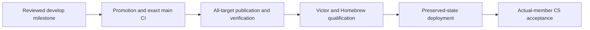

# Sandhi 0.14.0

**Status: release candidate; promotion and publication pending.**

## Included changes

| Surface | Change | Boundary |
|---|---|---|
| Codex tool calls | Preserve authoritative completed arguments ([#368](https://github.com/anvai-labs/sandhi/pull/368)) | Does not establish end-to-end agent task success |
| Codex streaming | Admit streams with bounded deadlines ([#369](https://github.com/anvai-labs/sandhi/pull/369)) | Keep explicit route deadlines; a longer client timeout does not replace them |
| Weighted allowances | Qualified Rust quotes with checked category arithmetic ([#370](https://github.com/anvai-labs/sandhi/pull/370)) | Opt-in calculator only; no live weighted budget enforcement |
| Proxy maintenance | Shared request preparation and access helpers ([#365](https://github.com/anvai-labs/sandhi/pull/365)) | Existing authorization and dispatch owners remain authoritative |
| Documentation | Shared Anvai family styling ([#367](https://github.com/anvai-labs/sandhi/pull/367)) | OSS/commercial ownership stays separate |
| Packaging | One 0.14.0 identity across binaries, crates and bindings | Existing wire versions remain independent |

Private-CA support and the existing OIDC/token compatibility modes are retained.
Existing neutral usage and budget meaning do not change. The allowance calculator
is not a reservation or settlement receipt; see [TD-0032](../td/TD-0032-weighted-allowance-policy.md).

## Release and adoption gates

| Gate | State | Required evidence |
|---|---|---|
| Version preparation | Prepared | Workspace, binding manifests and all lockfiles agree |
| Cumulative review and CI | Pending | Review against main, feature and promotion CI |
| Main authority | Pending | Executed exact-source main push CI, including release safeguards |
| Publication | Pending | GitHub binaries, four wheel platforms, four crates, three npm packages |
| Consumer adoption | Pending | Official-wheel Victor tests, Homebrew installs and private-CA checks |
| Managed deployment | Pending | Preserved state/configuration and recorded runtime identities |
| Full mixed-team C5 | Open | Actual deliverables, distinct sessions, correlation and usage conservation |

Open PRs [#362](https://github.com/anvai-labs/sandhi/pull/362),
[#363](https://github.com/anvai-labs/sandhi/pull/363) and
[#364](https://github.com/anvai-labs/sandhi/pull/364) contain separate unmerged
stream qualification, catalog and reasoning work. They are not included in this
candidate and are not declared superseded.

The already-published 0.12.0 and 0.13.0 tags remain immutable. Follow
[RELEASING.md](../../RELEASING.md) for publication and verification; source tests
are not managed deployment, tokenizer, executed-cache or lifecycle acceptance.
