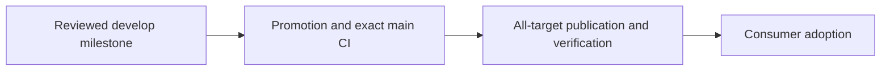

# Sandhi 0.15.0

**Status: published and artifact-verified on 2026-11-07; consumer adoption and managed deployment pending.**

## Included changes

| Surface | Change | Boundary |
|---|---|---|
| Dual-scheme listeners ([#398](https://github.com/anvai-labs/sandhi/pull/398)) | `SANDHI_HTTP_BIND` opts a plaintext HTTP companion listener into the TLS process; both sockets bind before either accepts and share one admission budget, per-IP table and graceful drain (TD-0017 D7) | Same-port protocol multiplexing rejected (ADR-0009 class); a non-loopback companion warns, never silently serves |
| Dialect parity ([#397](https://github.com/anvai-labs/sandhi/pull/397), ADR-0014) | `count_tokens` endpoints (Anthropic `/v1/messages/count_tokens`, Gemini `:countTokens`), SSE lifecycle parity — Anthropic content blocks, Gemini tool calls, Responses output folding, spec `created` — and ingress `route` labeling on every usage event | `count_tokens` runs the full admission pipeline but takes no lease and emits no usage event; estimates match reservation |
| Translation-plane prompt caching ([#397](https://github.com/anvai-labs/sandhi/pull/397), ADR-0013) | Cross-family routes to Anthropic upstreams auto-place `cache_control: ephemeral` when the client supplied no native bucket; client-owned `extensions["anthropic"]` (including empty) suppresses auto placement | Marker placement stays client-owned whenever claimed; no cache accounting change |
| Guarded `sandhi_extensions` passthrough ([#397](https://github.com/anvai-labs/sandhi/pull/397)) | Reserved body field for family-native extras (Anthropic `cache_control`, `top_k`/`metadata`, Gemini `safetySettings`) | Validated at decode, policy-classified, stripped from forwarded bytes; encoders can only add native extras, never override the decoded contract |
| Policy: Anthropic Messages input format ([#392](https://github.com/anvai-labs/sandhi/pull/392)) | `/v1/messages` bodies are inspected policy input | Was a hard `503 policy_unavailable` (`unsupported_dialect`) on every Anthropic-ingress request |
| Policy: undecodable tool arguments ([#400](https://github.com/anvai-labs/sandhi/pull/400)) | Non-JSON tool arguments are inspected as text plus a JSON-escape-decoded view, instead of failing the gate closed for the rest of the session | Syntactically-valid JSON that strict decoding rejects (duplicate keys, out-of-range numbers, lone surrogates, excess depth) still fails closed — it could decode differently in a consumer |
| Transport operability ([#393](https://github.com/anvai-labs/sandhi/pull/393)) | Per-credential `User-Agent` override, `SANDHI_CONNECT_TIMEOUT_SECS`, upstream non-success WARN logging (status, vendor request id, bounded body) and dial DEBUG logging | Client-facing errors stay redacted by default; server-side logs carry the full error |
| Dependencies ([#383](https://github.com/anvai-labs/sandhi/pull/383), [#394](https://github.com/anvai-labs/sandhi/pull/394)) | `sentinelpass-protocol` 0.18.0 → 0.19.0 (via 0.18.0) | Protocol crate API identical between pins |

Neutral units, attribution binding (key-authoritative subject/group/session), and the
reservation-settlement ledger semantics are unchanged from 0.14.x. The measure-vs-price
boundary is untouched: nothing in this release emits dollars.

## Release verification

The published tag passed its release gates and artifact verification. Use the
[`v0.15.0` source tag](https://github.com/anvai-labs/sandhi/releases/tag/v0.15.0)
when reproducing this release. A locally built or previously deployed binary does
not acquire later release fixes until it is upgraded and verified.
