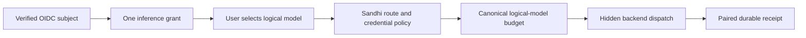

# Sandhi 0.19.0: model-scoped OIDC budgets

Status: **published from immutable tag `v0.19.0`**. The tag points to exact main
commit `c5c4553b846cf1630c7db24db9ddcbc0f3c4f657`; source checks, promotion,
publication and all-target artifact verification completed. Managed deployment and
provider soak remain separate acceptance gates.

## Why this release exists

A multi-model coding grant often combines independently provisioned plans. A single
shared allowance is too coarse, while one client-facing grant per model leaks an
internal budget dimension into model discovery and makes switching models awkward.

Sandhi 0.19.0 keeps one verified OIDC subject, one inference grant and one user-facing
logical model list. The operator explicitly opts into model-derived budget scopes.



## Configuration

```json
{
  "upstream": "route/coding",
  "models": ["coding-fast", "coding-reasoning", "coding-open"],
  "budget_scope": "coding/shared",
  "model_budget_scope": "coding/{model}",
  "rate_limit_per_min": 30
}
```

| Decision | Owner |
|---|---|
| Who may use the route | Sandhi OIDC subject/group policy |
| Which logical models are visible | Sandhi grant and route declaration |
| Which hidden backend and credential serve a model | Sandhi |
| Which model budget is charged | Sandhi, from the canonical logical model |
| Whether to switch after a warning or block | User or calling agent, explicitly |

Configure each derived scope with its own neutral-token limit, window, alert threshold
and `warn` or `block` policy. `warn` records the event and continues. `block` refuses
only the selected model. Other authorized models remain available; Sandhi never
substitutes a model automatically.

A fixed `budget_scope` remains exactly what it was. A literal `{model}` in that field
does **not** become dynamic. Only `model_budget_scope` expands.

## Accounting identity

Model IDs are authorized case-insensitively where the underlying model ecosystem uses
inconsistent casing. Accounting nevertheless uses the configured canonical spelling.

| Boundary | Rule |
|---|---|
| Direct OIDC inference | Uses the configured grant model spelling |
| Delegated-key mint | Canonicalizes requested models before persistence |
| Delegated-key replay | Canonicalizes the durable record against the current grant |
| Logical route | Uses the route declaration's canonical logical ID |
| Fixed provider | Uses the grant allowlist's canonical spelling |
| Validation | Rejects case-ambiguous grant models and every expanded reserved `upstream:` scope |

Direct access and delegated keys therefore share the same selected-model budget. A
caller cannot create a fresh allowance by sending `CODING-FAST`, `coding-fast`, or a
mixed-case spelling.

## Upgrade and compatibility

1. Quiesce the existing Sandhi writer and preserve the complete SQLite ledger, private
   OIDC configuration, vault credentials and rollback artifacts.
2. Upgrade to the official 0.19.0 artifact; delegated-key storage adds a nullable
   `model_budget_scope` column on first reopen. Existing grants and virtual keys retain
   their fixed-scope behavior.
3. Leave grants without `model_budget_scope` unchanged. To enable independent model
   allowances, add the explicit template and configure each derived scope.
4. Restart, verify `/version.package_version`, readiness, model discovery, each selected
   model, warning behavior and request/receipt joins.
5. Use the coordinated Victor release that pins the verified official
   `sandhi-gateway==0.19.0` binding. Do not adopt a consumer release until its own
   published-artifact qualification and release gates complete.

### Rust API compatibility

This is a minor release because public `VirtualKey` gains the optional
`model_budget_scope` field. Rust callers that exhaustively construct `VirtualKey` must
supply the new field. Existing serialized/request contracts do not add a client-visible
wire major. Pure library users that do not construct the new field retain prior budget
behavior.

## Qualification record

| Gate | Result |
|---|---|
| Focused durable store tests | 8/8 passed |
| OIDC auth tests | 28/28 passed |
| Logical routing tests | 12/12 passed |
| Clippy / format / docs strict / docs tests | Passed locally |
| Independent exact-source review | Clean after delegated-key canonicalization review |
| Feature-branch public CI | All 25 checks passed at `deba094b9a3263574a0d8d5db2cf9e7ff4df7439` |
| Post-merge develop CI | [Passed](https://github.com/anvai-labs/sandhi/actions/runs/43678213599) at merge `4b937aacd1fa90ff48d1b81e7e94ab8f46d3c2f7` |
| Exact-main promotion CI | [Passed](https://github.com/anvai-labs/sandhi/actions/runs/43685650407) at `c5c4553b846cf1630c7db24db9ddcbc0f3c4f657` |
| Publication and all-target verification | [Passed](https://github.com/anvai-labs/sandhi/actions/runs/43687411760): GitHub archives, PyPI, crates.io and npm |
| Managed deployment and provider soak | Pending |

This release measures neutral tokens. Model-specific limits are capacity policy, not
prices, provider-billing equivalence or savings claims.
