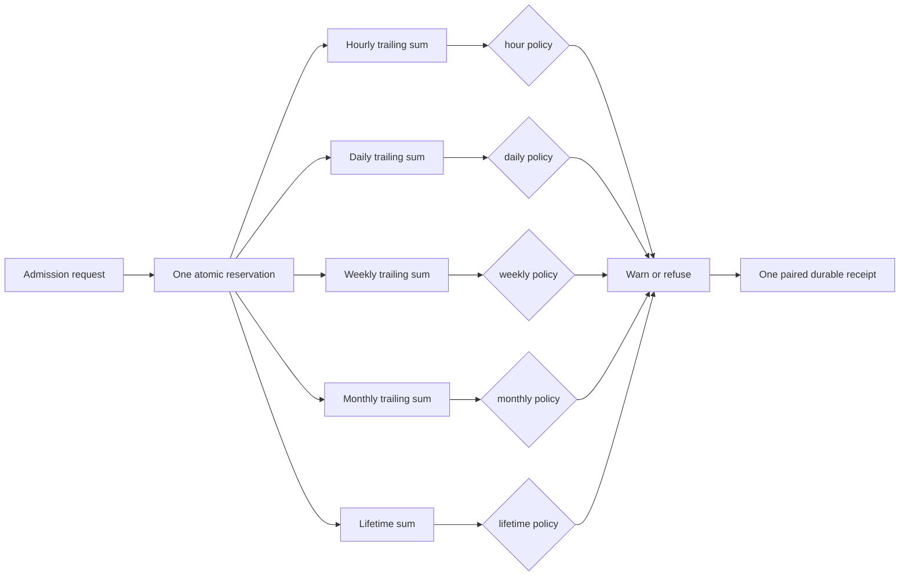

# Sandhi 0.20.0: hierarchical rolling budgets

Status: **published 2026-11-16**. Immutable annotated tag `v0.20.0` (tag object
`f4afad2a2037d21c01f9480fc936328341b1688f`) points to reviewed exact `main`
commit `184215c7b265f7214246b5db50455ff3317cbb04`. Publication, managed
deployment and live-provider soak remain separate gates.

## Why

A single lifetime, UTC-day or calendar-month bucket cannot express both short bursts
and durable monthly capacity. An hourly spike can exhaust an operator's immediate
allowance while a week still has headroom; conversely, a daily reset can hide a
week that is already over budget. A hierarchy needs each level to warn or block
independently, and a short window must release capacity continuously as usage ages
out instead of waiting for a calendar boundary.



## Canonical policy

Every operator and declarative budget uses the same `limits` object. A one-bucket
policy has one key; a hierarchy has several. Each key carries its own token cap and
policy.

```json
{
  "scope": "coding/shared",
  "limits": {
    "hourly":  { "limit_tokens": 50000,   "policy": "warn"  },
    "daily":   { "limit_tokens": 250000,  "policy": "warn"  },
    "weekly":  { "limit_tokens": 1000000, "policy": "block" },
    "monthly": { "limit_tokens": 4000000, "policy": "block" }
  },
  "alert_thresholds": [80]
}
```

Supported keys are exactly `hourly`, `daily`, `weekly`, `monthly` and `total`.
The fixed trailing intervals are:

| Window | Enforcement interval |
|---|---|
| Hourly | `(now - 1 hour, now]` |
| Daily | `(now - 24 hours, now]` |
| Weekly | `(now - 7 days, now]` |
| Monthly | `(now - 30 days, now]` |
| Total | All settled history |

Admission performs one indexed settled-spend lookup per selected window and one shared
in-flight-reservation lookup inside the existing immediate SQLite transaction. A hard
window refuses before inserting a lease. A warn window records threshold evidence and
continues even when a sibling hard window has not been crossed. Unknown paired usage
and unresolved in-flight ceilings remain counted until explicit settlement or recovery;
they are not erased by time.

Alert thresholds apply independently to every configured window. An 80% rule can
therefore fire on the hourly denominator while monthly utilization remains low.

## Direct updates and declarative apply

- A direct `POST /admin/budget` or `budget set` request defines the complete
  hierarchy for that scope and atomically removes omitted windows.
- `set_limit(scope, None)` clears every window for the scope.
- Declarative config apply remains additive: removing a budget entry from
  `SANDHI_CONFIG` does not revoke a live policy. Apply adds or updates the entries
  that are present.
- The admin CLI uses `--hourly`, `--daily`, `--weekly`, `--monthly` and `--total`
  with matching `--<window>-policy` flags. At least one window is required.
- `GET /admin/budget` groups a scope's `windows`; `GET /admin/budget/usage` returns
  only `scope` and the `windows` array.

## Compatibility and storage

This is a minor release with an intentional breaking operator/config/CLI change:
the singular `limit_tokens` plus `window` request and its global `policy` are removed.
Use one canonical `limits` entry instead:

```json
{"total": {"limit_tokens": 1000000, "policy": "block"}}
```

Existing durable budget rows migrate in place from a `scope` primary key to a
composite `(scope, window)` primary key. Values, policies and reservation history
are preserved. Their window names are then interpreted by the new trailing-interval
rule immediately: existing `daily` rows move from UTC-day boundaries to the last
24 hours, and existing `monthly` rows move from a calendar month to the last 30
days. Plan the upgrade window with that semantic change in mind.

The hierarchy is bounded to five known windows. There are no reset daemons, mutable
reset counters, or unbounded window names. Multi-replica admission remains outside
this release; the existing single-file durable writer is still required for HTTP
generation.

Inference consumers do not select or inspect budget windows. They continue to present
a Sandhi credential and choose an authorized logical model. The observable difference
is authorization behavior: an earlier warn or refusal based on Sandhi's selected
per-window policy.

Victor 0.29.2 pins `sandhi-gateway==0.19.0`. That existing consumer qualification
remains valid; adopting the 0.20.0 binding requires its own coordinated consumer
release and artifact verification.

## Upgrade

1. Quiesce the single Sandhi writer and preserve its complete SQLite store, OIDC
   configuration, credential references and rollback artifacts.
2. Upgrade to the official 0.20.0 artifact and verify `/version.package_version`.
3. Confirm readiness, then inspect `GET /admin/budget`: every old scope should have
   one migrated window.
4. Replace old single-window requests with the canonical `limits` object. Start with
   `warn` for short windows if uncertain, then promote to `block` after observing
   receipts.
5. Verify each configured window's spend and remaining values, an aging short-window
   boundary, mixed warn/block behavior, and normal logical-model dispatch.
6. Do not claim managed deployment or provider soak until live delegated-key traffic
   and receipt joins have been checked on the upgraded artifact.

## Publication record

- [Exact-main push CI](https://github.com/anvai-labs/sandhi/actions/runs/43802316048)
  and [main-only Pages deployment](https://github.com/anvai-labs/sandhi/actions/runs/43802316088)
  completed successfully at `184215c`.
- The [immutable release workflow](https://github.com/anvai-labs/sandhi/actions/runs/43804727466)
  passed authorization, all platform builds, GitHub release creation and every PyPI,
  crates.io and npm publisher, followed by its all-target verifier.
- The public [v0.20.0 release](https://github.com/anvai-labs/sandhi/releases/tag/v0.20.0)
  contains both verified binary archives.
- An independent local run of `scripts/verify-release.py v0.20.0 --targets
  pypi,crates,npm,github --repo anvai-labs/sandhi` verified wheel platforms, all
  four non-yanked crates, the root and platform npm packages, and both GitHub
  archive sizes and SHA-256 digests.

## Qualification record

| Gate | Result |
|---|---|
| Core window parsing and in-memory behavior | Passed |
| Durable migration, restart, sharding and rolling-window suites | Passed |
| Mixed per-window warn/block enforcement | Passed |
| Focused operator/config/CLI/dashboard budget tests | Passed |
| Full Rust workspace tests | Passed locally at release head |
| Clippy with warnings denied, strict MkDocs and dashboard JavaScript parsing | Passed locally |
| Exact-head independent adversarial review | Clean |
| Feature-branch public CI | Passed at `515e922` (all required checks) |
| Post-merge develop CI and exact-main promotion CI | Passed at `aa94492`, `2e20194` and `184215c` |
| GitHub, PyPI, crates.io and npm publication verification | Passed by release workflow and independent local verifier |
| Managed deployment and provider soak | Pending |
