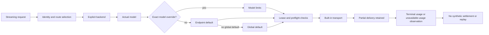

# Sandhi 0.21.0: exact vault grants and streaming policy

Status: **source candidate, 2026-11-17**. This guide describes the reviewed
source release candidate. Promotion, immutable publication, deployment and live
consumer qualification are separate gates and are not claimed here.

## Why

Sandhi 0.20 exposed two operational seams that were too broad for production
use. SentinelPass labels still authorized a domain lookup rather than the exact
entry intended for a service, and every model on a logical route inherited the
same streaming body limit. A long planning stream therefore either widened a
whole route or hit a default unrelated to the selected backend and actual model.

This release makes both boundaries exact. Vault retrieval names one SentinelPass
entry, and streaming deadline policy resolves after logical-route and backend
selection to one actual model. It also records the shared routing vocabulary and
typed manifest direction needed to keep future Sandhi and Victor configuration
names aligned without moving credentials into a shared file.



## SentinelPass exact-entry grants

The native IPC vault backend now uses SentinelPass protocol 0.20
`VaultOp::ServiceGetSecret`. Vault metadata stores only the exact SentinelPass
entry ID and the environment-variable name of the service token. The token value
stays in the process environment and is not persisted to SQLite, serialized into
backend metadata, logged, or copied into a provider request.

Unbound labels continue to use the deprecated domain lookup so operators can
migrate deliberately. Successful legacy use is counted once per reference. When
a strict SentinelPass profile refuses that lookup, Sandhi returns
`409 vault_legacy_denied` instead of silently bypassing the profile.

Inventory now reports the active vault backend, whether each reference is exact
or legacy, the non-secret grant class projected from SentinelPass, and ordinary
reference-onboarding fields. Partial exact bindings, backend changes, malformed
ACL rows, and a missing named token fail closed. A direct secret write clears an
obsolete exact binding on the next metadata generation so a reused label cannot
silently select a different SentinelPass entry.

This slice does not make the dashboard a retrieval authority and does not close
TD-0033. Daemon-verified ACL state, live backend-miss parity, strict-daemon
qualification, and executable-pin evidence remain open.

## Exact streaming deadlines

Streaming policy is startup-only and resolves in this order:

1. exact actual model at a registered transport reference;
2. endpoint default at that reference;
3. global default.

An override must name an already registered direct `provider:label` reference or
explicit `backend/<backend-id>` route. The complete setup, idle, and body triple
replaces the inherited values. Partial triples, wildcard models, unknown fields,
duplicate keys, zero and fractional milliseconds, unregistered references, and
policies that do not fit the ceiling are rejected.

The built-in defaults become:

| Limit | New default | Previous default |
|---|---:|---:|
| Setup | 30 seconds | 30 seconds |
| Idle | 180 seconds | 90 seconds |
| Body | 420 seconds | 180 seconds |
| Ceiling | 840 seconds | 240 seconds |

The ceiling leaves 60 seconds of settlement headroom under the 900-second
reservation TTL. Both `setup_ms + body_ms` and `idle_ms` must fit. Deployments
that need the previous values can configure them explicitly.

For the DS3 coding-planning backend, the reviewed policy remains deliberately
narrow:

```json
{
  "streaming_deadlines": {
    "ceiling_ms": 840000,
    "default": {
      "setup_ms": 30000,
      "idle_ms": 180000,
      "body_ms": 420000
    },
    "endpoints": {
      "backend/qwen-coding-plan": {
        "models": {
          "qwen3.7-plus": {
            "setup_ms": 30000,
            "idle_ms": 180000,
            "body_ms": 600000
          }
        }
      }
    }
  }
}
```

The change activates only after a supported config apply and service restart.
The old policy remains active until a sanitized admin receipt records the new
desired and active values.

Authenticated OpenAI-shaped model discovery now includes a sanitized
`sandhi_streaming` object. It reports the logical model, effective limits,
source, target stability, and ceiling. It omits backend names, transport URLs,
credential references, and secrets. Compatible targets with different limits
report `multiple_targets` rather than inventing a stable value before affinity
chooses one.

Streaming callers may send `x-sandhi-stream-body-budget-ms` exactly once. The
value is advisory and can never raise gateway policy. Malformed, duplicate,
zero, out-of-range, or above-policy values fail before rate admission,
reservation, provider dispatch, and source egress. Victor can configure this
need explicitly with `stream_body_timeout_secs`; it is not inferred from an
outer planning deadline.

The long-stream acceptance fixture passes the previous 180-second default, times
out only at its exact-model override, retains partial delivery, emits one
unavailable-usage observation, creates no settlement, invents no charge, and
does not replay inference during recovery. This is source and CI evidence, not a
managed DS3 deployment receipt.

## Shared routing vocabulary

[ADR-0045](../adr/0045-unified-model-routing-configuration.md) and
[TD-0035](../td/TD-0035-unified-routing-configuration.md) define one typed TOML
source manifest compiled to canonical JSON. The design separates provider,
protocol, dialect, credential, account, endpoint, model, backend, route,
gateway, profile, and transport. Capability maxima use
`limits.max_context_tokens` and `limits.max_output_tokens`; requested generation
output uses `generation.output_tokens`.

This release adds the accepted vocabulary, example manifest, and parser
regression for the canonical Sandhi example. Runtime TOML parsing, compilers,
migration reports, and catalog-boundary cleanup remain future work. “OpenAI
compatible” is not a provider; it is a protocol/dialect that a provider may
expose.

## Compatibility and upgrade

This is a minor release with intentional breaking public Rust and dashboard
shape changes:

- `VaultEntry` changes its public shape;
- `VaultStore::register_metadata` changes arity;
- the dashboard keys response changes from a vault array to
  `{ "backend", "keys" }`;
- legacy invalid labels are represented as `invalid_reference` inventory rather
  than being hidden.

Operators should audit SentinelPass metadata before upgrading, ensure every
exact service grant names a real environment variable, and keep the service
token outside Sandhi persistence. Preserve the complete database and private
configuration, then upgrade to the official 0.21.0 artifact and verify
`/version.package_version`.

For streaming, capture the prior admin config digest and rollback policy before
apply. Use exact actual-model overrides for long workloads instead of widening
a route. Restart only after config validation reports the desired policy, then
require `/readyz`, an authenticated model-discovery receipt, and an admin receipt
that activation completed. Do not edit the live SQLite database directly.

Consumers using the Python or Node binding must recompile against the new public
shapes. The advisory body-budget wire header is additive and cannot change
direct-provider or buffered request behavior when unset.

## Qualification state

| Gate | State |
|---|---|
| Focused deadline, routing, discovery, and long-stream tests | Passed in source |
| Sandhi feature-branch public CI | Passed for the final #485, rebased #487 and rebased #486 heads |
| Post-merge develop CI | In progress for the combined `16a8351` head |
| Exact-main promotion CI and Pages deployment | Pending |
| All-target immutable publication and verifier | Pending |
| DS3 deployed policy and sanitized live receipts | Pending |
| TD-0033 daemon/ACL and backend-miss acceptance | Open |
