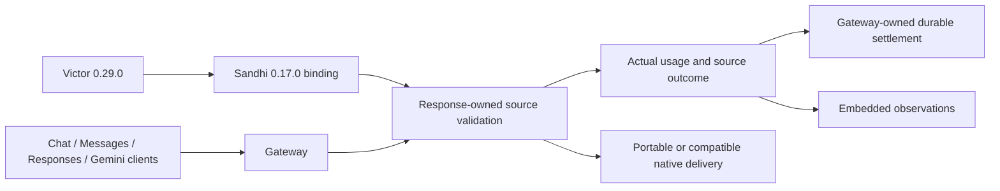

# Coordinated Sandhi / Victor execution-contract migration

This is a source checkpoint for [ADR-0038](../adr/0038-coordinated-victor-contract-migration.md),
not a release or deployed-service acceptance. The user identified Victor as the
sole consumer and explicitly authorized moving both projects instead of retaining
a permissive legacy mode.

## Prepared versions and implemented scope

| Component | Prepared version | Consumer contract |
| --- | --- | --- |
| Sandhi workspace, Python and Node packages | 0.17.0 | Existing wire schema v1; stricter default typed streaming semantics |
| Victor and its version-coupled native artifact | 0.29.0 | Exact `sandhi-gateway==0.17.0` pin |
| Victor Contracts / CodeGraph | Independent versions retained | No unrelated contract/package release |

All ordinary Chat, Responses, Messages and Gemini **typed streams** now use the
same response-owned source observer and family projectors as accounted streams.
Messages/Gemini's old decoders and their separate `NativeUsage` accumulator are
removed. Compatible native delivery preserves complete original frames; portable
delivery refuses meaningful state it cannot represent. A client dialect remains
a supported interface, not a backward-compatibility execution mode.

The diagram describes the admitted typed streaming seam. Embedded observations
are not receipts and do not create a gateway ledger. Source measurements and
delivery outcomes remain independent. Cache field availability can precede
content as an `Unavailable` metadata-only update without inventing measured zero
tokens. Actual partial measurements remain partial; final usage and successful
finish require clean source qualification. Known reported reasoning zero remains
distinct from absence.

Physical handles require retries disabled. Both qualified delivery contracts use
the configured total operation deadline, including setup and draining, so
heartbeats cannot extend a refused embedded stream indefinitely. The separate
idle bound still applies. The paused-clock regression exercises both delivery
contracts with and without an already scoped total deadline.

Victor now sets retry-free handles for direct and gateway calls, refuses iterator
EOF without a validated finish, and honors terminal provider errors before fuzzy
retry/fallback classification, including cause chains. Ambiguous FFI, transport
and timeout failures are terminal when the binding supplies no authoritative
pre-dispatch proof. Known circuit-open errors can retain explicit retry permission.

## Independent draft review and regression fixes

| Reproduced issue | Correction and negative boundary |
| --- | --- |
| Messages/Gemini lost inspected cache availability when numeric usage was unavailable | Carry availability through the existing source observer and metadata decorator; verify it precedes content without a final numeric verdict. |
| A later drain timeout replaced an already known projection refusal | Preserve the first delivery refusal across all four projectors while source evidence records the actual timeout; the refusal remains nonretryable. |
| An opaque Victor binding failure retried the primary three times and then ran a fallback | Terminal mapping plus canonical-error checks before retry/fallback heuristics; direct and cause-wrapped projection, transport, timeout and opaque-binding cases verify one primary invocation and no fallback. |
| Messages returned immediately on portable refusal | Drain the same bounded source; compare native and portable cases with identical final source counts and exactly one dispatch. |

These are regressions against captured drafts. Final committed-tree review is a
separate gate; this report does not confer its own approval.

## Validation recorded so far

| Check | Result |
| --- | --- |
| Full Sandhi Rust workspace | 1,215 passed; six opt-in ignored across 52 completed suites |
| Release packaging/safeguard tests | 360 passed |
| Candidate Python 0.17.0 wheel tests | 98 passed on Python 3.12 / Linux x86_64 |
| Candidate Node 0.17.0 binding tests | 58 passed on Linux x86_64 |
| Victor full provider suite | 1,871 passed; five skips |
| Adjacent Victor resilience suites | 49 passed |
| Default and ONNX + SentinelPass all-target Clippy | Passed |
| Victor typing, Black and Ruff | Passed for changed production/test files |
| Sandhi package identity / Victor version synchronization | Passed |
| Strict MkDocs build and binding contract facade check | Passed |
| Full current SDK/dashboard/CPU-origin run | 563 passed, one fixture failure, three skips; retained as a failed run |
| Affected standard Chat / Messages / Gemini SDK cases after fixture correction | 27 passed |
| Final exact-tip independent review and public CI | Pending |

The installed candidate environment reports Sandhi 0.17.0, chat contract minor 13,
and Victor 0.29.0 from the intended candidate locations. This proves that local
tests used the candidate binding rather than an older globally installed wheel;
it does not qualify other wheel platforms or publish a package.

Fixture migrations replace unfinished SSE events, missing message/block lifecycle
fields, nonstandard Chat usage placement and synthetic terminal-chunk counters
with complete source wire exchanges. Existing framing, size, tool, cache,
credential-header and interruption assertions remain active. Intentional malformed
source tests still refuse completion. Earlier failed draft logs are retained;
later passes do not establish the cause of unrelated accounting waits.

The full SDK run's failure was
`test_responses_shorthand_input_reaches_chat_backend[True]`: its shared mock Chat
source placed usage on a terminal choice while declaring the standard placement
profile. The new common source observer correctly refused that measurement. The
fixture now emits a separate totals event with `choices: []`; the standard
qualifier stays strict and explicit terminal-choice profiles remain separate.
All 27 affected ordinary vendor SDK cases pass after that fixture-only correction.
This is combined evidence, not a claim that the retained full run was green.
The six immutable gateway snapshots were verified to contain identical bytes.

The previously pushed `bbd9a60` checkpoint's
[public CI](https://github.com/anvai-labs/sandhi/actions/runs/43242145694) completed
all 14 jobs successfully. Every allocated job, including its aggregate, was
verified on public GitHub-hosted Ubuntu runners. Its docs run passed as well.
Those results belong to that prior commit, not this prepared migration.

## Remaining gates

Buffered-contract unification, constrained Codex aggregate retirement, the gateway
accounting-default/switch migration, explicit nonstandard usage profiles in the
embedded binding, exact paired source review, and full green SDK/CI qualification
remain open. Nonstandard GLM usage conventions must use a declared backend profile;
direct embedded migration still needs that profile surface and live qualification.
Keep the retained
[spontaneous accounting-wait evidence](accounting-running-wait-2026-11-12.md) open;
this migration neither diagnoses nor closes that reliability gate. Broader agent,
media, issuer/subscription and provider cache-lifecycle qualification remains in
[TD-0034](../td/TD-0034-protocol-neutral-router-cache-accounting.md).

No release tag, package publication, merge, running-service upgrade or external
credential mutation is included. Publish the qualified Sandhi artifacts before a
Victor release depending on that exact version is made installable from registries.
Victor's root, API and CPU-embeddings deployment locks carry the same exact pin.
PyPI queries on 2026-11-12 returned 404 for both prepared versions; registry-only
consumer CI/install jobs cannot resolve Sandhi 0.17.0 yet. Local candidate-wheel
qualification is separate evidence. Keep the prepared consumer change unmerged
until its dependency gate is met.
