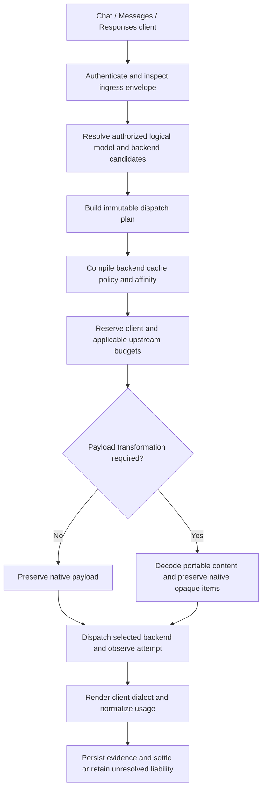

# Router, dialect, cache and accounting inventory

Review date: 2026-11-11. Source: `4baedaf` (workspace version `0.16.2`).
Scope: code and design review, existing automated tests and synthetic local probes.
The initial inventory pass changed no runtime implementation, deployed
configuration, credentials or external provider.
The pre-existing untracked TD-0033 document was left untouched.

This inventory describes the initial source baseline. The implementation
checkpoint at the end records subsequent workspace fixes; remaining proposals
are not claims of shipped or deployed behavior.
The current goal, constraints and subsequent milestones are maintained in
[TD-0034](../td/TD-0034-protocol-neutral-router-cache-accounting.md).

## Assessment

Sandhi has the foundations for this gateway already. Keep the neutral contract,
provider adapters, two forwarding planes, virtual-key authority and ledger.
An incremental refactor is warranted; a ground-up replacement is not.

The present product is a **key-bound upstream gateway with dialect translation**.
It is not yet a backend selector with a common cache policy and uniform durable
accounting. Basic Chat-to-Codex, Chat-to-Anthropic and native OpenAI success does
not establish agent-loop or cache fidelity across every combination.

The intended target should explicitly separate:

1. Client dialect: Chat Completions, Anthropic Messages, or Responses.
2. Logical model: what the client requests and its key may access.
3. Backend instance: actual model, endpoint protocol, endpoint profile, credential
   reference, account scope and capabilities.
4. Cache intent and its backend-specific implementation.
5. Logical requests, physical dispatches, raw token measurements and allowance charges.

## Existing capability inventory

| Area | Present implementation | Practical boundary |
| --- | --- | --- |
| Client protocols | `/v1/chat/completions`, `/v1/messages`, `/v1/responses`; also Gemini ingress | Dialect auth, error rendering, buffered responses and SSE exist. Native feature coverage is incomplete. |
| Neutral runtime | `ChatRequestV1`, messages, tools, media, reasoning controls, metadata; `ChatResponseV1` and stream events | Good common baseline. No first-class cache intent, block cache metadata, opaque reasoning-state item or route plan. |
| OpenAI-compatible backends | `OpenAiCompat`, catalog facts, configurable base URL, keyless local backends | Suitable transport baseline for open-weight servers. Wire compatibility alone does not establish model/tool/cache capabilities. |
| Anthropic backend | Native Messages transport, API-key and Bearer auth, typed codec | Bearer transport exists; a symmetric subscription lease/refresh/expiry lifecycle does not. |
| OpenAI Responses backend | Separate native transport and typed item/event codec | Available through `ProviderRuntime`; standard Responses is not selectable through the normal provider configuration/factory. |
| ChatGPT/Codex backend | `ChatGptCodex` Responses profile, fixed Codex base, account header, access-token lease, expiry checks, retry-free dispatch | SSE is mandatory upstream, buffered calls aggregate it; raw forwarding disabled. These endpoint constraints must remain explicit. |
| Backend resolution | Virtual key's `upstream_ref` looks up one `ProviderHandle` | No gateway route groups, logical model mapping, cross-backend selection, health-based selection or backend affinity. Catalog endpoint facts are not such a planner. |
| Forwarding | Same-family raw forwarding, otherwise decode and encode through neutral types | Reuses native cache shape where raw forwarding is eligible. All ingress still goes through decoding/validation first. |
| Anthropic cache controls | Native markers survive raw forwarding; translated requests without an Anthropic bucket get markers on the last tool and last system block | Only stable-prefix placement. Any Anthropic extension bucket suppresses automatic placement. No common TTL/mode/namespace policy. |
| OpenAI cache controls | Same-family raw forwarding preserves fields; encoders clone their own extension bucket | Chat's `openai` bucket and Responses' `openai_responses` bucket do not share cache settings. |
| Cache measurements | Shared parsers; fresh/read/write counters; cache-read status/source and aggregate coverage | Strong existing handling of reported zero versus absent/malformed. Write provenance and lifetime categories are incomplete. |
| Affinity | Derived session IDs and catalog-owned affinity headers, including InferFlux | Session grouping is not provider-independent cache isolation. The OpenAI spec has no session header; session IDs are not automatically emitted as prompt-cache keys. |
| Budgets and identity | Key-bound models/attribution, rate limits, reservations, client and upstream budgets | Reservations are estimates, not proven input/output token bounds. Upstream scope currently uses provider slug, not backend instance/account. |
| Settlement | Legacy settlement plus owned/tracked execution and recovery infrastructure | Owned accounting currently admits a narrow OpenAI-compatible transport subset. Native Anthropic and Responses/Codex are not uniformly supported. |
| Allowances | Neutral raw tokens, global cache-read budget weight, pure per-category allowance calculator | Per-scope durable policy revisions and full operator activation remain pending under TD-0032. No provider-dollar pricing should be put into the neutral meter. |
| Observability | Usage events, SQLite, run grouping, diagnostics and physical-attempt observation | General usage SQL omits several event evidence fields and has no backend-instance/account route dimension. Attempt diagnostics do not imply authoritative multi-backend accounting. |

Primary implementation locations:

- [Ingress and dispatch](../../crates/sandhi-proxy/src/lib.rs): routes at 675;
  key-bound resolution at 2477; provider-slug back-leg scope at 2543;
  output-bound/plane decision at 2653.
- [Preparation](../../crates/sandhi-proxy/src/preparation.rs): decode before plane
  selection, allowlist/policy/identity checks, session derivation, deadlines.
- [Neutral contract](../../crates/sandhi-core/src/chat.rs): content at 35,
  request at 161, capabilities at 431, session derivation at 558.
- [Provider runtime](../../crates/sandhi-providers/src/typed.rs): families at 19,
  handle at 290, owned-accounting eligibility at 357, factories at 551.
- [Gateway provider construction](../../crates/sandhi-proxy/src/operator.rs): 352;
  [configuration](../../crates/sandhi-proxy/src/config.rs): provider entries at 66.
- [Usage parsing](../../crates/sandhi-core/src/usage.rs),
  [field provenance](../../crates/sandhi-core/src/cache_read.rs),
  [usage store](../../crates/sandhi-store/src/lib.rs): SQL projection at 183.

## Findings to address before claiming seamless routing

Priorities below describe implementation order and user impact; they are not
claims of live-provider failures. Local reproductions are identified explicitly.

### P1: Valid Responses shorthand can silently lose user input

`codec.rs:1454` switches only on `item.type`; its default is an empty string.
An input item such as `{"role":"user","content":"hello"}` therefore takes the
skip arm at 1505. The encoder reconstructs `input` or `messages` from neutral
messages, so retaining the original body in extensions does not rescue it.
The same arm skips reasoning/encrypted items.

**Local reproduction:** `/v1/responses` with instructions plus a shorthand user
item, routed to the OpenAI Chat mock, returned HTTP 200. The upstream received
only the system message. This is silent request-content loss.

Normalize shorthand items. Preserve same-backend opaque items in order; reject
unsupported cross-backend state explicitly. Add multi-turn tests, not just a
single successful Responses completion. The subscription profile always uses
the typed path, making this particularly relevant to native Responses clients.

### P1: OpenAI cache-write accounting assumes an obsolete universal zero

`usage.rs:305,333,374` hardcode `cache_creation_tokens: 0`. The Responses parser
subtracts reads only. Current official OpenAI documentation describes models
reporting `input_tokens_details.cache_write_tokens` and disjoint ordinary input,
read and write categories. The Chat parser needs its corresponding protocol
coverage as well; support must be verified per model/endpoint profile.

**Local reproduction:** synthetic Chat usage with total input 11, reads 4 and
writes 3, translated into Anthropic output, reported fresh input 7 and writes 0.
The correct disjoint breakdown is fresh 4, reads 4, writes 3. Neutral total
input stays 11, so total-token checks alone miss this defect. Write-aware
allowances, cost attribution and client cache reports would be wrong.

Parse write counters and lifetime details when supported, validate overlap, and
preserve old payload semantics when fields are absent. Do not infer that the
ChatGPT subscription backend supports every Platform API field or convention.
Translated OpenAI/Responses usage rendering must also retain supported write
details; today `codec.rs:1732,2298` render read details only.

Source: [official OpenAI prompt-caching guide](https://developers.openai.com/api/docs/guides/prompt-caching).

### P1: Cache intent is lost between compatible-looking protocols

`decode_openai_request` stores native cache keys/options in `extensions.openai`.
The Responses encoder reads only `extensions.openai_responses`
(`openai_responses_typed.rs:146`) and has no cache-field mapping. Ordinary
`prompt_cache_key`, retention/options and content-level metadata therefore do
not automatically follow a Chat-to-Responses/Codex request. The reverse
translation has the same ownership problem.

Anthropic markers have a different loss mode. Its ingress joins system blocks
into one text value (`codec.rs:1270`). Its typed encoder rebuilds all messages,
copies system cache controls by index and tool cache controls by name
(`anthropic_typed.rs:122,188–205,240–250`). It does not restore message-block
markers. A marker on the second native system block is not attached to the
single reconstructed block. Thinking/signature blocks are also skipped at
ingress. Raw forwarding protects eligible native calls; this becomes observable
when typed handles or transformations require re-encoding.

Add a representation for block boundaries and cache hints. A generic native
body clone is not enough to preserve ordered, block-specific semantics.

### P1: Provider identity, protocol and authentication are coupled

`ProviderEntry` has no endpoint-family/profile field. The admin factory infers
family from slug (`operator.rs:418`), while `ProviderFamily::for_slug` never
returns `OpenAiResponses` (`typed.rs:66`). The standard Responses factory arm
therefore cannot be reached through ordinary configuration. The special
`openai` + `oauth` branch works, but selects the constrained Codex profile.
A custom Anthropic-compatible provider slug defaults to OpenAI Chat unless a
host constructs its handle explicitly.

Anthropic `bearer` selects Bearer auth, but `oauth` falls through to API-key
auth (`operator.rs:424–427`). There is no Anthropic analogue of the OpenAI
access-only envelope, expiry fence or owner lease publisher in this path.

Make endpoint protocol, endpoint profile and credential kind explicit data.
Retain backward-compatible defaults. Give each subscription profile its own
verified credential lifecycle and capability tests; Bearer header support
alone does not establish subscription integration.

### P1: Durable accounting coverage is narrower than routing coverage

`ProviderHandle::supports_owned_buffered` requires a raw, single-attempt
OpenAI-compatible handle (`typed.rs:357`). The owned handler further restricts
dialect, policy, output limit, streaming mode and idempotency
(`settlement/buffered.rs:132–147`). Enabling that mode rejects unsupported
routes; it does not grant all backends equivalent crash-recovery guarantees.

The general `usage_events` SQL projection stores cache observations but omits
`usage_basis`, `usage_completeness`, outcome, attempt count and upstream request
ID (`sandhi-store/src/lib.rs:183–276`). Richer event and execution evidence
exists elsewhere, but cannot be assumed present for every historical usage row.
`upstream:{provider.slug()}` also groups API and subscription instances of the
same provider together by design.

Before adding failover, define one lifecycle for every backend: admitted,
dispatch authorized, dispatched, terminal evidence, settled or unresolved.
Record backend-instance identity and every physical attempt. Preserve the
existing provider-level scope as an explicit aggregation option rather than
silently changing budget meaning.

### P2: Passthrough is constrained by a translation-grade decoder

Preparation decodes before deciding to forward raw bytes. Responses native
tools without a function name fail at `codec.rs:1396`; Anthropic document and
other unmodelled block types fail in its content decoder. Consequently some
native requests never reach even an otherwise raw-capable backend.

**Local reproduction:** a Responses request with `tools:[{"type":"web_search"}]`
received HTTP 400 before dispatch. The example establishes ingress rejection;
whether a selected backend supports that tool remains a separate capability
decision.

Introduce an admission envelope for raw forwarding: model, streaming flag,
output bounds, identity and inspectable policy content. Run complete semantic
translation only when needed. Input-policy inspection must still cover all
forwarded content; an envelope must not create uninspected extension channels.

### P2: Unrelated Anthropic extras disable automatic caching

`anthropic_typed.rs:134` tests bucket presence, not caching intent.

**Local reproduction:** a plain Chat-to-Anthropic request got an automatic
system marker. Adding only `sandhi_extensions.anthropic.top_k=5` removed it.
This is documented ADR-0013 behavior, rather than an accidental regression,
but it is an unsuitable long-term coupling for seamless cache management.

Use an explicit cache mode with defined precedence. Preserve the documented
empty-bucket opt-out during migration. Do not mistake that legacy opt-out for
a provider-native instruction that disables every form of upstream caching.

### P2: Agent compatibility needs conversation-state and limit contracts

Native reasoning/signature/encrypted state cannot be translated as ordinary
prose or transferred between providers. Responses `previous_response_id` is
kept only in its native bucket; switching to Chat/Anthropic does not expand
the referenced history. The gateway has no common continuation-state owner.

The Codex encoder also removes `max_output_tokens` and temperature by profile
design (`openai_responses_typed.rs:230`). A budget-injected output limit is
therefore not an upstream-enforced generation limit on that endpoint.
Conversely, the Anthropic encoder requires an output limit, while a stock
OpenAI caller may omit one. These are capability/normalization decisions that
must happen before dispatch, with a documented route default or explicit refusal.

Keep provider-bound state pinned to a compatible backend/account. Allow
switching only from complete portable history, or provide an explicit history
materialization mechanism. Advertise estimate-based budgets honestly and
distinguish request acceptance from parameter support.

## Proposed design

### 1. Explicit backend definitions and authorized route planning

Introduce a backend registry entry containing an opaque backend ID, provider
slug, endpoint family, endpoint profile, base URL, credential reference,
account-scope reference and model-specific capabilities. Secrets remain in the
vault. Profiles include standard Chat, standard Responses, constrained Codex
Responses, and independently verified Anthropic API/subscription profiles.

Keep existing `upstream_ref` as a fixed single-backend route. Add opt-in route
groups and logical-model mappings, including the actual backend model ID.
Authorize both the client-facing alias and eligible backend mapping. Discovery
must expose only callable models/routes and must not imply that a model name
works on every candidate backend.

Resolve authentication and ingress metadata before backend planning, then
freeze a `DispatchPlan`: ingress dialect, requested/resolved model, backend and
credential version, endpoint profile, native/translated decision, cache plan,
deadline, budget scopes and accounting policy revision. Execution must use
this exact plan; configuration changes must not retarget an in-flight call.

### 2. Loss-aware canonical content with native attachments

Extend the existing neutral contract additively or through an explicitly
versioned successor. Preserve content-block boundaries and attach native
metadata to stable block/item IDs rather than matching only array indices.
Represent opaque native reasoning/tool items as backend-bound attachments;
do not manufacture interchangeable reasoning state.

Each adapter declares supported features and returns one of: supported,
explicitly transformed with declared semantics, or rejected. Preserve unknown
native fields on safe same-profile routes. Avoid silently dropping fields
that affect content, tools, continuation, cache behavior or token limits.

### 3. Cache policy as a separate compilation step

Represent intent independently of extension-bucket presence: preserve native,
automatic stable prefix, automatic conversation prefix, explicit breakpoints,
or request to disable gateway-added caching. Include an optional lifetime,
authenticated namespace scope, client cache key and stable-prefix version.

An adapter compiles that intent to supported native controls. Anthropic
placement and OpenAI cache options are not interchangeable one-for-one; TTLs,
breakpoint rules and support vary by model and endpoint profile. Reject an
unsupported required control, or expose an explicit best-effort decision.
Changing the current default placement needs an ADR-0013 compatibility update.

Keep conversation ID, cache namespace, prefix identity and backend affinity
as separate concepts. Build namespace isolation from authenticated authority,
not an unscoped client `user` value. A session hash is an affinity hint, not
proof of provider cache isolation. Do not insert attribution strings into
prompt content to obtain namespace separation.

Cache reuse remains local to the actual provider/model/account/region/server
capability. A backend switch can be transparent in API shape but produce a
cold cache. Existing provider-side state is not portable KV state. There is
no need to introduce response memoization to solve prompt-cache routing.

Sources: [OpenAI prompt caching](https://developers.openai.com/api/docs/guides/prompt-caching)
and [Anthropic prompt caching](https://platform.claude.com/docs/en/build-with-claude/prompt-caching).
Those API documents do not establish identical support on subscription endpoints.

### 4. Raw measurements and allowance accounting remain separate

Retain disjoint fresh input, cache reads, cache writes and output, plus explicit
reasoning inclusion. Add supported write-lifetime splits and provenance for
all categories needed by allowances. Preserve unknown, absent, malformed and
reported-zero distinctions through parsing, persistence and aggregation.

Where a protocol reports inclusive input, validate
`total_input = fresh + read + write`; Anthropic's fresh input is already
exclusive. Re-encoding client usage must follow that client's convention.
Never add reasoning twice when output already includes it. A cache-hit report
is provider-reported evidence, not proof of physical backend execution reuse.

Persist logical request ID, execution ID, physical attempt ID, backend/account
scope, model mapping and immutable accounting policy revision. Settle physical
resource consumption independently of deduplicated logical usage views.
Continue TD-0032 rather than inventing a parallel allowance calculator. Token
allowances are gateway policy, not a conversion of subscription limits into
guaranteed provider quota or API-dollar pricing.

### 5. Switching and multiplexing semantics

Start with deterministic selection among authorized candidates and stable
affinity. Backend selection must respect capabilities, endpoint profile,
account state, model mapping, cache compatibility and local budget eligibility.
Health/rate-limit feedback can be added after these invariants are testable.

Choose among candidates before dispatch. Post-dispatch fallback is a separate
operation: timeouts can mean an already-running inference, and streams cannot
be spliced across models. Require explicit replay policy, retain the failed or
ambiguous attempt's liability, reserve for the next attempt and account for
both. Credential/policy denials must not silently move data to a different
provider. Do not implement concurrent hedging as an incidental retry feature.

## Work sequence and acceptance

| Stage | Work | Acceptance gate |
| --- | --- | --- |
| 0 | Freeze the supported ingress/backend/profile matrix; add regressions for the confirmed losses | Responses shorthand and cache-write fixtures fail for the right reason before fixes; baseline remains green. |
| 1 | Fix request loss, cache-write parsing/rendering and native-state preservation/refusal | Content and usage conservation on buffered and streamed paths; multi-turn tool/reasoning round trips. |
| 2 | Explicit backend definitions and immutable single-backend dispatch plans | Standard Responses and custom Anthropic-compatible endpoints configurable; API and subscription instances distinguishable; old configs preserved. |
| 3 | Common cache intent, stable block metadata and adapter compilation | Native controls survive; automatic/explicit/opt-out precedence is independent of unrelated extras; unsupported controls are observable. |
| 4 | Generalize qualified execution evidence and persist policy/backend dimensions | Every admitted backend/profile has declared interruption/restart/settlement behavior; unknown liability cannot become a final zero. |
| 5 | Add authorized route groups, model mappings and affinity | Same client/key can reach only its eligible backends; discovery, policy, deadline and budget use the resolved plan. |
| 6 | Optional controlled failover; provider-specific live cache qualification | Each actual attempt accounted once; no ambiguous transparent replay; independent warm/cold and namespace evidence. |

Do not start by adding a provider-selection `match` inside each HTTP handler,
forcing all native traffic through neutral JSON, or replacing the ledger.
These would multiply the current fidelity and accounting seams.

## Required cache and agent test matrix

Cross these dimensions where each profile actually supports the feature:

- Ingress: Chat, Messages, Responses.
- Backend: OpenAI-compatible API/local, Anthropic API, standard Responses,
  constrained Codex Responses, and separately qualified Anthropic subscription.
- Delivery: buffered and streaming; raw forwarding and translated/re-encoded paths.
- Conversation: text, parallel tools, tool results, images/files where supported,
  shorthand Responses input, opaque reasoning/signatures and continuation IDs.

Required assertions:

1. Preserve native bytes when no transformation is required. When a
   transformation is required, preserve ordered content and applicable cache
   boundaries, not merely output text.
2. Preserve Chat-to-Responses cache keys/options and reverse mappings where
   semantically supported; separate unsupported-control refusal from missing fields.
3. Verify Anthropic tools/system/message breakpoints, mixed supported TTLs,
   explicit marker precedence, unrelated native extras and opt-out migration.
4. Test cold then repeated warm prefixes above each model's documented minimum,
   changed suffix, changed tool/system prefix, expiry, changed backend/account
   and namespace isolation. Treat a hit as a measured result, not a guaranteed
   outcome of sending the same request twice.
5. Test reported zero, absent, malformed, inconsistent totals, write categories,
   lifetime splits and reasoning overlap. Compare wire response, neutral event,
   persisted records, aggregates and settled allowance units.
6. Interrupt before input usage, after Anthropic `message_start`, after content,
   after final usage and at EOF; include client disconnect, timeout and process
   restart. Each path must settle qualified evidence or retain explicit liability.
7. Exercise expired/replaced credentials, model denial, rate limits, local and
   upstream budgets, configuration changes while in flight and attempted replay.
8. Run real SDK multi-turn loops. Current basic OpenAI SDK conformance does not
   exercise `client.responses`; successful Chat SDK calls do not certify it.

Mock suites establish transformation/accounting contracts. Live provider
acceptance must independently record requested controls and observed cache
usage, with synthetic prompts and actual backend/profile identity. Existing
InferFlux cache audit/replay evidence in TD-0028 is useful, but it is not
certification of Anthropic, OpenAI Platform or subscription cache behavior.

## Validation performed in this review

- `cargo test --locked -p sandhi-core -p sandhi-providers -p sandhi-proxy --lib --test cache_read_availability --test subscription_gateway --test terminal_stream_accounting --test proxy`
  — **680 passed**, zero failed or ignored. This is the selected library and
  integration suite, not the full workspace/all-features/binding matrix.
- `python -m pytest tests/sdk-conformance/test_openai_sdk.py tests/sdk-conformance/test_anthropic_sdk.py tests/sdk-conformance/test_reasoning.py -q`
  — **35 passed**. Local real proxy binaries and synthetic upstreams; no provider accounts.
- Five additional disposable local gateway probes confirmed four behaviors:
  lost OpenAI write category; dropped Responses shorthand user item; rejection
  of a native non-function Responses tool; and automatic Anthropic cache markers
  disappearing when an unrelated native bucket is supplied (two comparison calls).
  The maintainer probe was temporary; it adds no permanent regression tests.

Relevant prior design work to continue:
[ADR-0004](../adr/0004-two-plane-proxy-and-enforcement-boundary.md),
[ADR-0010](../adr/0010-cache-read-reporting-availability.md),
[ADR-0013](../adr/0013-native-extensions-passthrough-and-auto-cache-control.md),
[ADR-0014](../adr/0014-dialect-parity-counting-and-streaming-fidelity.md),
[TD-0028](../td/TD-0028-cache-accounting-availability.md),
[TD-0032](../td/TD-0032-weighted-allowance-policy.md), and
[subscription gateway](../subscription-gateway.md).

## First implementation checkpoint

The first candidate increment fixes the confirmed shorthand Responses message
loss and OpenAI cache-write categorization, with no public neutral-contract
field changes. It does not implement dynamic routing or a common cache policy.

- Responses ingress treats role-bearing items with omitted `type` as messages.
  System, developer, user and assistant history survives translation.
- Chat and Responses parsers retain optional `cache_write_tokens` in existing
  `cache_creation_tokens`, subtracting reads and writes once from inclusive
  input. Compatible hit/miss precedence remains supported. Absent writes keep
  their previous zero default; lifetime splits and write provenance remain open.
- Qualified buffered/streaming Chat usage rejects malformed write counters and
  overlapping read/write totals. Legacy parsers retain their lenient numeric
  behavior for malformed inputs, including saturation and inconsistency warnings.
- Translated Chat/Responses usage renders nonzero write details. The previous
  payload shape is retained when no write count is measured.
- The new matrix exposed a further bug: a Chat upstream's `finish_reason`
  precedes its trailing usage, so the translated Responses/Anthropic terminal
  envelope could contain zeros. The Chat decoder now retains Finish until
  protocol completion, after final usage, and ends at `[DONE]` without awaiting
  HTTP EOF. A prior transport error produces an error rather than successful Finish.

Regression coverage includes an 18-case matrix: three ingress dialects × three
OpenAI backend profiles (Chat, standard Responses, constrained Codex Responses)
× buffered/streaming. It compares upstream message preservation, client usage,
neutral events, SQLite categories and both budget scopes. The fixture reports
10 fresh + 60 reads + 30 writes + 20 output = 120 raw units; a 0.1× read allowance
settles 66 units, with output-included reasoning counted once. Codex is exercised
through a synthetic runtime seam, not a real subscription account.

Additional tests cover shorthand history with the official OpenAI SDK, malformed
write evidence, parser/renderer conservation, completion ordering at every byte
split with LF/CRLF, and a transport error after finish reason but before usage.
Original failing regressions reproduced missing history, writes categorized as
fresh input and invalid write evidence being accepted before implementation.

Native opaque reasoning/state preservation, request-side cache-key translation,
cache-policy/bucket coupling, explicit backend configuration and uniform durable
execution coverage remain open. In particular this increment does not claim
subscription cache-control parity or live warm/cold cache acceptance.

Checkpoint validation:

- `cargo test --locked --workspace -q`: final run **997 passed, 6 ignored,
  zero failed**. Ignored tests remain opt-in; this is default-feature workspace
  validation, not the separate binding or all-feature matrix.
- SDK/reasoning command above, including the new Responses SDK cases:
  **37 passed**.
- `cargo clippy --locked --workspace --all-targets -- -D warnings`,
  `cargo fmt --all --check`, and `git diff --check`: passed.
- One earlier unrestricted full-workspace attempt failed the existing
  `owned_buffered_back_leg_never_races_its_primary_settle` stress test with
  HTTP 502 on call 56. The isolated 200-call run and final full-workspace rerun
  passed. No cause was established and no settlement implementation was changed
  to suppress that intermittent result; retain it as a follow-up observation.
