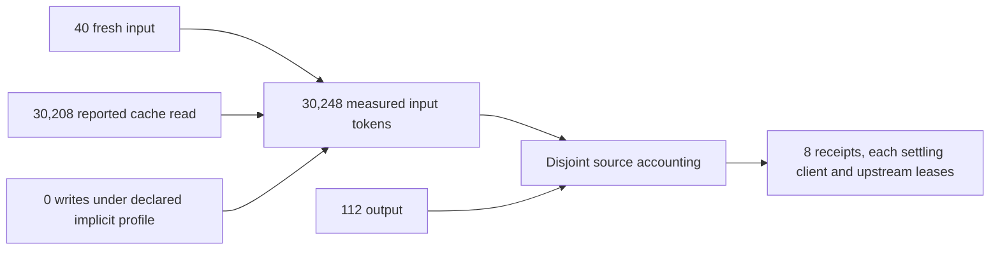

# GLM Messages streams: portable output, native state and cache accounting

The corrected live run passed **8/8 SDK calls and joined physical-attempt, usage
and paired-settlement checks**, with gateway exit 0. It used GLM `glm-5.3` at
`https://api.z.ai/api/anthropic`, explicit `anthropic_implicit_cache`, a logical
route, two identical synthetic-prefix calls per client and **explicitly disabled
thinking**. SDK/provider retries were disabled. This is endpoint/model/control
qualification, not universal Anthropic or subscription acceptance.

| Client protocol | Calls | Joined receipts | Processing plane |
|---|---:|---:|---|
| OpenAI Chat | 2 | 2 | Translation |
| Anthropic Messages | 2 | 2 | Transparent |
| OpenAI Responses | 2 | 2 | Translation |
| Gemini | 2 | 2 | Translation |

All eight calls reported cache reads. Source totals were **40 fresh input,
30,208 cache read, zero cache write and 112 output tokens**. Reasoning was **not
separately reported**; absence is not a measured reasoning zero. The observed
input read share was **99.87%**. Earlier diagnostic calls had already used the
synthetic prefix, so this does not establish a cold-to-warm improvement, cache TTL,
expiry or paid cache-write behavior. Read share is not a monetary saving or a
subscription quota conversion.



## Retained failures and fixes

The [default-thinking report](artifacts/zai-messages-streams-default-thinking-2026-11-12.json)
passed the two native Messages calls. Six translations refused nonportable thinking
state, retained partial evidence and had no final receipt; shutdown exited 124.
A separate structural inspection confirmed a nonempty signature delta. Its
[metadata-only summary](artifacts/zai-messages-stream-shapes-2026-11-12.json)
contains field names, types, counts and signature length, without text, signature
values or credentials. The source signature guard remains in place.

An explicit request to disable thinking then exposed two request-control bugs:
the Messages encoder removed the control, relying on provider defaults, and Gemini
ingress did not recognize the installed SDK's nested `thinking_budget` spelling.
The [initial controlled report](artifacts/zai-messages-streams-initial-control-2026-11-12.json)
joined six calls; both Gemini calls failed and shutdown exited 124. It was started
before the failed Gemini SDK case was noticed and is retained as diagnostic
evidence. It is not a successful qualification run.

The encoder now sends an explicit disable, including Responses effort `none`;
contradictory controls refuse. Gemini accepts the observed snake-case spelling
and `thinkingBudget`, rejects duplicate aliases and fences unrepresented controls
to native routes. Structured Gemini stream errors now have numeric HTTP codes.
The four real SDK intent tests prove the resulting Messages request includes the
disable. Default Google SDK failure handling is also checked for one origin send;
a failed body may surface as a transport error.

The [corrected report](artifacts/zai-messages-streams-qualified-2026-11-12.json)
contains eight new qualification calls after those changes. It does not replay or
repair earlier executions. Failed calls may have consumed provider quota; their
unknown accounting is not converted into zero usage. Defaults remain unchanged,
and unsupported signed-state translation still fails explicitly.

## Reproduction and artifact identity

The harness reads the existing credential from the external settings file into
memory, uses a disposable private gateway and writes sanitized evidence. No real
credential belongs in a command argument, repository configuration or artifact.

```bash
python scripts/qualify_zai_router.py --live --backend messages \
  --accounting tracked --delivery streaming --logical-route \
  --cache-pairs --cache-profile implicit_only --thinking disabled \
  --output /tmp/zai-messages-streams.json
```

| Result | Sanitized qualification summary |
| --- | --- |
| Default thinking, negative | [Summary](artifacts/zai-messages-streams-default-thinking-2026-11-12.json) |
| Initial explicit control, negative | [Summary](artifacts/zai-messages-streams-initial-control-2026-11-12.json) |
| Corrected explicit control, qualified | [Summary](artifacts/zai-messages-streams-qualified-2026-11-12.json) |

The summaries retain SDK versions and measured results; original operational records are retained privately. Production source
changes after a report require their own scoped evidence; a matching model name
does not qualify a different codec, deployment or subscription. See
[ADR-0031](../adr/0031-qualified-messages-stream-ownership.md) for source ownership,
native-state boundaries and the remaining full-goal gates.
