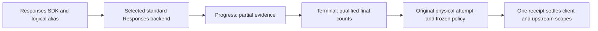

# GLM tracked Responses streaming qualification

Two authorized live calls used `glm-5.3` through Z.AI's advertised standard
Responses endpoint, a private disposable gateway and a logical alias. Both calls
used the OpenAI Responses SDK with retries disabled and the same synthetic long
prefix. This extends [M5d buffered evidence](zai-router-tracked-buffered-2026-11-11.md)
with one narrow streaming pair; it is not subscription or translated-stream acceptance.

| Call | Fresh input | Cache read | Separate write | Output including reasoning | Reasoning subset |
| --- | ---: | ---: | ---: | ---: | ---: |
| First | 3,781 | 0 | 0 | 32 | 18 |
| Repeated | 5 | 3,776 | 0 | 30 | 16 |

The repeated request reported 99.87% of its input as cached. This measures token
reuse for these calls, not monetary savings, billing, a write/TTL guarantee or
transfer of cache between providers. The first explicit zero remains distinct from
an absent cache counter. Reasoning is already included in output and is not added again.

Both SDK results matched the two durable observations and both original
attempt/context/usage/paired-receipt joins. There were two intents, two contexts,
two physical attempts, two terminal observations, four reservations and two
receipts. Both budget legs constrain the same call and are not additive usage.
The gateway exited zero with no accounting diagnostics. Credentials and temporary
configuration were removed with the disposable gateway; the retained report was
checked for absence of the configured credential.

Evidence: [redacted report](artifacts/zai-router-tracked-responses-stream-cache-pairs-2026-11-11.json).
Finished at `2026-11-12T02:24:09Z` (November 11 locally).

- Report SHA-256: `50cb12ed7ba8869d0cd811a203ae65ae9d4953078d92cf48642e10456177812d`.
- Gateway SHA-256: `181b57b3ac860679995897e093728e086450302c1f42cf33b6a946c8320d4e5f`.
- Source contract: [ADR-0026](../adr/0026-qualified-responses-stream-accounting.md).

The parser, response owner and seven real process/SDK cases separately cover
incomplete/failed terminals, partial-only evidence, missing/malformed usage,
post-terminal data and unchanged single-attempt ownership. This live pair does
not replace those synthetic fault drills or qualify Codex, Gemini upstreams,
Anthropic subscriptions, tool loops or deployed lifecycle.
