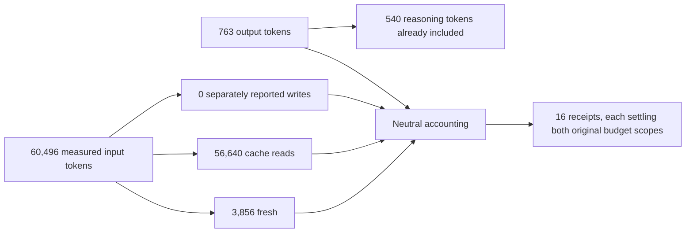

# GLM tracked translated streaming and cache evidence

This opt-in live run used the existing external Z.AI coding credential, synthetic
prompts and a disposable gateway. No credential or production gateway was changed.
Chat, Messages, Responses and Gemini SDK clients used logical aliases to select
Chat and Responses coding backends, with two calls per cell. SDK retries were zero.

| Result | Verified evidence |
| --- | --- |
| Calls | 16/16 parsed successfully |
| Durable joins | 16/16 request → context → physical attempt → final usage → paired receipt |
| Processing plane | 12 translated, four transparent |
| Source profiles | Chat: `openai_terminal_chunk_usage`; Responses: `standard` |
| Cache observations | 15 calls reported reads: eight Chat, seven Responses |
| Shutdown | Gateway exit 0, complete accounting inventory |
| Artifact SHA-256 | `773deec2bcecece1bf42dab2e5ff8c7adb1bcd28133f81d6ca2b247d6dcb23a2` |

The [sanitized report](artifacts/zai-router-tracked-translated-streams-qualified-2026-11-11.json)
records the gateway binary/harness hashes, exact endpoint/model selections, SDK
versions, source counters, physical attempts and paired settlements. It identifies
`glm-5.3`, OpenAI 2.18.0, Anthropic 0.79.0 and google-genai 1.75.0. The producer
binary hash is `438d6ef7e44a05a4404bef26fda2e9f7537abfe1e76eb3c890bfc7082e01ed58`.
This is unreleased source evidence, not qualification of a deployed service.



The measured input read share was 93.63%. This is not a percentage price saving,
subscription quota conversion or guaranteed cache hit. The calls intentionally
reuse a synthetic prefix, and prior qualification traffic can prewarm it. The run
is not a controlled cold-start/TTL/minimum-prefix experiment and does not prove
cache migration between endpoints, accounts or providers. Zero separate writes
means those endpoints did not report that category; it does not establish that
cache construction was free. Reasoning is a subset of output and is not added again.

## Retained failure and correction

The [initial report](artifacts/zai-router-tracked-translated-streams-initial-2026-11-11.json)
failed all eight Chat accounting joins. The native Chat SDK could finish while
its accounting remained unresolved; translated clients received body failures.
Standard qualification rejected `InvalidUsage(NonFinalUsage)` because Z.AI puts
request-total usage on one terminal choice, followed by `[DONE]`, rather than an
empty-choices chunk. The eight Responses joins passed. The gateway exited 124
with retained liabilities; unavailable counters were not treated as measured zero.

[ADR-0029](../adr/0029-explicit-terminal-chat-usage-profile.md) adds an explicit
placement profile for that exact contract. Standard qualification stays unchanged.
The corrected run consists of new, separately recorded test calls; the gateway did
not replay the ambiguous calls. Both reports are retained. The verifier also joins
the selected processing plane, so SDK success alone cannot count as translated
accounting acceptance.

## Reproduce without exposing the credential

Build the gateway from the intended checkout, install the SDK dependencies in an
isolated environment and run:

```sh
python scripts/qualify_zai_router.py --live --accounting tracked \
  --delivery streaming --backend chat --backend responses \
  --cache-profile implicit_only --cache-pairs --logical-route \
  --output /tmp/zai-tracked-streams.json
```

The key remains in the existing external settings file; the harness stages it in
a private temporary vault and sanitizes reports. The harness declares endpoint
profiles explicitly. Use `--verify report.json` for offline validation without
inference. Live Codex/Anthropic subscription behavior, native Gemini/Message source
stream qualifiers, full tool/media loops and the retained accounting-wait stress
failure remain separate [goal gates](../td/TD-0034-protocol-neutral-router-cache-accounting.md).
