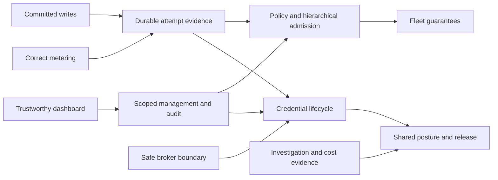

# TD-0026: Gateway product evolution and delivery plan

Status: historical product roadmap. This record explains the original delivery
slices; current shipped behavior is described by the operator guides, owning ADRs
and release notes. Later execution-accounting work is described in
[TD-0034](TD-0034-protocol-neutral-router-cache-accounting.md).

## Mandate

Work backward from a coherent product vision to user journeys, requirements, architecture,
contracts, implementation slices, and executable acceptance gates. Cover developer and operator
UX, operational tracking, security, usage and cost controls, reliability, and ecosystem integration.
Co-design credential lifecycle and shared capabilities with SentinelPass and AgentBrowser. Keep proposed behavior
distinct from shipped behavior and preserve ownership of existing ADRs and TDs.

Planning completion is separate from implementation, integration and publication.

## Activity tracker

| ID | Activity | State | Evidence / next action |
|---|---|---|---|
| A01 | Inventory vision, designs, contracts, implementation, and tests | Complete | Evidence register F01–F16 links findings to source, impact and acceptance |
| A02 | Research gateway capability and guarantee expectations | Complete | Primary documentation inspected on 2026-09-04; translate findings into independent product requirements |
| A03 | Review SentinelPass integration and reciprocal opportunities | Complete | Adapter plus public broker source at `00d1e7de` inspected; SP0–SP4 proposed; live daemon validation remains an implementation gate |
| A04 | Define working-backward vision, journeys, and success measures | Complete | J01–J06 and R01–R13 drafted; self-hosted-first and existing pricing boundary used as stated defaults, not user sign-off |
| A05 | Produce evidence register and target architecture | Complete | Confirmed behavior, gaps and validation hypotheses distinguished; component/contract/failure ownership defined |
| A06 | Sequence implementation with dependencies and release gates | Complete | W01–W14 below map requirements, findings, owners, dependencies and acceptance |
| A07 | Validate baseline and review documents | Complete | Workspace and IPC-feature tests passed; whitespace/content checks and 68 local documentation links passed across five files |
| A08 | Extend co-design to browser execution and joint smoke coverage | Complete | AgentBrowser inspected and rebuilt at `dec28b388`; AB01 real-engine synthetic smoke passed; AB02–AB05 broker/evidence/REST contracts remain proposed |

## Tracking rules

- States: Pending, In progress, Blocked, Complete, Deferred. Record the concrete reason for a block.
- Each delivery slice records owner role/repository, dependencies, acceptance evidence, and status.
- Update this file and the documentation index together when lifecycle status changes.
- Update owning TDs when implementation lands; this umbrella does not supersede accepted ADRs.
- Estimates describe effort ranges after dependencies clear, not committed delivery dates.
- Cross-repository designs are proposals until both contract implementations and compatibility
  checks exist. Never treat a published message type as proof of daemon authorization behavior.
- A slice marked Complete below is implemented and locally verified, not necessarily merged or
  released. Track remote CI, integration and publication separately in the checkpoint table.

## Historical release checkpoints

| Milestone | Delivered boundary | Public record |
| --- | --- | --- |
| 0.6.0 | Initial single-node engineering baseline and all-target publication | [Release](https://github.com/anvai-labs/sandhi/releases/tag/v0.6.0) |
| 0.6.1 | Diagnostic source-contract additions, with an explicit Rust source-compatibility warning | [Release](https://github.com/anvai-labs/sandhi/releases/tag/v0.6.1) |
| 0.7.0 | Original S1–S5 producer/gateway/consumer contract integration | [Release](https://github.com/anvai-labs/sandhi/releases/tag/v0.7.0) |

These historical engineering releases did not certify production usability,
live broker lifecycle, fleet behavior or deployment-specific recovery. Consult
[release safeguards](../product/release-safeguards.md) for the maintained process.

## Review outputs

- [Checkpoint adversarial review](../reviews/checkpoint-adversarial-review-2026-09-05.md):
  confirmed regressions, corrections, re-review evidence and explicit remaining gates.
- [Evidence register and codebase review](../reviews/gateway-review-2026-09-04.md): F01–F16,
  baseline validation and capability disposition.
- [Vision, journeys, requirements and architecture](../product/gateway-vision-and-requirements.md):
  J01–J06, R01–R13, component seams, accounting and security invariants, proposed success measures.
- [SentinelPass co-design](../upstream/sentinelpass-gateway-codesign.md): reciprocal capabilities
  S01–S06, existing trust boundary, proposed contracts, failure behavior and SP0–SP4 delivery.
- [Browser, gateway and vault co-design](../upstream/browser-gateway-vault-codesign.md):
  component boundaries, secret resolution, correlated evidence and AB01–AB05 joint delivery.

## Delivery tracker

Implementation states are tracked per slice below. Effort ranges are rough engineer effort after dependencies
clear, excluding external release lead time. Owners below are responsible roles/repositories;
individual assignment and capacity are not assumed. Every slice needs a reviewable change,
verification evidence and an operator-facing release note before its status becomes Complete.

| ID | Delivery / traceability | Owner | Depends on | Estimated effort | Acceptance / evidence to attach | State |
|---|---|---|---|---|---|---|
| W01 | Truthful authenticated dashboard; R01, F01/F06/F07 | Sandhi proxy/UI maintainer | Baseline | 3–5 days | Embedded assets, shared auth, explicit data states, script-safe actions and fallible reads; 18 browser/fault cases plus AB01 smoke pass; workspace coverage 87.54%, native IPC-feature 172 tests pass; operator guide/changelog updated | Complete |
| W02 | Committed management writes; R02 foundation, F02 | Sandhi operator/store maintainer | Baseline | 3–5 days | Complete: failed commits preserve live metadata; strict budget input; explicit config/inline-alert partial outcomes; 20 real HTTP/SQLite/restart/concurrency/UI/CLI regressions pass plus signed-cap store test; release/operator notes updated | Complete |
| W03 | Metering semantics and guarantee correction; R03, F03/F04 | Sandhi core/providers maintainer | Baseline | 1–2 weeks | Explicit reasoning inclusion and minor-7 schemas; legacy totals preserved; parser/plane/store/ledger/binding corpus and 24 end-to-end cases pass; [estimated-reservation capability matrix](../product/metering-and-budget-guarantees.md) and concurrent overshoot regression | Complete |
| W04 | Safe broker integration and onboarding; R07/R13, F08/F09, SP0/SP1 | Sandhi store/proxy + SentinelPass protocol owners | Baseline | 1–2 weeks | Native real-handler reproduction fixed; bounded runtime/queue, explicit capabilities, read-only API/CLI/browser registration and 16 broker scenarios pass; [integration contract](../product/broker-integration-contract.md). Live daemon certification remains SP4; generations/revocation cutoff remain W09 | Complete |
| W05 | Attempt accounting and durable evidence; R03/R05/R11, F05/F06 | Sandhi core/store + downstream consumer owner | W02/W03; accounting-contract review | 2–4 weeks | W05a complete: atomic settlement receipts, bounded/fenced delivery claims and 14 focused tests; [substep contract](../product/attempt-accounting-and-evidence.md). W05b–e retain physical-attempt capture, proxy integration, recovery, export and consumer review gates. A settlement receipt is not an upstream attempt | In progress |
| W06 | Operational readiness and recovery; R05/R12, F12/F13 | Sandhi operations/proxy maintainer | Baseline; W05 for authoritative backlog | 1–2 weeks | W06a/b/c and W06d automation verified and integrated. UA01 accepts engineering evidence for this release; remaining release decisions pending. Hands-on usability deferred until before production, not performed. See TD-0020 and checkpoint gates | In progress |
| W07 | Scoped management, audit and egress security; R06/R10, F07/F11/F15 | Sandhi security/API + control-plane owner | W01/W02; identity-boundary review | 2–4 weeks | Cross-scope CRUD/query denial, mutation audit, bounded/redacted egress and webhook delivery, auth/session threat model, failure-injection evidence | Pending |
| W08 | Declarative policy and hierarchical usage controls; R02/R04/R08, F10/F16 | Sandhi core/store + policy consumer owner | W02/W03/W05/W07 | 2–4 weeks | Reconcile TD-0005; durable revision/conflict preconditions, shadow/effective policy, signed freshness, all-scope/window atomic reservation, rate/token/concurrency tests, explainable denial | Pending |
| W09 | Credential generations and revocation; R07, F09, SP2 | Sandhi credential manager + SentinelPass owners | W04/W05/W07; broker contract release | 2–3 weeks | Bounded new-dispatch cutoff, generation switch/drain, restart and missed-event recovery, broker outage/expiry matrix | Pending |
| W10 | Operator investigation and cost evidence; R01/R05/R11, J02/J03/J04/J06 | Sandhi UI/API + pricing consumer owner | W05/W06/W07; W08 for full policy view | 2–3 weeks | Paginated/filterable timeline, reserved/uncertain/final quantities, data freshness; downstream price-version reconciliation; complete user drills | Pending |
| W11 | Governed routes and bounded guardrails; R09/R10, F14/F15 | Sandhi providers/proxy maintainer | W03/W05/W07/W08; measured workload | 2–4 weeks | Concurrent half-open breaker, eligible routes, retry accounting, affinity/residency restrictions, bounded stream/content inspection and false-positive evaluation | Pending |
| W12 | Fleet and long-lived storage guarantees; R04/R12, F10/F13 | Sandhi store/operations maintainer | W05/W06/W08; TD-0007 backend decision | 3–6 weeks | Two-replica admission races, partition/failover behavior, clock/TTL recovery; bounded history and rollup equivalence; restore and upgrade drills | Pending |
| W13 | Reciprocal posture and lifecycle release; R07/R13, S03/S04/S05, SP3/SP4 | Sandhi + SentinelPass owners | W07/W09/W10; scoped metadata ADR | 2–4 weeks | Authorized metadata projection, usage freshness, zero cross-domain reuse inference, old/new protocol and Unix/Windows matrix, joint runbook | Pending |
| W14 | Optional monetary admission and protocol breadth | Sandhi + relevant consumer owners | W05/W08/W10; named demand; relevant ADR gates | Spike 2–5 days each; implementation estimated after decision | Monetary reservation/compensation design; separate modality/MCP/duplex/H2 admission evidence; no scope admitted by checklist alone | Deferred |

Critical dependency chain for governed operation:

The table is authoritative for dependencies; the diagram shows the major chains only. W01–W04
and initial W06 measurements can proceed independently with adequate staffing. Land related contract changes in dependency order and preserve each component's review and acceptance boundaries.

## Milestones and review checkpoints

### M1 engineering acceptance

The initial milestone combined operator usability, truthful metering, safe
credential-broker boundaries and a measured single-node baseline. Automated
engineering results do not substitute for observed usability or qualify a live
broker deployment. The [acceptance boundaries](../product/m1-acceptance-decisions.md)
retain those distinctions.

### Milestone definitions

1. **M0 — review package:** A01–A07 complete, provisional decisions explicit, findings reproducible
   from cited code and future validation clearly separated. Complete; M1 is now underway.
2. **M1 — trustworthy single-node baseline:** W01–W04 plus initial W06. A configured dashboard is
   usable, control updates are truthful, metering semantics are pinned and broker calls are safe.
   Usability review and deployment acceptance remain distinct from engineering tests.
3. **M2 — accountable team gateway:** W05–W10. Scoped authority, durable attempt evidence,
   hierarchical policy, incident investigation and credential lifecycle work together. Monetary
   reporting remains downstream. Complete operator/security/finance scenario reviews.
4. **M3 — resilient governed deployment:** W11–W13 as needed by deployment demand. Publish tested
   routing, fleet limits, storage longevity, recovery and credential-posture guarantees. No fleet
   claim before shared-ledger and distributed failure gates pass.
5. **M4 — admitted expansions:** selected W14 spikes, each with a named adopter and separate scope
   decision. Defer unproven breadth instead of making M1–M3 depend on it.

### M2 engineering sequence

M2 starts with W05b because physical-attempt identity and terminal evidence are prerequisites for
W08 policy reconciliation, W09 credential cutoff evidence and W10 operator/cost investigation.
Logical usage events and aggregate attempt counts cannot safely stand in for that evidence.

1. Define an internal, versioned attempt-observation contract with opaque execution/attempt
   identity, provider/model facts, transport outcome, bounded provider correlation, neutral usage
   and explicit final/partial/unavailable measurement state. Exclude request bodies, credentials,
   raw headers, prices and identity-provider authority.
2. Instrument the actual provider transport boundary across typed and transparent planes. Emit no
   physical attempt for validation/circuit/admission rejection before send; give each retry its own
   identity; classify setup/whole-call timeout, caller cancellation, provider rejection, transport
   failure, successful terminal usage and interrupted-stream partial usage.
3. Keep the observer opt-in and in-memory for W05b. Do not connect it to settlement, persistence,
   export, UI or enforcement until W05c–e establish failure policy and consumer acknowledgement.
4. Add deterministic adapter/plane/retry/cancellation tests, then run provider, proxy, workspace,
   formatting, clippy and coverage gates. Obtain a fresh adversarial review before a focused PR to
   `develop`; merge only with green latest-head CI and verify exact post-merge CI.
5. Before any external schema or authoritative mode, record downstream accounting review of
   logical-versus-physical totals, unknown liability, amendments and price-effective-time needs.

P01–P03 remain pre-production gates and are deliberately not reclassified as M2 implementation
blockers. No M2 work authorizes deployment or expands the v0.6.0 production assurance claim.

At each checkpoint, collect the observed user result, latency/resource cost, denied/failed-path
behavior and unresolved tradeoffs. A prototype walkthrough is not a usability result; a green
unit suite is not a distributed correctness proof. Record evidence and update this tracker.

## Existing design ownership and required reconciliation

| Existing work | Relationship to this plan |
|---|---|
| ADR-0001/0004/0005 | Preserve neutral measurement, two forwarding planes, custody enforcement and truthful settlement; propose amendments explicitly if guarantees or event semantics change |
| TD-0003/0009/0011/0013/0021/0022 (complete) | Keep shipped status; W01–W05 are follow-up correctness/product work, not a claim the earlier release never shipped |
| TD-0004/0005 | Own catalog/policy; reconcile stale examples and SDK authority claims before W08 |
| TD-0007/0012 | Own shared ledger/limiter evolution; W08/W12 specify hierarchical and fleet acceptance |
| TD-0014/0015/0016/0020 | Own resource safety, measurement, throughput and readiness; W06/W12 coordinate rather than create duplicate implementations |
| TD-0017/0018/0019 | Own TLS lifecycle, duplex exploration and untrusted codec hardening; maintain protocol admission gates |
| TD-0024 | Own retention/rollups; update old idempotency assumptions and ensure late settlement/recovery is compatible with W05 |
| TD-0025 | Own family registry and funnel refactoring; use differential evidence from W03/W05 before changing structure; separate behavior fixes from moves |
| TD-0023 | Own release automation; extend existing feature/contract gates for new broker contracts without reopening completed release scope |

## Verification and release plan

- Behavioral regressions first for confirmed defects. Browser tests must run the served UI;
  hand-authenticated API tests alone missed F01. Fault tests must force actual storage/IPC failure.
- Run workspace tests and the native IPC feature suite for affected changes. Run real-SDK
  conformance, schema/codegen drift and Python/Node contract tests when the relevant boundaries
  change. Preserve repository formatting, clippy and coverage requirements.
- Add property/model tests for multi-scope reservation, retries, cancel, unknown usage, expiry,
  late settlement, outbox replay and rollup. Use process crashes as well as injected errors.
- Capture baseline/after performance using a fixed mock-provider workload: complete and streaming,
  transparent and translation, token/cache/reasoning variants, many tenants and long history.
  Report hardware, dataset, concurrency, offered load, error ratio and sample variance.
- Use feature flags for new policy/routing behavior; shadow decisions before enforcement. Do not
  shadow a known correctness fix by silently retaining wrong measurements.
- Version public contracts; regenerate rather than hand-edit schemas. Validate old readers and
  historical data semantics. Back up before migration; test restore and continued accounting.
- Canary rollout needs a named operator, observed readiness/export lag and a rollback rule.
  Restoring an old binary must not discard new ledger/attempt data or resurrect revoked credentials.
- Release notes distinguish fixed defects, new capabilities, migration actions and limitations.
  Update this plan, owning TDs, the index and operator guide with actual verification evidence.

## Open decisions and dependencies

| ID | Decision/dependency | Default / resolution point |
|---|---|---|
| Q01 | Self-hosted teams versus enterprise-first priority | Self-hosted first; user preference requested; adjust ordering before implementation staffing |
| Q02 | Pricing ownership | Preserve ADR-0001; monetary reporting/admission integrated through a connected authority; no money in Sandhi core |
| Q03 | Strict budget support by provider/model/category | W03 resolved current eligibility: none; bytes/4 is not a proven input bound. Current admission is estimated; no strict mode exists. Future strict policy must reject unsupported combinations and prove all charged dimensions first |
| Q04 | Physical-attempt versus existing logical event semantics | Add a separate versioned record; confirm downstream reconciliation with W05 contract review |
| Q05 | Shared backend and cross-scope atomicity | TD-0007 experiment before W12; no assumption that independent SQLite shards provide fleet coordination |
| Q06 | Broker auto-lock, credential lease lifetime and emergency cancellation | SP2 security/operator review; proposed 60-second revalidation target is unmeasured |
| Q07 | External credential posture grants | SentinelPass's required grant-class ADR before SP3; no full-vault or reuse-graph exposure |
| Q08 | SentinelPass local/working-branch context | Public pinned source reviewed; inspect actual sibling branch when available before modifying it |
| Q09 | Staffing and calendar commitment | Assign maintainers after M0 review; effort ranges are not a release schedule |
