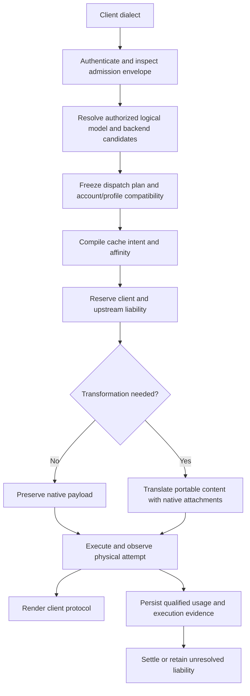

# TD-0034: Protocol-neutral routing, cache control and execution accounting

- **Status:** Active goal; incremental implementation in progress, 2026-11-11.
- **Authority:** User requested goal mode, objectives, constraints and autonomous
  execution of the router/cache/accounting solution on 2026-11-11.
- **Baseline:** [Inventory and first fixes](../reviews/router-cache-inventory-2026-11-11.md).
- **Baseline alignment:** On the user's request, fetched upstream refs and moved
  the uncommitted work from detached `v0.16.2` (`4baedaf`) to local
  `feat/protocol-neutral-router` at `origin/develop` (`21b98bb`). The one additional
  commit is the main-to-develop sync merge; both committed file trees are identical.
  All working edits and unrelated TD-0033 were preserved. No rebase, commit, merge
  or remote publication was needed.
- **Delivery boundary:** Source implementation, reproducible evidence and operator
  documentation. Deployment, external credential mutation, merge and publication
  are separate actions requiring authorization when not already granted.

## Goal and observable outcome

A third-party agent uses its ordinary OpenAI Chat Completions, Anthropic Messages,
Responses or native Gemini client against Sandhi. Gemini is explicitly in scope
following the user's 2026-11-11 clarification, rather than only a preserved legacy
adapter. Its authorized logical model resolves to a
configured backend independently of the client's dialect. Sandhi preserves the
portable conversation and applicable native state, applies explicit backend cache
policy, renders the client's protocol and records attributable usage and settlement
for each physical dispatch. Unsupported conversions fail explicitly before dispatch.

Backend scope includes OpenAI-compatible API/open-weight servers, Anthropic
Messages endpoints, standard OpenAI Responses, and constrained ChatGPT/Codex
Responses. Anthropic subscription support requires an explicit, verified credential
profile and expiry/renewal contract; accepting a Bearer header is insufficient.
Treat Gemini generateContent/streamGenerateContent as first-class ingress and
backend protocols; preserve existing Cohere and Ollama behavior during the refactor.

The goal remains active until the implementation and required source-level
acceptance gates below are complete. A successful single request, a green isolated
test or a nearly exhausted execution window does not complete the goal. Live
qualification remains explicitly pending where the necessary approved accounts,
endpoints or credentials are unavailable; those capabilities must not be advertised
as live-verified. A missing external prerequisite does not stop independent work.

## Objectives

| ID | Objective | Observable acceptance |
| --- | --- | --- |
| O1 | Decouple client dialect, model alias, backend instance, endpoint protocol/profile and credential reference | A standard Responses endpoint and a custom Anthropic-compatible endpoint are configured explicitly; provider-name inference remains a legacy default. |
| O2 | Authorize logical-model routing and backend selection | A key can reach only eligible model/backend mappings; denied routes do not reserve or dispatch; discovery agrees with callable routes. |
| O3 | Preserve conversation and tool semantics | Text, tools, parallel calls/results and supported media survive multi-turn loops. Same-backend opaque state is preserved in order; nonportable state is pinned or explicitly rejected. |
| O4 | Manage cache intent across dialects and backend profiles | Native controls and block boundaries survive; automatic/explicit/preserve/opt-out precedence is defined independently of unrelated native extras; unsupported required controls are rejected. |
| O5 | Make selection and affinity compatible with cache/state locality | An immutable dispatch plan records actual model, backend, account scope and profile; switching does not reuse incompatible continuation IDs or imply transferable KV state. |
| O6 | Normalize tokens and persist qualified execution evidence | Fresh/read/write/output/reasoning categories conserve totals; every dispatch has an identity and terminal/unknown evidence; both client and upstream budgets settle once or retain unresolved liability. |
| O7 | Deliver usable operator and agent integration | Configuration/admin/CLI/restart paths agree; supported SDKs work without request rewrites; documentation identifies capabilities, limitations and evidence. |
| O8 | Provide a professional navigable operator console | Dedicated workspaces expose routing, cache/token evidence, budgets and management; keyboard/mobile/SSO workflows and stale-data/authentication boundaries remain correct. User explicitly expanded scope and requested AgentBrowser inspection. |

## Constraints and invariants

1. **Reuse the foundations.** Keep the two forwarding planes, layered crates,
   virtual keys, existing provider transports, neutral contract and ledger.
   No replacement gateway or parallel allowance/accounting implementation.
2. **Preserve compatibility.** Existing configs and fixed `upstream_ref` keys keep
   their meaning. New behavior is opt-in or accompanied by a documented migration.
   Fix confirmed silent content loss rather than preserving it as compatibility.
3. **Authority precedes dispatch.** Keys/groups/grants authorize the requested alias
   and resolved backend/model. Request headers and native extensions cannot change
   authenticated attribution, select another account or loosen policy.
4. **Separate endpoint metadata from secret storage.** Backend protocol/profile,
   model mappings and routing policy are non-secret gateway configuration. Secret
   material stays in the vault. A credential reference does not by itself authorize
   every endpoint/profile; profile validation occurs before credential mutation.
5. **Preserve subscription fences.** Codex profile keeps its fixed endpoint,
   account header, strict access-only envelope, dispatch expiry check, constrained
   codec and disabled raw bypass. A generic protocol override cannot weaken them.
   Grant refresh has one owner; do not copy/share refresh tokens between tools.
6. **Avoid silent loss.** Preserve unknown native fields on compatible routes;
   reject unsupported content/state/control transformations before dispatch.
   A native body clone does not justify dropping ordered content on re-encode.
7. **Keep native forwarding efficient.** Use minimal admission extraction plus
   policy inspection when forwarding native payloads. Re-encode only when needed.
   Policy inspection must cover all forwarded text and extras on either plane.
8. **Treat cache locality honestly.** Conversation identity, namespace, stable
   prefix and backend affinity are distinct. Authenticated scope determines
   namespace policy. Do not claim latency proves a hit or that cache state migrates
   across model/provider/account/region/server boundaries.
9. **Conserve measurements.** For inclusive input, fresh + read + write equals
   total input where qualified evidence establishes those categories. Anthropic
   input is already fresh. Respect explicit reasoning inclusion; never count it
   twice. Preserve reported zero versus absent/malformed/unsupported/unknown.
10. **Keep allowances separate.** Raw token observations remain neutral units.
    Continue TD-0032 for weights and policy revisions; no dollars, tiers, SKUs or
    invented conversion of subscription quotas into guaranteed token entitlement.
    Existing estimated reservations remain estimates rather than hard token bounds.
11. **No implicit inference replay.** Selection happens before dispatch. Ambiguous
    completion, timeout, credential denial or a partially delivered stream does
    not silently trigger another model/account. Optional replay must reserve and
    record a separate attempt, preserve prior liability and use explicit policy.
    Concurrent hedging is outside this goal's initial implementation.
12. **Make execution recoverable.** Persist the chosen backend/profile/account
    scope and immutable policy revision with the execution. Restart/cancellation
    must not turn unknown liability into a measured final zero or reissue inference.
13. **Bound resources.** Keep existing request/stream limits, transport deadlines,
    backpressure, secret redaction and cancellation ownership. Avoid unbounded
    routing state, native-item buffers, caches or diagnostic labels.
14. **Protect the workspace.** Preserve the completed first-stage edits and the
    unrelated TD-0033 work. Do not reset/stash unrelated changes. No commits,
    releases, deployments or external credential writes are implied by goal mode.

## Architecture to implement

The backend registry owns stable backend ID, provider label, endpoint
family/profile, URL, credential reference and declared model capabilities,
separately from the vault's credential identity. ADR-0016 supplies the factory seam;
ADR-0017 adds bounded durable definitions, config/admin/CLI and reconstruction.
Declared model IDs are enforced; capability negotiation remains M3/M4 work.

An immutable dispatch plan includes requested alias and actual model, backend ID,
credential/account version, endpoint/profile, transformation decision, cache plan,
deadline, budget scopes and accounting-policy revision. Configuration updates affect
new admissions; they cannot retarget work that already owns a dispatch plan.

Native attachments preserve item ordering and provenance. Same-profile replay of
encrypted reasoning or signed thinking must retain the exact state. Cross-profile
conversion requires portable materialized history or an explicit refusal. A provider
continuation ID cannot be sent to another backend as though it were a conversation.

Cache policy is a compilation step: preserve native, automatic stable prefix,
automatic conversation prefix, explicit breakpoints, or suppress gateway-added
caching, with supported lifetime, scope and key rules. Compile to the selected
model/profile's controls; do not invent one-to-one mappings between differing TTL
and breakpoint semantics. Preserve ADR-0013's existing opt-out during migration.

## Milestones and completion gates

| Milestone | Status | Required result |
| --- | --- | --- |
| M0: Inventory and reproducible defects | Complete in workspace | Baseline review and local reproductions; existing work preserved. |
| M1: Initial content/accounting fixes | Implemented and source-validated | Responses shorthand, cache-write categorization/rendering, strict write qualification and stream completion ordering; 18-case matrix. |
| M2a: Explicit endpoint binding | Implemented and source-validated | Typed protocol/profile selection and factory validation independent of provider slug; supported legacy defaults and Codex fences pinned by tests. See ADR-0016 and evidence below. |
| M2b: Backend registry and operator lifecycle | Implemented and source-validated | Config/admin/CLI persistence, restart reconstruction, credential rotation/revocation, declared model scoping and backward-compatible fixed routes. ADR-0017; targeted Rust and real-process evidence below. |
| M3: Conversation and cache semantics | In progress | ADR-0018 implements codec-owned ordered input and classified refusal; ADR-0019 adds native streaming and Codex retention. ADR-0020 implements declared cache compilation, scoped keys and observed credential generations. Broader content/tool/media fidelity remains required. |
| M4: Authorized routing and affinity | In progress | ADR-0021 candidate implements logical aliases, actual codec/profile preflight, deterministic priority/rendezvous selection, immutable in-memory plans, scoped discovery and durable compatible session pins. Issuer provenance and broader authorization/lifecycle qualification remain required. |
| M5: Uniform execution accounting | In progress | ADR-0022 freezes context; ADR-0023 adds paired budget ownership; ADR-0024 persists single-attempt transport evidence; ADR-0025 qualifies four buffered protocols; ADR-0026 qualifies transparent standard Responses streaming; ADR-0027 qualifies constrained buffered Codex aggregation. Broader streaming ownership/qualification and the retained intermittent settlement failure remain open. |
| M6: End-to-end qualification | In progress | Z.AI live text/cache matrices and synthetic SDK/lifecycle evidence recorded below. Full agent-loop/interrupt/restart and subscription qualification remain required; unresolved cases clearly gated. |
| M7: Operator console and visible efficiency semantics | Implemented and source-validated | Navigable workspaces, backend/route inventory, token-composition/coverage, attribution filtering and bounded usage diagnostics. AgentBrowser inspected a synthetic preview; affected browser/management/SSO and strict docs checks passed. This is a workspace candidate, not a deployed release. |

No milestone is complete on a constructor-only test when its acceptance requires
config, restart, request execution or persistence. Keep this table current after
each implementation increment. Completion of M2a does not complete M2b.

## Acceptance matrix

Cross Chat, Messages, Responses and native Gemini ingress with compatible Chat/open-weight,
Anthropic, standard Responses, Codex, Gemini and independently qualified subscription
profiles. Exercise both streaming and buffered delivery and every available raw
and translation plane. Record unsupported combinations rather than counting skips
as successful compatibility.

Required journeys:

- Text, shorthand history, tools/results, parallel tool calls, supported media,
  same-profile opaque state and portable-history switching.
- Native cache controls; translated cache keys/options; explicit and automatic
  breakpoints; unrelated extras; opt-out; changed prefix/suffix; TTL boundaries;
  namespace/account/backend changes and below-minimum prefixes.
- Reported zero, absent, malformed and inconsistent usage; cache writes/lifetime
  splits; reasoning overlap; comparison of client wire, neutral event, SQL,
  aggregates, allowance receipts and front/back budget settlement.
- Model/key/group denial, expired/rotated credentials, spoofed attribution,
  rate/budget refusal, configuration changes in flight and attempted replay.
- Disconnect/timeout before dispatch, before usage, after input usage, after final
  usage, at protocol completion and before transport EOF; restart with unresolved
  work; exactly-once settlement and no hidden redispatch.
- Config/admin/CLI/restart equivalence, secret redaction, scoped discovery,
  bounded diagnostics and unchanged legacy behavior.
- Gemini path-based model/stream selection and native header credentials; system
  instructions, ordered parts, function calls/results, thinking/signature state,
  inline/file media, cached-content references, native cache observations and
  estimated countTokens behavior. API-key and Bearer endpoint profiles are distinct
  from a Vertex/ADC credential lifecycle, which is not yet admitted.

Use narrow meaningful red/green tests first, then affected integration/SDK suites,
workspace tests, formatting and Clippy. Generate contract/schema/binding outputs
when public neutral types change. All-feature and binding gates are run when
affected and recorded separately from default workspace coverage. A failing
concurrency check is retained as evidence even if a later retry succeeds.

Live warm/cold tests use synthetic prompts and explicitly authorized endpoints.
Record resolved model/profile/account scope, requested cache controls, observed
read/write counters and limitations. A repeated request is not a guaranteed hit.
Do not treat OpenAI Platform behavior as proof for the Codex subscription backend.
Current official sources inform capability design, not blanket endpoint guarantees:
[Responses](https://developers.openai.com/api/reference/resources/responses/methods/create),
[OpenAI cache controls](https://developers.openai.com/api/docs/guides/prompt-caching),
[gateway rollout](https://learn.chatgpt.com/docs/enterprise/roll-out-a-gateway),
[authentication](https://learn.chatgpt.com/docs/auth), and
[Anthropic caching](https://platform.claude.com/docs/en/build-with-claude/prompt-caching).

## Starting evidence and known follow-up

M1's final default workspace run passed 997 tests with six opt-in tests ignored;
37 SDK/reasoning checks passed. Formatting and Clippy passed. This is workspace
candidate evidence; no merge, deployment, released artifact or live cache
qualification is claimed. See the baseline review for exact commands.

An earlier unrestricted run failed the existing 200-call owned-settlement stress
test with HTTP 502 on call 56; isolated and full reruns passed. The M2b full run
reproduced HTTP 502 at call 63. A subsequent 81-case proxy run and two diagnostic
81-case runs passed, without establishing a cause. This remains an open M5/M6
qualification issue; green retries do not erase either failure. Diagnostics now
distinguish admission, dispatch authorization and terminal settlement using bounded
reason codes, without logging intents, scopes, usage snapshots or SQL error text.

M2a is implemented through [ADR-0016](../adr/0016-explicit-backend-endpoint-binding.md).
Six new endpoint tests verify explicit families across provider labels, strict
metadata decoding, invalid profile/auth combinations, supported legacy defaults,
Codex fixed-origin/access-only/expiry constraints, and real synthetic native
Responses/Anthropic/Gemini dispatch with Bearer auth. The new API initially failed
to compile because the seam was absent; the Gemini wire-auth assertion also
failed before its factory mapping was corrected.

M2a validation: 195 proxy library tests plus 44 selected integration tests passed
(`backend_endpoint`, `cache_write_translation`, `operator`, `subscription_gateway`).
Proxy all-target Clippy with warnings denied, workspace formatting, diff whitespace
and three documentation tests passed. This is affected-source validation following
M1's full workspace baseline, not a new all-workspace or live-provider result.

Compatibility correction: non-OpenAI `oauth` settings previously fell through to
API-key transport without implementing OAuth. These now fail configuration; use
the actual `api_key`/`bearer` scheme or an implemented lease profile. Existing
OpenAI OAuth keeps its Codex fences. Gemini Bearer now selects Bearer transport.

M2b implements [ADR-0017](../adr/0017-backend-registry-lifecycle.md) and the
[operator guide](../operator/backends.md). New store tests cover real file reopen,
conditional revision changes/reactivation, strict bounded definitions, stale
writers and corrupt metadata. Six gateway integration tests cover admission and
discovery, credential rotation/revocation/reconstruction, stale mutations, admin
gating, config preflight/order/idempotency and host-owned route preservation.

Four real-process SDK tests cover CLI lifecycle, external fixture credential
rotation through read-only reference registration, persisted reconstruction without
config reapply, independent backend/credential revocation and failed dependencies
that cannot mint new keys or publish profiles through an old binding. These use
disposable local credentials and a synthetic Responses origin. The fourth case
uses the ordinary Google Gemini SDK through an explicitly registered Responses
backend, with native cache-read/total usage and credential isolation assertions.

Affected validation before the final broad run: 16 new/selected Rust integration
tests passed (six endpoint, six registry, four store); 67 SDK checks passed across
backend registry, configured-store startup, OpenAI, Anthropic and reasoning suites;
19 management checks passed. Workspace Clippy with warnings denied passed before
and after the bounded diagnostic additions. One full run stopped at
the stress failure above (850 passed, five ignored, one failed at that point);
it is not counted as a successful workspace gate. The final default workspace run
passed 1,013 tests with six opt-in tests ignored; the earlier stress failure remains
open as described above. No live cache/subscription qualification is claimed.

After the Gemini scope addition, the cache accounting matrix passed all 24
combinations (four ingress dialects × three Chat/Responses/Codex backend profiles
× buffered/streaming). Gemini wire totals/read/reasoning remain consistent while
separate cache writes are retained in neutral events, SQLite and both budget legs.
The initial Google SDK run skipped because the dependency was absent; installing
google-genai 1.75.0 within a disposable temporary environment enabled nine existing
SDK tests to pass. A subsequent 13-case registry/Gemini run passed, including the
new explicit Responses route. The final combined run, including the new native SDK
countTokens case, passed 97 checks across registry, configured-store startup,
OpenAI, Anthropic, Gemini, reasoning and management suites. Documentation tests
passed (three), workspace formatting and diff whitespace checks passed, and
workspace all-target Clippy with warnings denied passed after the expanded matrix.
The active milestone is M3; M4–M6 and live qualification remain outstanding.

## M3 implementation design

### First increment and evidence

ADR-0018 introduces optional NativeInputV1 in contract minor 11. It binds ordered
native input to its portable projection without duplicating the body in metadata, preserves
admitted model/limit authority, and rejects classified incompatible input before
reservation. Compatible buffered native output is also preserved. Core tests
first failed to compile while the seam was absent. Gateway red tests then
reproduced Gemini's missing adjacent text/null results, dropped Responses media,
native built-in-tool rejection and discarded buffered output state; each now passes.

Validation after implementation: 120 core, 274 provider and 195 proxy library
tests plus three core and five gateway native-input tests passed. The 24-case
cache accounting matrix and six subscription tests passed. The combined SDK and
management run passed 97 checks after the buffered response and plaintext fixes.
The Python wheel was built with the updated contract, installed into a disposable
environment, its import path/minor 11 checked, and 96 binding tests passed. A fresh
Node addon passed 88 checks; the initial sandbox socket failures were rerun outside
the sandbox rather than counted as product failures. Both binding workspaces passed
locked Clippy and formatting; facades/schema ratchet and documentation tests passed.

An initial all-feature run exposed 11 plaintext endpoint regressions: the
admission-only Chat projection discarded its native bucket but kept the new
metadata. It now clears both, and all 14 plaintext tests pass. The final
`cargo test --locked --workspace --all-features --quiet` passed 1,038 tests with
11 opt-in cases ignored. All-feature workspace Clippy with warnings denied passed.
The final default workspace run passed 1,021 tests with six opt-in cases ignored.
Workspace and both binding format checks, generated-facade drift and diff whitespace
checks passed. The earlier M1/M2b
intermittent settlement failure remains an unresolved qualification observation;
these passing runs do not establish its cause or resolution.

Remaining M3 work is substantive: broaden loss-aware content/control handling,
including rich tool results and native media; implement profile/model cache-policy
compilation with explicit opt-out and namespace rules. Keep M4 account/backend
pinning and M5 durable dispatch attribution as separate required work.

### Design for the remaining work

[Gemini's focused inventory](../reviews/gemini-router-cache-inventory-2026-11-11.md)
adds interleaved parts/tool-result loss, signatures, file/MIME handling, cached
resource provenance and native SDK loops to the same fidelity gate. Generic Bearer
transport is not evidence of Vertex/ADC support. Google SDK dependencies are
installed in a disposable temporary environment; a missing SDK skip is not a pass.

The first implementation increment is recorded in
[ADR-0018](../adr/0018-ordered-native-input-and-projection.md). A codec-owned native
snapshot now preserves ordered input during compatible re-encoding, detects stale
projections, and refuses classified nonportable input on incompatible routes.
Gemini mixed results and Responses inline media are projected faithfully; compatible
buffered responses preserve native output state. ADR-0019 adds compatible streamed
state. This does not establish arbitrary vendor-extension portability or account affinity.
The Anthropic encoder still ties automatic cache placement to the presence of an
entire native extras bucket, including unrelated extras. That policy coupling and
request-side cache compilation remain required work.

1. Classify fidelity against the **final** forwarding plane. Native forwarding
   preserves supported upstream-native items and unknown extras. A forced
   re-encode (including output-bound injection on a same-family route) must pass
   the same loss check as a cross-family translation. The check must run before
   physical dispatch in legacy and tracked paths.
2. Represent ordered native attachments with explicit ingress provenance and
   ordered boundaries. Client passthrough buckets cannot forge decoder ownership.
   Reuse exact native sequences only when their decoded portable projection still
   matches the admitted request. Typed model/limits/attribution remain authoritative.
   Until a representation is executable, refuse affected translations explicitly.
3. Preserve materialized text, supported media and parallel tool calls/results.
   Native reasoning, signed thinking, provider continuation references and unknown
   ordered items require a compatible backend/profile or an explicit refusal;
   summaries are not a substitute for opaque state. M4 adds account/backend pinning.
4. Separate backend cache policy, request cache intent and family-native extras.
   Add preserve-native, automatic-stable-prefix, automatic-conversation-prefix
   and suppress-gateway-placement modes. Keep the documented legacy empty
   Anthropic-bucket opt-out while introducing an explicit opt-out. Unrelated
   extras must not disable a separately selected automatic policy.
5. Compile controls using profile/model capability facts. Preserve native block
   boundaries and lifetime fields when compatible. Do not equate a cache key,
   prefix breakpoint, retention request and continuation ID. Unsupported required
   semantics fail before dispatch; best-effort changes need qualified evidence.
6. Keep authenticated namespace, conversation identity and backend/account scope
   distinct. Any generated cache identifier must bind the admitted scope and
   selected target; never forward raw identity as a cross-tenant cache namespace.
   A credential refresh/version change needs an explicit account-compatibility
   rule before reusing state or affinity.

Acceptance begins with red/green tests for opaque-state loss/refusal, Responses
media, interleaved and parallel tools, Anthropic system/message cache boundaries,
unrelated extras versus opt-out, forced same-family translation, and every ingress
in both delivery modes. Follow with SDK tool loops and profile-specific cache wire
assertions. Keep provider cache-hit measurements separate from synthetic control
and accounting conservation tests.

### Native streaming and Codex aggregation increment

[ADR-0019](../adr/0019-native-stream-attachments.md) implements contract minor 12:
default-off native SSE attachments alongside canonical metering events. Built-in
Chat, Messages, Responses and Gemini support the opt-in; unsupported typed handles
reject it. Compatible typed proxy streams forward the attachments and suppress
duplicate canonical rendering and extra DONE markers. The raw plane is unchanged.
Codex buffered delivery retains its bounded native terminal response, preserving
encrypted output for a subsequent materialized turn with the account/store fences
still enforced.

Red tests reproduced missing streamed opaque output, bare-CR Chat completion
waiting for HTTP EOF and truncated EOF ending without an error. The fixes are
covered across every byte split, LF/CRLF/CR and multiline data for all four families.
Tests also cover SSE id/event preservation, aggregate frame bounds, numeric usage
before visible frames, transport/protocol errors, one Final usage, no duplicate
terminal markers, unsupported opt-in and bounded buffered aggregation. A real
gateway Codex fixture executes buffered, streamed and next-turn requests, verifies
encrypted state/account headers and checks both budget legs. These are synthetic
endpoint/profile assertions, not live subscription qualification.

Validation for this increment:

- Core contract minor/schema ratchet and facade generation passed. The final
  provider library has 283 passing tests. Selected proxy native-input, cache-write
  and subscription integration suites passed; the cache test spans 24 journeys.
- `cargo test --locked --workspace --all-features --quiet` passed 1,048 tests with
  11 opt-in cases ignored after the truncated-EOF fix. Workspace all-feature
  all-target Clippy with warnings denied passed.
- The final `cargo test --locked --workspace --quiet` passed 1,031 tests with six
  opt-in cases ignored. Workspace/binding format checks, locked binding Clippy,
  generated-facade drift, three documentation tests and diff whitespace checks
  passed. No other source changes followed these validation runs.
- Fresh Python wheel and Node addon builds passed. The installed Python minor is
  12; 97 Python binding tests and 89 Node checks passed, including real default-off
  and opt-in frame/usage consumption. Existing consumers do not receive the new
  event without the flag. TD-0008 records local consumer decisions and pending
  external release coordination; no notification or release is claimed.
- The SDK/management run first had 96 passes and one Gemini reasoning fixture
  startup timeout. The isolated 24-case reasoning suite and a subsequent combined
  97-case run passed. No product cause was established for the startup timeout.

The first all-feature run of this increment reproduced the existing owned-settle
stress failure at call 85: HTTP 502, a success usage observation and one retained
accounting owner. Two diagnostic 81-case runs and subsequent full all-feature runs
passed. The cause remains unestablished; neither the native-stream fixes nor those
passing reruns resolve this M5/M6 qualification issue. Additional bounded timeout
diagnostics identify admission, authorization or settlement waits on recurrence.
The earlier call-56/call-63 failures remain part of the evidence.

### Cache compilation implementation checkpoint (minor 13)

[ADR-0020](../adr/0020-cache-intent-compilation.md) now implements separate request
intent, backend/model capability declarations, native control placement and
observed usage. Legacy/preserve/auto/automatic-stable/automatic-conversation/
suppress modes, exact lifetime validation, both-plane execution, scoped-key
construction and pre-budget refusals are implemented. All four ingress protocols
consume `sandhi_cache`; neutral bindings expose `cache_intent`. Internal plans
are excluded from JSON/schema and bound to input, target and observed credential
generation. Output-cap admission does not invalidate a frozen plan.

Policy absence preserves legacy behavior. A present declaration without a default
selects preserve-native, so an unqualified native-only profile cannot accidentally
inherit Anthropic synthesis. A fixed default accepts an identical override.
Vault metadata generations survive restart, rotation and re-registration without
reusing a revoked generation; they do not detect unreported external secret changes.
Codex permits no synthesis. Provider-default caching does not promise tenant
isolation; scoped OpenAI keys do not prove physical cache placement or a hit.

Eleven cache integration tests include the 32 ingress/backend/mode journeys,
native controls, TTL/order conflicts, pre-budget refusal, namespace changes,
forced typed caps and Codex constraints. SDKs exercise all four clients, persisted
config/CLI declarations, restart and namespace rotation. Real Python/Node minor-13
bindings passed 98 tests/90 checks; external release coordination remains open.

Current primary documentation was checked for OpenAI, Anthropic and Gemini cache
mechanisms; endpoint/model capabilities must be declared rather than inferred from
wire compatibility. The Gemini review additionally records Google's distinct
Interactions protocol as unimplemented; generateContent evidence does not qualify
Interactions, Vertex/ADC or cache-resource lifecycle management.

M3 remains active for richer loss-aware content/tool/media coverage. M4 routing/
account affinity, M5 durable attribution and settlement, and broader M6 agent-loop/
cache/lifecycle qualification remain required. No merge, deployment, external
credential mutation or publication has been performed.

### Live Z.AI qualification and product documentation

The user authorized live testing with the configured Z.AI credential. Disposable
gateways exercised its advertised Chat, Messages and standard Responses endpoints
with `glm-5.3`. The final short-prompt matrix passed all 24 client/backend/mode
combinations. The final repeated-prefix run passed 48 calls; every call reported
3,776 cache-read plus 5 fresh tokens, and all 48 SDK projections matched their
step-correlated durable observation. The cache profile is implicit-only/auto;
baseline native-only declarations select preserve-native. See the
[full live review and retained unsuccessful runs](../reviews/zai-router-live-2026-11-11.md).

Live testing found a real defect: Messages streaming returned input/cache counts
in terminal usage after zero start placeholders. The reducer read those counts
only at message start. A red unit test reproduced the loss; field-wise cumulative
merging now handles both locations and retains missing fields. All four ingress
regressions settle both budget legs once; final live results match storage.
One post-fix short probe hit the upstream 90-second deadline. A separate full
matrix passed, but neither its cause nor general backend reliability is established.
Legacy timeout observations and the `backend:external` dimension do not qualify
M5's durable attempt/backend attribution or unknown liability.

Final source verification after this fix:

- Workspace default tests: 1,046 passed, six opt-in cases ignored. All-feature
  tests: 1,063 passed, 11 ignored. The initial default invocation was denied
  fixture sockets by the sandbox; the authorized rerun passed.
- All-target, all-feature workspace Clippy and both locked binding Clippy runs
  passed with warnings denied. Facade drift and Rust formatting checks passed.
- Freshly rebuilt Python and Node bindings passed all 98 tests and 90 checks
  after the terminal-usage fix. One Node glob invocation exited at the file level
  without an assertion diagnostic; the explicit-file invocation passed. No
  additional product cause was established.
- The selected SDK/management/observability suite passed 103 cases before the
  terminal-usage fix; its affected cache/provider/proxy regressions and both full
  workspace runs passed after the fix. Rebuilt live gateways supply the direct
  post-fix SDK evidence; this is not a claim that all SDK lifecycle tests were rerun.

The MkDocs homepage and top-level **Efficiency and control** section now expose
[cache-aware routing and token efficiency](../product/cache-aware-routing.md)
alongside local ONNX/egress policy. Diagrams explain cache marker boundaries,
token flow and the measured 3,781-token example. Documentation distinguishes
cache-read share from cost savings, marks source candidates and links actual
live evidence, operator configuration and unfinished goal milestones.

The pinned MkDocs toolchain's strict build and ten brand-check tests passed.
Headless Chromium rendered all three cache-guide diagrams at desktop and mobile
sizes without page errors or horizontal page overflow. Shared brand files were
left unchanged. Flow diagrams use vertical layouts so their labels remain legible.

## M4 and operator-console increment, 2026-11-11

The preceding preview-launch turn was a verified wait: readiness and dashboard
responses confirmed the existing service was live. This increment is progress:
source admission/selection changed, regressions were reproduced and corrected,
and design/operator evidence was added.

[ADR-0021](../adr/0021-logical-routing-and-compatible-affinity.md) now records the
logical route implementation and compatibility rules. Config/admin/CLI persist
revision-conditional aliases and exact backend/model targets. Priority and
order-independent rendezvous selection filter actual codec/profile compatibility
and compiled cache controls. Transactional session pins survive restart and refuse
incompatible/unavailable targets without silent fallback. Count endpoints do not
create generation pins. Gemini discovery filters uncallable path aliases;
host-owned upstream names retain precedence and cannot be shadowed.

Actual reconstructed credential identity now supplements observed generations in
cache/affinity binding. Unreported external secret-file changes invalidate old
pins and scoped keys after reload. Constrained Codex same-account token renewal
can retain affinity, while changed accounts and expired leases refuse. This is
synthetic transport/account evidence, not live subscription qualification.

Two additional admission defects were reproduced and corrected:

- Duplicate JSON model/content keys reached generation under ordinary last-key
  decoding. All ingress now uses strict duplicate-key rejection before admission,
  including escaped duplicate spellings and nested content.
- A Chat request with `stop` selected a Responses candidate whose actual encoder
  refused it. Pure encoder/profile preflight now excludes that candidate for a new
  session. An existing Responses pin refuses the incompatible turn instead of
  switching to an otherwise eligible Chat target. Both delivery modes are tested.

The [operator console](../operator/dashboard.md) adds ten navigable workspaces,
backend/route inventory, qualified token composition, attribution filters and a
bounded persisted-usage inspector. It preserves separate diagnostics permission,
CSRF, stale-data notices and immediate protected-data clearing on authentication
changes. AgentBrowser inspected the existing page and the redesigned candidate on
a disposable synthetic gateway. Two inspected screenshots are retained in the
operator guide. The existing installed TLS service was not changed. The local
review instance remains a preview, not a deployment.

Validation for this increment:

- `cargo test --locked --workspace --all-features --quiet`: **1,077 passed**, 11
  opt-in tests ignored after actual encoder preflight. The previous run before
  that additional regression passed 1,076. Historical settlement stress failures
  above remain unresolved; this green run does not establish their cause.
- `cargo clippy --locked --workspace --all-targets --all-features -- -D warnings`
  and `cargo fmt --all -- --check`: passed. JavaScript syntax and diff whitespace
  checks passed.
- Dashboard, management, run-tree, logical-route, backend-registry and store-startup
  SDK suite: **112 passed**. Broker and browser acceptance-decision suite:
  **40 passed**. These ran after strict JSON admission; the route/backend SDK
  suite then passed **all eight cases again after encoder preflight**.
- Final console label/endpoint clarification: **eight affected browser cases
  passed**, covering light/dark desktop/mobile assets, escaped inventory and
  persisted diagnostics/SSO grants. This is local synthetic evidence.
- Pinned strict MkDocs build, ten brand-check tests and the shared-brand checksum
  check passed. The console has a prominent Operate entry, home-page task link,
  visual guide and configuration/design references.
- A changed-file scan against the authorized provider and disposable preview
  credentials passed without printing their values. Unused temporary copies of
  existing-service credentials were removed; the synthetic preview retained its
  private token and stable loopback address for user review.

M4 remains in progress: a pin is not issuer provenance for an individual opaque ID,
and broader OIDC route, capacity, interruption and lifecycle qualification remains
required. M3 still needs richer media/tool-loop fidelity qualification. The
selected routing plan at this checkpoint was retained in memory. The M5a increment
below adds its first durable context; uniform physical-dispatch attribution and
settlement/recovery remain required.
Legacy provider-slug budget dimensions are documented explicitly. M6's live
fixed-backend results do not qualify the new logical route or subscriptions.

## M5a: Durable execution context and baseline alignment, 2026-11-11

This increment is progress. Upstream comparison confirmed the detached release
tree and current `origin/develop` tree were identical. The work now lives on
`feat/protocol-neutral-router` at the current develop commit, with all uncommitted
changes and unrelated TD-0033 preserved. No commit, rebase, merge, push or deployment
occurred.

[ADR-0022](../adr/0022-durable-execution-context.md) adds a bounded, strict internal
context record to the existing tracked admission transaction. The primary lease,
intent, request correlation, dispatch fence and selected route/backend/cache/policy
summary commit together. An explicit required-context marker prevents missing or
corrupt new evidence from becoming an apparently valid older context-free row.
Older rows migrate with absent context rather than fabricated metadata.

The admitted accounting-policy version and cache-read weight are frozen. Terminal
recording refuses a different weight; recovery keeps the original frozen charge.
The HTTP regression first reproduced a completed/settled logical call with no
durable selection record, then passed for supported buffered Chat/Messages and
tracked Chat streaming. The fixture now emits the required native chunk type;
qualification was not relaxed to accept malformed streams.

Three store cases cover atomic rollback under context-write failure, wrong scope,
weight fencing, exact restart persistence/receipt replay, corrupt or missing
required context and migration of an older context-free fence. The real SDK
restart case injects receipt failure, verifies durable terminal/context evidence,
kills the gateway, changes runtime weight and rotates the fixture credential.
Recovery settles the old charge without another model call or context rewrite;
the next materialized session records the new weight/generation and both budget
legs settle their measured charges.

Verification on the aligned baseline:

- All-feature workspace: **1,081 passed**, 11 opt-in tests ignored.
- Logical-route, recovery and shutdown SDK/process suite: **44 passed**, including
  the new original-charge/credential-rotation journey.
- Affected default Rust proxy/routing suite: **91 passed**; store evidence suite:
  **42 passed**. The three new store cases and routed HTTP case also passed in
  focused runs.
- Workspace all-target/all-feature Clippy with warnings denied, Rust formatting,
  diff whitespace and pinned strict MkDocs build: passed.

This does **not** admit additional protocols into tracked mode. Default legacy
calls still lack this durable context record. Per-physical-dispatch identity and
qualified terminal/unknown evidence, durable linkage/recovery of both budget legs,
all-family tracked activation and broader media/tool/session qualification remain
required. Historical intermittent owned-settlement stress failures remain open;
the passing run above does not establish their original cause. M5 and the overall
goal remain active.

## M5b: Atomic paired budget ownership, 2026-11-11

This increment is progress. The new regression first reproduced an unmeasured
upstream failure holding 31 units on the client scope and zero on the upstream
scope. New supported tracked HTTP requests now use one admission transaction for
both reservations, intent/correlation/context/fence and durable back-leg linkage.
Either scope's denial or a linkage-write fault commits no accounting rows.

[ADR-0023](../adr/0023-paired-budget-settlement.md) records the implemented
candidate. Canonical terminal settlement inserts one original primary receipt and
charges both linked rows with the same frozen amount and timestamp, atomically.
An injected back-leg update failure rolls back both charges and the receipt;
recovery uses the original terminal observation. No second model request is made.

Absent, partial or unqualified usage keeps both liabilities held through expiry
and restart. Legacy release and both explicit/reserve-time reclaim paths recognize
the linkage and independent required back-leg ID on the dispatch fence. A missing
link cannot silently authorize a legacy zero release. Proven pre-dispatch closure
releases both at zero as closure evidence, not invented provider usage. Default
legacy behavior and older unpaired records retain their historical semantics.

Four paired store cases cover denial/write-failure rollback, unknown-liability
reopen/expiry, legacy release refusal, atomic settlement failure/recovery/replay,
safe closure and missing-link refusal. The HTTP error/missing-usage regression now
holds both scopes. Ineligible tracked requests are tested to create neither
reservation and make no origin call. The process tests now compare context/link
rows and require both scopes to recover or remain held together.

Verification:

- All-feature workspace: **1,085 passed**, 11 opt-in tests ignored.
- Final affected default proxy/routing run: **91 passed**; evidence store run:
  **46 passed**. The four paired cases additionally passed after adding explicit
  reserve-time expiry assertions, and the strengthened ineligible-request case
  checks zero reservation rows and no dispatch.
- Main logical-route/recovery/shutdown process run: **40 passed** and four
  shutdown assertions failed because they still expected the historical upstream
  zero release. Those assertions were changed to require both retained liabilities;
  **all eight buffered/streamed HTTP/TLS shutdown cases passed** on the affected
  rerun. The 44 distinct journeys are synthetic; no live provider result is implied.
- Workspace all-target/all-feature Clippy with warnings denied, Rust formatting,
  whitespace checks and strict MkDocs: passed.

Unknown held capacity can exhaust a budget; no automatic amendment/release or
inference replay is supplied. Existing tracked protocol eligibility is unchanged.
Durable physical-attempt identity/terminal evidence, all-family qualified tracked
activation and richer tool/media/session qualification remain open. Historical
intermittent settlement-stress failures are retained above; these passing runs do
not establish their original cause. M5 and the full goal remain active.

## M5c: Durable single-attempt transport evidence, 2026-11-11

[ADR-0024](../adr/0024-durable-physical-attempt-evidence.md) implements another
bounded increment on existing tracked surfaces. New paired admissions require one
retry-free attempt. The first dispatch authorization atomically allocates its
opaque ID and binds it to both the dispatch fence and physical-attempt row. Only
the successful first authorization receives the in-process permit. Authorization
is not proof of a send; absence of later evidence means unknown status.

Both buffered forwarding planes and qualified transparent Chat streaming pass
that identity to the existing transport observer. Cloned single-attempt contexts
share a consume-once guard; a second instrumented call refuses before constructing
another transport future. Dispatch/terminal facts include bounded timestamps,
outcome, optional HTTP status/request ID and dropped/invalid flags. Durable
execution context supplies actual backend/model/account attribution; diagnostic
provider/model labels and diagnostic parsed usage are not settlement authority.

The request owner freezes the transport snapshot with qualified usage before
telemetry. Both records commit atomically, and the existing jobs owner retains
the exact snapshots on write failure. Canonical settlement/recovery additionally
requires complete transport evidence. Missing/partial/invalid evidence retains
both liabilities even if execution usage is otherwise final. Replays require
identical facts; no refinement, requoting or inference replay is introduced.
Required missing/corrupt rows fail closed. Migration creates no attempts for
older fences; default legacy and historical admission semantics remain unchanged.

Verification at this checkpoint:

- All-feature workspace: **1,091 passed**, 11 opt-in tests ignored. The initial
  sandbox run denied local mock-server binds; the permitted rerun passed.
- Logical-route/recovery/shutdown process suite: **44 passed**. The copied-binary
  token/TLS-OIDC SIGKILL drills now inspect persistent attempt identity, unknown
  evidence before publication and immutable terminal evidence across receipt
  recovery. Route credential/weight changes retain the original attempt snapshot
  and charge. All cases use synthetic local origins; recovery makes no model call.
- Eight paired/attempt store cases cover authorization allocation rollback,
  identity/permit replay, atomic usage/evidence writes, unchanged evidence replay,
  incomplete-evidence liability, required-row corruption, actual older-schema
  migration, paired settlement, expiry and safe closure. Provider tests exercise
  real local HTTP sends and cross-mode reuse refusal, plus typed qualified usage
  with absent, malformed, zero and cache-split responses.
- Final focused checks: **91 proxy/routing tests** and **eight paired/attempt store
  tests passed**, including the older-schema migration and safe-closure assertions.
  Workspace all-target/all-feature Clippy with warnings denied, strict MkDocs,
  formatting/whitespace checks, three documentation-link tests and ten brand-token
  tests/checks passed.

This does not qualify tracked Anthropic, standard Responses, constrained Codex or
Gemini backends, translated streaming, broader agent tool/media loops, subscription
lifecycle, export or deployment. Their source ownership/restart gates remain
required. The historical intermittent settlement-stress failures above remain
unresolved; passing reruns do not establish their original cause. M5 and the full
goal remain active.

## M5d: Qualified buffered protocol matrix and live tracked caching, 2026-11-11

[ADR-0025](../adr/0025-qualified-buffered-protocol-accounting.md) activates tracked
buffered Chat, Messages, Responses and Gemini ingress against the four built-in
standard backend protocols. The same two forwarding planes, paired reservations,
frozen context, single-attempt observer and canonical receipt owner are reused.
Target selection checks accounting eligibility before confirming a pin. An existing
incompatible pin refuses; a new session can select a later compatible target.
Async/background Responses refuses before a pin/lease on logical routes, and
before either lease on fixed backends.

Pure family qualifiers distinguish missing/malformed/inconsistent required counters
from explicit zero and preserve reported reasoning zero. Inclusive cache and
reasoning categories are not counted twice. Gemini's separately reported tool-use
prompt tokens are included in neutral fresh input; Anthropic's reported thinking
subset is retained within output. Built-in buffered JSON rejects duplicate keys;
qualified raw forwarding retains ambiguous bytes with qualification failure.
Unavailable snapshots now retain bounded static qualification reasons.

The first live tracked Z.AI run exposed an omitted Messages cache-write counter:
16/24 SDK cells succeeded, with eight unqualified executions retaining both
reservations. A separate diagnostic call confirmed the wire shape. The explicit
`anthropic_implicit_cache` endpoint profile permits missing/zero separate writes
when uncached input includes implicit construction, while requiring reported reads
and rejecting contradictory writes. It is independent of request cache controls,
survives CLI/API persistence/restart, is frozen in context, and fences changed pins.
The standard profile remains strict. No provider-name heuristic or OAuth bypass
was introduced.

A subsequent run had 24 qualified receipts but one client accounting 502. Owned
accounting now retries only the outer `LedgerBusy` result, which proves no SQL
ran, within the original accounting wait and shutdown deadline. Deterministic
tests force actual contention before releasing the mutex, cover budget exhaustion,
admission/authorization/closure/settlement, forbid late authorization, and verify
that storage ambiguity is not retried by this loop. Original evidence and permits
are never recreated. Public one-shot jobs retain their previous behavior.

Verification at this checkpoint:

- All-feature workspace: **1,102 passed**, 11 opt-in tests ignored. An earlier
  run reproduced the retained stress regression at call 190; diagnostic/final
  reruns passed. Its historical cause remains unproven.
- Final protocol/recovery/logical-route/shutdown suite: **91 passed**. This includes
  the 16-cell buffered SDK matrix, all four clients under standard/implicit Messages
  profiles, restart/profile-revision fencing, missing/malformed/ambiguous usage,
  receipt failure recovery, SIGKILL, pre-admission refusals and actual SQL-backed
  verifier corruption checks. Fixtures are synthetic and use copied binaries.
- Final live Z.AI tracked matrix: **24/24 successful buffered calls**, 24 matching
  durable observations, 24 qualified attempt/receipt joins, all 24 with reported
  cache reads, and clean shutdown. Four clients × three advertised backend
  protocols × two repeated-prefix calls, through authorized logical aliases.
  See the [review and four retained reports](../reviews/zai-router-tracked-buffered-2026-11-11.md).
- Final report verification passed offline without changing its checksum. The
  configured credential was absent from all retained qualification artifacts.
- Workspace all-target/all-feature Clippy with warnings denied, Rust formatting,
  whitespace checks, documentation-link/brand checks and strict MkDocs passed.

The final live matrix observed 120 fresh input, 90,624 cache-read and 1,095 output
tokens, with 455 reported reasoning tokens already included in output. The 99.87%
input read share is warm-cache evidence, not a monetary saving, quota entitlement
or proof of cache transfer. Both budget legs constrain the same model call and
must not be added together as consumption.

The initial profile failure, the separate usage diagnostic and the 23/24 response
failure are retained. Controlled mutex tests and later green runs do not establish
that every earlier intermittent failure had that cause. New live reports capture
bounded static accounting reason codes for future diagnosis.

Remaining scope is unchanged: strict non-Chat streaming and translated-stream
ownership, constrained Codex SSE aggregation, fuller tool/media/state loops,
issuer-bound opaque-state provenance, subscription refresh/expiry/account lifecycle,
operator-facing joined durable diagnostics, and broader source/live acceptance.
The next accounting increment must extend the complete-event observer/qualification
seam rather than promote lenient stream sniffers into settlement authority. M5,
M6 and the full goal remain active.

## M5e: Qualified standard Responses streaming, 2026-11-11

[ADR-0026](../adr/0026-qualified-responses-stream-accounting.md) extends the bounded
complete-event observer and existing raw response owner to standard Responses.
Tracked mode now admits bounded transparent Responses alongside Chat under the
same retry-free/durable/Block/deadline requirements. Codex aggregation and other
tracked streaming paths remain gated.

Created/queued/progress counters are validated as Partial only. Missing counters
remain unavailable; omissions preserve known cumulative lower bounds. Complete
completed/incomplete/failed response events can supply Final counts after strict
required-counter, cache, reasoning and total checks. Response identity, reported
sequence order, event/type agreement, duplicate JSON keys, post-terminal data and
truncated framing fail qualification conservatively. A failed response records
provider rejection independently of HTTP status. Errors retain preceding counts.

The additive response-owner `evidence()` snapshot preserves canonical partial
counters and explicit reasoning zero while retaining the copyable legacy
`snapshot()` projection. The proxy and physical attempt guard consume canonical
evidence. Drop, timeout and transport failures close one source and publish one
terminal attempt; valid final measurements remain distinct from delivery success.

Source validation passed `cargo test --locked --workspace` (1,093 passed,
six opt-in ignored), Clippy across workspace/all targets with warnings denied,
formatting and diff checks. The tracked SDK/process suite passed all 57 cases,
including seven new Responses streaming cases for valid/incomplete/failed,
progress-only, missing/malformed and post-terminal evidence. New parser tests
exercise every byte split and CR/LF/CRLF; response-owner tests cover unpolled/drop,
transport failure, timeout and canonical completeness. Initial broad sandbox runs
could not bind local sockets; the network-enabled reruns passed.

Delivery compatibility is now part of tracked logical-route preflight before pin
confirmation. New streams skip targets needing unsupported translation; existing
incompatible pins refuse without moving; unbounded streams create no pin or lease.
Three added process cases cover these decisions. After that routing change, all
81 proxy HTTP tests and ten routing tests passed again, as did the final 57-case
SDK suite and warnings-denied Clippy. Strict MkDocs, three documentation-link
tests and ten brand-token tests/checks also passed.

The [live GLM Responses streaming pair](../reviews/zai-router-tracked-responses-stream-2026-11-11.md)
passed two SDK results, two correlated durable observations and two complete
attempt/context/usage/paired-receipt joins. Its repeated request reported 3,776
cache-read tokens; both calls retained disjoint input/output/reasoning semantics.
The disposable gateway exited zero and the retained report contains no configured
credential. This narrow pair does not qualify subscriptions or translated streams.

Remaining M5/M6 work includes constrained Codex SSE aggregation, Messages/Gemini
and translated streaming, broader interruption/restart/tool/media acceptance,
subscription lifecycle and issuer-bound opaque-state provenance. Joined operator
diagnostics and broader M3/M4 gates also remain open. The goal remains active.

The next Codex increment must qualify bytes at the actual HTTP response owner
and preserve credential expiry/account fencing and existing deadlines. The typed
Responses decoder can stop at its terminal event, so its decoded usage or native
attachment alone cannot establish EOF validity. Avoid adding an independent
second attempt guard, enabling external raw subscription forwarding, replaying
inference, or treating the legacy line sniffer as qualified settlement evidence.

## M5f: Qualified buffered Codex aggregation, 2026-11-11

[ADR-0027](../adr/0027-qualified-codex-buffered-accounting.md) admits retry-free
buffered host delivery through the constrained Codex codec. The upstream remains
SSE. One physical response owner performs strict complete-event qualification and
owns one attempt guard. The typed aggregator drains through HTTP EOF before
qualified success, including after a native terminal. Raw subscription forwarding
remains disabled; gateway fixed-origin, expiry, account and credential-header
fences remain enforced. Other expiring profiles are not admitted by this exception.

An additive source observation handle is attached internally, once, to a tracked
attempt context. Canonical counts remain available to terminal capture after
decoder failure, source timeout or cancellation. Only observed dispatches count
in tracked usage; an authorized slot or pre-transport credential refusal is not
an invented physical send. Source usage and transport facts still enter the
original atomic terminal/paired-settlement path, without inference replay.

The resilience decorator refuses qualified retry configurations and captures the
original buffered deadline across setup, aggregation and EOF draining. Heartbeats
cannot reset it. Qualified decoding uses complete SSE events in both native-output
modes, covering multiline data, CRLF and an initial BOM. Interrupted data framing
stays partial; an interrupted keepalive comment does not erase earlier usage.

Final source validation passed 1,098 default-workspace Rust tests with six opt-in
tests ignored, warnings-denied workspace/all-targets Clippy, formatting/diff checks,
62 tracked/backend SDK regressions, 13 documentation/brand unit tests, the brand
checker and strict MkDocs. The [source acceptance review](../reviews/codex-qualified-accounting-source-2026-11-11.md)
records 24 provider HTTP matrix calls, deterministic decoder/deadline tests and
28 four-ingress gateway HTTP cases. The gateway cases join frozen Codex profile,
one physical attempt, canonical token usage and both reservation states, including
distinct unavailable and explicit-zero outcomes. No live subscription claim follows.

The initial full run found a keepalive-cancellation regression, corrected and
verified by partial-data/comment drop tests and disconnect/deadline/shutdown checks.
It also reproduced the intermittent 200-call settlement failure on call 138, with
final usage and one retained owner. The [failure artifact](../reviews/artifacts/codex-accounting-source-failures-2026-11-11.json)
is retained; its original accounting reason and binary hash were not captured.
An isolated 200-call run, a 15-case owned-accounting group with logging and later
full workspace runs passed. These passes do not establish the original cause;
the reliability gate remains open.

The client output limit remains an admission-estimate input: the Codex codec omits
it from the upstream request. This increment does not create a hard upstream token
cutoff, subscription quota conversion, cache-write/TTL guarantee or monetary price.
Actual qualified usage settles using the original allowance policy.

Remaining work includes qualified Codex streamed host delivery, Messages/Gemini
and translated streaming, the retained settlement reliability issue, full tool/media
and issuer-bound state journeys, subscription lifecycle, joined operator diagnostics
and broader M3/M4/M6 acceptance. The original goal remains active.

## M5g prerequisite and Git checkpoint, 2026-11-11

The provider runtime now exposes factory-gated qualified typed streaming for Chat,
standard Responses and constrained Codex. It uses the same strict physical source
observer, one attempt guard, complete-event decoding, canonical cache/reasoning
counts and EOF validation as buffered Codex. A 36-call synthetic HTTP matrix
crosses the three profiles, both native-output modes and six evidence conditions;
it checks source completeness, missing/malformed usage, later framing failures,
canonical zero preservation and rejection of a reused attempt context.

This is the transport/codec prerequisite for broader tracked HTTP streaming.
Current gateway activation remains bounded transparent Chat/standard Responses;
translated and Codex streamed host delivery still require the next owner/admission
increment. Full default-workspace tests and warnings-denied Clippy passed after
this prerequisite. Previously completed live and SDK evidence retains its stated
checkpoint scope.

The user requested commit/push/PR checkpoints before continuing further. The
checkpoint includes the completed router/cache/backend/accounting/UI increments
and this validated prerequisite, preserving unrelated TD-0033 work. A subsequent
remote fetch found one upstream documentation commit for the Victor boundary;
the checkpoint is aligned with current `develop` before publication. Merge readiness
still requires CI and review of the explicitly retained reliability and scope gates.

Before staging, known configured credentials were absent from all tracked/new
working files and the existing index. The same exact/encoded-value check covered
all locally available historical Git blobs. Independent default-rule Gitleaks scans
identified only unchanged public TLS test keys, brand checksums and documented
placeholder credentials; no live API key was identified. Staged and committed
content are checked again before push. Audit output stays outside Git and contains
no printed credential values.
