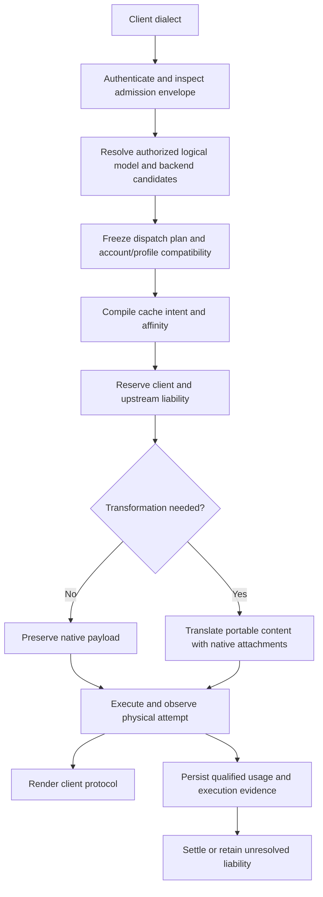

# TD-0034: Protocol-neutral routing, cache control and execution accounting

- **Status:** Active goal; incremental implementation in progress, 2026-11-11.
- **Authority:** User requested goal mode, objectives, constraints and autonomous
  execution of the router/cache/accounting solution on 2026-11-11.
- **Baseline:** [Inventory and first fixes](../reviews/router-cache-inventory-2026-11-11.md).
- **Baseline alignment:** On the user's request, fetched upstream refs and moved
  the uncommitted work from detached `v0.16.2` (`4baedaf`) to local
  `feat/protocol-neutral-router` at `origin/develop` (`21b98bb`). The one additional
  commit is the main-to-develop sync merge; both committed file trees are identical.
  All working edits and unrelated TD-0033 were preserved. No rebase, commit, merge
  or remote publication was needed.
- **Delivery boundary:** Source implementation, reproducible evidence and operator
  documentation. Deployment, external credential mutation, merge and publication
  are separate actions requiring authorization when not already granted.

## Goal and observable outcome

A third-party agent uses its ordinary OpenAI Chat Completions, Anthropic Messages,
Responses or native Gemini client against Sandhi. Gemini is explicitly in scope
following the user's 2026-11-11 clarification, rather than only a preserved legacy
adapter. Its authorized logical model resolves to a
configured backend independently of the client's dialect. Sandhi preserves the
portable conversation and applicable native state, applies explicit backend cache
policy, renders the client's protocol and records attributable usage and settlement
for each physical dispatch. Unsupported request conversions fail before dispatch;
unsupported source-output projections fail explicitly while retaining source evidence.

Backend scope includes OpenAI-compatible API/open-weight servers, Anthropic
Messages endpoints, standard OpenAI Responses, and constrained ChatGPT/Codex
Responses. Anthropic subscription support requires an explicit, verified credential
profile and expiry/renewal contract; accepting a Bearer header is insufficient.
Treat Gemini generateContent/streamGenerateContent as first-class ingress and
backend protocols; preserve existing Cohere and Ollama behavior during the refactor.

The goal remains active until the implementation and required source-level
acceptance gates below are complete. A successful single request, a green isolated
test or a nearly exhausted execution window does not complete the goal. Live
qualification remains explicitly pending where the necessary approved accounts,
endpoints or credentials are unavailable; those capabilities must not be advertised
as live-verified. A missing external prerequisite does not stop independent work.

## Objectives

| ID | Objective | Observable acceptance |
| --- | --- | --- |
| O1 | Decouple client dialect, model alias, backend instance, endpoint protocol/profile and credential reference | Standard Responses and custom Messages endpoints are configured explicitly; omitted protocol uses catalog defaults, and explicit protocol takes precedence. |
| O2 | Authorize logical-model routing and backend selection | A key can reach only eligible model/backend mappings; denied routes do not reserve or dispatch; discovery agrees with callable routes. |
| O3 | Preserve conversation and tool semantics | Text, tools, parallel calls/results and supported media survive multi-turn loops. Same-backend opaque state is preserved in order; nonportable state is pinned or explicitly rejected. |
| O4 | Manage cache intent across dialects and backend profiles | Native controls and block boundaries survive; automatic/explicit/preserve/opt-out precedence is defined independently of unrelated native extras; unsupported required controls are rejected. |
| O5 | Make selection and affinity compatible with cache/state locality | An immutable dispatch plan records actual model, backend, account scope and profile; switching does not reuse incompatible continuation IDs or imply transferable KV state. |
| O6 | Normalize tokens and persist qualified execution evidence | Fresh/read/write/output/reasoning categories conserve totals; every dispatch has an identity and terminal/unknown evidence; both client and upstream budgets settle once or retain unresolved liability. |
| O7 | Deliver usable operator and agent integration | Configuration/admin/CLI/restart paths agree; supported SDKs work without request rewrites; documentation identifies capabilities, limitations and evidence. |
| O8 | Provide a professional navigable operator console | Dedicated workspaces expose routing, cache/token evidence, budgets and management; keyboard/mobile/SSO workflows and stale-data/authentication boundaries remain correct. User explicitly expanded scope and requested AgentBrowser inspection. |

## Constraints and invariants

1. **Reuse the foundations.** Keep the two forwarding planes, layered crates,
   virtual keys, existing provider transports, neutral contract and ledger.
   No replacement gateway or parallel allowance/accounting implementation.
2. **Coordinate the consumer migration.** On 2026-11-12 the user identified Victor
   as the only client and authorized moving both projects together. Do not retain
   a permissive legacy execution/decoder mode solely for backward compatibility.
   Migrate Victor's in-process binding and gateway integration with Sandhi, with
   an explicit contract/version gate and paired acceptance evidence. Keep the
   supported client dialects and native/portable delivery contracts; these are
   product capabilities, not legacy modes. Existing key/config authority must
   remain intact or have an explicit migration; never reset budgets or secrets.
3. **Authority precedes dispatch.** Keys/groups/grants authorize the requested alias
   and resolved backend/model. Request headers and native extensions cannot change
   authenticated attribution, select another account or loosen policy.
4. **Separate endpoint metadata from secret storage.** Backend protocol/profile,
   model mappings and routing policy are non-secret gateway configuration. Secret
   material stays in the vault. A credential reference does not by itself authorize
   every endpoint/profile; profile validation occurs before credential mutation.
5. **Preserve subscription fences.** Codex profile keeps its fixed endpoint,
   account header, strict access-only envelope, dispatch expiry check, constrained
   codec and disabled raw bypass. A generic protocol override cannot weaken them.
   Grant refresh has one owner; do not copy/share refresh tokens between tools.
6. **Avoid silent loss.** Preserve unknown native fields on compatible routes;
   reject unsupported request content/state/control transformations before dispatch.
   Refuse unrepresentable source output without replay or hiding measured usage.
   A native body clone does not justify dropping ordered content on re-encode.
7. **Keep native forwarding efficient.** Use minimal admission extraction plus
   policy inspection when forwarding native payloads. Re-encode only when needed.
   Policy inspection must cover all forwarded text and extras on either plane.
8. **Treat cache locality honestly.** Conversation identity, namespace, stable
   prefix and backend affinity are distinct. Authenticated scope determines
   namespace policy. Do not claim latency proves a hit or that cache state migrates
   across model/provider/account/region/server boundaries.
9. **Conserve measurements.** For inclusive input, fresh + read + write equals
   total input where qualified evidence establishes those categories. Anthropic
   input is already fresh. Respect explicit reasoning inclusion; never count it
   twice. Preserve reported zero versus absent/malformed/unsupported/unknown.
10. **Keep allowances separate.** Raw token observations remain neutral units.
    Continue TD-0032 for weights and policy revisions; no dollars, tiers, SKUs or
    invented conversion of subscription quotas into guaranteed token entitlement.
    Existing estimated reservations remain estimates rather than hard token bounds.
11. **No implicit inference replay.** Selection happens before dispatch. Ambiguous
    completion, timeout, credential denial or a partially delivered stream does
    not silently trigger another model/account. Optional replay must reserve and
    record a separate attempt, preserve prior liability and use explicit policy.
    Concurrent hedging is outside this goal's initial implementation.
12. **Make execution recoverable.** Persist the chosen backend/profile/account
    scope and immutable policy revision with the execution. Restart/cancellation
    must not turn unknown liability into a measured final zero or reissue inference.
13. **Bound resources.** Keep existing request/stream limits, transport deadlines,
    backpressure, secret redaction and cancellation ownership. Avoid unbounded
    routing state, native-item buffers, caches or diagnostic labels.
14. **Protect the workspace.** Preserve the completed first-stage edits and the
    unrelated TD-0033 work. Do not reset/stash unrelated changes. No commits,
    releases, deployments or external credential writes are implied by goal mode.

## Architecture to implement

The backend registry owns stable backend ID, provider label, endpoint
family/profile, URL, credential reference and declared model capabilities,
separately from the vault's credential identity. ADR-0016 supplies the factory seam;
ADR-0017 adds bounded durable definitions, config/admin/CLI and reconstruction.
Declared model IDs are enforced; capability negotiation remains M3/M4 work.

An immutable dispatch plan includes requested alias and actual model, backend ID,
credential/account version, endpoint/profile, transformation decision, cache plan,
deadline, budget scopes and accounting-policy revision. Configuration updates affect
new admissions; they cannot retarget work that already owns a dispatch plan.

Native attachments preserve item ordering and provenance. Same-profile replay of
encrypted reasoning or signed thinking must retain the exact state. Cross-profile
conversion requires portable materialized history or an explicit refusal. A provider
continuation ID cannot be sent to another backend as though it were a conversation.

Cache policy is a compilation step: preserve native, automatic stable prefix,
automatic conversation prefix, explicit breakpoints, or suppress gateway-added
caching, with supported lifetime, scope and key rules. Compile to the selected
model/profile's controls; do not invent one-to-one mappings between differing TTL
and breakpoint semantics. Preserve ADR-0013's existing opt-out during migration.

## Milestones and completion gates

The coordinated retirement decision and its migration gates are recorded in
[ADR-0038](../adr/0038-coordinated-victor-contract-migration.md). This supersedes
earlier increments' promises to retain permissive legacy decoders indefinitely;
their historical validation remains evidence for those commits only.

The [paired source checkpoint](../reviews/coordinated-victor-contract-2026-11-12.md)
prepares Sandhi 0.17.0 and Victor 0.29.0, shares the four admitted typed streaming
pipelines, and records review regressions and qualification limits. Buffered
unification and the gateway accounting-default migration remain open; the version
bump does not imply that either repository has been released or deployed.

| Milestone | Status | Required result |
| --- | --- | --- |
| M0: Inventory and reproducible defects | Complete in workspace | Baseline review and local reproductions; existing work preserved. |
| M1: Initial content/accounting fixes | Implemented and source-validated | Responses shorthand, cache-write categorization/rendering, strict write qualification and stream completion ordering; 18-case matrix. |
| M2a: Explicit endpoint binding | Implemented and source-validated | Typed protocol/profile selection and factory validation independent of provider slug; supported legacy defaults and Codex fences pinned by tests. See ADR-0016 and evidence below. |
| M2b: Backend registry and operator lifecycle | Implemented and source-validated | Config/admin/CLI persistence, restart reconstruction, credential rotation/revocation, declared model scoping and backward-compatible fixed routes. ADR-0017; targeted Rust and real-process evidence below. |
| M3: Conversation and cache semantics | In progress | ADR-0018 implements codec-owned ordered input and classified refusal; ADR-0019 adds native streaming and Codex retention. ADR-0020 implements declared cache compilation, scoped keys and observed credential generations. ADR-0034 validates portable buffered output while preserving compatible native state. Broader streaming content/tool/media fidelity remains required. |
| M4: Authorized routing and affinity | In progress | ADR-0021 candidate implements logical aliases, actual codec/profile preflight, deterministic priority/rendezvous selection, immutable in-memory plans, scoped discovery and durable compatible session pins. Issuer provenance and broader authorization/lifecycle qualification remain required. |
| M5: Uniform execution accounting | In progress | ADR-0022 freezes context; ADR-0023 adds paired budget ownership; ADR-0024 persists single-attempt transport evidence; ADR-0025 qualifies four buffered protocols; ADR-0026 qualifies transparent standard Responses streaming; ADR-0027 qualifies constrained buffered Codex aggregation; ADR-0028 connects four client dialects to qualified typed Chat/Responses/Codex streams; ADR-0031 connects Messages profiles; ADR-0032/0033 connect Gemini source qualification and EOF ownership with explicit native-state limits. The retained intermittent accounting-wait failure and broader accounting acceptance remain open. |
| M6: End-to-end qualification | In progress | Z.AI live text/cache matrices and synthetic SDK/lifecycle evidence recorded below. Full agent-loop/interrupt/restart and subscription qualification remain required; unresolved cases clearly gated. |
| M7: Operator console and visible efficiency semantics | Implemented and source-validated | Navigable workspaces, backend/route inventory, token-composition/coverage, attribution filtering and bounded usage diagnostics. AgentBrowser inspected a synthetic preview; affected browser/management/SSO and strict docs checks passed. This is a workspace candidate, not a deployed release. |

No milestone is complete on a constructor-only test when its acceptance requires
config, restart, request execution or persistence. Keep this table current after
each implementation increment. Completion of M2a does not complete M2b.

## Acceptance matrix

Cross Chat, Messages, Responses and native Gemini ingress with compatible Chat/open-weight,
Anthropic, standard Responses, Codex, Gemini and independently qualified subscription
profiles. Exercise both streaming and buffered delivery and every available raw
and translation plane. Record unsupported combinations rather than counting skips
as successful compatibility.

Required journeys:

- Text, shorthand history, tools/results, parallel tool calls, supported media,
  same-profile opaque state and portable-history switching.
- Native cache controls; translated cache keys/options; explicit and automatic
  breakpoints; unrelated extras; opt-out; changed prefix/suffix; TTL boundaries;
  namespace/account/backend changes and below-minimum prefixes.
- Reported zero, absent, malformed and inconsistent usage; cache writes/lifetime
  splits; reasoning overlap; comparison of client wire, neutral event, SQL,
  aggregates, allowance receipts and front/back budget settlement.
- Model/key/group denial, expired/rotated credentials, spoofed attribution,
  rate/budget refusal, configuration changes in flight and attempted replay.
- Disconnect/timeout before dispatch, before usage, after input usage, after final
  usage, at protocol completion and before transport EOF; restart with unresolved
  work; exactly-once settlement and no hidden redispatch.
- Config/admin/CLI/restart equivalence, secret redaction, scoped discovery,
  bounded diagnostics and unchanged legacy behavior.
- Gemini path-based model/stream selection and native header credentials; system
  instructions, ordered parts, function calls/results, thinking/signature state,
  inline/file media, cached-content references, native cache observations and
  estimated countTokens behavior. API-key and Bearer endpoint profiles are distinct
  from a Vertex/ADC credential lifecycle, which is not yet admitted.

Use narrow meaningful red/green tests first, then affected integration/SDK suites,
workspace tests, formatting and Clippy. Generate contract/schema/binding outputs
when public neutral types change. All-feature and binding gates are run when
affected and recorded separately from default workspace coverage. A failing
concurrency check is retained as evidence even if a later retry succeeds.

Live warm/cold tests use synthetic prompts and explicitly authorized endpoints.
Record resolved model/profile/account scope, requested cache controls, observed
read/write counters and limitations. A repeated request is not a guaranteed hit.
Do not treat OpenAI Platform behavior as proof for the Codex subscription backend.
Current official sources inform capability design, not blanket endpoint guarantees:
[Responses](https://developers.openai.com/api/reference/resources/responses/methods/create),
[OpenAI cache controls](https://developers.openai.com/api/docs/guides/prompt-caching),
[gateway rollout](https://learn.chatgpt.com/docs/enterprise/roll-out-a-gateway),
[authentication](https://learn.chatgpt.com/docs/auth), and
[Anthropic caching](https://platform.claude.com/docs/en/build-with-claude/prompt-caching).

## Starting evidence and known follow-up

M1's final default workspace run passed 997 tests with six opt-in tests ignored;
37 SDK/reasoning checks passed. Formatting and Clippy passed. This is workspace
candidate evidence; no merge, deployment, released artifact or live cache
qualification is claimed. See the baseline review for exact commands.

An earlier unrestricted run failed the existing 200-call owned-settlement stress
test with HTTP 502 on call 56; isolated and full reruns passed. The M2b full run
reproduced HTTP 502 at call 63. A subsequent 81-case proxy run and two diagnostic
81-case runs passed, without establishing a cause. This remains an open M5/M6
qualification issue; green retries do not erase either failure. Diagnostics now
distinguish admission, dispatch authorization and terminal settlement using bounded
reason codes, without logging intents, scopes, usage snapshots or SQL error text.

M2a is implemented through [ADR-0016](../adr/0016-explicit-backend-endpoint-binding.md).
Six new endpoint tests verify explicit families across provider labels, strict
metadata decoding, invalid profile/auth combinations, supported legacy defaults,
Codex fixed-origin/access-only/expiry constraints, and real synthetic native
Responses/Anthropic/Gemini dispatch with Bearer auth. The new API initially failed
to compile because the seam was absent; the Gemini wire-auth assertion also
failed before its factory mapping was corrected.

M2a validation: 195 proxy library tests plus 44 selected integration tests passed
(`backend_endpoint`, `cache_write_translation`, `operator`, `subscription_gateway`).
Proxy all-target Clippy with warnings denied, workspace formatting, diff whitespace
and three documentation tests passed. This is affected-source validation following
M1's full workspace baseline, not a new all-workspace or live-provider result.

Compatibility correction: non-OpenAI `oauth` settings previously fell through to
API-key transport without implementing OAuth. These now fail configuration; use
the actual `api_key`/`bearer` scheme or an implemented lease profile. Existing
OpenAI OAuth keeps its Codex fences. Gemini Bearer now selects Bearer transport.

M2b implements [ADR-0017](../adr/0017-backend-registry-lifecycle.md) and the
[operator guide](../operator/backends.md). New store tests cover real file reopen,
conditional revision changes/reactivation, strict bounded definitions, stale
writers and corrupt metadata. Six gateway integration tests cover admission and
discovery, credential rotation/revocation/reconstruction, stale mutations, admin
gating, config preflight/order/idempotency and host-owned route preservation.

Four real-process SDK tests cover CLI lifecycle, external fixture credential
rotation through read-only reference registration, persisted reconstruction without
config reapply, independent backend/credential revocation and failed dependencies
that cannot mint new keys or publish profiles through an old binding. These use
disposable local credentials and a synthetic Responses origin. The fourth case
uses the ordinary Google Gemini SDK through an explicitly registered Responses
backend, with native cache-read/total usage and credential isolation assertions.

Affected validation before the final broad run: 16 new/selected Rust integration
tests passed (six endpoint, six registry, four store); 67 SDK checks passed across
backend registry, configured-store startup, OpenAI, Anthropic and reasoning suites;
19 management checks passed. Workspace Clippy with warnings denied passed before
and after the bounded diagnostic additions. One full run stopped at
the stress failure above (850 passed, five ignored, one failed at that point);
it is not counted as a successful workspace gate. The final default workspace run
passed 1,013 tests with six opt-in tests ignored; the earlier stress failure remains
open as described above. No live cache/subscription qualification is claimed.

After the Gemini scope addition, the cache accounting matrix passed all 24
combinations (four ingress dialects × three Chat/Responses/Codex backend profiles
× buffered/streaming). Gemini wire totals/read/reasoning remain consistent while
separate cache writes are retained in neutral events, SQLite and both budget legs.
The initial Google SDK run skipped because the dependency was absent; installing
google-genai 1.75.0 within a disposable temporary environment enabled nine existing
SDK tests to pass. A subsequent 13-case registry/Gemini run passed, including the
new explicit Responses route. The final combined run, including the new native SDK
countTokens case, passed 97 checks across registry, configured-store startup,
OpenAI, Anthropic, Gemini, reasoning and management suites. Documentation tests
passed (three), workspace formatting and diff whitespace checks passed, and
workspace all-target Clippy with warnings denied passed after the expanded matrix.
The active milestone is M3; M4–M6 and live qualification remain outstanding.

## M3 implementation design

### First increment and evidence

ADR-0018 introduces optional NativeInputV1 in contract minor 11. It binds ordered
native input to its portable projection without duplicating the body in metadata, preserves
admitted model/limit authority, and rejects classified incompatible input before
reservation. Compatible buffered native output is also preserved. Core tests
first failed to compile while the seam was absent. Gateway red tests then
reproduced Gemini's missing adjacent text/null results, dropped Responses media,
native built-in-tool rejection and discarded buffered output state; each now passes.

Validation after implementation: 120 core, 274 provider and 195 proxy library
tests plus three core and five gateway native-input tests passed. The 24-case
cache accounting matrix and six subscription tests passed. The combined SDK and
management run passed 97 checks after the buffered response and plaintext fixes.
The Python wheel was built with the updated contract, installed into a disposable
environment, its import path/minor 11 checked, and 96 binding tests passed. A fresh
Node addon passed 88 checks; the initial sandbox socket failures were rerun outside
the sandbox rather than counted as product failures. Both binding workspaces passed
locked Clippy and formatting; facades/schema ratchet and documentation tests passed.

An initial all-feature run exposed 11 plaintext endpoint regressions: the
admission-only Chat projection discarded its native bucket but kept the new
metadata. It now clears both, and all 14 plaintext tests pass. The final
`cargo test --locked --workspace --all-features --quiet` passed 1,038 tests with
11 opt-in cases ignored. All-feature workspace Clippy with warnings denied passed.
The final default workspace run passed 1,021 tests with six opt-in cases ignored.
Workspace and both binding format checks, generated-facade drift and diff whitespace
checks passed. The earlier M1/M2b
intermittent settlement failure remains an unresolved qualification observation;
these passing runs do not establish its cause or resolution.

Remaining M3 work is substantive: broaden loss-aware content/control handling,
including rich tool results and native media; implement profile/model cache-policy
compilation with explicit opt-out and namespace rules. Keep M4 account/backend
pinning and M5 durable dispatch attribution as separate required work.

### Design for the remaining work

[Gemini's focused inventory](../reviews/gemini-router-cache-inventory-2026-11-11.md)
adds interleaved parts/tool-result loss, signatures, file/MIME handling, cached
resource provenance and native SDK loops to the same fidelity gate. Generic Bearer
transport is not evidence of Vertex/ADC support. Google SDK dependencies are
installed in a disposable temporary environment; a missing SDK skip is not a pass.

The first implementation increment is recorded in
[ADR-0018](../adr/0018-ordered-native-input-and-projection.md). A codec-owned native
snapshot now preserves ordered input during compatible re-encoding, detects stale
projections, and refuses classified nonportable input on incompatible routes.
Gemini mixed results and Responses inline media are projected faithfully; compatible
buffered responses preserve native output state. ADR-0019 adds compatible streamed
state. This does not establish arbitrary vendor-extension portability or account affinity.
The Anthropic encoder still ties automatic cache placement to the presence of an
entire native extras bucket, including unrelated extras. That policy coupling and
request-side cache compilation remain required work.

1. Classify fidelity against the **final** forwarding plane. Native forwarding
   preserves supported upstream-native items and unknown extras. A forced
   re-encode (including output-bound injection on a same-family route) must pass
   the same loss check as a cross-family translation. The check must run before
   physical dispatch in legacy and tracked paths.
2. Represent ordered native attachments with explicit ingress provenance and
   ordered boundaries. Client passthrough buckets cannot forge decoder ownership.
   Reuse exact native sequences only when their decoded portable projection still
   matches the admitted request. Typed model/limits/attribution remain authoritative.
   Until a representation is executable, refuse affected translations explicitly.
3. Preserve materialized text, supported media and parallel tool calls/results.
   Native reasoning, signed thinking, provider continuation references and unknown
   ordered items require a compatible backend/profile or an explicit refusal;
   summaries are not a substitute for opaque state. M4 adds account/backend pinning.
4. Separate backend cache policy, request cache intent and family-native extras.
   Add preserve-native, automatic-stable-prefix, automatic-conversation-prefix
   and suppress-gateway-placement modes. Keep the documented legacy empty
   Anthropic-bucket opt-out while introducing an explicit opt-out. Unrelated
   extras must not disable a separately selected automatic policy.
5. Compile controls using profile/model capability facts. Preserve native block
   boundaries and lifetime fields when compatible. Do not equate a cache key,
   prefix breakpoint, retention request and continuation ID. Unsupported required
   semantics fail before dispatch; best-effort changes need qualified evidence.
6. Keep authenticated namespace, conversation identity and backend/account scope
   distinct. Any generated cache identifier must bind the admitted scope and
   selected target; never forward raw identity as a cross-tenant cache namespace.
   A credential refresh/version change needs an explicit account-compatibility
   rule before reusing state or affinity.

Acceptance begins with red/green tests for opaque-state loss/refusal, Responses
media, interleaved and parallel tools, Anthropic system/message cache boundaries,
unrelated extras versus opt-out, forced same-family translation, and every ingress
in both delivery modes. Follow with SDK tool loops and profile-specific cache wire
assertions. Keep provider cache-hit measurements separate from synthetic control
and accounting conservation tests.

### Native streaming and Codex aggregation increment

[ADR-0019](../adr/0019-native-stream-attachments.md) implements contract minor 12:
default-off native SSE attachments alongside canonical metering events. Built-in
Chat, Messages, Responses and Gemini support the opt-in; unsupported typed handles
reject it. Compatible typed proxy streams forward the attachments and suppress
duplicate canonical rendering and extra DONE markers. The raw plane is unchanged.
Codex buffered delivery retains its bounded native terminal response, preserving
encrypted output for a subsequent materialized turn with the account/store fences
still enforced.

Red tests reproduced missing streamed opaque output, bare-CR Chat completion
waiting for HTTP EOF and truncated EOF ending without an error. The fixes are
covered across every byte split, LF/CRLF/CR and multiline data for all four families.
Tests also cover SSE id/event preservation, aggregate frame bounds, numeric usage
before visible frames, transport/protocol errors, one Final usage, no duplicate
terminal markers, unsupported opt-in and bounded buffered aggregation. A real
gateway Codex fixture executes buffered, streamed and next-turn requests, verifies
encrypted state/account headers and checks both budget legs. These are synthetic
endpoint/profile assertions, not live subscription qualification.

Validation for this increment:

- Core contract minor/schema ratchet and facade generation passed. The final
  provider library has 283 passing tests. Selected proxy native-input, cache-write
  and subscription integration suites passed; the cache test spans 24 journeys.
- `cargo test --locked --workspace --all-features --quiet` passed 1,048 tests with
  11 opt-in cases ignored after the truncated-EOF fix. Workspace all-feature
  all-target Clippy with warnings denied passed.
- The final `cargo test --locked --workspace --quiet` passed 1,031 tests with six
  opt-in cases ignored. Workspace/binding format checks, locked binding Clippy,
  generated-facade drift, three documentation tests and diff whitespace checks
  passed. No other source changes followed these validation runs.
- Fresh Python wheel and Node addon builds passed. The installed Python minor is
  12; 97 Python binding tests and 89 Node checks passed, including real default-off
  and opt-in frame/usage consumption. Existing consumers do not receive the new
  event without the flag. TD-0008 records local consumer decisions and pending
  external release coordination; no notification or release is claimed.
- The SDK/management run first had 96 passes and one Gemini reasoning fixture
  startup timeout. The isolated 24-case reasoning suite and a subsequent combined
  97-case run passed. No product cause was established for the startup timeout.

The first all-feature run of this increment reproduced the existing owned-settle
stress failure at call 85: HTTP 502, a success usage observation and one retained
accounting owner. Two diagnostic 81-case runs and subsequent full all-feature runs
passed. The cause remains unestablished; neither the native-stream fixes nor those
passing reruns resolve this M5/M6 qualification issue. Additional bounded timeout
diagnostics identify admission, authorization or settlement waits on recurrence.
The earlier call-56/call-63 failures remain part of the evidence.

### Cache compilation implementation checkpoint (minor 13)

[ADR-0020](../adr/0020-cache-intent-compilation.md) now implements separate request
intent, backend/model capability declarations, native control placement and
observed usage. Legacy/preserve/auto/automatic-stable/automatic-conversation/
suppress modes, exact lifetime validation, both-plane execution, scoped-key
construction and pre-budget refusals are implemented. All four ingress protocols
consume `sandhi_cache`; neutral bindings expose `cache_intent`. Internal plans
are excluded from JSON/schema and bound to input, target and observed credential
generation. Output-cap admission does not invalidate a frozen plan.

Policy absence preserves legacy behavior. A present declaration without a default
selects preserve-native, so an unqualified native-only profile cannot accidentally
inherit Anthropic synthesis. A fixed default accepts an identical override.
Vault metadata generations survive restart, rotation and re-registration without
reusing a revoked generation; they do not detect unreported external secret changes.
Codex permits no synthesis. Provider-default caching does not promise tenant
isolation; scoped OpenAI keys do not prove physical cache placement or a hit.

Eleven cache integration tests include the 32 ingress/backend/mode journeys,
native controls, TTL/order conflicts, pre-budget refusal, namespace changes,
forced typed caps and Codex constraints. SDKs exercise all four clients, persisted
config/CLI declarations, restart and namespace rotation. Real Python/Node minor-13
bindings passed 98 tests/90 checks; external release coordination remains open.

Current primary documentation was checked for OpenAI, Anthropic and Gemini cache
mechanisms; endpoint/model capabilities must be declared rather than inferred from
wire compatibility. The Gemini review additionally records Google's distinct
Interactions protocol as unimplemented; generateContent evidence does not qualify
Interactions, Vertex/ADC or cache-resource lifecycle management.

M3 remains active for richer loss-aware content/tool/media coverage. M4 routing/
account affinity, M5 durable attribution and settlement, and broader M6 agent-loop/
cache/lifecycle qualification remain required. No merge, deployment, external
credential mutation or publication has been performed.

### Live Z.AI qualification and product documentation

The user authorized live testing with the configured Z.AI credential. Disposable
gateways exercised its advertised Chat, Messages and standard Responses endpoints
with `glm-5.3`. The final short-prompt matrix passed all 24 client/backend/mode
combinations. The final repeated-prefix run passed 48 calls; every call reported
3,776 cache-read plus 5 fresh tokens, and all 48 SDK projections matched their
step-correlated durable observation. The cache profile is implicit-only/auto;
baseline native-only declarations select preserve-native. See the
[full live review and retained unsuccessful runs](../reviews/zai-router-live-2026-11-11.md).

Live testing found a real defect: Messages streaming returned input/cache counts
in terminal usage after zero start placeholders. The reducer read those counts
only at message start. A red unit test reproduced the loss; field-wise cumulative
merging now handles both locations and retains missing fields. All four ingress
regressions settle both budget legs once; final live results match storage.
One post-fix short probe hit the upstream 90-second deadline. A separate full
matrix passed, but neither its cause nor general backend reliability is established.
Legacy timeout observations and the `backend:external` dimension do not qualify
M5's durable attempt/backend attribution or unknown liability.

Final source verification after this fix:

- Workspace default tests: 1,046 passed, six opt-in cases ignored. All-feature
  tests: 1,063 passed, 11 ignored. The initial default invocation was denied
  fixture sockets by the sandbox; the authorized rerun passed.
- All-target, all-feature workspace Clippy and both locked binding Clippy runs
  passed with warnings denied. Facade drift and Rust formatting checks passed.
- Freshly rebuilt Python and Node bindings passed all 98 tests and 90 checks
  after the terminal-usage fix. One Node glob invocation exited at the file level
  without an assertion diagnostic; the explicit-file invocation passed. No
  additional product cause was established.
- The selected SDK/management/observability suite passed 103 cases before the
  terminal-usage fix; its affected cache/provider/proxy regressions and both full
  workspace runs passed after the fix. Rebuilt live gateways supply the direct
  post-fix SDK evidence; this is not a claim that all SDK lifecycle tests were rerun.

The MkDocs homepage and top-level **Efficiency and control** section now expose
[cache-aware routing and token efficiency](../product/cache-aware-routing.md)
alongside local ONNX/egress policy. Diagrams explain cache marker boundaries,
token flow and the measured 3,781-token example. Documentation distinguishes
cache-read share from cost savings, marks source candidates and links actual
live evidence, operator configuration and unfinished goal milestones.

The pinned MkDocs toolchain's strict build and ten brand-check tests passed.
Headless Chromium rendered all three cache-guide diagrams at desktop and mobile
sizes without page errors or horizontal page overflow. Shared brand files were
left unchanged. Flow diagrams use vertical layouts so their labels remain legible.

## M4 and operator-console increment, 2026-11-11

The preceding preview-launch turn was a verified wait: readiness and dashboard
responses confirmed the existing service was live. This increment is progress:
source admission/selection changed, regressions were reproduced and corrected,
and design/operator evidence was added.

[ADR-0021](../adr/0021-logical-routing-and-compatible-affinity.md) now records the
logical route implementation and compatibility rules. Config/admin/CLI persist
revision-conditional aliases and exact backend/model targets. Priority and
order-independent rendezvous selection filter actual codec/profile compatibility
and compiled cache controls. Transactional session pins survive restart and refuse
incompatible/unavailable targets without silent fallback. Count endpoints do not
create generation pins. Gemini discovery filters uncallable path aliases;
host-owned upstream names retain precedence and cannot be shadowed.

Actual reconstructed credential identity now supplements observed generations in
cache/affinity binding. Unreported external secret-file changes invalidate old
pins and scoped keys after reload. Constrained Codex same-account token renewal
can retain affinity, while changed accounts and expired leases refuse. This is
synthetic transport/account evidence, not live subscription qualification.

Two additional admission defects were reproduced and corrected:

- Duplicate JSON model/content keys reached generation under ordinary last-key
  decoding. All ingress now uses strict duplicate-key rejection before admission,
  including escaped duplicate spellings and nested content.
- A Chat request with `stop` selected a Responses candidate whose actual encoder
  refused it. Pure encoder/profile preflight now excludes that candidate for a new
  session. An existing Responses pin refuses the incompatible turn instead of
  switching to an otherwise eligible Chat target. Both delivery modes are tested.

The [operator console](../operator/dashboard.md) adds ten navigable workspaces,
backend/route inventory, qualified token composition, attribution filters and a
bounded persisted-usage inspector. It preserves separate diagnostics permission,
CSRF, stale-data notices and immediate protected-data clearing on authentication
changes. AgentBrowser inspected the existing page and the redesigned candidate on
a disposable synthetic gateway. Two inspected screenshots are retained in the
operator guide. The existing installed TLS service was not changed. The local
review instance remains a preview, not a deployment.

Validation for this increment:

- `cargo test --locked --workspace --all-features --quiet`: **1,077 passed**, 11
  opt-in tests ignored after actual encoder preflight. The previous run before
  that additional regression passed 1,076. Historical settlement stress failures
  above remain unresolved; this green run does not establish their cause.
- `cargo clippy --locked --workspace --all-targets --all-features -- -D warnings`
  and `cargo fmt --all -- --check`: passed. JavaScript syntax and diff whitespace
  checks passed.
- Dashboard, management, run-tree, logical-route, backend-registry and store-startup
  SDK suite: **112 passed**. Broker and browser acceptance-decision suite:
  **40 passed**. These ran after strict JSON admission; the route/backend SDK
  suite then passed **all eight cases again after encoder preflight**.
- Final console label/endpoint clarification: **eight affected browser cases
  passed**, covering light/dark desktop/mobile assets, escaped inventory and
  persisted diagnostics/SSO grants. This is local synthetic evidence.
- Pinned strict MkDocs build, ten brand-check tests and the shared-brand checksum
  check passed. The console has a prominent Operate entry, home-page task link,
  visual guide and configuration/design references.
- A changed-file scan against the authorized provider and disposable preview
  credentials passed without printing their values. Unused temporary copies of
  existing-service credentials were removed; the synthetic preview retained its
  private token and stable loopback address for user review.

M4 remains in progress: a pin is not issuer provenance for an individual opaque ID,
and broader OIDC route, capacity, interruption and lifecycle qualification remains
required. M3 still needs richer media/tool-loop fidelity qualification. The
selected routing plan at this checkpoint was retained in memory. The M5a increment
below adds its first durable context; uniform physical-dispatch attribution and
settlement/recovery remain required.
Legacy provider-slug budget dimensions are documented explicitly. M6's live
fixed-backend results do not qualify the new logical route or subscriptions.

## M5a: Durable execution context and baseline alignment, 2026-11-11

This increment is progress. Upstream comparison confirmed the detached release
tree and current `origin/develop` tree were identical. The work now lives on
`feat/protocol-neutral-router` at the current develop commit, with all uncommitted
changes and unrelated TD-0033 preserved. No commit, rebase, merge, push or deployment
occurred.

[ADR-0022](../adr/0022-durable-execution-context.md) adds a bounded, strict internal
context record to the existing tracked admission transaction. The primary lease,
intent, request correlation, dispatch fence and selected route/backend/cache/policy
summary commit together. An explicit required-context marker prevents missing or
corrupt new evidence from becoming an apparently valid older context-free row.
Older rows migrate with absent context rather than fabricated metadata.

The admitted accounting-policy version and cache-read weight are frozen. Terminal
recording refuses a different weight; recovery keeps the original frozen charge.
The HTTP regression first reproduced a completed/settled logical call with no
durable selection record, then passed for supported buffered Chat/Messages and
tracked Chat streaming. The fixture now emits the required native chunk type;
qualification was not relaxed to accept malformed streams.

Three store cases cover atomic rollback under context-write failure, wrong scope,
weight fencing, exact restart persistence/receipt replay, corrupt or missing
required context and migration of an older context-free fence. The real SDK
restart case injects receipt failure, verifies durable terminal/context evidence,
kills the gateway, changes runtime weight and rotates the fixture credential.
Recovery settles the old charge without another model call or context rewrite;
the next materialized session records the new weight/generation and both budget
legs settle their measured charges.

Verification on the aligned baseline:

- All-feature workspace: **1,081 passed**, 11 opt-in tests ignored.
- Logical-route, recovery and shutdown SDK/process suite: **44 passed**, including
  the new original-charge/credential-rotation journey.
- Affected default Rust proxy/routing suite: **91 passed**; store evidence suite:
  **42 passed**. The three new store cases and routed HTTP case also passed in
  focused runs.
- Workspace all-target/all-feature Clippy with warnings denied, Rust formatting,
  diff whitespace and pinned strict MkDocs build: passed.

This does **not** admit additional protocols into tracked mode. Default legacy
calls still lack this durable context record. Per-physical-dispatch identity and
qualified terminal/unknown evidence, durable linkage/recovery of both budget legs,
all-family tracked activation and broader media/tool/session qualification remain
required. Historical intermittent owned-settlement stress failures remain open;
the passing run above does not establish their original cause. M5 and the overall
goal remain active.

## M5b: Atomic paired budget ownership, 2026-11-11

This increment is progress. The new regression first reproduced an unmeasured
upstream failure holding 31 units on the client scope and zero on the upstream
scope. New supported tracked HTTP requests now use one admission transaction for
both reservations, intent/correlation/context/fence and durable back-leg linkage.
Either scope's denial or a linkage-write fault commits no accounting rows.

[ADR-0023](../adr/0023-paired-budget-settlement.md) records the implemented
candidate. Canonical terminal settlement inserts one original primary receipt and
charges both linked rows with the same frozen amount and timestamp, atomically.
An injected back-leg update failure rolls back both charges and the receipt;
recovery uses the original terminal observation. No second model request is made.

Absent, partial or unqualified usage keeps both liabilities held through expiry
and restart. Legacy release and both explicit/reserve-time reclaim paths recognize
the linkage and independent required back-leg ID on the dispatch fence. A missing
link cannot silently authorize a legacy zero release. Proven pre-dispatch closure
releases both at zero as closure evidence, not invented provider usage. Default
legacy behavior and older unpaired records retain their historical semantics.

Four paired store cases cover denial/write-failure rollback, unknown-liability
reopen/expiry, legacy release refusal, atomic settlement failure/recovery/replay,
safe closure and missing-link refusal. The HTTP error/missing-usage regression now
holds both scopes. Ineligible tracked requests are tested to create neither
reservation and make no origin call. The process tests now compare context/link
rows and require both scopes to recover or remain held together.

Verification:

- All-feature workspace: **1,085 passed**, 11 opt-in tests ignored.
- Final affected default proxy/routing run: **91 passed**; evidence store run:
  **46 passed**. The four paired cases additionally passed after adding explicit
  reserve-time expiry assertions, and the strengthened ineligible-request case
  checks zero reservation rows and no dispatch.
- Main logical-route/recovery/shutdown process run: **40 passed** and four
  shutdown assertions failed because they still expected the historical upstream
  zero release. Those assertions were changed to require both retained liabilities;
  **all eight buffered/streamed HTTP/TLS shutdown cases passed** on the affected
  rerun. The 44 distinct journeys are synthetic; no live provider result is implied.
- Workspace all-target/all-feature Clippy with warnings denied, Rust formatting,
  whitespace checks and strict MkDocs: passed.

Unknown held capacity can exhaust a budget; no automatic amendment/release or
inference replay is supplied. Existing tracked protocol eligibility is unchanged.
Durable physical-attempt identity/terminal evidence, all-family qualified tracked
activation and richer tool/media/session qualification remain open. Historical
intermittent settlement-stress failures are retained above; these passing runs do
not establish their original cause. M5 and the full goal remain active.

## M5c: Durable single-attempt transport evidence, 2026-11-11

[ADR-0024](../adr/0024-durable-physical-attempt-evidence.md) implements another
bounded increment on existing tracked surfaces. New paired admissions require one
retry-free attempt. The first dispatch authorization atomically allocates its
opaque ID and binds it to both the dispatch fence and physical-attempt row. Only
the successful first authorization receives the in-process permit. Authorization
is not proof of a send; absence of later evidence means unknown status.

Both buffered forwarding planes and qualified transparent Chat streaming pass
that identity to the existing transport observer. Cloned single-attempt contexts
share a consume-once guard; a second instrumented call refuses before constructing
another transport future. Dispatch/terminal facts include bounded timestamps,
outcome, optional HTTP status/request ID and dropped/invalid flags. Durable
execution context supplies actual backend/model/account attribution; diagnostic
provider/model labels and diagnostic parsed usage are not settlement authority.

The request owner freezes the transport snapshot with qualified usage before
telemetry. Both records commit atomically, and the existing jobs owner retains
the exact snapshots on write failure. Canonical settlement/recovery additionally
requires complete transport evidence. Missing/partial/invalid evidence retains
both liabilities even if execution usage is otherwise final. Replays require
identical facts; no refinement, requoting or inference replay is introduced.
Required missing/corrupt rows fail closed. Migration creates no attempts for
older fences; default legacy and historical admission semantics remain unchanged.

Verification at this checkpoint:

- All-feature workspace: **1,091 passed**, 11 opt-in tests ignored. The initial
  sandbox run denied local mock-server binds; the permitted rerun passed.
- Logical-route/recovery/shutdown process suite: **44 passed**. The copied-binary
  token/TLS-OIDC SIGKILL drills now inspect persistent attempt identity, unknown
  evidence before publication and immutable terminal evidence across receipt
  recovery. Route credential/weight changes retain the original attempt snapshot
  and charge. All cases use synthetic local origins; recovery makes no model call.
- Eight paired/attempt store cases cover authorization allocation rollback,
  identity/permit replay, atomic usage/evidence writes, unchanged evidence replay,
  incomplete-evidence liability, required-row corruption, actual older-schema
  migration, paired settlement, expiry and safe closure. Provider tests exercise
  real local HTTP sends and cross-mode reuse refusal, plus typed qualified usage
  with absent, malformed, zero and cache-split responses.
- Final focused checks: **91 proxy/routing tests** and **eight paired/attempt store
  tests passed**, including the older-schema migration and safe-closure assertions.
  Workspace all-target/all-feature Clippy with warnings denied, strict MkDocs,
  formatting/whitespace checks, three documentation-link tests and ten brand-token
  tests/checks passed.

This does not qualify tracked Anthropic, standard Responses, constrained Codex or
Gemini backends, translated streaming, broader agent tool/media loops, subscription
lifecycle, export or deployment. Their source ownership/restart gates remain
required. The historical intermittent settlement-stress failures above remain
unresolved; passing reruns do not establish their original cause. M5 and the full
goal remain active.

## M5d: Qualified buffered protocol matrix and live tracked caching, 2026-11-11

[ADR-0025](../adr/0025-qualified-buffered-protocol-accounting.md) activates tracked
buffered Chat, Messages, Responses and Gemini ingress against the four built-in
standard backend protocols. The same two forwarding planes, paired reservations,
frozen context, single-attempt observer and canonical receipt owner are reused.
Target selection checks accounting eligibility before confirming a pin. An existing
incompatible pin refuses; a new session can select a later compatible target.
Async/background Responses refuses before a pin/lease on logical routes, and
before either lease on fixed backends.

Pure family qualifiers distinguish missing/malformed/inconsistent required counters
from explicit zero and preserve reported reasoning zero. Inclusive cache and
reasoning categories are not counted twice. Gemini's separately reported tool-use
prompt tokens are included in neutral fresh input; Anthropic's reported thinking
subset is retained within output. Built-in buffered JSON rejects duplicate keys;
qualified raw forwarding retains ambiguous bytes with qualification failure.
Unavailable snapshots now retain bounded static qualification reasons.

The first live tracked Z.AI run exposed an omitted Messages cache-write counter:
16/24 SDK cells succeeded, with eight unqualified executions retaining both
reservations. A separate diagnostic call confirmed the wire shape. The explicit
`anthropic_implicit_cache` endpoint profile permits missing/zero separate writes
when uncached input includes implicit construction, while requiring reported reads
and rejecting contradictory writes. It is independent of request cache controls,
survives CLI/API persistence/restart, is frozen in context, and fences changed pins.
The standard profile remains strict. No provider-name heuristic or OAuth bypass
was introduced.

A subsequent run had 24 qualified receipts but one client accounting 502. Owned
accounting now retries only the outer `LedgerBusy` result, which proves no SQL
ran, within the original accounting wait and shutdown deadline. Deterministic
tests force actual contention before releasing the mutex, cover budget exhaustion,
admission/authorization/closure/settlement, forbid late authorization, and verify
that storage ambiguity is not retried by this loop. Original evidence and permits
are never recreated. Public one-shot jobs retain their previous behavior.

Verification at this checkpoint:

- All-feature workspace: **1,102 passed**, 11 opt-in tests ignored. An earlier
  run reproduced the retained stress regression at call 190; diagnostic/final
  reruns passed. Its historical cause remains unproven.
- Final protocol/recovery/logical-route/shutdown suite: **91 passed**. This includes
  the 16-cell buffered SDK matrix, all four clients under standard/implicit Messages
  profiles, restart/profile-revision fencing, missing/malformed/ambiguous usage,
  receipt failure recovery, SIGKILL, pre-admission refusals and actual SQL-backed
  verifier corruption checks. Fixtures are synthetic and use copied binaries.
- Final live Z.AI tracked matrix: **24/24 successful buffered calls**, 24 matching
  durable observations, 24 qualified attempt/receipt joins, all 24 with reported
  cache reads, and clean shutdown. Four clients × three advertised backend
  protocols × two repeated-prefix calls, through authorized logical aliases.
  See the [review and four retained reports](../reviews/zai-router-tracked-buffered-2026-11-11.md).
- Final report verification passed offline without changing its checksum. The
  configured credential was absent from all retained qualification artifacts.
- Workspace all-target/all-feature Clippy with warnings denied, Rust formatting,
  whitespace checks, documentation-link/brand checks and strict MkDocs passed.

The final live matrix observed 120 fresh input, 90,624 cache-read and 1,095 output
tokens, with 455 reported reasoning tokens already included in output. The 99.87%
input read share is warm-cache evidence, not a monetary saving, quota entitlement
or proof of cache transfer. Both budget legs constrain the same model call and
must not be added together as consumption.

The initial profile failure, the separate usage diagnostic and the 23/24 response
failure are retained. Controlled mutex tests and later green runs do not establish
that every earlier intermittent failure had that cause. New live reports capture
bounded static accounting reason codes for future diagnosis.

Remaining scope is unchanged: strict non-Chat streaming and translated-stream
ownership, constrained Codex SSE aggregation, fuller tool/media/state loops,
issuer-bound opaque-state provenance, subscription refresh/expiry/account lifecycle,
operator-facing joined durable diagnostics, and broader source/live acceptance.
The next accounting increment must extend the complete-event observer/qualification
seam rather than promote lenient stream sniffers into settlement authority. M5,
M6 and the full goal remain active.

## M5e: Qualified standard Responses streaming, 2026-11-11

[ADR-0026](../adr/0026-qualified-responses-stream-accounting.md) extends the bounded
complete-event observer and existing raw response owner to standard Responses.
Tracked mode now admits bounded transparent Responses alongside Chat under the
same retry-free/durable/Block/deadline requirements. Codex aggregation and other
tracked streaming paths remain gated.

Created/queued/progress counters are validated as Partial only. Missing counters
remain unavailable; omissions preserve known cumulative lower bounds. Complete
completed/incomplete/failed response events can supply Final counts after strict
required-counter, cache, reasoning and total checks. Response identity, reported
sequence order, event/type agreement, duplicate JSON keys, post-terminal data and
truncated framing fail qualification conservatively. A failed response records
provider rejection independently of HTTP status. Errors retain preceding counts.

The additive response-owner `evidence()` snapshot preserves canonical partial
counters and explicit reasoning zero while retaining the copyable legacy
`snapshot()` projection. The proxy and physical attempt guard consume canonical
evidence. Drop, timeout and transport failures close one source and publish one
terminal attempt; valid final measurements remain distinct from delivery success.

Source validation passed `cargo test --locked --workspace` (1,093 passed,
six opt-in ignored), Clippy across workspace/all targets with warnings denied,
formatting and diff checks. The tracked SDK/process suite passed all 57 cases,
including seven new Responses streaming cases for valid/incomplete/failed,
progress-only, missing/malformed and post-terminal evidence. New parser tests
exercise every byte split and CR/LF/CRLF; response-owner tests cover unpolled/drop,
transport failure, timeout and canonical completeness. Initial broad sandbox runs
could not bind local sockets; the network-enabled reruns passed.

Delivery compatibility is now part of tracked logical-route preflight before pin
confirmation. New streams skip targets needing unsupported translation; existing
incompatible pins refuse without moving; unbounded streams create no pin or lease.
Three added process cases cover these decisions. After that routing change, all
81 proxy HTTP tests and ten routing tests passed again, as did the final 57-case
SDK suite and warnings-denied Clippy. Strict MkDocs, three documentation-link
tests and ten brand-token tests/checks also passed.

The [live GLM Responses streaming pair](../reviews/zai-router-tracked-responses-stream-2026-11-11.md)
passed two SDK results, two correlated durable observations and two complete
attempt/context/usage/paired-receipt joins. Its repeated request reported 3,776
cache-read tokens; both calls retained disjoint input/output/reasoning semantics.
The disposable gateway exited zero and the retained report contains no configured
credential. This narrow pair does not qualify subscriptions or translated streams.

Remaining M5/M6 work includes constrained Codex SSE aggregation, Messages/Gemini
and translated streaming, broader interruption/restart/tool/media acceptance,
subscription lifecycle and issuer-bound opaque-state provenance. Joined operator
diagnostics and broader M3/M4 gates also remain open. The goal remains active.

The next Codex increment must qualify bytes at the actual HTTP response owner
and preserve credential expiry/account fencing and existing deadlines. The typed
Responses decoder can stop at its terminal event, so its decoded usage or native
attachment alone cannot establish EOF validity. Avoid adding an independent
second attempt guard, enabling external raw subscription forwarding, replaying
inference, or treating the legacy line sniffer as qualified settlement evidence.

## M5f: Qualified buffered Codex aggregation, 2026-11-11

[ADR-0027](../adr/0027-qualified-codex-buffered-accounting.md) admits retry-free
buffered host delivery through the constrained Codex codec. The upstream remains
SSE. One physical response owner performs strict complete-event qualification and
owns one attempt guard. The typed aggregator drains through HTTP EOF before
qualified success, including after a native terminal. Raw subscription forwarding
remains disabled; gateway fixed-origin, expiry, account and credential-header
fences remain enforced. Other expiring profiles are not admitted by this exception.

An additive source observation handle is attached internally, once, to a tracked
attempt context. Canonical counts remain available to terminal capture after
decoder failure, source timeout or cancellation. Only observed dispatches count
in tracked usage; an authorized slot or pre-transport credential refusal is not
an invented physical send. Source usage and transport facts still enter the
original atomic terminal/paired-settlement path, without inference replay.

The resilience decorator refuses qualified retry configurations and captures the
original buffered deadline across setup, aggregation and EOF draining. Heartbeats
cannot reset it. Qualified decoding uses complete SSE events in both native-output
modes, covering multiline data, CRLF and an initial BOM. Interrupted data framing
stays partial; an interrupted keepalive comment does not erase earlier usage.

Final source validation passed 1,098 default-workspace Rust tests with six opt-in
tests ignored, warnings-denied workspace/all-targets Clippy, formatting/diff checks,
62 tracked/backend SDK regressions, 13 documentation/brand unit tests, the brand
checker and strict MkDocs. The [source acceptance review](../reviews/codex-qualified-accounting-source-2026-11-11.md)
records 24 provider HTTP matrix calls, deterministic decoder/deadline tests and
28 four-ingress gateway HTTP cases. The gateway cases join frozen Codex profile,
one physical attempt, canonical token usage and both reservation states, including
distinct unavailable and explicit-zero outcomes. No live subscription claim follows.

The initial full run found a keepalive-cancellation regression, corrected and
verified by partial-data/comment drop tests and disconnect/deadline/shutdown checks.
It also reproduced the intermittent 200-call settlement failure on call 138, with
final usage and one retained owner. The [failure artifact](../reviews/artifacts/codex-accounting-source-failures-2026-11-11.json)
is retained; its original accounting reason and binary hash were not captured.
An isolated 200-call run, a 15-case owned-accounting group with logging and later
full workspace runs passed. These passes do not establish the original cause;
the reliability gate remains open.

The client output limit remains an admission-estimate input: the Codex codec omits
it from the upstream request. This increment does not create a hard upstream token
cutoff, subscription quota conversion, cache-write/TTL guarantee or monetary price.
Actual qualified usage settles using the original allowance policy.

Remaining work includes qualified Codex streamed host delivery, Messages/Gemini
and translated streaming, the retained settlement reliability issue, full tool/media
and issuer-bound state journeys, subscription lifecycle, joined operator diagnostics
and broader M3/M4/M6 acceptance. The original goal remains active.

## M5g prerequisite and Git checkpoint, 2026-11-11

The provider runtime now exposes factory-gated qualified typed streaming for Chat,
standard Responses and constrained Codex. It uses the same strict physical source
observer, one attempt guard, complete-event decoding, canonical cache/reasoning
counts and EOF validation as buffered Codex. A 36-call synthetic HTTP matrix
crosses the three profiles, both native-output modes and six evidence conditions;
it checks source completeness, missing/malformed usage, later framing failures,
canonical zero preservation and rejection of a reused attempt context.

This is the transport/codec prerequisite for broader tracked HTTP streaming.
Current gateway activation remains bounded transparent Chat/standard Responses;
translated and Codex streamed host delivery still require the next owner/admission
increment. Full default-workspace tests and warnings-denied Clippy passed after
this prerequisite. Previously completed live and SDK evidence retains its stated
checkpoint scope.

The user requested commit/push/PR checkpoints before continuing further. The
checkpoint includes the completed router/cache/backend/accounting/UI increments
and this validated prerequisite, preserving unrelated TD-0033 work. A subsequent
remote fetch found one upstream documentation commit for the Victor boundary;
the checkpoint is aligned with current `develop` before publication. Merge readiness
still requires CI and review of the explicitly retained reliability and scope gates.

Before staging, known configured credentials were absent from all tracked/new
working files and the existing index. The same exact/encoded-value check covered
all locally available historical Git blobs. Independent default-rule Gitleaks scans
identified only unchanged public TLS test keys, brand checksums and documented
placeholder credentials; no live API key was identified. Staged and committed
content are checked again before push. Audit output stays outside Git and contains
no printed credential values.

### SDK retry follow-up before publication

Installed OpenAI and Anthropic SDKs each repeated a mocked accounting 502 three
times with their normal defaults despite JSON `retryable=false`. Both stopped
after one request when `x-should-retry: false` was supplied. Tracked accounting
errors and tracked typed errors after committed final usage now emit that header.
The existing gateway/provider single-attempt fence remains independent.

Four real SDK/gateway cases retain default retry settings and verify one upstream
call, one execution and one physical attempt on missing usage or injected receipt
failure. Unknown usage leaves both reservations held. Persisted final usage recovers
one original receipt after process death/trigger removal, without another model
call. The Codex four-ingress fixture also checks retry suppression for failed
output with final accounting. Clients ignoring the header and network loss before
headers remain outside this SDK response-hint guarantee.

### Independent review: structured resource and tool-output fidelity

The checkpoint review reproduced two additional refusal gaps. Chat file IDs in
message content were not classified as backend-bound resources, and non-string
Responses function outputs could become JSON text on another protocol. Structured
file references are now detected recursively in admitted content, including tool
outputs. They require an established stateful logical route, refuse cross-family
translation and undergo endpoint-codec preflight before admission; constrained
Codex therefore refuses unresolved file IDs without a lease or execution event.

Non-string Responses function outputs retain their exact native shape on compatible
Responses backends. Cross-family requests refuse before reservation or dispatch
until a faithful portable projection exists. This includes text-block arrays as
well as images, files and future output shapes; ordinary string outputs remain
portable. Regression cases cover both delivery modes, all four target families,
resource affinity and the constrained Codex profile. These are explicit fidelity
boundaries, not evidence of completed multimodal tool-result translation.

### Published checkpoint and retained authorization-timeout diagnosis

Draft PR #446 publishes independently reviewed commit `84e04c3`, aligned with
`develop` at `4443ed8`. Its exact Git index contained no configured raw/encoded
credential matches; Gitleaks found zero findings across the two new commits.
Independent review passed the native/routing/Codex fixtures and four real SDK
retry/recovery cases. The complete SDK/backend rerun passed 66 cases.

The full workspace rerun again failed the 200-call stress test, this time on call
79. Its last sink event is not joined to the failed HTTP response and cannot
establish that call's usage or dispatch. A dispatch-authorization wait timeout for
the next request after that event is recorded in the retained recurrence artifact.
The later full proxy run (82 cases) and isolated stress test passed; cause remains
open. A diagnostic follow-up distinguishes owner timeout, task failure and terminal
scheduling refusal, and records the failed request ID/upstream count in the stress
assertion. It changes no timeout/retry/settlement policy. CI and broader reliability
acceptance remain required before merge and goal completion.

### Public GitHub-hosted CI correction

The owner confirmed this public repository must use public GitHub-hosted runners.
`OWNER_PRIVATE_CI_ENABLED` is now `false`, this PR's queued private-route runs were
cancelled, and the ordinary PR run was restarted. The workflow follow-up removes
`pull_request_target`/owner authorization routing, pins all Linux jobs to hosted
Ubuntu images and deletes the separate overflow-runner smoke workflow. Release
macOS/Windows matrices remain hosted. CONTRIBUTING records the policy, and release
checks reject private/dynamic/colliding runner labels, including hidden matrix
entries. The aggregate gate and all existing test/coverage/release checks remain.

## M5g: Qualified translated streaming, 2026-11-11

[ADR-0028](../adr/0028-qualified-translated-stream-accounting.md) connects the
qualified typed provider API to the existing HTTP response owner. All four client
formats can stream from Chat, standard Responses and constrained Codex sources.
Logical routing preflights that streaming capability before pin confirmation;
compatible standard native routes remain transparent. Messages/Gemini upstream
streams still refuse before admission until their source observers qualify.

Canonical source evidence, captured after source drop, owns settlement regardless
of typed decoder progress. A single persisted attempt and one receipt settle both
reservations. Missing/truncated/contradictory evidence stays unresolved; a failed
Responses model result may still settle independently qualified final usage.
No route retries or switches after dispatch. Existing Codex codec, account/expiry,
raw-bypass refusal and estimated admission/output-limit semantics remain intact.

The final source matrix exercises 104 HTTP combinations across four profiles/four
client formats and delivery/evidence outcomes, including explicit zero and failed
model output. Sixteen translated disconnect/deadline/shutdown cases preserve final
source measurements; an additional oversized projection case verifies the 8 MiB
payload/event budget, body failure, one origin call and retained liabilities.
The bulk matrix has its own integration-test executable and retains the full
existing proxy suite. An earlier combined parallel run reproduced an accounting
admission wait timeout in the existing Codex fixture; subsequent passing runs do
not establish its cause. The retained reliability gate is still open.

Actual SDK regressions uncovered a translated Anthropic stop delta without usage,
which crashes its high-level stream accumulator. It now carries final usage.
Translated finish events wait for source EOF because Chat can report its finish
reason before the usage chunk. Responses terminal event names also match their
completed/incomplete status. Twenty-four real SDK cases cover four clients, two
standard source protocols/three placement profiles and both normal/output-limited completion with source
cache/reasoning counts and paired receipts. Streaming route tests also verify
selection and reuse of a compatible existing pin and refusal of unbounded calls.

The complete default workspace passed 1,105 tests (six opt-in ignored), and the
initial full tracked/backend SDK suite passed 74 cases before the additional eight
output-limit cases. Final feature, SDK, live endpoint and independent-review evidence
will be recorded before publication. Passing synthetic Codex cases do not qualify
a live subscription. Remaining goal scope includes Messages/Gemini source streams,
full agent tool/media/provenance journeys, subscription lifecycle, joined operator
evidence and the retained accounting-wait reliability gate.

### M5g live placement qualification and explicit Chat profile

The first 16-call live GLM tracked stream matrix retained an important failure:
eight Chat source calls had no qualified receipt because the endpoint reports
usage on its single terminal choice, not an empty-choices usage chunk. All eight
Responses joins passed. The native Chat SDK could complete despite unknown durable
accounting, which is why client completion alone cannot qualify a route.

[ADR-0029](../adr/0029-explicit-terminal-chat-usage-profile.md) declares
`openai_terminal_chunk_usage` explicitly for Chat/static credentials. Standard
qualification is unchanged; progress/multi-choice/unknown terminal shapes fail,
required counter/conservation validation remains, and both transports receive the
same declared placement. Backend metadata and frozen context persist it; restart
and profile-change pin refusal are exercised through actual processes. Duplicate
identical totals also retain a subsequently explicit reasoning zero.

The corrected [live report and analysis](../reviews/zai-router-tracked-translated-streams-2026-11-11.md)
passed 16/16 SDK calls and physical-attempt/usage/paired-receipt joins, including
12 translated calls. Fifteen calls reported cache reads. Fresh/read/write/output
counts were 3,856/56,640/0/763; 540 reasoning tokens were already included in output.
The 93.63% measured input read share is not a price saving or subscription quota
conversion. The gateway exited 0. The initial failure report remains alongside the
corrected evidence; new test calls are not an automatic inference replay.

Public hosted CI completed successfully for published checkpoint `110ca49`,
including coverage and Python/Node/ARM packaging. It predates this M5g increment;
current source still requires final regression/secret checks, exact-commit
independent review and new hosted CI before publication/merge readiness.

### Final M5g source checks before independent review

The final ONNX-feature workspace passed 1,112 tests (11 opt-in ignored). The full
default workspace passed 1,109 tests before the last optional-zero-presence case;
that added case also passed independently on the default provider graph. The full
tracked/backend SDK suite passed 91 cases. Warnings-denied workspace/all-target
Clippy passed with and without ONNX, strict MkDocs passed, and generated binding
facades remained synchronized. No neutral wire type/schema changed in this increment.

The final matrix contains 104 HTTP source/dialect/evidence cases, 16 translated
cancellation/deadline/shutdown cases and one projection-overflow case. Twenty-four
real SDK stream cases cover normal/output-limited completion for four clients on
Chat standard/terminal-choice and Responses standard profiles. A separate actual
process restart/revision test preserves the declared terminal profile and refuses
a changed existing pin. The live corrected GLM matrix passed all 16 joined calls;
its negative predecessor is retained. These checks do not close live subscriptions,
Messages/Gemini source streams, broader tool/media/provenance or reliability gates.

### Latest default-workspace reliability result

After the final Chat finish/usage ordering assertion, the default workspace again
hit the retained 200-call stress failure. The improved diagnostics now join the
failed response ID: call 93, `req_1794458455035_206`, timed out during **admission**,
while the origin had received only 92 calls. The displayed final-usage event is
from request 205, the preceding successful call. Thus this recurrence proves a
pre-dispatch accounting wait failure, not lost usage for an executed model call.
The [retained artifact](../reviews/artifacts/accounting-predispatch-timeout-2026-11-11.json)
includes the warning, exact failure and log hash. Worker scheduling, SQLite/IO and
contention causes remain unproven. No timeout was enlarged and no inference was
replayed. The latest full default run is therefore **not green**; the preceding
feature/default passes and current source/SDK evidence do not close this gate.
The checkpoint remains draft and is not ready to merge.

### Independent M5g tool review follow-up

The independent reviewer rejected `f21006d` after reproducing two text-matrix gaps.
Truncated Chat tool arguments became an invented Gemini `{}`, and a Responses
incomplete tool result became normal tool completion because tool presence was
classified before status. The added regressions reproduced both before the fixes.
Gemini projection now parses strict JSON objects and fails delivery for invalid,
incomplete, duplicate-key and non-object arguments in both response modes. The
shared stream encoder is fallible; lifecycle mismatches also refuse. Buffered
projection failures emit a non-retryable 502 after original final usage settles,
with the retry-suppression header. No replacement arguments or inference retries
are introduced. Explicit incomplete/filter reasons now take priority over normal
tool completion, including the shared buffered Responses decoder.

The six-case dedicated integration fixture now exercises 213 HTTP calls: the
original 121 source/lifecycle/bounds calls plus 24 streamed argument cases, 44 tool
terminal cases and 24 buffered argument cases. All passed, joining final source
usage to one original receipt and both leases even for failed projection. A
separate provider unit case covers buffered incomplete/filter tool classification.
Broader workspace/SDK checks and re-review apply to the resulting fix commit;
the rejected checkpoint has no approval record and has not been pushed.

Temporary fsync-only tracing of the existing proxy fixture found a 1.477-second
sync in one passing run; a second run passed the admission stress but tripped a
short route-deadline assertion. This instrumentation is outside Git and does not
establish the admission-timeout cause. The reliability gate remains open.

The resulting tool fixes passed the full default workspace: 1,114 tests, six
opt-in ignored. All 91 tracked/backend SDK cases passed after the failed-delivery
fixture was corrected to wait for a receipt rather than only an observation.
The first broad SDK run also missed one gateway's readiness deadline before any
request; the final run used the same startup/accounting limits. Warnings-denied
workspace/all-target Clippy passed with and without ONNX, strict MkDocs passed,
and binding facade checks remained clean. These successful reruns do not close
the earlier admission-timeout cause or broaden the live text/cache report into
live tool/subscription qualification. Fresh independent review applies to the
combined feature and fix range.

### M5h Messages source-evidence prerequisite

[ADR-0030](../adr/0030-messages-stream-usage-qualification.md) adds a bounded
complete-event Messages reducer to the library observer. It keeps cumulative
progress partial, preserves explicit reasoning zero and disjoint fresh/read/write
categories, and requires a stopping delta's explicit output plus `message_stop`
before final qualification. Missing required cache categories are never inferred.
Separate-write and implicit-cache conventions are explicit and family-scoped;
positive implicit writes, malformed/regressing counters and contradictory TTL or
thinking relationships fail qualification while retaining prior observations.

Seven numeric fields and one bounded message ID are retained, without content or
credentials. Same-frame TTL relationships are validated before merging; across
updates, reported TTL subsets remain lower bounds for a newer aggregate. Derived
partial parents never become actual final counter observations. Provider errors,
identity/order violations, duplicate JSON keys, truncation and post-terminal data
are sticky qualification errors. Unknown events cannot inject usage. Explicit
model-fallback blocks remain conservatively unqualified.

Three core tests and ten Messages observer tests cover the new contract, including
every byte split for both profiles and CR/LF/CRLF. Existing standard Chat/Responses
observer cases pass. Raw dispatch tests additionally pin the activation boundary:
native Messages and Gemini streaming operations are still refused before physical
send/attempt creation. This prerequisite does not yet activate typed or raw tracked
Messages routing, establish live-provider behavior or close the reliability gate.
Next work is profile plumbing and strict typed decoder draining followed by the
four-client source/lifecycle/settlement matrix. Gemini remains a separate source
qualifier and owner acceptance increment.

The public hosted [CI run for reviewed checkpoint `3442b52`](https://github.com/anvai-labs/sandhi/actions/runs/43159606117)
passed every job, including coverage, SDK conformance, ONNX/default Rust checks and
binding packaging. Job records show only GitHub Actions runners with literal
`ubuntu-24.04` or `ubuntu-24.04-arm` labels. Repository private CI routing remains
disabled. That run predates this M5h library increment; each new tip still needs
its own review and public hosted checks.

The final M5h default workspace passed 1,127 tests (six opt-in ignored), including
the existing translated-stream HTTP and admission-stress fixtures. Warnings-denied
core/provider all-target Clippy and ONNX-feature workspace/all-target Clippy passed.
Formatting, strict MkDocs and generated binding-facade checks passed. These checks
qualify this library increment; they do not enable the gated families or explain
the earlier intermittent accounting wait. Secret scans and exact-commit independent
review remain publication requirements for the resulting tip.

### M5i Messages source ownership and real SDK request controls

[ADR-0031](../adr/0031-qualified-messages-stream-ownership.md) connects both Messages
usage profiles to raw and typed physical owners. Profile validation precedes
attempt authorization and HTTP setup. The existing bounded HTTP owner now accepts
portable Messages output for four ingress dialects; the shared typed qualifier
publishes one authoritative final usage and finish only after source EOF. Partial
or absent evidence never settles. Previously qualified final usage remains
independent of failed projection, delivery, cancellation and deadlines.

The dedicated complete-event Messages projection preserves initial text/thinking
and actual tool input, validates block lifecycle and refuses unsupported native
state. Signed/redacted thinking, unknown events and tool-caller provenance survive
native delivery or fail translation explicitly. The seven-case HTTP fixture now
contains 385 calls, including 192 source/dialect/evidence calls, 24 lifecycle calls,
one overflow case, 36 Gemini argument cases, 60 terminal-reason cases, 24 buffered
argument cases and 48 native-state/tool-input cases. The provider matrix adds 64
raw/typed profile/native/evidence calls. Multiline byte-boundary and truncated-EOF
tests use the actual qualified source/decoder pipeline.

The initial expanded cancellation fixture missed a reply carried in the first
transparent chunk. Its join now inspects that chunk before waiting for another;
production deadlines and settlement assertions were unchanged. The prior known
admission-timeout cause remains open.

The [live GLM Messages evidence](../reviews/zai-messages-tracked-streams-2026-11-12.md)
retains the default-thinking failure: two native calls joined, six translations
refused a nonempty signature and retained partial liabilities. A structural trace
contains no content/signature values. Explicit thinking disable then exposed an
encoder omission and the installed Gemini SDK's nested snake-case budget field.
The first controlled report was started before the Gemini SDK failure was noticed;
its six successes/two failures are retained. Explicit disable now reaches Messages,
including Responses effort `none`; contradictory controls refuse. Both Gemini
budget spellings are supported, ambiguous aliases reject, and unrepresented
controls remain native-only. Structured Gemini SSE errors carry numeric codes.

The corrected eight-call matrix passed every SDK/attempt/usage/paired-receipt join
and exited 0, with six translated and two transparent calls. All eight reported
reads: fresh/read/write/output totals 40/30,208/0/112. Reasoning was not separately
reported. Its 99.87% input read share is not a price saving, TTL acceptance or
cold-to-warm test; earlier diagnostics had used the same synthetic prefix. These
are new qualification calls, not replay of earlier model executions. Default
signed-thinking translation remains refused, and native Gemini source streams,
broader agent journeys, subscription lifecycle, operator joins and reliability
remain full-goal work. Final regression, secret and exact-review evidence applies
to the resulting commit before publication.

Final M5i default workspace validation passed 1,134 tests (six opt-in ignored),
including all 385 HTTP calls and the admission-stress fixture. The full
tracked/backend SDK suite passed 113 cases; the separate reasoning suite passed
24 cases. One older refusal fixture still used Messages as its unsupported family;
it now uses the still-unqualified Gemini source and retains all pre-admission,
zero-dispatch and zero-reservation assertions. Default/ONNX workspace/all-target
Clippy, formatting, strict docs and binding-facade checks passed. Public hosted
[CI for reviewed `74b4a10`](https://github.com/anvai-labs/sandhi/actions/runs/43162442233)
also passed every job, with its documentation run green. It predates M5i; the new
tip needs its own hosted checks. Passing source tests still do not explain or
resolve the earlier intermittent admission wait.

Independent review rejected `7a4571c` with one native-control finding: compatible
Gemini requests lost `includeThoughts` when output-cap injection forced typed
re-encoding. The new wire regression reproduced that loss before the fix. The
Gemini encoder now merges the original thinking object, replaces only modeled
budget controls and canonicalizes the two accepted budget spellings without
duplicates. Four routed cases cover both spellings and both delivery modes, with
an asserted 4,096-token injected cap and the original native control preserved.
The complete nine-case native-input integration fixture passed. The rejected tip
has no clean approval record and has not been pushed; re-review applies to the
resulting fix commit. This follow-up changes Gemini backend re-encoding, which is
outside the recorded live Messages-source path; it does not claim a new live
Gemini-source qualification.

The combined fix tree passed the full default workspace: 1,135 tests, six opt-in
ignored. Workspace/all-target Clippy passed with and without ONNX; formatting,
strict MkDocs and generated binding-facade checks passed. The earlier live binary
hashes retain their report-specific scope. Exact-commit re-review and new-tip
public hosted CI remain separate publication/merge requirements.

### M5j — Gemini source-usage prerequisite

[ADR-0032](../adr/0032-gemini-stream-usage-qualification.md) defines the conservative
GenerateContent complete-event qualifier. Cached tokens remain an inclusive prompt
subset; tool-result input and thoughts are separate. Cumulative counters replace
rather than sum. All observed candidates must finish, and a self-contained final
usage frame must report prompt, candidate and total counts at or after completion.
Clean HTTP EOF is additionally required. Abort, truncation, missing parents,
identity drift or regressing counters retain partial evidence, never final usage.

This increment is an observation prerequisite. Tracked Gemini source routing and
typed opt-in remain disabled. The reducer keeps only bounded identity/candidate
state and numeric measurements. No native Gemini live-provider acceptance is
claimed, and no additional live call or Google credential is used. Next gates are
strict source/decoder ownership, native-state fidelity/refusal, exact-path admission,
and four-client SDK/HTTP/lifecycle/paired-receipt coverage. The retained accounting
admission-timeout reliability issue and broader full-goal acceptance remain open.

The first M5j broad workspace run reproduced the accounting stress failure at call
174, now in **dispatch authorization** (`wait_timeout`), with 173 origin calls.
The last printed final event again belongs to the previous request. Its
[sanitized evidence](../reviews/artifacts/accounting-dispatch-authorization-timeout-2026-11-12.json)
proves no origin call for that failed request, not the timing cause or safe replay.
This is distinct from the earlier admission-stage observation. No production
deadline was increased; a subsequent pass cannot close the reliability gate.

The final M5j workspace run completed all 47 suites with 1,147 tests passed and six
opt-in cases ignored, including the 12 new core/observer/owner tests. Its pass does
not resolve the preceding stress failure. Default and ONNX workspace/all-target
Clippy, formatting, strict documentation and binding-facade checks passed. The
previous reviewed checkpoint `aeb3ce7` separately completed
[public CI](https://github.com/anvai-labs/sandhi/actions/runs/43174261838): all 14 jobs
succeeded, runtime labels were only `ubuntu-24.04` / `ubuntu-24.04-arm`, and all
runner names were GitHub Actions. Its docs run also passed. Exact-commit review and
new-tip public CI remain separate gates for M5j.

### M5k — Gemini source ownership and client accounting

[ADR-0033](../adr/0033-qualified-gemini-stream-ownership.md) connects both Gemini
transport planes to the existing tracked response owner. The transparent bridge
now carries Gemini's validated path model and stream selection, including exact
`?alt=sse` framing; the previous constant-path assumption produced a pre-send
failure. API-key and Bearer forms remain exclusive. A separate complete-event typed
decoder preserves native frames or refuses unsupported portable projections,
including opaque signatures/media/provenance, multiple candidates, continuation
state and non-object/missing/partial tool arguments. Portable call indices remain
unique across chunks, and stop/limit/filter semantics remain explicit.

Portable projection refusal drains the same bounded source before publishing its
error. A clean HTTP EOF can therefore qualify actual final source counts and one
paired settlement even when delivery fails. If EOF is missing, Gemini counts remain
partial despite an explicit candidate finish. The four cancellation/deadline/shutdown
cases assert that difference from independently terminated source families. Unknown
standalone JSON shapes cannot inject a harmless-looking post-finish event.

The synthetic HTTP matrix contains 596 calls across eight tests: 236 source/client/
evidence cases, 28 lifecycle cases, one overflow, 36 streamed argument cases, 71
tool-terminal cases, 24 buffered argument cases, 48 Messages native-state cases and
52 Gemini native-state/tool cases. The provider Gemini matrix contains 96 physical
raw/typed calls across both credential forms and attachment modes, including native
preservation and portable refusal with final source evidence. Three complete-event
decoder tests cover byte splits, multiline data, three newlines, stable indices,
native payload equality, malformed tools and truncated EOF. Exact generation-path
tests keep buffered/resource/non-SSE/extra-query shapes refused before setup.

The real client SDK stream matrix now contains 48 cells: four ingress dialects,
six source profiles and two terminal modes. Gemini's separate thoughts become
inclusive output only at client projection; source accounting keeps its original
disjoint categories. Two additional Gemini cases exercise default-SDK failure,
partial counter persistence, both retained reservations and no inference replay
across process restart. These are synthetic origins, not live native Google
acceptance. No live request or external credential was used for this increment.

Initial negative runs remain in local logs: one shared test assumed every source
used body `stream:true`; another used a different synthetic tool name; and a forced
missing-output-cap experiment was correctly rejected by tracked admission's
explicit-limit requirement. The final tests retain URL-based streaming and explicit
limits. Native typed preservation is tested through the provider/library seam;
same-family gateway traffic uses its compatible transparent path. No production
deadline, admission requirement or inference retry was relaxed for these fixtures.

The new bare-adapter guard rejects non-object bodies and path-unsafe models before
attempt authorization or HTTP setup. Its initial fixture incorrectly treated a
colon-containing label as unsafe; the shared model-ID contract permits colons while
the transport still appends the fixed generation operation. The corrected fixture
uses actual query/fragment/path hazards and proves zero dispatch/observations. The
first full SDK run passed 145 existing/expanded cases and exposed a second fixture
assumption: partial evidence can have a frozen policy valuation for reconciliation.
That value is not a committed debit. The corrected two-case restart test passes
and asserts retained leases, no receipt, one persisted usage event and no replay.

The previous checkpoint's private duration-only sync diagnostic completed three
passing 82-case proxy suites. It observed no sync at or above 25 ms in those runs;
that is not a failed-run timing trace and does not establish the accounting-wait
cause. Admission and dispatch-authorization failures remain separately retained,
and the full-goal reliability gate stays open.

Final activation validation passed all 48 Rust workspace suites: 1,154 tests and
six opt-in ignored. The complete real-client SDK/backend/reasoning regression
passed 147 cases, including all 48 stream matrix cells and both new restart cases.
Default and ONNX workspace/all-target Clippy, formatting, strict MkDocs and binding
facade checks passed. Indexed actual-credential and encoded-form scanning and
staged default-rule Gitleaks found no secrets. Exact-commit independent review and
new-tip public CI remain publication/merge gates. The preceding reviewed `c098f45`
[public run](https://github.com/anvai-labs/sandhi/actions/runs/43177467213) separately
passed all 14 jobs, with only GitHub Actions runner names and `ubuntu-24.04` /
`ubuntu-24.04-arm` labels; its documentation build passed. No private or overflow
runner was used.

Independent review rejected `fe782e3` with a P1 tool-history finding. An actual
three-request Chat-to-Gemini stream loop generated `gemini_call_0` twice and then
sent the earlier `alpha-result` under function name `beta`. The new unit regression
reproduced that wrong name before the fix. Omitted IDs now use response-specific
128-bit random namespaces across buffered and both stream decoders. Supplied IDs
stay unchanged. Gemini request encoding resolves and consumes only preceding
unanswered calls; repeated IDs in later completed turns cannot change earlier
results. Future references, consumed results and duplicate outstanding IDs refuse.
Legacy stream call indices span chunks, and buffered/legacy tool completion now
maps `STOP` with calls to neutral tool completion consistently with tracked streams.

Four new Rust regressions and sixteen real-SDK three-request loops cover all four
ingress families, both delivery modes, and omitted versus reused supplied IDs.
The SDK loops passed independently of the earlier text matrix: all 48 actual
upstream calls retained correct result names and identifiers, and every loop
joined three receipts and six settled leases. No live provider or credential was
used. The rejected commit was not published as a branch tip or given a clean record; validation
and exact-commit re-review apply to the fix tree. The provider-label budget review
lead was not a finding: ADR-0015/0021 deliberately retain adapter-slug scopes, and
operator labels remain descriptive. It does not establish provider-label budget
enforcement merely because a fixture provisions several scopes.

The [sanitized independent reproduction](../reviews/artifacts/gemini-tool-history-review-regression-2026-11-12.json)
records the wrong third wire payload and the sixteen corrected SDK loops. A broad
fix-tree SDK run passed 162 cases and exposed a pre-existing failed-stream header
race in the Responses progress-only fixture: HTTP body failure can close the
connection before headers flush. The corrected assertion wraps the whole receive,
retains source/one-send/partial-liability checks, and passed its focused case. A
broad concurrent Rust run also retained six HTTP fixture failures; warning-phase
diagnostics are now enabled in that fixture, and all eight tests subsequently
passed without changing deadlines. That does not establish a timing cause or close
the reliability gate; final regressions and exact-tree re-review remain required.

The final fix-tree workspace completed all 48 suites: 1,158 passed, six opt-in
ignored. The corrected complete SDK regression passed 163 cases, including the
sixteen three-request tool loops. Both default and ONNX workspace/all-target
Clippy, formatting, strict documentation and binding checks passed. Actual-secret
and common encoded-form scans cleared all 542 indexed files; staged Gitleaks was
clean. These successful reruns do not resolve the retained concurrent timing
failures. Exact-commit independent re-review and new-tip public CI remain gates.

### M5l — Buffered source evidence and explicit output fidelity

[ADR-0034](../adr/0034-buffered-source-evidence-and-output-fidelity.md) records the
confirmed buffered failure: valid source counts disappeared when typed decoding
failed. Built-in completed JSON transports now retain strict numeric usage in the
existing single-attempt response slot before decoding. The tracked owner uses it
for the same durable attempt/usage/paired-settlement pipeline. A delivery error
cannot erase measured work; missing/malformed measurements still hold liability.

Gateway preparation requests native buffered output only for a compatible client.
Portable validation rejects meaningful opaque/unknown output, media/provenance,
invalid tools and content interleaving the neutral response cannot preserve.
Materialized reasoning is rendered in each client protocol without inventing a
provider signature or portable continuation credential. Buffered Codex retains
reasoning and checks its terminal snapshot; interim Responses/Chat event fidelity
remains open. Bare Gemini complete, legacy stream and qualified stream methods now
all reject unsafe model paths and non-object bodies before dispatch.

The expanded Rust HTTP matrix initially passed 116 calls, including all four sources and
clients, native envelope equality, projection failures with Final usage, reported
zero and unavailable missing/malformed counters. Provider unit tests pass 337
cases. The first new SDK run passed 35/36: a synthetic Gemini signature was not
base64 and was correctly rejected by the Google SDK. The corrected fixture passed
its isolated case; the combined SDK regression then passed all 199 cases. No
production validation was relaxed. The broader Rust run
exposed an old Codex test that expected encrypted reasoning to disappear on
portable output. Its expanded 48-call matrix now covers both portable text and
opaque state, requiring explicit refusal for incompatible state while retaining
Final source measurements; it passes. Final broad regression and exact-commit
independent review are required before this checkpoint is pushed.

The preceding published fix `598f9cf` completed all 14 jobs in the same
[public CI run](https://github.com/anvai-labs/sandhi/actions/runs/43185927674),
including real SDK conformance, coverage and ARM wheels. Actual jobs used only
GitHub Actions runner names with `ubuntu-24.04` or `ubuntu-24.04-arm` labels.
Its documentation run also passed. `OWNER_PRIVATE_CI_ENABLED` remains `false`;
branch workflows select public GitHub-hosted runners, including the public
macOS/Windows release matrix. Private and overflow runners are not used.
The retained admission/dispatch timing failures and broader subscription/agent
journeys remain open. No new live-provider request, credential change, merge,
deployment or release was performed for this increment.

Independent review rejected `23caa78` with P2: buffered Gemini `SPII` and
`MODEL_ARMOR` filtering became Responses `completed`. The
[sanitized two-call reproduction](../reviews/artifacts/buffered-filter-terminal-review-regression-2026-11-12.json)
records it. Both now map to filtering. The expanded 32-call terminal matrix covers
all four clients: supported filter terminals are preserved and unsupported
Messages projection refuses, with Final source counts and both leases settled.
Incomplete Responses without a representable reason also refuses. The combined
buffered matrix now passes 148 HTTP calls. A request-ownership fixture formerly
relied on dropping encrypted output; its portable-text reply now keeps the test
focused on admitted history and spoof rejection. All nine native-input tests pass.

The fix-tree workspace passes all 49 suites: 1,168 tests and six opt-in ignored.
Provider units pass 338 cases, including missing/contradictory incomplete reasons.
Default and ONNX Clippy pass with warnings denied. The initial combined SDK run
passed 199 cases; the final fix-tree SDK run and independent re-review remain
publication checks. Earlier negative runs remain documented rather than being
counted as successful acceptance. Passing stress/lifecycle runs do not establish
the cause or resolution of the retained admission/authorization timing failures.

The [fresh live GLM buffered cache-pair run](../reviews/zai-buffered-fidelity-cache-pairs-2026-11-12.md)
passed 24/24 calls and full SDK/source/attempt/receipt joins across four clients
and the three advertised GLM endpoints, using explicit thinking-disable controls.
All 12 second requests reported 3,776 cached input tokens; 20/24 calls reported
positive reads. Fresh/read/write/output totals were 15,224/75,520/0/615. Responses
reported 290 reasoning tokens already included in output; Messages did not report
a separate thinking count. The 83.22% input read share is observed reuse, not a
price saving, cold-cache test or TTL proof. The source/harness hashes and all 24
joins are retained without credentials. The disposable gateway shut down cleanly
with 24 receipts and 48 settled leases; the existing dashboard remains available
at the requested loopback URL and was not redeployed by this qualification.

### M5m — Deterministic output refusal without SDK inference replay

The published `4e4f19f` checkpoint passed all 199 final-source SDK cases and was
independently cleared against fresh develop after the P2 fix. The reviewer passed
338 provider units, the original two-call filtering reproduction and the 32-call
filter matrix, and independently recomputed the live artifact joins and valuation.
Its public CI is running; its strict documentation build passed. All thirteen
allocated jobs used actual GitHub Actions runner names and public Ubuntu labels.
The obsolete base-workflow mirror had zero jobs and was cancelled. No private or
overflow runner was used.

A subsequent actual-SDK check found deterministic output refusal on the legacy
path was mislabeled retryable transport failure. The default OpenAI SDK sent three
Messages inferences for one signed-thinking refusal. The
[sanitized regression](../reviews/artifacts/buffered-refusal-sdk-retry-regression-2026-11-12.json)
retains the three-call failure. The additive provider error category
`OutputProjection` now renders `output_projection_error`, HTTP 502 and
`retryable:false`; transport resilience will not retry it even with an explicit
retry policy. The shared error renderer sends `x-should-retry:false` for typed
nonretryable errors under both redaction modes. Egress-only refusals use the same
category. Legacy durable accounting and pre-header connection retry behavior are
not changed by this fix.

All nine cross-protocol legacy SDK refusal cases pass with one origin request
using normal OpenAI/Anthropic retry defaults. The first expanded run passed 42/45
cases and failed three assertions because Anthropic's exception body retains an
extra error envelope. Inspecting the actual response JSON fixes the assertion;
no production behavior was changed for that fixture correction. The 339 provider
units and 28 codec tests pass, including refusal under explicit transport retries
and header/redaction behavior in all four client protocols. Broader fix-tree
validation and independent exact-commit review remain checkpoint gates.

The live GLM report now explicitly scopes unknown thinking counters to canonical
source accounting. Some client-protocol fields use zero compatibility defaults;
those fields neither establish measured source reasoning nor drive settlement.
This documents the existing boundary rather than claiming universal optional
field fidelity on client wire projections. The broader streaming-state and
accounting-wait reliability gates remain open.

### Provider SDK refresh and baseline alignment

The user requested current provider SDK pins and a fresh develop comparison.
`origin/develop` remains `4443ed8544404d1fdd944e596141ac615f3f23d9`; the published
`241e752` routing checkpoint includes it, with zero commits behind and fifteen
ahead. Its public CI completed all 14 jobs, including full SDK/dashboard,
coverage/packaging and Rust feature variants, and its documentation passed. All
actual jobs used GitHub Actions runners on public Ubuntu images. A rebase would
not incorporate any new baseline work, so no history rewrite was performed.

The [SDK refresh report](../reviews/provider-sdk-refresh-2026-11-12.md) records
exact stable pins verified from PyPI: OpenAI 3.49.0, Anthropic 2.8.0 and Google
GenAI 3.2.0. A shared requirements file replaces the older-major ranges in public
CI. The dependency worktree starts from the reviewed/published checkpoint and
preserves the unfinished Chat streaming changes in the original worktree.

The new SDKs expose two real gateway compatibility gaps: Google defaults to
`/v1/models/...`, and Anthropic API-key clients now use Bearer authentication.
Gemini `/v1` and `/v1beta` now share admission/accounting handlers. Shared discovery
uses native credential headers or client/version hints for serialization only,
retains key/route authorization, and omits path-unsafe IDs from Gemini listings.
SDK tests cover default generation, streaming, counting, native discovery,
invalid keys, query-key refusal and unsupported methods across both prefixes.

Initial latest-SDK matrix: 12 passed, four Gemini 404s; corrected targeted run:
30 passed. Initial router run: 205/208 passed, with three tests catching the older
httpx failed-body exception while current SDKs use httpx2. The exact transport
exception classes are now accepted without weakening source/count/one-send or
restart assertions; all three focused cases pass. The older installed SDKs pass
34 generation/discovery/matrix/recovery compatibility cases against the updated
gateway. An initial full latest-SDK run passed 538 tests, skipped three opt-in
integrations and retained the Anthropic discovery failure before its fix. Its
corrected two-case current-SDK discovery rerun passes. The final frozen-source
full suite passed 539 tests with three optional skips, including real dashboard
and CI-pinned CPU-origin qualification. Independent review cleared `f7cd6bf`
against `4443ed8` and passed 17 archived-source gateway cases, including mixed
credential/header precedence. Public CI for the refreshed checkpoint remains
required before merge; broader streaming and accounting-wait gates stay open.

### Portable Chat stream fidelity and Responses terminal presentation

[ADR 0035](../adr/0035-portable-chat-stream-output.md) records a strict portable
decoder over the existing bounded qualified Chat source. Compatible native and
legacy decoders retain their established behavior. Tool fragments are assembled
within explicit byte/cardinality/identity limits, while opaque output, invalid
tools, multiple choices and unrepresentable ordering refuse explicitly. The same
source drains after source-projection refusal so authoritative counters survive;
the existing availability wrapper and final source authority remain in place.

Responses egress now keeps reasoning/refusal types and ordered items in its
terminal output, with proper added/delta/done lifecycles and bounded retention.
Gemini receives plain reasoning as `thought:true`; filtering/refusal combinations
with no faithful client representation fail explicitly. Early encoder refusal
does not guarantee later counters were observed, and held liabilities remain safe.
Focused current-SDK stream accumulation and strict schema checks pass six cases
after adding the missing Responses usage total. Full frozen-source checks,
independent review and public CI remain checkpoint gates. Opaque interim
Responses-source validation and the retained accounting-wait failures stay open.

Independent review rejected `ddceb70` for three P2 findings: Chat identity/model
drift merged successful output, a rejected fragment remained above its retention
limit while draining, and Responses start metadata bypassed retention accounting.
Fixes fence present identities and preflight storage before mutation. Additional
actual HTTP and SDK refusal/receipt tests cover drift; direct retention tests
verify rejected fragments and metadata are not stored. The rejected tip received
no clean record; the resulting exact tip requires independent re-review.

The SDK checkpoint's public SDK/dashboard, coverage, packaging and docs passed,
but the SentinelPass Rust job reproduced an admission `wait_timeout` in
`messages_implicit/gemini/malformed` (502 versus 200). Twelve jobs succeeded and
the aggregate gate failed. All fourteen actual runner labels were public; no
blind retry or deadline increase was used. The
[public failure report](../reviews/public-ci-admission-timeout-2026-11-12.md)
retains structural evidence without inventing origin/receipt joins. This is an
additional reliability observation, not proof of the earlier local failures' cause.

The corrected `e728102` code checkpoint passes the final full current-SDK suite:
549 passed, three optional skips, including real dashboard and CI-pinned CPU
origin. Five distinct gateway fixture copies and their current alias share the
frozen binary hash recorded in ADR 0035. Independent exact-tip re-review cleared the three findings and passed
five parser units, three encoder units and 22 provider HTTP cases. All nine proxy
stream tests and ten focused SDK accumulation/refusal cases pass; the new Chat
proxy matrix covers 88 calls. The earlier workspace snapshot passed 1,178 tests
with six opt-in ignored across 50 suites; subsequent fixes have focused regression
evidence and default/ONNX Clippy. This does not erase the public reliability gate.

The [credential audit](../reviews/credential-audit-2026-11-12.md) separates zero
configured-value matches from seven generic full-history findings independently
classified as CSS hashes, intentional TLS test keys and documented auth examples.
No provider credential leak was identified; no suppressions or history rewrite
were used. Broader Responses-source interim state and accounting-wait diagnostics
remain the next work.

### Request-correlated accounting wait diagnostics

The retained local and public failures lack queue/run/publication timing evidence.
Each existing accounting transition now carries one bounded process-local timing
record through its worker and ticket. Admission, authorization, pre-dispatch close
and terminal wait warnings include request ID, stage, queue/run/publication wall
time, publication offset, configured wait and actual wait start/age. A nonblocking
registry probe reports pending/available/stale/busy/poisoned state. No data enters
authorization, durable evidence, retry, deadline or liability decisions.

The [operator guide](../operator/accounting-wait-diagnostics.md) explains the phase
diagram, units and evidence limits. Controlled tests distinguish queued work from
running durable work and blocked result publication, check warning fields and
single-result transfer, and retain unstarted cancellation uncertainty. The prior
watch subscription precedes readiness checking; a simple lost-notification
explanation remains unsupported. Running time includes scheduling, ledger work
and known-busy backoff; a failed trace is still needed to separate those causes.

This diagnostic increment passes 207 proxy unit tests (19 job tests), all nine
qualified proxy stream tests under both default and SentinelPass features, and
eight stock-SDK recovery/preflight cases. Default workspace/all-target Clippy and
proxy all-target Clippy with ONNX plus SentinelPass pass, as do formatting,
bindings and strict docs. No spontaneous accounting wait timeout reproduced;
controlled tests deliberately expire their test waiters. Independent exact-tip
review cleared `09f1996`, and its
[public CI](https://github.com/anvai-labs/sandhi/actions/runs/43216453342) passed all
14 jobs with actual GitHub Actions runners on public Ubuntu images. Documentation
passed. These results do not identify or resolve the retained spontaneous failure.

### Abandoned Prepared-owner recovery

A controlled regression against the published diagnostics checkpoint `09f1996`
confirmed a separate recovery defect: after an HTTP admission times out and later
commits, the retained Prepared result holds a job slot and both reservations
indefinitely. The existing slice only retried terminal settlement. The red test
observed two held leases and zero attempts, usage observations or receipts.

[ADR 0036](../adr/0036-abandoned-prepared-recovery.md) extends that same bounded
slice to the original abandoned Prepared result or explicit Close work. The
existing durable pre-dispatch CAS validates the original intent/paired binding;
no inferred zero, replacement owner, authorization or inference replay is added.
Closing phase retains explicit work kind after a storage failure. Generic public
admission collection, unknown admission and MayHaveDispatched remain conservative.

Three abandonment boundaries, interrupted publication, generic collection,
unclaimed/competing authorization, failed transaction and missing paired link
have focused regressions. Four actual HTTP-shaped journeys retain the two-second
wait, observe queued timing, close only the late original admission, then issue a
fresh independent request. The sanitized artifact exports eight request/context
joins, four closure pairs without usage, four origin inferences and four receipts;
each measured pair settles at 12 neutral units. This repairs stranded capacity;
the retained spontaneous waits' cause remains unproven. Broader qualification,
independent review and public CI remain checkpoint gates.

The corrected recovery increment passes the full Rust workspace: 1,187 tests,
six opt-in ignored, across 50 suites. All 23 accounting job tests and all 128
tracked-accounting SDK cases pass. Default workspace/all-target and proxy
ONNX/SentinelPass all-target Clippy pass, along with formatting, generated
bindings and strict docs. The controlled HTTP artifact retains real database
joins; its test-source hash matches the compiled test file. Exact-tip independent
review and this increment's own public CI remain required before merge.

### Qualified Responses source fidelity

[ADR 0037](../adr/0037-portable-responses-source-output.md) adds an ordered,
bounded complete-event portable projection for qualified Responses and Codex
sources. It materializes terminal-only output, fences identity/prefix drift and
refuses meaningful interim native state. Refusal drains the same bounded source;
later actual counts remain available to the original owner. Native SSE frames
remain original. Buffered native assembly uses complete item snapshots and
refuses incomplete replay state or uncovered materialized content. Both Chat
and Responses recognize typed transport padding without disabling it upstream.
Legacy canonical delivery and source accounting authority remain separate.

Fifteen current-SDK gateway cases pass across OpenAI Chat, Messages and Gemini
clients, including three two-turn tool-result histories, real source/database
joins and paired neutral-unit settlement. Provider pin checks against PyPI find
OpenAI 3.49.0, Anthropic 2.8.0 and Google GenAI 3.2.0 current. Fresh `develop`
alignment needs no rebase. Broader workspace/feature checks, exact-tip review and
public CI remain this increment's checkpoint gates.

The published recovery checkpoint's twelve successful public CI jobs include
SDK/dashboard conformance, coverage and packaging. Its ONNX Rust step failed on
remote policy 503 versus expected403, before the provider/evaluator/receipt
assertions. The [failure report](../reviews/public-ci-policy-verdict-2026-11-12.md)
retains that evidence limit and fourteen actual public runner allocations. A
controlled valid reply delayed beyond the original remote cap reproduces the
symptom. The corrected semantic fixture uses explicit bounded budgets, preserves
tight deadline tests, and asserts actual zero provider calls and durable audit.
This is not proof of CI causation or a resolution of spontaneous accounting waits.

Independent review rejected Responses candidate `9a7cc77` after three real HTTP
probes confirmed omitted complete-item content and mismatched native delta item
identity. Fixes require complete part coverage and replay identity consistency,
account terminal snapshot bytes, and refuse post-terminal/unretained metadata.
The candidate has no clean record. Its pre-review full SDK run was interrupted
at 248 passing/two skipped cases to avoid qualifying a changing source snapshot;
final-source qualification and exact-tip re-review are still gates.

On stable source `eec5eaa`, full workspace validation reproduced two terminal
settlement failures under concurrent SDK qualification. New timing markers
show prompt worker starts (50/63 microseconds), followed by over two seconds in
running state with no publication. The
[local failure report](../reviews/accounting-running-wait-2026-11-12.md) retains
source counts, correlation limits and the unchanged safety behavior. This narrows
these occurrences beyond queueing but does not identify the internal ledger,
backoff, I/O or scheduling cause. The failed run remains a merge/reliability gate;
no blind retry or larger deadline replaces this evidence.

Stable Responses source `eec5eaa` completed full current-SDK qualification:
564 passed and three optional skips, including real dashboard and pinned CPU
origin. Six distinct binary copies plus their alias have one frozen hash, recorded
in ADR 0037's artifact. The two terminal-wait failures remain unresolved; a passing
SDK run does not establish their cause or release their liabilities.

### Owned ledger call and backoff observations

The retained running-worker failures lack internal call evidence. A bounded
private progress record now shares each existing owned job's lifetime and clock.
It observes outer try-lock, admission/authorization/closure, terminal recording
and receipt call boundaries, work-call counts, known outer-lock busy returns and
existing retry-sleep wall time. No diagnostic value enters authority, deadlines,
retry predicates, durable evidence, usage counters or liability decisions.
Public library method signatures and generic-job behavior remain compatible.

The [operator guide](../operator/accounting-wait-diagnostics.md) distinguishes
unobserved generic jobs, call-entry markers and actual commit proof. Controlled
outer-lock and SQLite-writer cases verify warning fields, cancelled-waiter
ownership and one original settlement each. The actual database joins are
exported with explicit synthetic/unpaired scope; there is no provider inference
in those fixtures. Existing 24 job tests pass. New markers are intended to narrow
the next spontaneous failure, not declare the retained failures resolved.

### M5t — Shared embedded configuration and explicit source profiles

[ADR-0039](../adr/0039-shared-embedded-endpoint-profiles.md) records the next source
candidate: one Rust factory for Python/Node, provider identity independent of wire
protocol, a shared non-secret profile type and early family/authentication/timeout
validation. Existing stored profile names and Codex transport fences are retained.
Victor carries constructor profile selection into its handle identity and declares
the direct Z.AI terminal Chat usage convention. Per-call profile overrides fail
before transport; model bodies never receive this configuration.

This is direct-source configuration, not completion of the gateway consumer
migration. The native/translated second-hop counts contract and cache-intent
compilation owner must be qualified before a client can switch arbitrary routed
backends seamlessly. Do not blindly force standard or copy one selected backend's
profile to every gateway client. Buffered unification, accounting-default retirement
and the separately retained spontaneous accounting-wait defect remain open.

The [M5t evidence report](../reviews/embedded-endpoint-profiles-2026-11-12.md)
records 107 Python, 65 Node, 731 changed-crate Rust and 1,932 Victor test passes,
plus two bounded live direct GLM stream checks. It also retains the failed full
workspace run: the back-leg regression timed out inside admission's reserve call
before dispatch. This does not diagnose the earlier terminal-settlement stalls.
The reliability/merge gate remains open; no deadline was widened.

The preceding streaming checkpoint `a74a8f1` completed all fourteen CI jobs on
verified public GitHub-hosted runners. Its final SDK/dashboard/CPU-origin job passed
564 cases with three skips. That green source-qualified run supersedes the earlier
563-pass/one-failure result for release gating; the earlier fixture failure remains
recorded as evidence. These results do not cover subsequent M5t edits.

### M5u — Admission store timing without accounting behavior changes

The [diagnostic increment](../reviews/admission-store-diagnostics-2026-11-12.md)
observes contextual paired admission from shard acquisition through SQLite commit.
Real writer contention, rollback and owned-ticket tests verify no early row,
dispatch, charge or loss of ownership, plus stage clearing after return. The full
workspace passed 1,223 tests with six opt-in ignores; both all-target Clippy
configurations, formatting and strict docs passed. This passing run did not
reproduce the spontaneous stall and does not diagnose either retained occurrence.
Unexpected future back-leg test failures retain only their synthetic database for
a later exact request join. The reliability gate stays open.

### M5v — Shared buffered source qualification

[ADR-0040](../adr/0040-shared-buffered-source-qualification.md) removes the ordinary
buffered qualification bypass across Chat, Messages, Responses and Gemini. Codex
uses its existing qualified SSE operation. Missing/invalid usage remains
unavailable for accounted owners and refuses ordinary callers without retry;
post-response decoder refusals cannot masquerade as retryable transport errors.
Known function fields and duplicate identities are validated in native and
portable views, preserving Gemini's optional unset fields. Detailed buffered Chat
audio/prediction counters remain optional subsets of inclusive parents.

The [checkpoint report](../reviews/shared-buffered-qualification-2026-11-12.md)
records the final candidate's 1,228 Rust, 271 Python, 69 Node and 45 focused actual
SDK passes. Both Clippy configurations passed. Earlier complete SDK and Python
runs nevertheless captured a shutdown timeout and native signal exit. Those
failures remain separate reliability/merge gates, with request-specific accounting
evidence where available; passing follow-ups do not diagnose them.

Buffered unification is implemented in this candidate. Gateway peer counts/cache
ownership, accounting-default retirement, broader cache/media/agent and
issuer/subscription qualification, and supported packaging remain unfinished.

### Next increments identified by parallel investigation

These are implementation prerequisites, not accepted capabilities:

1. Give gateway-facing FFI handles an explicit peer role and client dialect.
   Victor currently forwards direct backend protocol/profile configuration into
   gateway mode and chooses its gateway path by provider label. Normalize those
   independently; a Codex backend must not impose constrained Codex authentication
   on the client-to-gateway hop.
2. Resolve a bounded, server-owned counts convention once at the HTTP response
   boundary and share it between source observation and typed decoding. Derive
   the declaration from actual emitted native bytes versus rendered wire output;
   typed execution can still return a native envelope. Strip upstream declarations
   before generating the gateway's own metadata. This conveys parsing semantics,
   never backend credential authority or settlement provenance.
3. Forward validated cache intent through the gateway peer without local backend
   compilation or implicit marker placement. The server compiles once after
   authorized target selection, preserving existing credential, subject and backend
   generation fences. Qualify the same persistent client while switching sources
   with different cache/count conventions and join each execution to its receipts.
4. Coordinate Victor's gateway headers and streaming bounds before mandatory
   accounting. It currently emits an idempotency header refused by tracked
   admission. Validate a durable single-file store and one-shard topology before
   opening/migrating ledgers; preserve existing budget policies, rows and unknown
   liabilities. Requiring the canonical owner in public library serving paths
   must accompany the binary change. Warn is a soft-cap policy to qualify or
   refuse explicitly, not an obsolete execution mode to silently rewrite.
5. Validate emergency termination with blocked C exit handlers independently of
   the retained shutdown occurrence. Capture future process failures with the
   actual immutable launched binary and stable request-specific artifacts. Neither
   this contract experiment nor passing probes diagnose the Python signal exit
   or spontaneous accounting waits.

### M5w — Emergency termination and occurrence-specific executable provenance

The [emergency-exit checkpoint](../reviews/emergency-exit-and-binary-provenance-2026-11-12.md)
replaces ordinary exit only at the standalone binary's emergency 124 sites. Two
blocked C-exit-handler regressions fail on the old implementation and pass with
immediate OS termination. The final focused run passed four watchdog tests; nine
source/artifact provenance regressions and all sixteen existing synthetic HTTP/TLS
shutdown cells also passed. Acceptance deadlines and physical-call assertions
remain unchanged.
The integrated workspace passed 1,230 tests with six opt-in ignores; default and
ONNX/SentinelPass all-target Clippy plus binary all-feature Clippy passed.

The SDK session now snapshots Cargo's reported executable, records bounded
source/build observations and verifies the launched binary hash. This improves
future occurrence evidence without claiming hermetic compilation or diagnosing
the earlier SDK timeout. Successful final C callbacks, the original native Python
exit and spontaneous accounting waits remain separately unproven. Neither a
passing process run nor emergency termination authorizes unknown usage settlement.
An independent final-wheel Python investigation also retained 100 bounded debugger
probes without reproducing the signal exit. Its
[source-pinned evidence](../reviews/python-native-tls-exit-2026-11-12.md#final-wheel-bounded-debugger-follow-up)
is non-reproduction, not a fix or clearance of that separate native-process gate.
