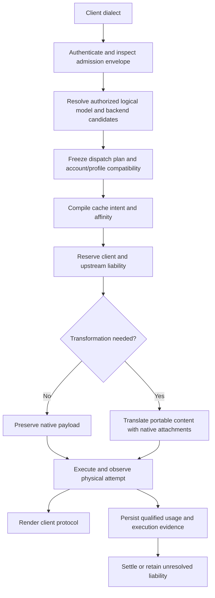

# TD-0034: Protocol-neutral routing, cache control and execution accounting

Status: design and implementation contract. Consult the [operator guide](../operator/proxy-guide.adoc),
[cache and token guide](../product/cache-aware-routing.md) and
[release notes](../releases/v0.17.1.md) for supported configuration and publication boundaries.

## Goal and observable outcome

A third-party agent uses its ordinary OpenAI Chat Completions, Anthropic Messages,
Responses or native Gemini client against Sandhi. Its authorized logical model resolves to a
configured backend independently of the client's dialect. Sandhi preserves the
portable conversation and applicable native state, applies explicit backend cache
policy, renders the client's protocol and records attributable usage and settlement
for each physical dispatch. Unsupported request conversions fail before dispatch;
unsupported source-output projections fail explicitly while retaining source evidence.

Backend scope includes OpenAI-compatible API/open-weight servers, Anthropic
Messages endpoints, standard OpenAI Responses, and constrained ChatGPT/Codex
Responses. Anthropic subscription support requires an explicit, verified credential
profile and expiry/renewal contract; accepting a Bearer header is insufficient.
Treat Gemini generateContent/streamGenerateContent as first-class ingress and
backend protocols; preserve existing Cohere and Ollama behavior during the refactor.

Capabilities require source-level and integration acceptance. A single successful
request does not establish the full matrix. Where a required provider account or
endpoint is unavailable, report that qualification as pending rather than
advertising live verification.

## Objectives

| ID | Objective | Observable acceptance |
| --- | --- | --- |
| O1 | Decouple client dialect, model alias, backend instance, endpoint protocol/profile and credential reference | Standard Responses and custom Messages endpoints are configured explicitly; omitted protocol uses catalog defaults, and explicit protocol takes precedence. |
| O2 | Authorize logical-model routing and backend selection | A key can reach only eligible model/backend mappings; denied routes do not reserve or dispatch; discovery agrees with callable routes. |
| O3 | Preserve conversation and tool semantics | Text, tools, parallel calls/results and supported media survive multi-turn loops. Same-backend opaque state is preserved in order; nonportable state is pinned or explicitly rejected. |
| O4 | Manage cache intent across dialects and backend profiles | Native controls and block boundaries survive; automatic/explicit/preserve/opt-out precedence is defined independently of unrelated native extras; unsupported required controls are rejected. |
| O5 | Make selection and affinity compatible with cache/state locality | An immutable dispatch plan records actual model, backend, account scope and profile; switching does not reuse incompatible continuation IDs or imply transferable KV state. |
| O6 | Normalize tokens and persist qualified execution evidence | Fresh/read/write/output/reasoning categories conserve totals; every dispatch has an identity and terminal/unknown evidence; both client and upstream budgets settle once or retain unresolved liability. |
| O7 | Deliver usable operator and agent integration | Configuration/admin/CLI/restart paths agree; supported SDKs work without request rewrites; documentation identifies capabilities, limitations and evidence. |
| O8 | Provide a professional navigable operator console | Dedicated workspaces expose routing, cache/token evidence, budgets and management; keyboard/mobile/SSO workflows and stale-data/authentication boundaries remain correct.  |

## Constraints and invariants

1. **Reuse the foundations.** Keep the two forwarding planes, layered crates,
   virtual keys, existing provider transports, neutral contract and ledger.
   No replacement gateway or parallel allowance/accounting implementation.
2. **Coordinate the consumer migration.** Move the coordinated Victor consumer and
   Sandhi together; do not retain a permissive execution/decoder mode solely for
   backward compatibility.
   Migrate Victor's in-process binding and gateway integration with Sandhi, with
   an explicit contract/version gate and paired acceptance evidence. Keep the
   supported client dialects and native/portable delivery contracts; these are
   product capabilities, not legacy modes. Existing key/config authority must
   remain intact or have an explicit migration; never reset budgets or secrets.
3. **Authority precedes dispatch.** Keys/groups/grants authorize the requested alias
   and resolved backend/model. Request headers and native extensions cannot change
   authenticated attribution, select another account or loosen policy.
4. **Separate endpoint metadata from secret storage.** Backend protocol/profile,
   model mappings and routing policy are non-secret gateway configuration. Secret
   material stays in the vault. A credential reference does not by itself authorize
   every endpoint/profile; profile validation occurs before credential mutation.
5. **Preserve subscription fences.** Codex profile keeps its fixed endpoint,
   account header, strict access-only envelope, dispatch expiry check, constrained
   codec and disabled raw bypass. A generic protocol override cannot weaken them.
   Grant refresh has one owner; do not copy/share refresh tokens between tools.
6. **Avoid silent loss.** Preserve unknown native fields on compatible routes;
   reject unsupported request content/state/control transformations before dispatch.
   Refuse unrepresentable source output without replay or hiding measured usage.
   A native body clone does not justify dropping ordered content on re-encode.
7. **Keep native forwarding efficient.** Use minimal admission extraction plus
   policy inspection when forwarding native payloads. Re-encode only when needed.
   Policy inspection must cover all forwarded text and extras on either plane.
8. **Treat cache locality honestly.** Conversation identity, namespace, stable
   prefix and backend affinity are distinct. Authenticated scope determines
   namespace policy. Do not claim latency proves a hit or that cache state migrates
   across model/provider/account/region/server boundaries.
9. **Conserve measurements.** For inclusive input, fresh + read + write equals
   total input where qualified evidence establishes those categories. Anthropic
   input is already fresh. Respect explicit reasoning inclusion; never count it
   twice. Preserve reported zero versus absent/malformed/unsupported/unknown.
10. **Keep allowances separate.** Raw token observations remain neutral units.
    Continue TD-0032 for weights and policy revisions; no dollars, tiers, SKUs or
    invented conversion of subscription quotas into guaranteed token entitlement.
    Existing estimated reservations remain estimates rather than hard token bounds.
11. **No implicit inference replay.** Selection happens before dispatch. Ambiguous
    completion, timeout, credential denial or a partially delivered stream does
    not silently trigger another model/account. Optional replay must reserve and
    record a separate attempt, preserve prior liability and use explicit policy.
    Concurrent hedging is outside this goal's initial implementation.
12. **Make execution recoverable.** Persist the chosen backend/profile/account
    scope and immutable policy revision with the execution. Restart/cancellation
    must not turn unknown liability into a measured final zero or reissue inference.
13. **Bound resources.** Keep existing request/stream limits, transport deadlines,
    backpressure, secret redaction and cancellation ownership. Avoid unbounded
    routing state, native-item buffers, caches or diagnostic labels.
## Architecture to implement

The backend registry owns stable backend ID, provider label, endpoint
family/profile, URL, credential reference and declared model capabilities,
separately from the vault's credential identity. ADR-0016 supplies the factory seam;
ADR-0017 adds bounded durable definitions, config/admin/CLI and reconstruction.
Declared model IDs are enforced; capability negotiation remains M3/M4 work.

An immutable dispatch plan includes requested alias and actual model, backend ID,
credential/account version, endpoint/profile, transformation decision, cache plan,
deadline, budget scopes and accounting-policy revision. Configuration updates affect
new admissions; they cannot retarget work that already owns a dispatch plan.

Native attachments preserve item ordering and provenance. Same-profile replay of
encrypted reasoning or signed thinking must retain the exact state. Cross-profile
conversion requires portable materialized history or an explicit refusal. A provider
continuation ID cannot be sent to another backend as though it were a conversation.

Cache policy is a compilation step: preserve native, automatic stable prefix,
automatic conversation prefix, explicit breakpoints, or suppress gateway-added
caching, with supported lifetime, scope and key rules. Compile to the selected
model/profile's controls; do not invent one-to-one mappings between differing TTL
and breakpoint semantics. Preserve ADR-0013's existing opt-out during migration.

## Milestones and completion gates

The coordinated retirement decision and its migration gates are recorded in
[ADR-0038](../adr/0038-coordinated-victor-contract-migration.md). This supersedes
earlier increments' promises to retain permissive legacy decoders indefinitely;
their historical validation remains evidence for those commits only.

The [paired source checkpoint](../reviews/coordinated-victor-contract-2026-11-12.md)
prepares Sandhi 0.17.0 and Victor 0.29.0, shares the four admitted typed streaming
pipelines, and records review regressions and qualification limits. Buffered
unification, mandatory original-store execution and immutable budget namespaces are
implemented and qualified in the 0.17 candidate. The version bump does not imply
publication or deployment; the protected integration/release gates below remain active.

| Milestone | Status | Required result |
| --- | --- | --- |
| M0: Inventory and reproducible defects | Complete in workspace | Baseline review and local reproductions; existing work preserved. |
| M1: Initial content/accounting fixes | Implemented and source-validated | Responses shorthand, cache-write categorization/rendering, strict write qualification and stream completion ordering; 18-case matrix. |
| M2a: Explicit endpoint binding | Implemented and source-validated | Typed protocol/profile selection and factory validation independent of provider slug; supported legacy defaults and Codex fences pinned by tests. See ADR-0016 and evidence below. |
| M2b: Backend registry and operator lifecycle | Implemented and source-validated | Config/admin/CLI persistence, restart reconstruction, credential rotation/revocation, declared model scoping and backward-compatible fixed routes. ADR-0017; targeted Rust and real-process evidence below. |
| M3: Conversation and cache semantics | Qualified for the declared 0.17 scope | Ordered native/portable history, tools and bounded media are preserved or explicitly refused; one backend cache compiler and issuer-bound references are qualified through Rust, actual SDK/media and agent loops. External resource adoption and arbitrary extensions remain unsupported, not implicitly qualified. |
| M4: Authorized routing and affinity | Qualified for the declared 0.17 scope | Authorized aliases, actual selected-wire preflight, immutable stored upstream allowance scopes, compatible durable pins, source-issued ownership and account-fenced renewal pass integration/restart/negative tests. Operator-declared account identity is not cryptographic attestation. |
| M5: Uniform execution accounting | Current-candidate acceptance qualified | One mandatory durable paired owner records admitted attempts and qualified source evidence when available; unknown usage stays held through restart/expiry. Recovery/shutdown and proof waiters retain original bounds; actual workers remain owned through completion. Current reliability checks pass. Historical unexplained incidents remain retained without cause/fix attribution. |
| M6: End-to-end qualification | Available-protocol source qualification complete; release delivery pending | Four-client/three-GLM-backend/two-mode live matrix passes with original paired evidence; real SDK/media/tool loops, interrupt/restart and public native platforms pass. Victor has a reviewed local 0.29 candidate against the 0.17 wheel. Published dependency, protected promotion, final registry verification and approved external subscription accounts are separate boundaries. |
| M7: Operator console and visible efficiency semantics | Qualified on the current gateway | Eleven navigable workspaces, actual operator panels/readiness/draining, keyboard/mobile/auth boundaries and strict docs pass. AgentBrowser inspected the real local preview with synthetic fixtures. Neutral tokens/cache placement and ONNX coverage are prominent; no production deployment or dollar-saving guarantee is inferred. |

No milestone is complete on a constructor-only test when its acceptance requires
config, restart, request execution or persistence. Keep this table current after
each implementation increment. Completion of M2a does not complete M2b.

## Acceptance matrix

Cross Chat, Messages, Responses and native Gemini ingress with compatible Chat/open-weight,
Anthropic, standard Responses, Codex, Gemini and independently qualified subscription
profiles. Exercise both streaming and buffered delivery and every available raw
and translation plane. Record unsupported combinations rather than counting skips
as successful compatibility.

Required journeys:

- Text, shorthand history, tools/results, parallel tool calls, supported media,
  same-profile opaque state and portable-history switching.
- Native cache controls; translated cache keys/options; explicit and automatic
  breakpoints; unrelated extras; opt-out; changed prefix/suffix; TTL boundaries;
  namespace/account/backend changes and below-minimum prefixes.
- Reported zero, absent, malformed and inconsistent usage; cache writes/lifetime
  splits; reasoning overlap; comparison of client wire, neutral event, SQL,
  aggregates, allowance receipts and front/back budget settlement.
- Model/key/group denial, expired/rotated credentials, spoofed attribution,
  rate/budget refusal, configuration changes in flight and attempted replay.
- Disconnect/timeout before dispatch, before usage, after input usage, after final
  usage, at protocol completion and before transport EOF; restart with unresolved
  work; exactly-once settlement and no hidden redispatch.
- Config/admin/CLI/restart equivalence, secret redaction, scoped discovery,
  bounded diagnostics and unchanged legacy behavior.
- Gemini path-based model/stream selection and native header credentials; system
  instructions, ordered parts, function calls/results, thinking/signature state,
  inline/file media, cached-content references, native cache observations and
  estimated countTokens behavior. API-key and Bearer endpoint profiles are distinct
  from a Vertex/ADC credential lifecycle, which is not yet admitted.

Use narrow meaningful red/green tests first, then affected integration/SDK suites,
workspace tests, formatting and Clippy. Generate contract/schema/binding outputs
when public neutral types change. All-feature and binding gates are run when
affected and recorded separately from default workspace coverage. A failing
concurrency check is retained as evidence even if a later retry succeeds.

Live warm/cold tests use synthetic prompts and explicitly authorized endpoints.
Record resolved model/profile/account scope, requested cache controls, observed
read/write counters and limitations. A repeated request is not a guaranteed hit.
Do not treat OpenAI Platform behavior as proof for the Codex subscription backend.
Current official sources inform capability design, not blanket endpoint guarantees:
[Responses](https://developers.openai.com/api/reference/resources/responses/methods/create),
[OpenAI cache controls](https://developers.openai.com/api/docs/guides/prompt-caching),
[gateway rollout](https://learn.chatgpt.com/docs/enterprise/roll-out-a-gateway),
[authentication](https://learn.chatgpt.com/docs/auth), and
[Anthropic caching](https://platform.claude.com/docs/en/build-with-claude/prompt-caching).

## Engineering qualification

The implementation is qualified through request admission, portable/native output,
cache compilation, original source usage, paired settlement and real consumer
loops. Validation records distinguish synthetic fixtures, live provider requests,
source builds and published artifacts.

| Surface | Required result |
| --- | --- |
| Client/backend matrix | Chat, Messages, Responses and Gemini retain supported conversation semantics or refuse explicitly |
| Cache behavior | Controls preserve ownership and backend scope; reported usage remains distinct from assumed cache reuse |
| Durable execution | One physical attempt retains original qualified usage and settles both budget legs once |
| Consumer migration | Explicit peer/schema contract; no permissive decoder or hidden replay |
| Operator UI | Accessible navigation, role-aware management and clear observation versus settlement semantics |
| Release | Reviewed exact source, substantive CI and complete artifact verification before publication |

Detailed source-level findings and bounded qualification summaries are available in
[the router inventory](../reviews/router-cache-inventory-2026-11-11.md),
[cohesive router qualification](../reviews/cohesive-router-qualification-2026-11-12.md),
[provider identity and budget namespaces](../reviews/provider-identity-and-budget-namespace-2026-11-12.md)
and [native proof lifecycle](../reviews/native-proof-work-2026-11-13.md).
Private intermediate logs, operator instructions and deployment workspaces are not
setup requirements or public product guarantees.
